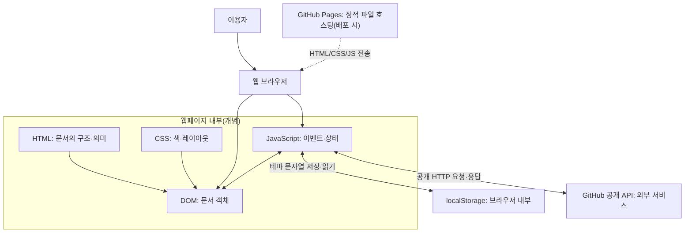
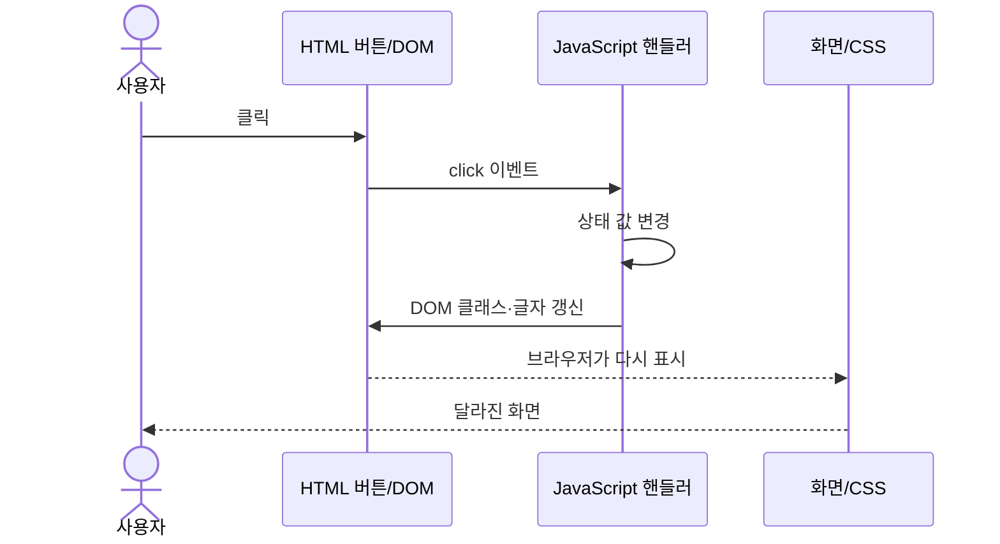
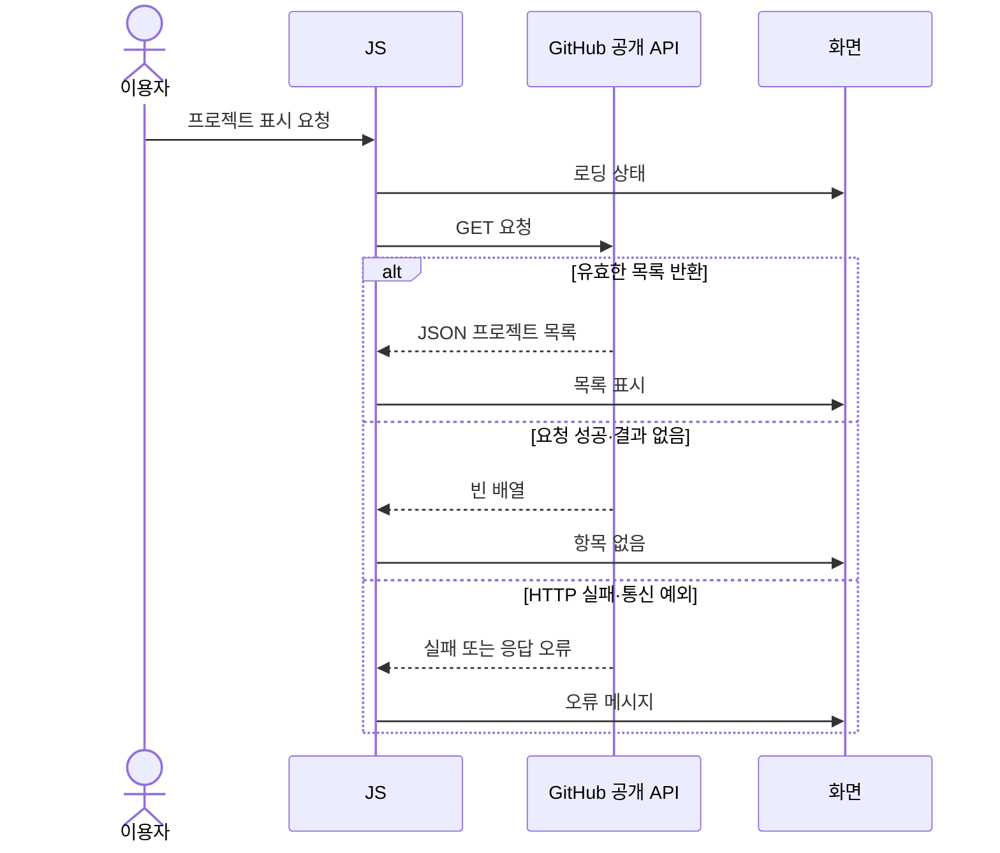
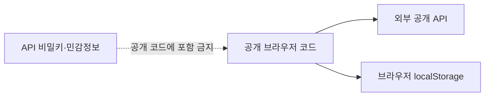

# B1-1 — 웹 기술 아키텍처 입문과 Mermaid

> **CONCEPT_ONLY / NOT_IMPLEMENTED / NOT_VERIFIED.** 이 도식은 교육용으로 웹의 책임과 정보 흐름을 시각화한 것입니다. 03단계 확정 설계, 04단계 실제 신규 코드, 05단계 테스트 증거가 아닙니다.

## 목차
- [1. 아키텍처의 의미](#what)
- [2. 웹 요소의 역할](#components)
- [3. 클릭·화면 변경](#click)
- [4. 공개 API 연동](#api)
- [5. 보안 경계](#security)
- [6. 학습 질문과 실제 설계 조건](#next)

## 1. 아키텍처란?

**아키텍처(Architecture)**는 시스템의 구성요소가 각각 **무슨 일을 맡으며 어떤 데이터를 주고받는지** 나타내는 구조입니다. 건물 도면처럼 전체 관계를 먼저 이해할 수 있지만, 설계도를 그렸다고 실제 건물을 지은 것은 아닙니다.

## 2. 브라우저·HTML·CSS·JavaScript 관계

| 요소 | 주요 책임 | 확인 질문 |
|---|---|---|
| HTML | 소개·링크·폼 같은 문서 의미 | ‘프로젝트’ 영역은 어디에 해당하는가? |
| CSS | 화면 배치·반응형·테마 | 기기 폭이 달라지면 무엇을 조정하나? |
| JavaScript | 상태·DOM 변경·네트워크 요청 | 클릭이 화면에 반영되는 과정은? |
| localStorage | 브라우저의 문자열 저장 | 서버 DB와 같은가? → 아니요 |
| 공개 API | 외부 공개 프로젝트 데이터 | 응답이 느리거나 실패하면? |
| Pages | 웹 파일 배포(향후) | 배포된 페이지와 실제 실행 증빙은 같은가? → 별도 검증 필요 |

## 3. 사용자 클릭→상태→화면 시퀀스

**구별할 말:** 클릭=이벤트 / 현재 값=상태 / `addEventListener`=리스너 등록 / `classList`·`textContent`=DOM 변경. 이 흐름은 미션 코드가 아니라 설명용 예시입니다.

## 4. GitHub 공개 API — 성공·빈 결과·실패

실제 네트워크 호출은 수행하지 않았습니다. API 사용 대상 계정·재시도 정책·요청 빈도는 공식 요구와 03단계 설계에 따라 결정합니다.

## 5. 보안 경계·저장소 위치

**기억할 규칙:** 브라우저 코드·정적 사이트는 외부에 공개된다고 가정합니다. 비밀키를 포함하지 않고, 외부 응답을 안전하게 표시해야 합니다. 교육용 구조와 실제 배포 검증은 구분합니다.

## 6. 실제 설계로 발전시키는 단계

**01 요구사항:** 공식 항목과 학습목표 연결 → **03 설계:** 실제 HTML 요소·상태·API 오류·데이터 흐름 설계 → **04 구현:** 별도 승인 후 신규 소스 작성 → **05~07:** 실제 테스트·증빙·숙달 검사.

**이해 질문:** (1) GitHub API가 실패하면 브라우저 화면을 어떻게 안내할까요? (2) 테마 상태는 왜 CSS 클래스와 localStorage가 별개인가요? (3) 위 그림이 실제 구현 PASS의 증거가 아닌 이유는?

[개념 설명](CORE-CONCEPTS.md) · [주요 코드](CODE-LEARNING-ROADMAP.md) · [00단계 시작 안내](README.md)
