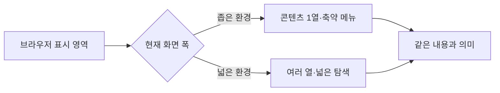
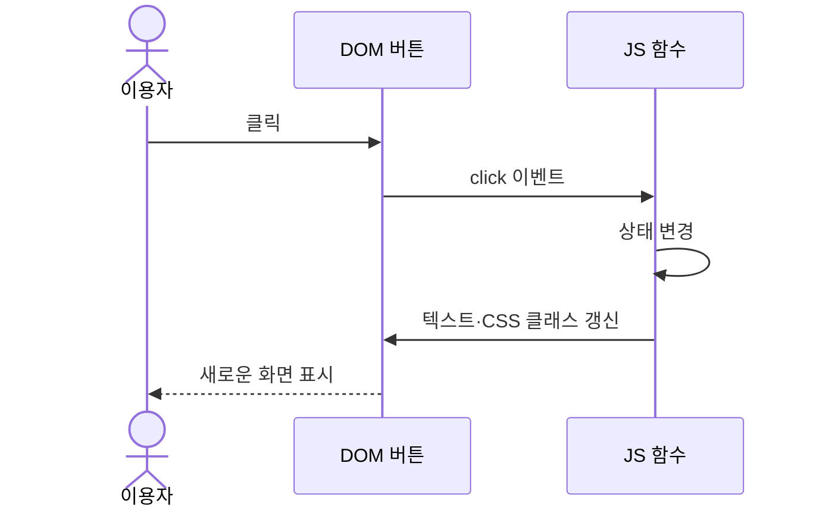
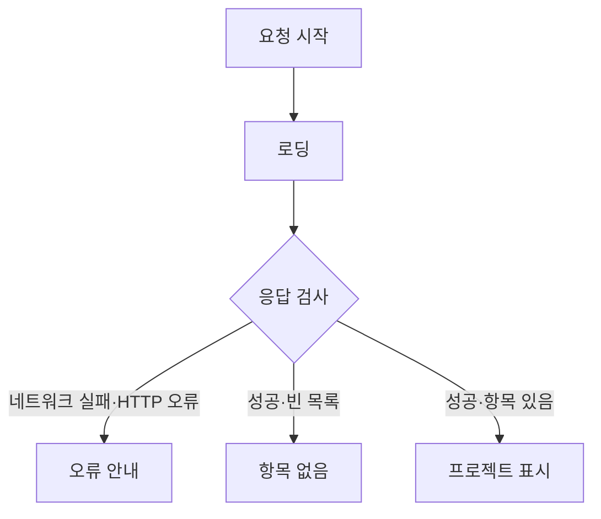

# B1-1 — 핵심 웹 기술 개념·원리 설명서

> **00단계 입문 학습자료 / 설명용 초안.** 실제 Round 04 웹사이트 구현·시험·학습자 평가는 아직 NOT_STARTED / NOT_VERIFIED. 그림은 이해를 돕기 위한 개념도로서 실제 03단계 확정 설계가 아닙니다.

## 현재 문서 목차
- [1. 구조·디자인·동작](#role)
- [2. 시맨틱 HTML](#semantic)
- [3. 반응형 CSS](#responsive)
- [4. DOM·이벤트·상태](#event)
- [5. 브라우저 저장](#storage)
- [6. 공개 API와 실패](#api)
- [7. 보안·오류·검증](#safety)
- [8. 확인 질문](#questions)

## 1. HTML·CSS·JavaScript의 역할을 왜 나눌까요?

- **HTML:** 글·제목·링크·버튼·입력 폼의 구조와 의미.
- **CSS:** 배치·여백·색상·반응형 표현.
- **JavaScript:** 사용자 이벤트·화면 상태·외부 데이터 처리.

**비유:** 집의 벽과 방 배치(HTML), 내부 꾸밈(CSS), 전등 스위치와 자동장치(JS). 기술적으로 세 부분은 상호작용할 수 있으므로 비유는 개념 이해에만 사용합니다.

**오해:** HTML 코드를 작성하는 것과 CSS 스타일을 적용하는 것은 다르지만, 문서 구조 자체도 접근성에 영향을 미칩니다.

## 2. 시맨틱 HTML — ‘어떤 요소인가’가 중요한 이유

`<header>`는 머리말, `<nav>`는 주요 탐색, `<main>`은 본문, `<footer>`는 끝부분을 나타냅니다. 적절한 의미 요소는 구조를 이해하고 보조 기술로 탐색하는 데 도움이 됩니다. 폼에는 관련 `<label>`과 키보드 조작 가능한 입력 요소를 마련해야 합니다.

**질문:** 메뉴를 표현할 때 모든 요소를 `
`로 만드는 것보다 `<nav>`가 의미를 전달하기 쉬운 이유는?

## 3. 반응형 — 화면을 작게 만드는 것이 아니라 배치를 조정

**Media Query**는 화면 조건에 따라 다른 스타일을 선택하게 해 줍니다. Flexbox는 주로 한 방향, CSS Grid는 행·열 기반 배치에 유용합니다.

**반례:** 넓은 화면에 맞는 고정 픽셀 너비를 그대로 유지하면 작은 기기에서 가로 스크롤이나 내용 잘림이 발생할 수 있습니다. 접근성은 반응형만으로 자동 보장되지 않습니다.

## 4. DOM · Event · State — 서로 다른 세 개념

- **DOM:** 브라우저가 문서를 나타내는 객체 모델.
- **Event:** 클릭·입력 등 사건.
- **State:** 현재 메뉴 열림 여부·선택한 테마 같은 값.
- **Handler:** 사건이 발생했을 때 실행할 처리 함수.

**가상 오류:** 선택자가 잘못되어 DOM 요소가 null이라면 클릭 핸들러 연결이 실패할 수 있습니다. 요소 유무와 코드 실행 시점을 확인합니다.

## 5. 테마 — 상태와 브라우저 저장은 별개의 책임

테마 선택 값은 JavaScript의 상태일 수 있고, 스타일 표현은 CSS 클래스·속성에 연결할 수 있습니다. 브라우저 localStorage에 문자열로 설정을 저장하면 **같은 출처의 같은 브라우저 환경**에서 다시 읽을 수 있습니다.

- 브라우저 저장소는 서버 데이터베이스가 아닙니다.
- 저장소가 제한된 상황에서는 접근이 실패할 수 있습니다.
- <ins>비밀번호·비밀 토큰을 localStorage에 보관하는 설계를 일반적인 안전한 기본값으로 취급하지 않습니다.</ins>

## 6. GitHub 공개 API — 요청 결과에 여러 상태가 있습니다

**주의:** `fetch`는 HTTP 403·404 같은 응답을 받았다는 이유만으로 자동 reject되는 것은 아닙니다. `response.ok`나 `response.status`를 확인하고 오류 처리합니다. 네트워크 예외는 별도로 `try/catch`에서 대응할 수 있습니다.

## 7. 검증과 안전

1. 공개 GitHub Pages에서 내려받는 JavaScript는 누구나 볼 수 있으므로 <ins>비밀키를 코드에 넣지 않습니다.</ins>
2. 외부 데이터·사용자 문자열은 검증하고, 단순 텍스트 출력이면 `textContent` 등의 안전한 방법을 검토합니다.
3. 코드와 Mermaid가 보기 좋다고 해서 실제 기능이 통과한 것은 아닙니다. 실행 조건·테스트 출력·커밋 SHA가 필요합니다.
4. 과거 Round의 성공 기록을 이번 Round 04의 성과로 재사용하지 않습니다.

## 8. 스스로 설명해 보기

1. CSS와 HTML의 역할을 한 문장씩 설명하세요.
2. 버튼 클릭(Event)과 메뉴 열림(State)은 어떤 차이가 있나요?
3. HTTP 403과 정상 응답인데 빈 프로젝트 목록인 경우의 사용자 안내는 같아야 하나요?
4. localStorage는 모든 이용자의 설정이 공유되는 서버 DB인가요?
5. 이 문서의 Mermaid는 실제 새 웹페이지의 확정 설계인가요?

**확인 답:** ① 구조/표현 ② 사건/값 ③ 구분해야 함 ④ 아니요 ⑤ 아니요, 교육용 개념도입니다.

[용어집](TECHNICAL-GLOSSARY.md) · [아키텍처](ARCHITECTURE-INTRO.md) · [코드 지도](CODE-LEARNING-ROADMAP.md) · [00단계 README](README.md)
