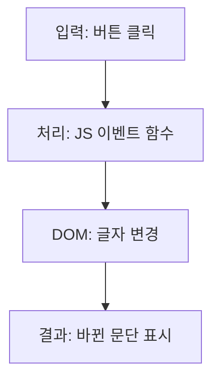

# B1-1 — 이해·설명·재현: 한 개념씩 배우는 첫 활동

> **EDUCATIONAL_EXAMPLE / NOT_EXECUTED / NOT_VERIFIED.** 본 문서는 개념 학습과 종이 재현을 위한 교안입니다. 신규 미션 코드의 실제 실행·테스트나 학습자 성취를 의미하지 않습니다.

## 목차
- [① 쉽게 이해하기](#learn)
- [② 두 문장으로 설명하기](#say)
- [③ 종이에 따라 재현하기](#trace)
- [④ 오류의 이유 찾기](#error)
- [⑤ 답과 오해 확인하기](#answers)
- [⑥ 진짜 코드 재현을 위해 필요한 것](#real)

## ① 먼저 이것 하나만 이해하세요

**이벤트(Event)**는 버튼 클릭처럼 발생한 사건입니다. **이벤트 리스너(Event Listener)**는 그 사건이 발생할 때 함수를 실행하도록 등록하는 방법입니다.

- **한글·영어·약어:** 문서 객체 모델(Document Object Model, **DOM**), 자바스크립트(JavaScript, **JS**)
- **쉬운 비유:** 초인종(버튼)을 누르면 알림이 울립니다. 웹에서는 버튼·DOM·JS가 연결되어 동작합니다. 비유는 모든 기술 조건을 포함하지 않습니다.
- **한 문장:** 클릭(입력) → 리스너 함수(처리) → 글자 변경(결과).

## ② 자료를 덮고 두 문장으로 설명해 보세요

**“이벤트 리스너가 무엇이고, 왜 필요한가요?”**

- 예시 답 1: 이벤트 리스너는 특정 사건이 발생하면 함수를 실행하도록 등록하는 방법입니다.
- 예시 답 2: 사용자가 버튼을 눌렀을 때 안내 글자를 바꾸기 위해 사용할 수 있습니다.

모르는 경우 **힌트 H1 질문 → H2 개념 → H3 절차 → H4 예시 해설**의 순서로 도움을 얻습니다.

## ③ 종이 재현: 눈으로 코드 실행 순서를 따라가요

[교육용 이벤트 코드](CODE-LEARNING-ROADMAP.md#event)의 실행을 **가정**하고 종이에 적어 보세요.

| 차례 | 무엇을 살펴보나요? | 예상되는 결과 |
|---|---|---|
| 1 | HTML에 `hello-button` 버튼과 `message` 문단이 있는가? | 둘 다 있다고 가정 |
| 2 | `querySelector`는 무엇을 찾는가? | DOM의 버튼·문단 |
| 3 | `addEventListener("click", …)`의 역할은? | 클릭 처리 함수 등록 |
| 4 | 클릭 뒤 `textContent`의 새 값은? | “안녕하세요!” |
| 5 | 요소를 찾지 못한 경우는? | 예시의 조건문 때문에 이벤트 등록하지 않음 |

**재현하기:** 표를 보지 않고 **버튼 → 클릭 → 함수 → 문단 변경**을 종이에 그려 보세요. 이 과정은 실습 코드의 **예상 실행 경로**이며 실제 브라우저 실행이 아닙니다.

## ④ 가상의 오류를 찾는 순서

**가상의 증상:** 버튼을 눌렀지만 글자가 바뀌지 않았습니다.

1. HTML의 ID와 JavaScript 선택자가 일치하는지 확인.
2. 스크립트가 DOM 요소 생성 이후 실행되는지 확인.
3. 선택된 값이 `null`인지 확인.
4. 클릭 함수가 호출되는지 확인.
5. 수정한 다음 정상·오류 상황을 다시 검사.

이것은 **가상 학습 사례**이며 신규 미션에서 실제 검출한 오류가 아닙니다.

## ⑤ 스스로 답해 봅시다

1. **DOM의 영어 원명은?** → Document Object Model.
2. **클릭은 이벤트인가요, 상태인가요?** → 이벤트(Event).
3. **클릭 후 문단은 어떤 글자가 될까요?** → 가정한 예시에서는 “안녕하세요!”.
4. **요소가 없으면?** → `querySelector`는 `null`을 반환할 수 있고 예시의 조건에서 리스너 등록을 생략합니다.
5. **종이 재현이 실행 PASS인가요?** → 아닙니다. 예상 값과 실제 실행 결과는 별도입니다.

## ⑥ 진짜 ‘설명·재현 완료’는 언제 인정하나요?

| 역량 | 학습자가 직접 해야 할 일 | 현재 판정 |
|---|---|---|
| L1 | 코드를 보면서 설명 | 실제 학습자 평가 전 |
| L2 | 그림만 보고 흐름 재구성 | 실제 학습자 평가 전 |
| L3 | 자료 없이 의미·원리 설명 | 실제 학습자 평가 전 |
| L4 | 승인 후 빈 환경에서 기능 구현·실행 | NOT_STARTED |
| L5 | 새로운 문제에 적용·재검증 | NOT_STARTED |

<ins>기능 재현 PASS에는 승인된 신규 코드·실제 실행 환경·예상/실제 결과·테스트 증거·커밋 SHA가 필요합니다.</ins> 이 문서만으로 PASS 또는 MASTER를 선언하지 않습니다.

**다음에 읽을 문서:** [00단계 README](README.md) · [기술 용어집](TECHNICAL-GLOSSARY.md) · [핵심 개념](CORE-CONCEPTS.md) · [실제 코드 학습 지도](CODE-LEARNING-ROADMAP.md)
