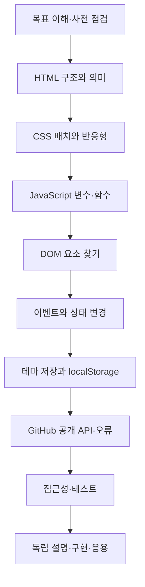

# B1-1 — 입문자 기술 학습 지도

> **00단계 선행학습 자료 (교육 설명 초안)** · 신규 코드 구현·실행·학습 숙달은 NOT_STARTED / NOT_VERIFIED. 공식 요구사항별 정확한 연결은 01단계에서 진행합니다.

## 목차
- [1. 무엇을 배울까요?](#what)
- [2. 학습 순서 Mermaid](#order)
- [3. 단계별 학습 목표](#units)
- [4. 기술 학습 9요소](#nine)
- [5. 자기 진단](#quiz)
- [6. 00~09단계와 연결](#stages)

## 1. 무엇을 배울까요?

<mark>HTML은 구조, CSS는 표현, JavaScript는 사용자 동작과 상태를 다룹니다.</mark> B1-1에서 학습자는 소개 웹페이지가 어떤 부분으로 구성되고, 사용자 클릭에 어떻게 반응하는지 설명할 수 있어야 합니다.

**쉬운 비유:** 건물의 구조·방 배치(HTML) / 인테리어(CSS) / 자동문·스위치 제어(JavaScript). 기술적 역할을 전부 설명하는 비유는 아니므로 아래 원리·코드와 함께 배웁니다.

## 2. 권장 학습 순서

## 3. 단원별 학습 목표

| 단원 | 먼저 알아야 할 개념 | 확인 질문·실습 | 자세한 문서 |
|---|---|---|---|
| U01 웹 구성 | HTML·CSS·JS | 세 기술의 책임 설명 | [용어집](TECHNICAL-GLOSSARY.md) |
| U02 문서 의미 | 시맨틱 HTML·label·alt | 왜 HTML 요소 의미가 중요한가? | [핵심 개념](CORE-CONCEPTS.md) |
| U03 화면 배치 | Grid·Flexbox·미디어 쿼리 | 좁은 화면과 넓은 화면 비교 | [아키텍처](ARCHITECTURE-INTRO.md) |
| U04 상호작용 | DOM·이벤트·상태 | 클릭→문구 갱신 흐름 예측 | [주요 코드](CODE-LEARNING-ROADMAP.md) |
| U05 설정 저장 | localStorage·CSS 클래스 | 다시 열었을 때 테마가 유지되는 이유 | [주요 코드](CODE-LEARNING-ROADMAP.md) |
| U06 외부 연결 | Fetch·JSON·HTTP·403 | 성공/빈 결과/오류의 차이 | [아키텍처](ARCHITECTURE-INTRO.md) |
| U07 품질 | 접근성·디버깅·실제 검증 | 오류 원인을 어떻게 찾는가? | [핵심 개념](CORE-CONCEPTS.md) |

## 설명하기·재현하기는 어떻게 하나요?

한 개념을 읽고 → 자료 없이 두 문장으로 설명 → **입력→처리→결과를 종이에 따라 그리기** → 질문으로 확인합니다. 이는 **교육용 예상 경로**이며 실제 실행이 아닙니다. [설명·종이 재현 가이드](LEARNER-EXPLAIN-RECONSTRUCT.md).

## 4. 모든 주요 기술에 반복할 9요소

**용어 → 개념 → 비유 → 아키텍처 → 주요 코드 → 실행 흐름 → 오류 해결 → 실습 → 평가.**

예를 들어 이벤트를 배우면: Event 정의 → 이벤트가 필요한 이유 → 초인종 비유 → 클릭 시퀀스도 → addEventListener 교육용 예제 → 예상 실행 흐름 → 버튼 없음 오류 → 글자 변경 연습 → 설명·독립 구현 평가 순서입니다.

실제 코드·실제 평가·실행 증빙은 후속 승인 및 개발 단계에서 생성합니다. <ins>교육용 예시를 신규 미션 구현 PASS로 표시하지 않습니다.</ins>

## 5. 사전 자기 점검 (평가 실시 전)

1. HTML과 CSS는 어떤 차이가 있나요?
2. 버튼 클릭을 JavaScript가 알게 되는 과정은 무엇인가요?
3. DOM과 Event는 같은 뜻인가요?
4. 외부 API에서 403이 반환되면 어떻게 안내할까요?
5. 코드를 실행하지 않고도 PASS로 주장해도 될까요?

**참고 답:** ① 구조와 표현 ② 이벤트 리스너 ③ 문서 모델과 사건은 다름 ④ 오류 상태와 적절한 메시지 표시 ⑤ 아니요. 이 답은 학습자 평가 결과가 아닙니다.

## 6. 원래의 00~09 목차 그대로 연결

00 학습 경로·기초 개념 → 01 공식 요구/평가 연결 → 02 기존 자료와 비교 → 03 실제 상세 아키텍처 설계 → 04 별도 승인 후 신규 코드 구현 → 05 시험 → 06 실증 → 07 L1~L5 학습자 평가 → 08 PPTX/PDF·실습 교안 → 09 인계.

[00단계 시작 안내](README.md) · [용어집](TECHNICAL-GLOSSARY.md) · [핵심 개념](CORE-CONCEPTS.md) · [아키텍처](ARCHITECTURE-INTRO.md) · [코드 학습 경로](CODE-LEARNING-ROADMAP.md)
