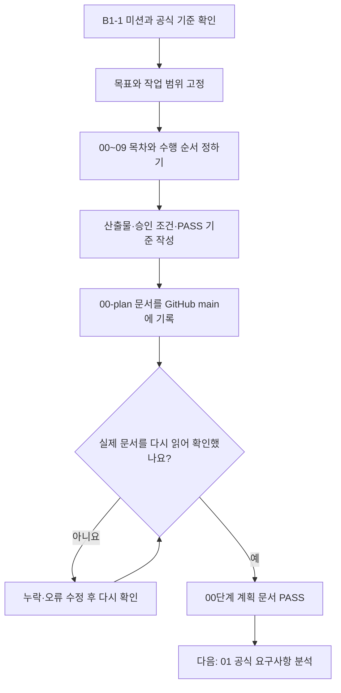

# B1-1 — 00단계 시작 안내 | 처음 방문한 학습자를 위한 README

> **00단계 계획 문서: PASS** · **다음 단계 01 공식 요구사항 분석: NOT_STARTED** · **새 웹페이지 구현: NOT_STARTED** · **기능·학습 평가: NOT_VERIFIED**  
> 확인일: 2026-10-26. 여기서 PASS는 <mark>계획서가 작성되어 GitHub에 정상 반영됐다는 뜻</mark>이며, 웹페이지를 완성하거나 학습 평가에 합격했다는 뜻이 아닙니다.

## ① 3분 안에 이해하기

**B1-1 미션은 무엇인가요?** HTML, CSS, JavaScript로 <mark>나를 소개하는 웹페이지를 새로 만드는 과제</mark>입니다.

**00단계는 무엇인가요?** 요리를 시작하기 전에 재료와 순서, 완성 기준을 정하듯이 <mark>목표·범위·작업 순서·승인·검증 방법을 문서로 준비</mark>하는 단계입니다.

**지금 무엇이 완료됐나요?** 작업 순서 00~09, 기존 자료 보존 기준, 학습 계획, 4종 슬라이드 목표, PASS/FAIL 기준을 정하고 GitHub 파일을 다시 읽어 확인했습니다. <ins>새 HTML/CSS/JavaScript 코드는 작성하지 않았습니다.</ins>

| 궁금한 점 | 현재 답 |
|---|---|
| 지금 어느 단계인가요? | **00 계획 완료(PASS)**. 다음은 **01 요구사항 분석** |
| 새 코드는 어디에 쓰나요? | `../04-src/` — **아직 README만 있음** |
| 지난 미션 결과는 어떻게 하나요? | 이전 Round 01~03 코드는 **보존·참고만** |
| 코드를 지금 만들어도 되나요? | <ins>아니요. 신규 코드 개발 승인은 `PENDING`입니다.</ins> |
| 발표와 학습자료는 완성됐나요? | **아니요**. 4종 패키지는 **계획만 승인** |

## ② 그림으로 보는 00단계 흐름

**읽는 방법:** 위에서 아래로 화살표를 따라가면 됩니다. 마지막의 <mark>PASS는 계획 문서 검증</mark>이고, **01단계 공식 PDF의 항목별 분석은 아직 진행하지 않았습니다.**

[Mermaid 그림 3개 + 화살표 설명 + 기본 용어 해설](STAGE-00-MERMAID-GUIDE.md)

## ③ 처음 방문한 학습자의 추천 읽기 순서

아래 순서대로 읽으면 **그림으로 큰 흐름을 이해한 다음 세부 계획과 합격 기준**을 확인할 수 있습니다.

| 순서 | 문서 | 이 파일을 읽는 이유 |
|---|---|---|
| **1** | **이 README** | 미션·00단계 목적·현재 상태를 3분 안에 이해 |
| **2** | [Mermaid 입문 설명서](STAGE-00-MERMAID-GUIDE.md) | 그림과 비유로 00단계 및 전체 진행 순서 이해 |
| **3** | [STATUS.md](STATUS.md) | 완료된 일과 아직 시작하지 않은 일을 구분 |
| **4** | [MASTER-PLAN.md](MASTER-PLAN.md) | 전체 목표, 필수·선택 기능, 00~09 일정 확인 |
| **5** | [ACCEPTANCE-GATES.md](ACCEPTANCE-GATES.md) | 다음 단계로 넘어가기 위한 PASS/FAIL 기준 이해 |

## ④ 필요할 때 찾아보는 상세 문서

| 문서 | 쉬운 용도 |
|---|---|
| [SOURCE-REGISTER.md](SOURCE-REGISTER.md) | 공식 미션 PDF·평가표와 참고 자료의 **출처 목록** |
| [SLIDE-PACKAGE-PLAN.md](SLIDE-PACKAGE-PLAN.md) | 발표 16장·학습 45장·심화 15~25장·복습 1~2장의 **제작 계획** |
| [LEARNING-SYSTEM-PLAN.md](LEARNING-SYSTEM-PLAN.md) | 용어·코드·실습·복습·AI 튜터·L1~L5를 이용한 **학습 설계** |
| [LEGACY-SOURCE-INVENTORY.md](LEGACY-SOURCE-INVENTORY.md) | 이전 Round 01~03 자료를 **어디에 왜 보존했는지** 확인 |
| [VISUAL-QA-20261026.md](VISUAL-QA-20261026.md) | 형광펜·밑줄 **화면 QA 시도 결과와 미검증 항목** 확인 |

이 폴더의 **총 9개 Markdown 문서**는 같은 정보를 복사한 자료가 아니라 역할이 다른 안내·계획·기준·근거 문서입니다. <ins>처음부터 9개를 모두 읽을 필요는 없습니다.</ins>

## ⑤ 처음 보는 용어 빠르게 이해하기

> **강조 표시 읽는 법:** <mark>형광펜</mark>은 기억할 핵심 개념, <ins>밑줄</ins>은 반드시 지킬 규칙, **굵은 글씨**는 주요 용어를 뜻합니다. GitHub 테마에 따라 형광펜 색상은 다를 수 있습니다.

| 용어 | 쉬운 설명 |
|---|---|
| **README** | 폴더를 처음 열었을 때 읽는 **안내서** |
| **GitHub / main** | 파일과 변경 기록을 보관하는 장소 / 현재 확인하는 **기본 가지(브랜치)** |
| **Mermaid** | 글로 작성한 순서도를 **그림으로 보여주는 형식** |
| **Commit(커밋)** | 파일 변경 내용을 하나의 **이력**으로 남기는 행위 |
| **SHA(해시 식별자)** | 커밋·파일 버전을 구별하기 위한 **식별값** |
| **Gate(게이트)** | 다음 단계로 넘어가기 전에 확인하는 **통과 조건** |
| **CORE / BONUS** | 필수로 충족할 **핵심 기능** / 하면 좋은 **추가 기능** |
| **Runtime(런타임)** | 코드를 **실제로 실행하는 환경과 실행 상태** |
| **DOM(문서 객체 모델)** | JavaScript가 웹페이지의 글자·버튼 등을 다루는 **구조** |
| **API** | 다른 프로그램이나 서비스와 기능·데이터를 주고받는 **연결 규칙** |
| **PRIMM** | 코드 **예측→실행→조사→수정→직접 만들기** 학습 방식 |
| **PASS / FAIL / NOT_VERIFIED** | **증거로 확인된 충족 / 확인된 미충족 / 아직 확인하지 못함** |
| **PENDING** | 필요한 **승인 또는 결정이 아직 없는 상태** |

더 자세한 설명은 [그림 설명서의 용어 해설](STAGE-00-MERMAID-GUIDE.md#6-자주-나오는-용어)을 참고하세요.

## ⑥ 스스로 이해했는지 확인하기

**문제를 먼저 생각하고, 아래 정답을 확인하세요.**

1. 00단계에서 실제 HTML 웹페이지를 만드는 것이 맞나요?
2. 00단계 PASS와 B1-1 전체 미션 완료는 어떤 점이 다른가요?
3. 새로 개발할 소스코드는 어느 폴더에 저장하나요?
4. 현재 `PENDING` 상태인 승인은 무엇인가요?
5. 다음 01단계에서 공식 PDF와 평가표를 가지고 무엇을 하나요?

### 정답·설명

1. **아닙니다.** 00단계는 목표·순서·검증 기준을 정하는 계획 단계입니다.
2. **다릅니다.** 00단계 PASS는 계획 문서 기준을 충족했다는 뜻이고, 미션 완료는 실제 개발·시험·증빙·평가가 필요합니다.
3. **`training/round-04-agent/04-src/`**입니다. 현재는 안내 README만 있습니다.
4. **신규 미션 코드 개발 승인**입니다. 아직 `PENDING`입니다.
5. **공식 요구사항·평가 15문항을 항목별로 확인**하고 필수·선택, 실습, 테스트·증빙 기준과 연결합니다. 이것은 00단계에서 이미 완료했다고 주장하지 않습니다.

## ⑦ 다음 단계는 무엇인가요?

**01 — 공식 요구사항 분석**: [01단계 폴더 열기](../01-requirements/README.md)

00단계의 계획·문서 확인은 **PASS**입니다. 다음 01단계에서는 공식 B1-1 미션 PDF와 평가 기준을 실제로 대조합니다. **01단계는 아직 NOT_STARTED**이며, <ins>사용자 승인 없는 신규 코드 작성·명령 실행·배포는 진행하지 않습니다.</ins>

**이 단계의 핵심 한 문장:** *먼저 무엇을 만들고 어떻게 확인할지 결정한 뒤, 공식 요구사항부터 하나씩 분석한다.*
