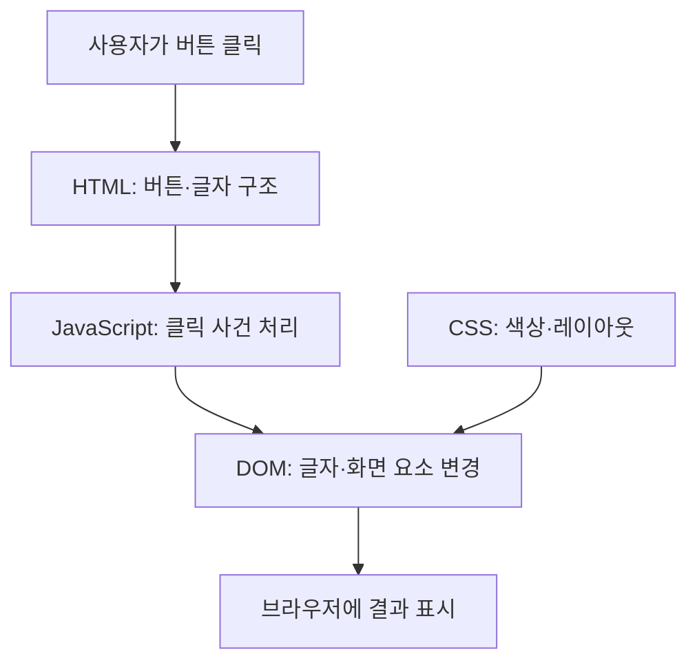

# B1-1 · 00단계 — 처음 배우는 웹페이지 만들기

> **00 계획 문서 PASS** · **01 공식 요구 분석 NOT_STARTED** · **신규 코드 개발 NOT_STARTED / 승인 PENDING**

**30초 요약:** <mark>HTML은 웹페이지의 구조, CSS는 디자인, JavaScript는 동작</mark>을 담당합니다. 지금은 웹페이지를 만들기 전에 **목표·작업 순서·학습자료·검증 기준을 준비한 단계**입니다. <ins>실제 웹페이지 구현과 학습 성취를 완료한 것은 아닙니다.</ins>

## 현재 문서의 구조화된 목차

| 학습 경로 | 목차 바로가기 | 누구에게 필요한가요? |
|---|---|---|
| **A · 처음 시작하기** | [① 시작 안내](#b11-00-start) | 처음 방문한 사람 |
| **B · 기술 배우기** | [② 웹 원리](#b11-00-tech) · [③ 학습자료](#b11-00-learning) · [④ 작은 코드](#b11-00-mini) | 기술을 배우고 싶은 사람 |
| **C · 진행 확인하기** | [⑤ 현재 상태](#b11-00-status) · [⑥ 확인 문제](#b11-00-check) | 어디까지 했는지 알고 싶은 사람 |
| **D · 더 알아보기** | [⑦ 용어 설명](#b11-00-glossary) · [⑧ 상세 문서](#b11-00-reference) | 근거·계획이 필요한 사람 |

<a name="b11-00-start"></a>

## A. 처음 시작하기

### ① 어디서부터 읽으면 되나요?

<mark>처음 방문했다면 아래 세 가지 중 **한 가지만 선택**하면 됩니다.</mark>

- **그림으로 먼저 이해:** [00단계 Mermaid 안내](STAGE-00-MERMAID-GUIDE.md)
- **웹 기술부터 배우기:** [기술 학습지도](LEARNING-MAP.md)
- **현재 상태만 확인:** [00단계 진행 현황](STATUS.md)

**이 미션에서 만들 것:** 나를 소개하는 웹페이지입니다. 00단계는 요리 전 레시피를 정하듯 전체 목표·순서와 통과 기준을 준비하는 일입니다. 실제 개발은 다음 단계들을 완료하고 별도 승인을 받은 후 진행합니다.

<a name="b11-00-tech"></a>

## B. 기술 배우기

### ② 웹페이지의 세 기술을 그림으로 이해해요



**쉬운 비유:** HTML은 집의 구조, CSS는 인테리어, JavaScript는 전등 스위치처럼 생각할 수 있습니다. 비유는 이해를 돕기 위한 것이며 기술의 모든 역할을 설명하지는 않습니다.

<ins>이 Mermaid는 교육용 개념도이며, 실제 B1-1 신규 구현의 확정 설계나 실행 증빙이 아닙니다.</ins> [상세 아키텍처 학습](ARCHITECTURE-INTRO.md)

<a name="b11-00-learning"></a>

### ③ 필요한 학습자료 5개만 순서대로 읽어보세요

| 순서 | 한 번에 하나씩 배우기 | 문서 |
|---|---|---|
| **1** | 전체 학습 순서 | [LEARNING-MAP.md](LEARNING-MAP.md) |
| **2** | HTML·CSS·JS·DOM·API의 뜻 | [TECHNICAL-GLOSSARY.md](TECHNICAL-GLOSSARY.md) |
| **3** | 기술의 개념·원리·비유 | [CORE-CONCEPTS.md](CORE-CONCEPTS.md) |
| **4** | Mermaid 구성도·데이터 흐름 | [ARCHITECTURE-INTRO.md](ARCHITECTURE-INTRO.md) |
| **5** | 코드 해설·예측·PRIMM | [CODE-LEARNING-ROADMAP.md](CODE-LEARNING-ROADMAP.md) |

**학습 원칙:** 용어 → 개념 → 비유 → 아키텍처 → 주요 코드 → 실행 흐름 → 오류 해결 → 실습 → 평가. 한 번에 전부 외우지 않고, 한 개념을 이해한 뒤 다음으로 이동합니다.

<a name="b11-00-mini"></a>

### ④ 첫 번째 작은 코드 — 버튼을 누르면 어떻게 될까요?

다음은 **교육용 짧은 예시**입니다. 기존 신규 소스에 저장되거나 실행된 코드가 아닙니다.

```javascript
const button = document.querySelector("#hello-button");
const message = document.querySelector("#message");

if (button && message) {
  button.addEventListener("click", () => {
    message.textContent = "안녕하세요!";
  });
}
```

- **DOM 요소 찾기:** `querySelector`로 버튼과 문단을 찾습니다.
- **클릭 감지:** `addEventListener("click", ...)`은 클릭할 때 함수를 실행하도록 등록합니다.
- **결과 예측:** 실제 버튼과 문단이 존재한다면 클릭 후 문단 글자가 “안녕하세요!”로 변경되도록 작성한 코드입니다.

**생각할 질문:** 클릭은 ‘사건(Event)’일까요, ‘현재 상태(State)’일까요? 버튼이 없는 HTML에선 어떻게 될까요?

해설과 다른 예제는 [주요 코드 학습자료](CODE-LEARNING-ROADMAP.md#event)에 있습니다. <ins>실제 코드 실행·테스트·독립 실습은 아직 수행하지 않았습니다.</ins>

<a name="b11-00-status"></a>

## C. 진행 확인하기

### ⑤ 무엇이 완료됐고 다음은 무엇인가요?

| 단계·항목 | 실제 상태 |
|---|---|
| **00 계획·기초 교육 문서 작성** | **PASS — 문서 준비·GitHub 확인 범위** |
| **01 공식 미션 PDF·평가 15문항 분석** | **NOT_STARTED** |
| **03 신규 웹 구조 상세 설계** | **NOT_STARTED** |
| **04 HTML·CSS·JavaScript 신규 개발** | **NOT_STARTED / 승인 PENDING** |
| **실행·테스트·배포·학습 숙달** | **NOT_VERIFIED** |
| **4종 슬라이드 실물(PPTX/PDF)** | **NOT_STARTED** |

**반드시 기억:** <mark>00단계 PASS는 계획·교육자료의 기록에 대한 판정</mark>이며, 앱 개발 PASS 또는 학습자의 MASTER가 아닙니다. 과거 Round 01~03 소스와 증빙은 보존·참고만 합니다.

**다음 작업:** [01단계 공식 요구사항 분석](../01-requirements/README.md). 공식 미션 PDF·평가표를 요구별로 구분하고 학습 목표·실습·검증 기준과 연결합니다.

<a name="b11-00-check"></a>

### ⑥ 스스로 확인하는 질문 3개

1. HTML, CSS, JavaScript는 각각 무엇을 담당하나요?
2. 클릭 사건(Event)과 클릭 후의 메뉴 상태(State)는 같은 말인가요?
3. 00단계 계획 PASS는 실제 웹페이지 완성을 뜻하나요?

**정답:** ① 구조·디자인·동작 ② 아닙니다. 사건과 현재 값은 다릅니다 ③ 아닙니다. 신규 구현과 실제 시험은 미시작입니다.

<a name="b11-00-glossary"></a>

## D. 상세 자료와 쉬운 용어

### ⑦ 처음 나오는 용어

| 기술·표현 | 한 줄 설명 |
|---|---|
| **DOM** | 브라우저가 문서 요소를 객체로 표현한 구조 |
| **API** | 다른 프로그램과 기능·데이터를 주고받는 연결 규칙 |
| **Mermaid** | 글로 만든 다이어그램을 그림으로 표시하는 방식 |
| **PRIMM** | 예측→실행→조사→수정→직접 만들기 학습 |
| **README** | 이 폴더를 처음 보는 사람을 위한 안내 |
| **PASS** | 실제 확인한 **해당 범위**의 기준 충족 |
| **NOT_VERIFIED** | 아직 충분한 실제 증거로 검증하지 못함 |
| **PENDING** | 필요한 승인이나 결정이 아직 없음 |

더 많은 용어는 [기술 용어집](TECHNICAL-GLOSSARY.md)을 참고하세요.

<a name="b11-00-reference"></a>

### ⑧ 모든 00단계 문서는 필요한 경우에만 확인하세요

| 문서 종류 | 어떤 자료인가요? |
|---|---|
| **처음 배우기** | [이 README](README.md), [Mermaid 흐름 안내](STAGE-00-MERMAID-GUIDE.md) |
| **웹 기술 배우기** | [학습지도](LEARNING-MAP.md), [용어](TECHNICAL-GLOSSARY.md), [개념](CORE-CONCEPTS.md), [아키텍처](ARCHITECTURE-INTRO.md), [주요 코드](CODE-LEARNING-ROADMAP.md) |
| **전체 계획·교육체계** | [MASTER-PLAN](MASTER-PLAN.md), [LEARNING-SYSTEM-PLAN](LEARNING-SYSTEM-PLAN.md), [SLIDE-PACKAGE-PLAN](SLIDE-PACKAGE-PLAN.md) |
| **검증·진행 상태** | [ACCEPTANCE-GATES](ACCEPTANCE-GATES.md), [STATUS](STATUS.md) |
| **공식 출처·과거 이력** | [SOURCE-REGISTER](SOURCE-REGISTER.md), [LEGACY-SOURCE-INVENTORY](LEGACY-SOURCE-INVENTORY.md) |
| **실제 화면 검수 기록** | [VISUAL-QA-20261026](VISUAL-QA-20261026.md) |

총 **15개 Markdown 문서**를 하나씩 모두 읽을 필요는 없습니다. 기존 문서는 삭제·이동하지 않았습니다.

**핵심 한 문장:** <mark>한 번에 하나를 이해하고, 짧은 예제로 예측하고, 질문으로 확인한 다음 다음 단계로 갑니다.</mark>
