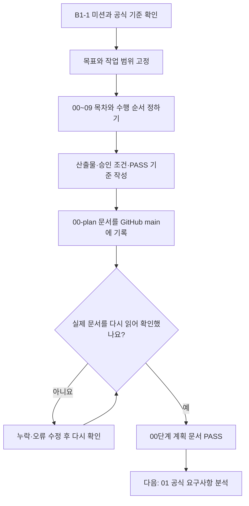

# B1-1 — 00단계 전체 계획·일정·승인 기준

> **00단계: PLAN_DOCUMENTS_READY** (2026-10-26). 이 판정은 계획 문서 구성에 한정됩니다. **B1-1 신규 코드 개발: NOT_STARTED / Runtime: NOT_VERIFIED / CLEAR: NOT_VERIFIED**.

## Mermaid로 00단계 한눈에 보기

**쉽게 말하면:** 00단계는 웹페이지를 바로 만드는 단계가 아니라, **무엇을 만들지(목표) → 어떤 순서로 할지(목차) → 무엇으로 확인할지(기준)**를 먼저 정하는 단계입니다. 문서를 GitHub에 저장한 뒤 실제로 다시 확인했기 때문에 **계획 문서 기준 PASS**입니다. 신규 웹페이지 구현과 실제 학습·평가는 아직 하지 않았습니다.

- [그림 3개·단계별 설명·용어 풀이 전체 보기](STAGE-00-MERMAID-GUIDE.md)

## 이번 단계의 목적

제2기 공식 B1-1 미션과 공식 평가표를 기준으로 **새 Round 04 Agent 수행 목표, 고정 목차, 단계별 PASS/FAIL 기준, 승인 경계, 산출물 및 발표 계획**을 기록합니다. 기존 Round 01~03의 코드와 증빙은 이력으로만 참고하고 신규 `04-src/`는 빈 상태로 유지합니다.

## 산출물

- [MASTER-PLAN.md](MASTER-PLAN.md) — 00~09 전체 개발·평가·발표 목차와 목표·일정
- [ACCEPTANCE-GATES.md](ACCEPTANCE-GATES.md) — 단계별 검증/판정/승인 게이트
- [SOURCE-REGISTER.md](SOURCE-REGISTER.md) — 공식 기준과 기존 자료의 근거·우선순위·검증 상태
- [STATUS.md](STATUS.md) — 00단계 완료 기준과 다음 단계 인계
- [LEGACY-SOURCE-INVENTORY.md](LEGACY-SOURCE-INVENTORY.md) — 기존 루트/과거 Round 비교 증빙(이전 작업에서 기록)

## 다음 단계

01 `../01-requirements/`: 공식 PDF·평가표의 **조항별 요구사항 / 수용 기준 / 증빙 추적표** 작성. 00단계 문서 존재와 01단계 충족을 혼동하지 않습니다.

## 승인 경계

사용자 요청 '단계별로 하나씩 진행'에 따라 이번에는 00단계 문서만 작성합니다. 01단계·02단계·03단계 조사/설계는 아직 진행하지 않았습니다. **04-src 새 코드 작성·명령 실행·GitHub Pages 게시 전환은 사용자 명시적 개발 승인** 이후에만 수행합니다. GitHub에 00단계 문서를 기록하는 행위는 미션 코드 개발이나 배포 검증이 아닙니다.

## 사용자 승인 4종 슬라이드 계획 (2026-10-26)

- [학습·발표 패키지 전체 계획](SLIDE-PACKAGE-PLAN.md)
- 발표 16장 / 학습 45장 / 기술 부록 15~25장 / 핵심 복습 1~2장.
- 실제 발표자료 및 신규 개발은 별도 단계이며 현 상태는 계획 승인입니다.

## 학습자 중심 AI 교육·학습체계 고도화 (2026-10-26 승인)

[학습체계 최종 계획](LEARNING-SYSTEM-PLAN.md) · 16가지 기법(M01~M16), PRIMM, AI 힌트 H1~H4, L1~L5 숙달, 8개 품질 게이트(QG-01~08), 사전·사후 평가·간격 복습을 단계별 작업으로 추가합니다. 신규 코드·교육자료·학습자 평가는 아직 미실시입니다.
