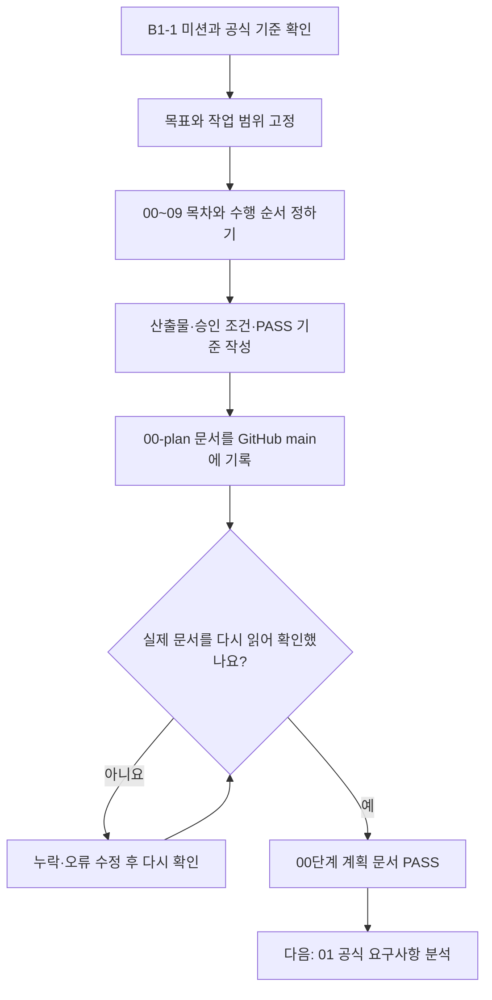
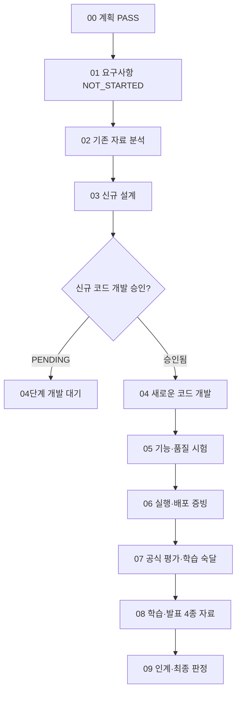
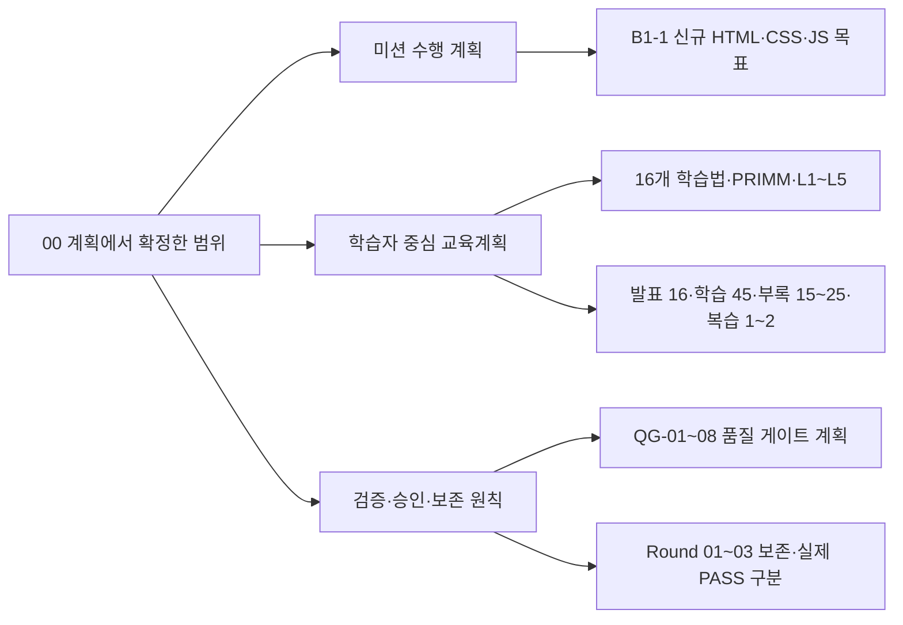

# B1-1 — 00단계 Mermaid 그림 설명서 (입문자용)

> **문서 유형:** 00단계 계획을 이해하기 위한 학습 자료.  
> **기준일:** 2026-10-26 · **계획 문서: PASS** · **01단계: NOT_STARTED** · **신규 구현: NOT_STARTED** · **기능/학습 평가: NOT_VERIFIED**.  
> Mermaid는 글로 표현한 흐름도를 GitHub에서 그림으로 볼 수 있는 도식 언어입니다. 이 다이어그램은 실제 프로그램을 실행하거나 테스트한 증거가 아닙니다.

**권장 읽기 순서:** [00단계 첫 안내·빠른 용어·학습 확인 문제](README.md) → **이 그림 설명서** → [현재 진행 상태](STATUS.md) → [전체 개발계획](MASTER-PLAN.md). 그림은 00단계 작업 순서를 설명할 뿐 실제 코드 개발의 PASS 증거가 아닙니다.

## 1. 00단계가 무엇인가요?

<mark>요리하기 전에 레시피, 필요한 재료, 순서와 완성 기준을 적는 일</mark>과 같습니다. B1-1은 새 웹페이지를 만드는 미션이지만, 00단계에서는 웹페이지 코드를 만들지 않습니다.

00단계에서 미리 결정한 것:
1. **무엇을 만들지:** <mark>B1-1 신규 소개 웹페이지</mark> 및 공식 미션 목표.
2. **어디서 만들지:** `training/round-04-agent/04-src/` (신규 코드의 단일 위치).
3. **어떤 순서로 할지:** 00 계획 → 01 요구 → 02 분석 → 03 설계 → 04 개발 → 05~09 검증·학습·인계.
4. **어떻게 확인할지:** 계획 문서의 존재·정합성·GitHub 재조회와 단계별 PASS 기준.
5. **무엇은 아직 하지 않을지:** <ins>새 웹페이지 구현·실행·배포, 실제 PPTX/PDF 제작, 학습자의 숙달 판정.</ins>

## 2. Mermaid ① — 00단계 자체의 작업 흐름

### 화살표를 따라 쉽게 읽기

- **목표·범위:** 공식 B1-1 과제와 평가 문서를 기준으로 새로 만들어야 할 것을 정합니다. 구체적인 공식 문구별 대조는 *다음 01단계*의 일입니다.
- **목차·순서:** 도중에 01~03을 건너뛰고 04 개발로 넘어가지 않도록 순서를 고정합니다.
- **산출물·승인:** 어떤 문서가 있어야 하는지, 실제 코드 개발은 언제 승인받아야 하는지 기록합니다.
- **GitHub 재조회:** 문서를 저장했다고 끝내지 않고 GitHub에 기록된 내용과 변경 파일을 다시 읽어서 확인합니다.
- **PASS:** 여기에서의 PASS는 <mark>00단계 계획 문서</mark>가 기준에 맞게 반영됐다는 뜻입니다. 미션 자체가 완성됐다는 뜻은 아닙니다.

## 3. Mermaid ② — 00단계가 전체 00~09에서 어디에 있는가?

| 단계 | 쉬운 뜻 | 2026-10-26 기준 |
|---|---|---|
| **00 계획** | 무엇을·왜·어디서·어떻게 검증할지 결정 | **PASS (문서만)** |
| **01 요구** | 공식 PDF와 평가표를 항목별로 확인 | **NOT_STARTED** |
| 02 분석 | 과거 자료와 새 작업의 차이 조사 | NOT_STARTED |
| 03 설계 | 실제 만들 화면·코드·시험 방법 설계 | NOT_STARTED |
| 04 개발 | 승인 후 신규 HTML·CSS·JS 작성 | NOT_STARTED / 승인 PENDING |
| 05 시험 | 새 코드가 실제로 동작하는지 테스트 | NOT_VERIFIED |
| 06 증빙 | 실제 결과·화면·로그·SHA를 보존 | NOT_VERIFIED |
| 07 평가 | 공식 평가 및 학습자의 독립 수행 확인 | NOT_VERIFIED |
| 08 자료 | 발표·학습·심화·복습 4종 제작 | NOT_STARTED |
| 09 인계 | 최종 결과·이력·재현 방법 정리 | NOT_STARTED |

**그림의 갈림길에서 중요한 점:** <ins>계획서를 만들었다고 자동으로 새 코드 개발이 승인되지는 않습니다.</ins> 지금 `owner_mission_development_approval: PENDING`이므로 04단계의 개발·실행은 아직 시작할 수 없습니다.

## 4. Mermaid ③ — 00단계에서 함께 준비한 세 가지

- **미션 계획:** 공식 B1-1 기준을 충족할 *새 웹페이지*의 개발 경로와 순서입니다.
- **학습 계획:** 배우면서 이해·설명·재현할 수 있도록 16개 학습법, PRIMM, L1~L5를 계획합니다.
- **검증 원칙:** QG-01~08, 공식 평가, 실제 코드와 증거, 과거 작업 보존을 구분합니다.

학습 슬라이드는 발표용 **16장**, 학습용 **45장**, 기술 심화 **15~25장**, 복습용 **1~2장**의 *제작 목표만 승인*된 상태입니다. 이 숫자는 교육자료가 이미 만들어졌다는 뜻이 아닙니다.

## 5. 00단계 산출물은 어디에 있나요?

| 파일 | 초보자가 이해할 내용 |
|---|---|
| [README.md](README.md) | 가장 먼저 읽는 00단계 안내 |
| [MASTER-PLAN.md](MASTER-PLAN.md) | 전체 목표와 00~09 개발 순서 |
| [ACCEPTANCE-GATES.md](ACCEPTANCE-GATES.md) | 무엇을 확인해야 PASS인지 |
| [SOURCE-REGISTER.md](SOURCE-REGISTER.md) | 공식 근거와 기존 자료의 구분 |
| [STATUS.md](STATUS.md) | 실제로 어디까지 진행됐는지 |
| [SLIDE-PACKAGE-PLAN.md](SLIDE-PACKAGE-PLAN.md) | 4종 슬라이드를 어떻게 구성할지 |
| [LEARNING-SYSTEM-PLAN.md](LEARNING-SYSTEM-PLAN.md) | 용어·개념·코드·실습·복습·평가 계획 |
| [LEGACY-SOURCE-INVENTORY.md](LEGACY-SOURCE-INVENTORY.md) | 과거 코드와 자료를 왜 보존했는지 |

## 6. 자주 나오는 용어

| 용어 | 쉬운 설명 |
|---|---|
| **Mermaid** | 텍스트로 순서도를 만들어 GitHub에서 시각적으로 보는 방법 |
| **README** | 이 폴더를 처음 보는 사람을 위한 사용 안내문 |
| **GitHub main** | 현재 공동으로 확인하는 공식 저장소의 기본 브랜치 |
| **Commit** | 저장소 파일 변경을 하나의 이력으로 기록한 단위 |
| **SHA** | 파일이나 커밋을 식별해 변경 여부를 대조하는 값 |
| **Gate** | 다음 단계로 넘어가기 전에 만족해야 할 확인 기준 |
| **PASS** | 실제 확인한 증거가 정해진 기준을 만족 |
| **FAIL** | 실제 검증에서 기준 미충족 확인 |
| **NOT_VERIFIED** | 아직 확인하지 않았거나 충분한 증거가 없음 |
| **PENDING** | 필요한 승인이 아직 없는 상태 |

## 7. 직접 확인하는 3가지 질문

1. **00단계 PASS는 웹사이트 개발이 끝났다는 뜻인가요?** → 아닙니다. 계획 문서 준비 완료입니다.
2. **실제 새로운 소스코드는 어디에 작성하나요?** → `training/round-04-agent/04-src/`입니다. 현재는 안내 README만 있습니다.
3. **다음 단계에서 무엇을 하나요?** → `01-requirements/`에서 공식 B1-1 PDF와 평가 15문항을 각각 확인하고 학습 목표·실습·검증 기준을 연결합니다.

**기억할 한 문장:** 00단계는 *"새로운 웹페이지를 만드는 작업을 안전하게 시작하기 위해 목표·순서·합격 기준을 정하고 기록하는 단계"*입니다.

**미실시 범위:** 위 그림은 설명 자료입니다. 새 미션 코드·배포·실행시험·학습 평가·PPTX/PDF는 수행하지 않았으며, 기존 Round 01~03의 소스와 성공 기록을 신규 Round 04 성과로 전환하지 않습니다.
