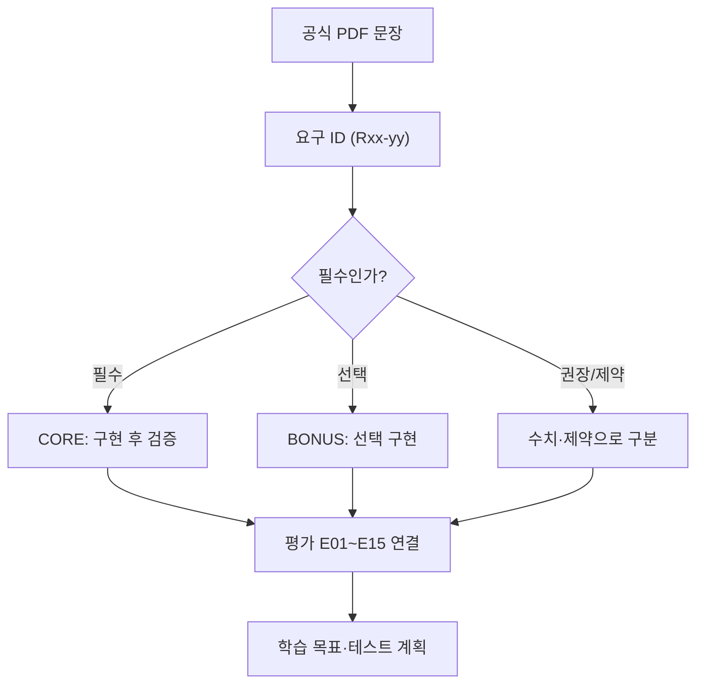

# B1-1 — 01단계 | 공식 요구사항을 먼저 이해하고 분류하기

**30초 요약:** 웹페이지를 만들기 전에 공식 미션 PDF와 평가 15문항을 읽어 **무엇이 필수이고, 어떤 것을 설명하고 검증해야 하는지** 연결합니다. **01단계는 요구·평가 문서 분석**이며 실제 웹페이지를 구현하는 단계가 아닙니다.

> **상태 구분:** 00단계 계획 문서 PASS · 01단계 공식 요구 분석 **문서 PASS** · **신규 소스 개발 승인 PENDING / 실제 구현 NOT_STARTED / 전체 CLEAR NOT_VERIFIED**. 최종 문서 게이트 판정은 [01단계 검증 보고](VALIDATION-REPORT.md)를 따릅니다.

**처음 읽는 방법:** 모든 항목을 암기할 필요는 없습니다. **공식 요구 하나 → 평가 질문 하나 → 학습목표 하나 → 나중에 확인할 증거 하나**를 순서대로 연결해 보세요.

**73개는 무엇인가요?** 공식 미션 문장을 검증하기 편하게 73개의 **추적 기록**으로 나눈 것입니다. 서로 다른 기능 73개를 만들라는 뜻은 아닙니다. 같은 선택 기능이 여러 절에 다시 등장해 별도 ID가 부여된 경우도 있습니다.

## 현재 문서의 목차

| 영역 | 바로가기 | 한눈에 볼 내용 |
|---|---|---|
| A. 무엇을 확인하나요? | [원본과 목표](#stage01-original) | 공식 PDF와 평가표 |
| B. 요구를 어떻게 나누나요? | [요구사항 목록](#stage01-req) | 필수·선택·권장 |
| C. 어떻게 배우고 평가하나요? | [학습·평가 연결](#stage01-learn) | 개념→설명→재현→테스트 |
| D. 다음 단계로 넘어갈 조건 | [검증·인계](#stage01-ready) | 기록·차이·진입 판정 |

## A. 먼저 공식 원본 2개 확인

| 자료 | 이 단계에서 확인할 내용 |
|---|---|
| [B1-1 공식 미션 PDF (9쪽)](https://drive.google.com/file/d/1YC6KKj-hCi54FzOhivZmetX0EQXFXXNy/view) | 공식 §4 요구사항 10영역·선택과제·환경 제약 |
| [공식 평가 체크리스트 (15문항)](https://drive.google.com/file/d/1tRJdh0a2cX8x3nAkpKYM9b6aVfPKed6q/view) | 기능 5 / 구조 4 / 핵심 개념 4 / 확장 질문 2 |

**예를 들어:** 'GitHub 프로젝트 카드 표시'는 공식 필수 요구입니다. '프로젝트 언어별 필터링'은 PDF에 **선택(BONUS)**이라고 적혀 있습니다. 둘은 구분해야 합니다.

## B. 요구사항을 작은 단위로 분류

### 오늘의 첫 개념: 필수와 선택을 구분하기

- **필수(CORE):** GitHub에서 저장소 목록을 받아 프로젝트 카드로 표시합니다.
- **선택(BONUS):** 버튼으로 프로젝트를 프로그래밍 언어별로 걸러 보여줍니다.
- **권장(RECOMMENDED):** 설정값 일부는 공식 권장값을 참고하며, 변경 가능 여부·기록 조건을 따집니다.

**스스로 설명:** “필수 기능이 동작하는지 확인하는 것”과 “선택 기능을 더해 보는 것”은 서로 다른 과제입니다.

### 한 가지 사례를 그림처럼 따라가 보세요

| 이어지는 순서 | 예시 | 무슨 뜻인가요? |
|---|---|---|
| **공식 PDF** | §4.8 GitHub 공개 API 연동 | 프로젝트 데이터 불러오기 |
| **요구 ID** | R08-01, R08-03~R08-06 | 요청·로딩·카드·오류·빈 상태 |
| **평가 ID** | E04 | 성공/로딩/실패/빈 목록을 구별할 수 있나요? |
| **학습목표 ID** | LO09 | HTTP 요청과 오류를 설명할 수 있나요? |
| **실제 증거** | 나중에 코드·브라우저 화면·테스트 | 지금은 만들지 않았으므로 아직 미검증 |

**눈으로 재현:** 요청 시작 → 로딩 → 응답 → 카드 또는 빈 화면 또는 오류 메시지. **이것은 실행 전 예상 흐름**입니다.

- [공식 PDF 세부 요구 73개와 분류](REQUIREMENTS-CATALOG.md): 요구 ID별 구체 조건·미래 검증 방법.
- [필수·선택·평가 차이 10건](SOURCE-CONFLICTS-AND-DECISIONS.md): 변경 기준값, filter, STATE 객체 등.
- **여기서 읽는 방법:** R02-01은 시맨틱 HTML, E07은 평가표의 시맨틱 HTML 질문처럼 번호를 연결합니다.

## C. 배워서 스스로 설명할 수 있도록 연결

### 처음 보는 용어를 쉽게 구별하기

| 표기 | 쉬운 설명 |
|---|---|
| **PDF** (Portable Document Format) | 공식 과제 문서의 파일 형식 |
| **CORE / BONUS** | 반드시 해야 하는 일 / 선택해서 해볼 일 |
| **R** — 요구사항(Requirement) | 무엇을 만들어야 하는지 표시한 **이번 문서의 번호** |
| **E** — 평가(Evaluation) | 무엇을 설명·평가하는지 표시한 **이번 문서의 번호** |
| **LO** — 학습목표(Learning Objective) | 무엇을 배워야 하는지 표시한 **이번 문서의 번호** |
| **PASS / NOT_VERIFIED** | 근거로 확인한 범위만 통과 / 실제 증거가 아직 없음 |

**주의:** R·E·LO는 공식 PDF의 번호가 아니라 요구를 쉽게 연결하려고 **이번 분석에서 붙인 식별자**입니다.

| 순서 | 문서 | 무엇을 할까요? |
|---|---|---|
| 1 | [E01~E15 공식 평가](EVALUATION-15-MAPPING.md) | 평가 질문의 의미 이해 |
| 2 | [LO01~LO14 학습목표](LEARNING-OBJECTIVES.md) | 어느 개념을 설명·예측할지 확인 |
| 3 | [00단계 학습지도](../00-plan/LEARNING-MAP.md) | 한 번에 한 개념씩 시작 |
| 4 | [00단계 설명·종이 재현](../00-plan/LEARNER-EXPLAIN-RECONSTRUCT.md) | 코드 예상 결과를 자료 없이 설명 |
| 5 | 실제 신규 구현 이후 | 실제 코드·테스트·증빙 연결(아직 미실시) |

**스스로 확인하는 질문 세 가지**

1. GitHub API에서 프로젝트 카드를 보여주는 것은 필수인가요? **네.**
2. 언어별 필터 버튼은 공식 PDF 기준 필수인가요? **아니요, 선택입니다.**
3. 01단계 문서 PASS이면 웹페이지도 구현 완료인가요? **아니요. 코드 실행·시험은 아직 없습니다.**

**핵심 원칙:** 문서를 읽었다고 실제 평가를 통과한 것이 아닙니다. 종이로 흐름을 그려 보는 **교육용 재현**과 브라우저에서 코드를 실행하는 **실제 재현**은 다릅니다.

## D. 01단계에서 무엇을 PASS로 판단하나요?

- 공식 PDF·평가표 원본 확인, 요구 분류 및 15문항 연결, 학습목표·수용 기준·증거 계획 작성.
- [01단계 검증 보고](VALIDATION-REPORT.md)에서 요구 ID 중복, E01~E15 누락, 링크 오류, 선택/필수 혼동을 확인.
- **01단계 문서 PASS(요구 73개·평가 15개·학습목표 14개 검증)와 전체 미션 CLEAR는 다른 결과**입니다. 신규 소스 개발·배포는 별도 승인 PENDING을 유지합니다.
- **다음 계획 단계:** [02 기존 환경·소스 분석](../02-analysis/README.md) (01단계 문서 게이트 충족 후 별도로 진행).

**기존 자료와 승인 경계:** [00 계획](../00-plan/README.md) · [상태 보고](../00-plan/STATUS.md) · [mission.yml](../mission.yml). 다른 Round의 이전 기능 PASS는 신규 미션의 PASS가 아닙니다.
