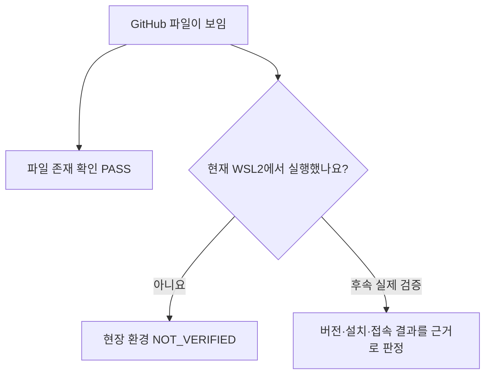

# B1-1 — 개발환경·도구·검증 가능 범위 비교 (02단계)

> GitHub 읽기 전용 근거 정리, 2026-10-26. **현재 WSL2 현장 실행 점검은 하지 않았습니다.** 지난 차수에 기록된 명령 출력은 현재 환경 진단을 대신하지 않습니다.

## 먼저 기억할 구분

- **저장소에서 찾음(FOUND_IN_GIT):** 실제 파일·Git Blob·설정이 현재 `main`에 있음.
- **과거 기록(HISTORICAL):** 당시 PC·가상환경·배포·테스트 기록이 있음. 현재 WSL2 상태 증명이 아님.
- **현재 환경 미확인(NOT_VERIFIED):** 로그인한 사용자의 WSL2 패키지·IDE·포트·연결/권한/브라우저 상태는 실제로 조회하지 않음.

## 1. 환경·도구 현황표

| 조사 대상 | 현재 확인 가능한 근거 | 실제 판정 | 03 설계·이후에 할 일 |
|---|---|---|---|
| GitHub `main` | 현재 HEAD 및 파일 트리 읽기 | **PASS — 저장소 내용 조회** | 신규 소스 경로를 별도 설계 |
| VS Code 설정 | `.vscode/settings.json` | **FOUND_IN_GIT** | 현재 WSL2 VS Code 실행 여부는 NOT_VERIFIED |
| Live Server 확장 | `.vscode/extensions.json`에 `ritwickdey.LiveServer` 추천 | **설정 파일 존재**, 실제 설치 NOT_VERIFIED | 공식 PDF의 VS Code + Live Server 요구와 현재 환경 일치 확인 |
| Live Server 포트 | `liveServer.settings.port: 5500` | **설정값만 확인** | 5500 포트 실제 리스너 동작 미확인 |
| Linux 셸 | `.vscode/settings.json`에 bash 기본 프로필 | **설정값만 확인** | 실제 `uname`, `/etc/os-release`, `bash` 등은 이후 승인된 진단으로만 실측 |
| 예전 Linux | [Round 02 환경 로그](../../round-02-clear/environment/README.md)에 Ubuntu 24.04.5, Bash, apt, Git 설치·인증 기록 | **HISTORICAL** | 이전 기기·사용자·경로를 현재 WSL2에 그대로 적용 금지 |
| 현재 Windows 11 Pro / WSL2 Ubuntu | 미션 운영 문서에 목표 환경으로 기록 | **현재 런타임 NOT_VERIFIED** | 설치·네트워크·DNS·Chrome/Chromium 사용 가능성 후속 점검 |
| 브라우저 | 과거 Round 03 Chromium 테스트 기록 | **HISTORICAL** | Round 04 실제 브라우저 실행 결과 없음 |
| Node / Python / Git / Codex | 과거 기록 또는 구성 기대 | **현재 명령 위치·버전 NOT_VERIFIED** | 필요한 항목만 승인된 단계에서 검사 |
| GitHub Pages | 과거 Round 03 공개 URL과 검증 기록 | **과거 배포 기록만 확인** | 신규 Round 04 새 배포 URL 없음 |
| 비밀키·권한 | 공개 과거 코드 일부의 문자열 검사; 인증값 원문 출력 안 함 | **현재 비밀정보·권한 상태 NOT_VERIFIED** | 승인 범위 외 토큰·Secret·배포 설정 변경 금지 |

**범위 구분:** `.github/workflows/`에는 기존 배포·검증 워크플로가 저장되어 있으나, 이를 지금 실행하거나 이전 배포 기록을 새로운 Round 04 결과로 승격하지 않았습니다.

## 2. 쉬운 그림

**비유:** 레시피 파일에 '오븐이 필요하다'고 적혀 있다고 지금 우리 집에 오븐이 준비된 것은 아닙니다. 설정 파일과 실제 설치·실행 결과를 구별합니다.

## 3. 이후 실제 확인할 체크리스트 (현재 실행하지 않음)

- [ ] WSL2 배포판과 bash 환경, 현재 작업 경로·권한 확인.
- [ ] Git·Codex·Python 등 필요한 도구의 실제 설치·버전 확인.
- [ ] VS Code/Live Server 설치·동작과 공식 PDF 요구 비교.
- [ ] Chrome/Chromium 및 로컬 HTTP 테스트 가능 여부 확인.
- [ ] 공개 GitHub API 요청 제한·DNS·네트워크·비밀정보 보호 점검.
- [ ] 체크 항목마다 **명령·결과·날짜·환경·PASS/FAIL/NOT_VERIFIED** 기록.

**후속 작업의 위치:** 02단계에서 파일 기반 분석은 완료할 수 있으나 현재 시스템에 대한 실제 실행 진단은 수행하지 않았습니다. 실제 실행은 향후 별도 승인·범위를 준수합니다.

[02단계 README](README.md) · [기존 소스 비교](LEGACY-ASSET-MATRIX.md) · [공식 요구 차이](REQUIREMENT-GAP-MATRIX.md)
