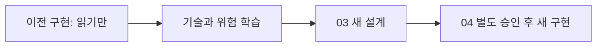

# B1-1 — 기존 파일과 소스 자산 비교 (02단계)

> **READ_ONLY_ANALYSIS / HISTORICAL_REFERENCE_ONLY** · 2026-10-26, GitHub `main` **936a25d266487d6bf6d8a43ed8bfbe26ac298207** 기준의 파일·코드 정적 비교입니다. 과거 미션의 PASS/CLEAR를 신규 Round 04 PASS로 이관하지 않습니다. **기존 코드 수정·실행·배포 없음**.

## 처음 보는 학습자에게

과거 작업을 보는 이유는 **이미 시도한 방법·배울 개념·발생할 수 있는 오류를 이해**하기 위해서입니다. 새 미션은 기존 코드를 복사해 완성하지 않고, `04-src/`에서 별도 승인을 받고 직접 새로 구현합니다.

## 1. 소스 위치·SHA·역할

| 구분 | 경로 | Git Blob SHA | 현재 구분 |
|---|---|---|---|
| Round 01 기준 HTML | `training/round-01-clear/reference/index.html` | `99435474b6a593cad6fbc0901fecd9a0acefe9b8` | 참조 구현 |
| Round 01 기준 CSS | `training/round-01-clear/reference/css/style.css` | `30134fe0eeded2c81c934476744b2ff46427484d` | 참조 구현 |
| Round 01 기준 JS | `training/round-01-clear/reference/js/script.js` | `f73bba261bc901335269802fa4f6b6019d89d3fb` | 참조 구현 |
| Round 02 이력 | `training/round-02-clear/` | 아래 문서·증빙별 SHA | 문서·브라우저 증빙; **main 트리에 Round 02 전용 신규 04-src 경로는 없음** |
| Round 03 HTML | `training/round-03-apos/04-src/index.html` | `2a751ab1e5dcf89eb90758fa209d6f3c6bc7292c` | 이전 미션 구현 |
| Round 03 CSS | `training/round-03-apos/04-src/css/style.css` | `d1fae4a091440ae121a2ca98d55bbc5a61934a3b` | 이전 미션 구현 |
| Round 03 JS | `training/round-03-apos/04-src/js/main.js` | `adc9c757196847f4755ad1ecccaf8c0adfb6bea6` | 이전 미션 구현 |
| 현행 루트 안내 HTML | `index.html` | `12760b0f6e714e863d8e5c4161cbfc92c84aaba9` | 미션 현황 안내, **신규 앱 아님** |
| Round 04 새 작성 장소 | `training/round-04-agent/04-src/README.md` | `531e099f0fb2dae62556427b943f4ced1a424c3e` | **코드 미작성** |

**파일 해시:** SHA는 Git 객체를 식별할 뿐 파일 내용의 기능 통과 또는 학습 성취를 뜻하지 않습니다. 이전 루트 `css/style.css`, `js/script.js`, `images/profile-placeholder.svg`는 `legacy/round-01-portfolio/` 아래 사본과 동일 Blob으로 확인되어 이전 링크 호환용으로 유지합니다.

## 2. 실제 파일 내용의 정적 관찰

| 학습 주제 | Round 01 참조 | Round 03 기존 소스 | 해석 |
|---|---|---|---|
| HTML 시맨틱·필수 섹션 | nav/main/form·section 확인 | nav/main/form·Hero/About/Skills/Projects/Contact 확인 | 과거 구조 학습 가능. 신규 구현 확인 아님 |
| 라벨·대체텍스트 | label 3개, alt 속성 관찰 | label 3개, alt 속성 관찰 | 실제 접근성 적절성은 별도 브라우저/보조기술 테스트 필요 |
| `<article>` 태그 | 3개 문자열 태그 확인 | `<article>` 시작 태그 **0개 관찰** | **03 설계에서 공식 §4.2 시맨틱 태그 요구를 다시 확인할 주의점**; 과거 평가 실패 단정 금지 |
| 외부 HTML 링크 | CSS link, JS defer 확인 | CSS link, JS defer 확인 | 이전 분리 구조는 참고만 |
| CSS 반응형 | `@media` 3회, 768/1024 코드 문자열 | `@media` 7회, 768/1024 코드 문자열 | 실제 모바일 화면 정상 여부는 과거 실행 증빙과 구분 |
| Flex·Grid | `display:flex/grid` 문자열 | `display:flex/grid` 문자열 | 행/열 배치 선택 이유 학습 |
| JS DOM·이벤트 | `addEventListener` 8회, selector 사용 | `addEventListener` 12회, selector 사용 | 이벤트→상태→DOM 흐름 추적 |
| 상태·저장 | STATE, localStorage 문자열 확인 | STATE, localStorage 문자열 확인 | 기존 설계 선택과 실제 신규 설계는 독립 |
| 외부 GitHub API | `fetch`·async/await·error 처리 | `fetch`·async/await·error 처리 | 요청 성패·오류 상태는 05단계 재시험 필요 |
| IntersectionObserver | 존재 | 존재 | 시각 효과/접근성 검토 대상 |

위 개수는 특정 소스에 대한 **정적 문자열·태그 검사 결과**입니다. 기능 성능이나 브라우저 사용자 경험을 측정한 숫자가 아닙니다.

## 3. 이전 검증·증빙의 소재와 시점

| 이전 차수 | 읽기 가능한 증거 위치 | 과거 기록의 주장 | 이번 단계의 증명 범위 |
|---|---|---|---|
| Round 01 | [REFERENCE-STATUS](../../round-01-clear/REFERENCE-STATUS.md) | 기준 구현 CORE READY, 실행은 미시작 | **경로는 아래의 정확한 상대경로 참조** |
| Round 02 | `training/round-02-clear/docs/final-verification.md`; `training/round-02-clear/evidence/` | 당시 실행·배포·화면 증빙 및 사용자 구술 검토 보류 | 현재 **파일 존재·기록 확인**만 |
| Round 03 | `training/round-03-apos/mission.yml`; `evidence/runtime-summary.json`; `evidence/public-runtime-summary.json` | 당시 Runtime/배포 기록 PASS | 이번 Round 04의 테스트 PASS 아님 |
| Round 03 검수 | `training/round-03-apos/evidence/VISUAL-REVIEW.md` | 한국어 글꼴·캡처 순서 재확인 후 독립 시각 검수 PASS | 과거 환경의 기록; 이번 화면 재검증 아님 |

**정확한 Round 01 참조:** [Reference Status](../../round-01-clear/REFERENCE-STATUS.md). 이전 Round 02 소스/증빙: [최종 검증 기록](../../round-02-clear/docs/final-verification.md). 이전 Round 03 검증: [실행 요약](../../round-03-apos/evidence/runtime-summary.json) · [공개 배포 요약](../../round-03-apos/evidence/public-runtime-summary.json) · [시각 검수](../../round-03-apos/evidence/VISUAL-REVIEW.md).

**서로 다른 시점의 상태 주의:** Round 03의 `evidence/EVIDENCE-MAP.md` 말미는 학습 설명 평가 보류 상태를 기록하지만, 이후 `mission.yml`·`CHECKLIST.md`는 완료를 기록합니다. **서로 다른 스냅샷으로 이해**하고 02단계에서 어느 하나의 문장을 Round 04 새 검증의 증거로 대체하지 않습니다.

## 4. 기존 소스에서 무엇을 배울까요?

1. **문서 역할 분리:** HTML 구조, CSS 스타일, JS 이벤트·데이터 처리를 각각 설명해 보세요.
2. **상태 흐름:** 테마 변경, API 요청, 폼 오류를 각각 '입력→상태→화면'으로 종이에 추적해 보세요.
3. **안전·한계:** API 오류·폼 검증·비밀정보·접근성·모션 줄이기 같은 예외 경로를 설계해야 합니다.
4. **신규 제작 금지/허용 경계:** 이전 코드는 **읽고 개념 이해만**. 새로운 Round 04 코드는 **03 상세 설계 + 별도 Owner 승인 이후** 독립 신규 작성.

[02단계 README](README.md) · [공식 요구와 공백 비교](REQUIREMENT-GAP-MATRIX.md) · [환경 비교](ENVIRONMENT-BASELINE.md) · [학습 진단](BASELINE-ASSESSMENT.md)
