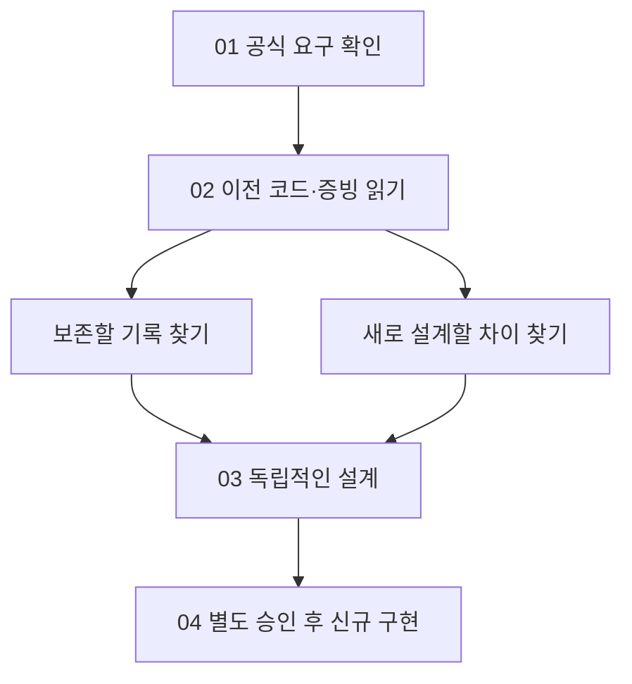
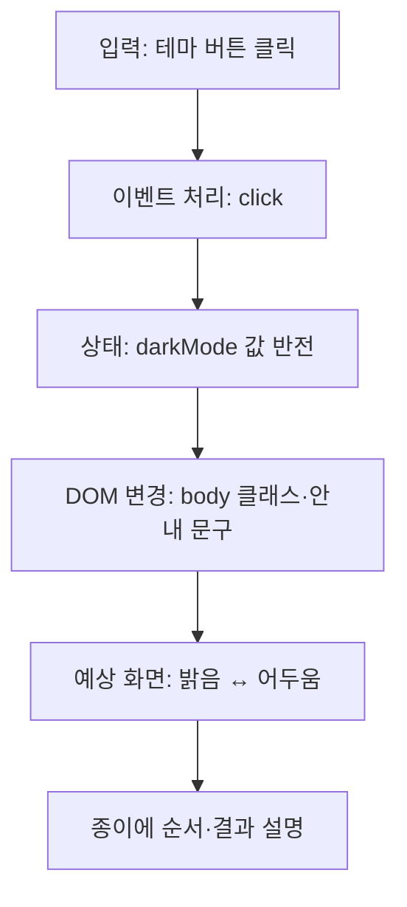

# B1-1 — 02단계 | 이전 자료를 읽고 새 작품의 출발점 찾기

> **30초 요약:** 예전에 만든 웹페이지와 개발환경 기록을 읽고, 공식 요구사항과 비교하여 **무엇을 보존하고 무엇을 새로 설계해야 하는지** 알아봅니다. **지금은 새 웹페이지를 만들거나 실행하지 않습니다.**
>
> **실제 상태:** 00 계획 문서 PASS · 01 공식 요구 문서 PASS · **02 자료 분석 문서 PASS** · 현재 WSL2 실행 환경과 실제 학습자 숙달 **NOT_VERIFIED** · 03 설계 **NOT_STARTED** · 04 개발 승인 **PENDING** · 미션 CLEAR **NOT_VERIFIED**. 상세 근거: [02단계 검증 보고](VALIDATION-REPORT.md).

## 맨 처음: 순서대로 따라 하는 5분 길잡이 (명령어 복사·붙여넣기 불필요)

1. 이 문서의 **A. 처음 시작하기**에서 이번 단계의 목표와 금지 범위를 읽습니다.
2. **B. 기술 배우기**에서 HTML·CSS·JavaScript의 역할과 **버튼을 누르면 화면이 바뀌는 이유**를 그림·코드로 확인합니다.
3. **C. 직접 해보기**에서 코드를 실행하는 대신 종이에 **입력 → 처리 → 예상 결과**를 그려 봅니다.
4. [사전 학습 진단](BASELINE-ASSESSMENT.md)의 A01~A10 중 답할 수 있는 것을 표시하고, 모르는 용어는 [기술 용어집](../00-plan/TECHNICAL-GLOSSARY.md)으로 확인합니다. **지금 답안을 제출하거나 점수를 기록할 필요는 없습니다.**
5. **D. 진행 확인·참고자료**에서 무엇이 PASS이고 무엇이 미검증인지 구분합니다.

**첫 학습의 성공 기준:** “HTML은 구조, CSS는 모양, JavaScript는 동작”이라고 자기 말로 설명하고 **클릭 → 이벤트 → 상태 → 화면 갱신**을 종이에 재현할 수 있는지 스스로 확인합니다. 이 자기 점검은 **공식 학습자 PASS가 아닙니다.**

## A~D 구조화된 목차

| 구분 | 바로 이동 | 입문자가 얻을 것 |
|---|---|---|
| **A. 처음 시작하기** | [목표·범위](#stage02-start) | 왜 이전 자료를 읽는지, 무엇을 하지 않는지 |
| **B. 기술 배우기** | [용어·코드·그림·오류](#stage02-review) | 9단계 학습법과 실제 읽을 수 있는 예시 |
| **C. 직접 해보기** | [종이 실습·자기 설명](#stage02-learn) | 실행 없이도 원리를 설명하고 예상 결과를 그리기 |
| **D. 진행 확인·참고자료** | [PASS·문서·다음 단계](#stage02-next) | 근거를 확인하고 03단계 설계로 넘길 내용 |

<a name="stage02-start"></a>

## A. 처음 시작하기 — 이번 단계는 무엇인가요?

**목표:** 이전 Round 01~03의 파일·코드·증빙을 **읽기만** 하고, 새로운 Round 04 웹페이지에 필요한 공식 요구사항과 아직 없는 기능을 구분합니다.

**쉬운 비유:** 지난 학기 과제의 정답과 실수 기록을 복습하지만, 이번 학기의 새 과제에 **지난 답안 자체를 복사해서 제출하지는 않습니다.**



**고정 규칙:** 신규 소스 파일을 만들 위치는 `../04-src/` 하나이며, 현재는 안내 `README.md`만 있습니다. 02단계에서는 **과거 코드 편집·복사·삭제, 새 소스 구현, 실행, 배포 및 브랜치 병합을 하지 않습니다.**

<a name="stage02-review"></a>

## B. 기술 배우기 — 용어 → 개념 → 비유 → 그림 → 코드 → 흐름 → 오류 → 실습 → 평가

### 1. 먼저 세 가지 기본 역할을 구분하세요

| 한글명(영어명, 약어) | 무슨 일을 하나요? | 쉬운 비유 | 코드에 보이는 모습 |
|---|---|---|---|
| 하이퍼텍스트 마크업 언어(HyperText Markup Language, **HTML**) | 제목·버튼·본문의 구조와 의미를 만듭니다 | 집의 방·문과 같은 구조 | `<button>` |
| 캐스케이딩 스타일 시트(Cascading Style Sheets, **CSS**) | 색·간격·크기와 화면 배치를 정합니다 | 집의 페인트·가구 배치 | `color: blue;` |
| 자바스크립트(JavaScript, **JS**) | 클릭·입력 같은 사용자 행동에 반응합니다 | 스위치를 누를 때 작동하는 장치 | `addEventListener()` |

**알아둘 핵심 용어**

| 처음 나오는 용어 | 쉬운 설명과 비유 |
|---|---|
| 문서 객체 모델(Document Object Model, **DOM**) | 브라우저가 HTML을 다루기 위한 객체 구조. 집의 방 번호표처럼 원하는 요소를 찾아 바꿉니다 |
| 이벤트(Event) | 클릭·입력 등 발생한 사건. 초인종을 누르는 행위 |
| 상태(State) | 현재 값. 예: 메뉴가 열렸는지, 다크 모드인지. 문 옆의 ‘열림/닫힘’ 표시 |
| 렌더링(Rendering) | 변경된 내용을 화면에 표시하는 과정 |
| 응용 프로그램 프로그래밍 인터페이스(Application Programming Interface, **API**) | 다른 서비스에 데이터를 요청하는 정해진 방법. 식당의 주문 창구 |
| 깃(Git) 커밋(Commit) | 변경 이력을 기록하는 단위. 작업한 날짜의 기록 사진 |
| 깃 객체 식별값(Git Object Hash, **SHA 계열 해시**) | 파일 내용이나 커밋을 식별하는 값. 기록의 지문. **같은 해시가 기능 시험 합격을 뜻하지는 않습니다** |
| 윈도우용 리눅스 하위 시스템(Windows Subsystem for Linux 2, **WSL2**) | Windows에서 Linux 환경을 사용하는 기술. 파일에 설정이 적혀 있어도 실제 설치 상태는 별도 확인해야 합니다 |

더 많은 용어는 [00단계 기술 용어집](../00-plan/TECHNICAL-GLOSSARY.md)과 [핵심 개념](../00-plan/CORE-CONCEPTS.md)에서 찾아보세요.

### 2. 대표 사례 — 테마 버튼 하나로 9단계 따라가기

**① 용어:** 문서 객체 모델(Document Object Model, DOM), 이벤트(Event), 상태(State), 렌더링(Rendering).

**② 개념:** 버튼을 클릭하면 JavaScript가 사건을 감지하고 테마 상태를 뒤집습니다. 그 상태에 따라 CSS 클래스와 설명 문구를 바꾸어 화면에 반영합니다.

**③ 쉬운 비유:** 방의 전등 스위치를 누르면 ‘켜짐/꺼짐’ 상태가 바뀌고, 불빛과 표시등도 그 상태를 보여줍니다.

**④ Mermaid 그림**



**⑤ 주요 코드 — 읽기 전용 교육 예시 (Round 04 신규 소스가 아닙니다)**

HTML 예시(구조):

```html
<button id="themeButton" type="button">테마 변경</button>
<p id="themeStatus">밝은 화면</p>
```

CSS 예시(모양):

```css
body.dark {
  background: #222;
  color: white;
}
```

JavaScript 예시(동작):

```javascript
const button = document.querySelector("#themeButton");
const status = document.querySelector("#themeStatus");
let darkMode = false;

if (button && status) {
  button.addEventListener("click", () => {
    darkMode = !darkMode;
    document.body.classList.toggle("dark", darkMode);
    status.textContent = darkMode ? "어두운 화면" : "밝은 화면";
  });
}
```

**한 줄씩 읽어보기:** `querySelector`는 버튼·문구를 찾고, `darkMode`는 현재 상태를 기억합니다. `if`는 필요한 요소가 있는지 확인하며, `addEventListener`는 클릭을 기다립니다. `!darkMode`는 참/거짓을 뒤집고, `classList.toggle`은 CSS 클래스를 맞춘 뒤, `textContent`로 화면 문구를 바꿉니다.

**⑥ 실행 흐름(예상 결과, 실제 실행 아님):** 처음에는 `darkMode=false`이고 ‘밝은 화면’입니다. 첫 번째 클릭 뒤 `true`와 ‘어두운 화면’, 두 번째 클릭 뒤 `false`와 ‘밝은 화면’을 예상합니다. 이 예시에는 새로고침 후 상태 저장 기능은 **없습니다**.

**⑦ 자주 생기는 오류와 해결 방법**

| 증상 | 원인 확인 | 해결 방향 |
|---|---|---|
| 버튼을 눌러도 반응이 없음 | HTML `id`와 `querySelector`의 이름이 같은지 | 요소 이름을 맞추고 스크립트 연결 여부 확인 |
| `null` 오류 | 해당 요소가 없거나 스크립트가 너무 일찍 실행되는지 | `if (button && status)` 등 존재 확인 |
| 글자는 바뀌는데 배경이 그대로임 | CSS 선택자 `body.dark`와 클래스명이 같은지 | CSS 규칙과 적용 대상을 대조 |
| 새로고침 후 밝은 테마로 돌아옴 | 예시에 브라우저 저장 기능이 없는지 | 오류로 단정하지 않고 향후 상태 저장 설계와 구분 |

**⑧ 종이 실습:** 새 파일을 만들거나 서버를 켜지 마세요. 종이에 `처음 / 1회 클릭 / 2회 클릭` 세 칸을 만들고 각각 `darkMode`, `body.dark` 적용 여부, 안내 문구를 적어 보세요.

**⑨ 자기 평가:** “어떤 코드가 클릭을 감지하고, 어떤 코드가 상태를 바꾸며, 어떤 코드가 글자를 바꾸나요?”를 코드 없이 두 문장으로 설명해 보세요. 실제 학습자 공식 판정은 [사전 학습 진단](BASELINE-ASSESSMENT.md)에서 별도로 설계하며 **아직 실시하지 않았습니다.**

### 3. 다른 기술은 어디서 배우나요?

| 학습 기술 | 이전 자료에서 확인할 것 | 같은 9단계로 생각할 질문 |
|---|---|---|
| HTML 시맨틱 구조 | [과거 파일·소스](LEGACY-ASSET-MATRIX.md) | `<nav>`와 `<main>`은 왜 구별하나요? |
| CSS 반응형·모바일 우선 | [과거 소스](LEGACY-ASSET-MATRIX.md) | 화면 폭이 바뀌면 어느 규칙이 작동하나요? |
| 이벤트·DOM·상태 | 위 테마 버튼 사례 | 클릭 전후 상태와 표시를 설명할 수 있나요? |
| GitHub API·비동기 처리 | [공식 요구와 차이](REQUIREMENT-GAP-MATRIX.md) | 로딩·성공·빈 결과·오류가 왜 서로 다른가요? |
| 문의 폼 검증·예외 처리 | [공식 요구와 차이](REQUIREMENT-GAP-MATRIX.md) | 이메일 형식 오류는 어디에 알려줘야 하나요? |
| Git·커밋·해시·증빙 | [이전 자료 보존](LEGACY-ASSET-MATRIX.md) | 옛 PASS와 새 PASS를 왜 분리하나요? |
| WSL2·VS Code·Live Server | [현재/과거 환경 비교](ENVIRONMENT-BASELINE.md) | 설정 파일 존재와 실행 확인은 왜 다른가요? |

*이 표는 개념별 학습 경로입니다. 기존 분석 파일이 모든 기술의 실행 가능한 9단계 교안을 완성했다는 뜻은 아닙니다. 실제 코딩 실습·실행은 승인된 이후 단계에서만 진행합니다.*

<a name="stage02-learn"></a>

## C. 직접 해보기 — 이해하기 → 설명하기 → 종이에 재현하기

### 1. 복사·붙여넣기 없이 3단계 연습

1. **이해하기:** ‘HTML=구조, CSS=모양, JavaScript=동작’을 자신의 주변 물건에 빗대어 한 문장씩 말합니다.
2. **설명하기:** 테마 버튼 사례에서 `click`, `darkMode`, `classList.toggle`, `textContent`가 각각 맡는 역할을 순서대로 설명합니다.
3. **재현하기:** 아래 빈 표를 종이에 옮겨 예상값을 적고, B의 코드·예상 결과와 비교합니다.

| 예상 시점 | `darkMode` | `body.dark` 클래스 | 안내 문구 |
|---|---|---|---|
| 처음 | ? | ? | ? |
| 첫 클릭 | ? | ? | ? |
| 두 번째 클릭 | ? | ? | ? |

**정답 확인:** 처음 `false/없음/밝은 화면` → 첫 클릭 `true/있음/어두운 화면` → 두 번째 클릭 `false/없음/밝은 화면`. 실제 프로그램을 실행한 증거가 아니라 **제시된 코드의 예상 동작**입니다.

### 2. 실수 찾기와 말로 설명하기

- 만약 HTML 버튼 이름이 `themeButton`인데 JavaScript는 `#themeBtn`을 찾는다면 어떤 일이 생길까요?
- GitHub에 이전 소스의 SHA가 남아 있다는 사실은 **이번 Round 04가 실행되었다**는 증거일까요?
- 새로운 API 요청에서 프로젝트 결과가 `[]`인 경우와 HTTP 403 오류인 경우, 안내 문구를 같게 해야 할까요?

**예상 설명:** ① 서로 다른 이름이므로 요소를 찾지 못함 ② 아니요, 과거 기록일 뿐 ③ 아니요, 정상적인 빈 결과와 서버 거부는 원인이 다름.

[사전·사후 학습 진단 10+10문항](BASELINE-ASSESSMENT.md)으로 더 연습할 수 있습니다. **실제 학습자 답안·점수·독립 수행 평가 결과는 아직 없습니다.**

<a name="stage02-next"></a>

## D. 진행 확인·상세 참고자료

### 1. PASS/FAIL/NOT_VERIFIED를 구별하세요

| 현재 확인 항목 | 실제 판정 | 입문자 해석 |
|---|---|---|
| 00·01·02 문서 작성·분석 | **PASS — 문서 범위** | 준비 자료를 만들고 확인했습니다 |
| Round 01~03 소스·증빙 | **PASS — 존재·정적 확인** | 이전 작업이 기록으로 남아 있습니다 |
| 현재 MCP 일부 읽기 도구 | **PASS — 읽기 경로만** | 옛 작업 상태·기존 파일 조회가 응답했습니다 |
| 지금 PC의 WSL2·VS Code·브라우저 | **NOT_VERIFIED** | 현재 설치·실행을 검증하지 않았습니다 |
| 입문자의 실제 설명·재현 능력 | **NOT_VERIFIED** | 학습자가 직접 수행한 평가가 없습니다 |
| Round 04 웹페이지·배포·CLEAR | **NOT_STARTED / NOT_VERIFIED** | 아직 개발·시험하지 않았습니다 |
| 04 신규 소스 작성 승인 | **PENDING** | 명시적 승인 전 작성하지 않습니다 |

**FAIL은 실제로 확인된 불충족일 때만 사용**합니다. 아직 시험하지 않은 경우에는 FAIL 대신 NOT_VERIFIED라고 씁니다.

### 2. 상세 자료는 이 순서로 열어 보세요

| 순서 | 문서 | 활용법 |
|---|---|---|
| 1 | [기존 소스·파일·증거](LEGACY-ASSET-MATRIX.md) | 예전 파일의 역할과 변경 여부 |
| 2 | [공식 요구와의 차이](REQUIREMENT-GAP-MATRIX.md) | 이번 새 미션에서 새로 설계할 내용 |
| 3 | [현재·과거 개발환경](ENVIRONMENT-BASELINE.md) | 실제 확인과 미확인을 구분 |
| 4 | [학습자 사전/사후 진단](BASELINE-ASSESSMENT.md) | 설명·종이 재현 점검 문항 |
| 5 | [02단계 검증 결과](VALIDATION-REPORT.md) | 재조회한 증거, 한계, 다음 단계 |
| 6 | [01단계 공식 요구](../01-requirements/README.md) | 공식 73개 요구·15개 평가 문항의 근거 |

**03단계로 넘길 것:** 새 HTML/CSS/JS 파일 구조, 반응형, 이벤트→상태→화면의 최소 3개 흐름, GitHub API 오류 처리, 폼 검증·접근성, 보안·브라우저 시험 및 증빙 방법의 **설계**입니다. **03 설계 진입 가능**과 **04 개발 승인**은 다릅니다.

[00단계 학습 시작](../00-plan/README.md) · [01단계 평가 15문항](../01-requirements/EVALUATION-15-MAPPING.md) · [03단계 설계 안내](../03-design/README.md) · [미션 승인 정보](../mission.yml)
