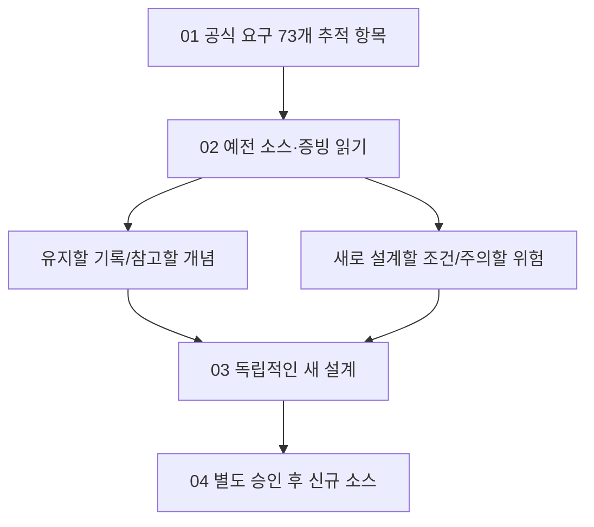

# B1-1 — 02단계 | 예전 자료를 읽고 새로 만들어야 할 범위 찾기

**30초 요약:** 이번 단계에서는 **이전 웹페이지 코드·브라우저 증빙·개발환경 설정**을 읽고, 공식 B1-1 요구사항과 비교합니다. 예전 결과는 그대로 보존하며 **새 Round 04에서는 코드를 아직 만들지 않습니다.**

> **상태:** 00단계 계획 문서 PASS · 01단계 요구 분석 문서 PASS · 02단계 파일 기반 비교 분석 **문서 PASS** · **실제 WSL2 환경·학습자 평가 NOT_VERIFIED / 신규 개발 승인 PENDING**. 최종 문서 게이트는 [02단계 검증 보고서](VALIDATION-REPORT.md)에서 확인합니다.

## 구조화된 목차 — A~D

| 구분 | 바로 이동 | 무엇을 배우나요? |
|---|---|---|
| **A. 처음 시작하기** | [이 단계의 목표](#stage02-start) | 이전 자료와 새 프로젝트의 차이 |
| **B. 기존 자료 분석하기** | [코드·환경 비교](#stage02-review) | HTML/CSS/JS와 이전 증빙 |
| **C. 직접 설명·재현하기** | [사전 학습 진단](#stage02-learn) | 자기 설명·예상 코드 흐름 |
| **D. 판정과 다음 단계** | [검증·인계](#stage02-next) | 02단계 PASS 범위·03 설계 |

## A. 처음 시작하기

### ① 02단계는 왜 필요한가요?

예전의 결과를 **복사해 새 작품으로 내는 것**이 아니라, 같은 기술을 **처음부터 이해하고 다시 설계할 준비를 하는 단계**입니다.

**입문자용 비유:** 지난 학기의 완성된 과제와 풀이집을 읽으며 실수하기 쉬운 부분을 배우되, 새 학기의 과제는 처음부터 직접 풀어야 합니다.

**현재 유일한 새 소스 작성 경로:** `../04-src/`. 지금은 **README 하나만 존재**, 신규 HTML/CSS/JS는 아직 없습니다.

## B. 기존 자료를 역할별로 조사하기

| 읽는 순서 | 문서 | 처음에는 이것만 확인하세요 |
|---|---|---|
| **1** | [기존 코드·파일·증거 목록](LEGACY-ASSET-MATRIX.md) | Round 01~03 소스 위치·SHA(버전 식별값) |
| **2** | [공식 요구와 기존 자산의 차이](REQUIREMENT-GAP-MATRIX.md) | 어떤 것은 이미 배웠고, 새로 만들어야 하는가? |
| **3** | [개발환경 비교](ENVIRONMENT-BASELINE.md) | 설정 파일 존재 ≠ 현재 PC에서 실행된 상태 |
| **4** | [공식 01단계 요구](../01-requirements/README.md) | 필수(CORE)·선택(BONUS)·수용 기준 확인 |

**자주 쓰는 용어 — 한글(영어, 약어)**

| 용어 | 아주 쉬운 설명 |
|---|---|
| **기준 상태(Baseline)** | 비교할 때 기준이 되는 이전 상태 |
| **차이·공백(Gap)** | 공식 요구에 비해 새 미션에 아직 없는 부분 |
| **증거(Evidence)** | 실제 수행 사실을 보여주는 파일·로그·화면 |
| **소스 코드(Source Code)** | 프로그램 동작을 정의한 파일 |
| **문서 객체 모델(Document Object Model, DOM)** | 브라우저가 관리하는 HTML 객체 구조 |
| **응용 프로그램 프로그래밍 인터페이스(Application Programming Interface, API)** | 다른 서비스에 데이터 요청하는 방식 |
| **Git 해시(Secure Hash Algorithm 등의 SHA 기반 식별값)** | 어떤 파일·커밋을 봤는지 구별하는 식별값 |

**구별하기:** Github에 이전 코드가 존재함은 **파일 존재 PASS**, 지금 새 미션 기능이 동작함은 **새로운 실행 결과 확인 후에만 PASS**입니다.

## C. 배운 것을 설명하고, 종이에 재현해 보세요

[사전 역량 진단 설계](BASELINE-ASSESSMENT.md)는 용어 10문항과 동등한 사후 평가 계획을 담고 있습니다. **실제 시험·점수 측정은 하지 않았습니다.**

**직접 말해 보는 질문 3개**

1. HTML·CSS·JavaScript는 각각 무엇을 담당하나요?
2. 예전 웹사이트의 메뉴를 누를 때 **클릭 → 이벤트 함수 → 메뉴 상태 → 화면 변화**가 이어지는 이유는 무엇인가요?
3. 예전 Round의 GitHub Pages 배포 성공을 이번 Round 04의 새 웹페이지 배포 성공으로 기록해도 될까요?

**핵심 정답:** ① 구조·표현·동작 ② 사용자의 동작이 프로그램 상태와 DOM 표시를 바꾸기 때문 ③ 아니요. 수행 차수·소스·환경·증거가 다릅니다.

**종이 재현:** 버튼 클릭 → 상태 변경 → CSS 클래스 또는 DOM 갱신 → 화면 표시를 그림으로 그려보세요. **실제 새 코드 실행이 아닌 교육용 예상 흐름**입니다.

## D. 02단계 검증과 03단계 인계

| 이번 단계에서 완료해야 할 것 | 검증 근거 |
|---|---|
| 기존 Root·Round 01~03 소스 경로·SHA·보존 확인 | [원본 자산 비교](LEGACY-ASSET-MATRIX.md) |
| 과거 브라우저 증빙의 **시점·출처**와 신규 미션의 상태 구분 | [자산 비교](LEGACY-ASSET-MATRIX.md) |
| 공식 요구 12개 영역과 현재 Round 04 공백 연결 | [공식 Gap 표](REQUIREMENT-GAP-MATRIX.md) |
| 현 WSL2의 설치·실행과 과거 설정/기록 구별 | [환경 비교](ENVIRONMENT-BASELINE.md) |
| 학습자 독립 수행 여부를 **실제 결과 없이 PASS로 기록하지 않음** | [사전 학습 계획](BASELINE-ASSESSMENT.md) |
| GitHub 파일 변경 범위·기존 코드·승인 보존 확인 | [02 검증 보고](VALIDATION-REPORT.md) |

**03단계에는** 새 HTML/CSS/JS 파일 구조, 반응형, 이벤트·상태 3개 흐름, GitHub API 오류, 폼 접근성, 브라우저 검증과 증빙 방식을 **설계만** 인계합니다. 실제 소스 구현은 **04단계 별도 승인 후** 가능합니다.

**주의:** 02단계에서 과거 자료를 읽는 것은 허용되지만 이전 파일의 편집·복사·삭제, 소스 신규 구현, 실제 명령 실행, 배포·병합을 수행하지 않습니다.

[00단계 시작](../00-plan/README.md) · [01단계 평가 15문항](../01-requirements/EVALUATION-15-MAPPING.md) · [03단계 설계 안내](../03-design/README.md)
