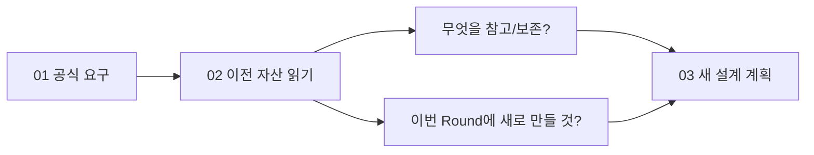

# B1-1 — 공식 요구와 과거 자산의 차이 (02단계)

> **분석 기준:** [01단계 공식 요구 73개](../01-requirements/REQUIREMENTS-CATALOG.md) · [평가 15문항](../01-requirements/EVALUATION-15-MAPPING.md) · GitHub main 과거 소스/증빙 정적 비교 (2026-10-26). **새 Round 04 코드는 존재하지 않습니다.** 과거 구현의 실제 동작을 다시 실행하지 않았습니다.

## 30초 핵심

- **보존:** 기존 소스와 이력·스크린샷·시험 기록은 그대로 둡니다.
- **이해:** 실제 과거 코드가 어떻게 구성됐는지 읽고 원리를 설명합니다.
- **신규:** 공식 요구와 비교해 03단계에서 새로 설계할 조건을 분류합니다.
- **검증:** 새 Round 04에서 기능 구현·시험·배포·숙달 검증은 **NOT_STARTED / NOT_VERIFIED**입니다.

## 1. 공식 12개 영역 기준 Gap(공백) 표

| 공식 PDF 기준 | 기존 자료에서 읽은 사실 | 이번 Round 04 상태 | 03 설계·후속 검증 권장 |
|---|---|---|---|
| **R01 — 파일·도구** | Round 01,03 소스에 HTML·CSS·JS 분리와 defer 확인; VS Code Live Server 추천/포트 설정 존재 | **신규 앱 없음; 현재 IDE 실행 NOT_VERIFIED** | 신규 파일 구조 설계; Live Server 실제 설치/실행 추후 확인 |
| **R02 — HTML·시맨틱** | Round 01,03에 header/nav/main/섹션/폼/label·alt 관찰. Round 03 HTML에서는 `<article>` 태그 **미관찰** | **신규 구조 미작성** | 공식 시맨틱 조건 전체 설계; article 적합 위치 및 보조기술 검토 |
| **R03 — 반응형·CSS** | Round 01,03 CSS 변수, 다크 테마, 768/1024 텍스트, Grid·Flex 미디어 쿼리 관찰 | **신규 CSS 없음** | 모바일 퍼스트, 768/1024, 테마·모션·키보드 상태 설계 |
| **R04 — JS·DOM** | 과거 JS에 STATE, querySelector, addEventListener, classList, localStorage 등 확인 | **신규 JS 없음** | 새 이벤트/DOM/상태 책임 분리 및 안전한 text/HTML 처리 |
| **R05 — 6개 상호작용** | 과거 JS와 Round 03 점검표에 메뉴·스크롤·테마·Observer 기록 | **이번 기능 미구현** | 상태 흐름과 300px/60px/threshold 변경·README 기록 조건 설계 |
| **R06 — 문의 폼** | 이전 HTML에 form/label 3개, JS에 제출/유효성 처리 텍스트; 과거 검사 기록 존재 | **새 폼 미구현** | 필수값·이메일·필드 인접 메시지·접근성, 전송 보너스 구분 |
| **R07 — ES6+·배열** | 과거 JS에 map/filter/forEach·함수·비동기 사용 | **신규 코드 없음** | map 필수 카드 변환과 filter 선택 기능 분리; HTML 출력 안전성 |
| **R08 — GitHub API** | 과거 JS fetch/async/await/오류 처리·Round 03 테스트 기록에서 성공/403/빈 상태 주장 확인 | **새 API 동작 미검증** | 요청 지연/성공/빈/403/네트워크 실패/재시도와 사용자 피드백 설계 |
| **R09 — 상태→화면** | Round 01,03 JS에 STATE 객체; 이전 기록에 theme/projects/form 등 흐름 | **독립 상태 흐름 0개 구현** | **최소 3개** 이벤트→상태→DOM 흐름을 새로 설계하고 설명 계획 |
| **R10 — Pages·제출** | 이전 Round 02/03 배포 URL·과거 화면·증빙 파일 존재 | **이번 Round 배포·캡처 없음** | 이번 신규 출처 URL·브라우저·모바일/다크 화면·SHA 별도 확보 |
| **R11 — BONUS** | 이전 이력에서 언어 필터/시스템 테마 등 보너스 기록 확인 | **선택 기능 미결정** | 별도 승인 전 외부 폼 전송 등 구현하지 않음. CORE 우선 |
| **R12 — 제약** | 과거 정적 HTML/CSS/JS 구조 관찰; 현재 소스 `04-src/`는 README뿐 | **신규 의존성·보안 상태 아직 없음** | 외부 UI 라이브러리·인라인 핸들러·style 금지, 최신 Chrome 시험 계획 |

**읽는 법:** `Rxx`는 01단계 공식 요구의 분류번호입니다. 위 표의 기존 기능 언급은 **정적 코드 관찰 또는 과거 보고서의 기록**이며 이번 차수에서 기능을 실행해 검증했다는 뜻이 아닙니다.

## 2. 앞서 배운 기능을 이 단계에서 설명해 보세요

| 기술(한글·영어·약어) | 설명 질문 | 현재 할 수 있는 읽기 전용 활동 |
|---|---|---|
| 문서 객체 모델(Document Object Model, DOM) | 클릭하면 어떤 DOM 요소가 바뀌나요? | 이전 `addEventListener`→`classList`를 보고 종이에 추적 |
| 응용 프로그램 프로그래밍 인터페이스(Application Programming Interface, API) | 로딩·성공·빈 결과·오류는 왜 달라야 하나요? | 예전 `fetch` 함수의 분기 조건 분석 |
| 캐스케이딩 스타일 시트(Cascading Style Sheets, CSS) | Flex와 Grid를 왜 나눌까요? | 미디어 쿼리·레이아웃 CSS 규칙 비교 |
| 상태(State)·렌더(Render) | 상태 객체가 꼭 하나여야 하나요? | 이전 STATE의 장단점과 새 설계 대안 설명 |
| 증거(Evidence) | 과거 PASS가 왜 새 PASS가 아닐까요? | 파일 경로·시점·SHA·실행 환경을 구분 |

**종이 재현:** 클릭→상태 변경→화면 갱신을 한 줄로 직접 설명하고, 과거 코드를 보지 않고 다시 그려봅니다. **실제 새 코드 실행·학습자 평가 아님**.

## 3. 새 설계에서 빠뜨리면 안 될 주의점

1. **원문과 과거 소스 혼동 금지:** 이전 코드에 특정 태그가 없더라도 새 미션은 공식 조건에 맞춰 독립 구현합니다.
2. **접근성:** aria/alt/label **문자열이 있다**는 사실은 적절한 접근성 동작 PASS가 아닙니다.
3. **배포 근거 분리:** 기존 GitHub Pages 화면은 과거 환경/차수의 사실입니다. Round 04 URL·실측은 05~06단계 이후.
4. **이전 증거 시간차:** Round 02 README에는 초기 '미착수'와 뒤쪽 'PASS' 기록이 혼재하고, Round 03 증빙 맵에는 중간 검토 단계와 이후 완료 기록이 함께 있습니다. 읽는 시점을 구분합니다.
5. **금지 범위:** 신규 파일 복제·테스트 실행·패키지 설치·서버 배포·브랜치 병합·Secret 읽기/변경 없음.
6. **쟁점 승계:** [01단계 10건 기록](../01-requirements/SOURCE-CONFLICTS-AND-DECISIONS.md) 중 filter 보너스, 별도 STATE 객체, Live Server 도구, 외부 메시지 전송은 03 설계 시 명확히 정리합니다.

## 4. 02→03 인계 계약

- **보존할 것:** 기존 전체 Round 파일·Git 이력·스크린샷·배포 기록·기존 루트 호환 경로.
- **새로 설계할 것:** 59 CORE 원자 요구 + 제약·권장 사항의 수용 방법, 이벤트 상태 흐름 최소 3개, 모듈 구성, 폼·API 오류 경로, 브라우저 테스트 방법, 출처 및 보안.
- **별도 확인:** 현재 WSL2 및 VS Code·Live Server·Chrome 실제 설치·사용 가능 여부.
- **개발 승인:** **PENDING**. 03 설계 자료 정리는 가능하지만 **04 개발·실행은 승인 전 금지**.

[02단계 시작](README.md) · [원본 목록](LEGACY-ASSET-MATRIX.md) · [환경](ENVIRONMENT-BASELINE.md) · [사전 학습 진단](BASELINE-ASSESSMENT.md)
