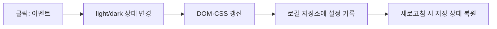

# B1-1 Round 04 — 03-1 공식 요구·설계 범위·수용 기준

> **30초 요약:** 이 단계에서는 웹페이지에 어떤 기능을 넣을지 **요구사항(Requirement, R)**을 확인하고, 무엇을 평가할지 **평가문항(Evaluation, E)**과 무엇을 배울지 **학습목표(Learning Objective, LO)**를 연결합니다. **실제 웹페이지 코드는 작성하지 않는 설계 단계**입니다.
>
> **판정:** 03-1 **PASS(공식 요구·설계 범위 문서 정적 검증에 한정)** · 현재 03-1~03-7 설계 문서 **PASS**, 03-8 **NOT_STARTED**, 04 소스 개발 승인 **PENDING**, 실제 런타임·학생 숙달·미션 CLEAR **NOT_VERIFIED**. 전체 최신 상태는 [03단계 통합 목차](README.md)를 기준으로 합니다.
>
> **이 파일의 유래:** 기존 `03-design/README.md`의 **03-1 C절 전체 및 03-1 역사적 검증 기록**을 독립 문서로 이동했습니다. 과거 PASS는 해당 검사 당시 스냅샷이며 신규 실행 결과가 아닙니다.

## A. 입문자 3분 Quick Start — 먼저 무엇부터 볼까요?

1. **0~1분:** 아래 C-1 원본 자료 표를 확인하고, 공식 미션 PDF와 평가 15문항이 왜 기준인지 살펴봅니다.
2. **1~2분:** C-2의 R01~R12 표 중 **R05(버튼·스크롤)** 한 줄을 골라 “어떤 행동이 필요한가”를 자기 말로 설명합니다.
3. **2~3분:** C-3의 D03을 보고 “300px 위로 버튼, 60px 상단 변화”가 **설계 기준이지 실제 실행 PASS가 아님**을 구별합니다.

**현재 할 일:** 읽기·종이 설명만 합니다. 설치·명령어 실행·파일 생성·배포는 하지 않습니다.

| 이동 | 무엇을 찾을까요? |
|---|---|
| [C. 03-1 원본 설계 내용](#stage03-scope) | 공식 근거 5종, R01~R12·D01~D10, 테마 예시 |
| [D. 03-1 역사적 검증](#stage03-history) | 완료 당시 PASS 기준·실제 정적 확인 결과 |
| [03-2 정보 구조](03-2-INFORMATION-ARCHITECTURE.md) | 요구를 실제 화면 영역으로 연결 |
| [03-3 파일 구조](03-3-FILE-RESPONSIBILITIES-AND-RESPONSIVE-LAYOUT.md) | HTML·CSS·JS 파일 책임 |
| [03단계 전체 README](README.md) | 03-1~03-8 최신 목차와 진도 |

## B. 이해하기 쉬운 용어

| 한글(영문·약어) | 쉬운 뜻 | 예 |
|---|---|---|
| 요구사항(Requirement, **R**) | 반드시 만들거나 지켜야 하는 조건 | R05 메뉴 열기/닫기 |
| 평가문항(Evaluation Item, **E**) | 결과와 원리를 확인할 질문 | E03 메뉴가 실제 동작하는가? |
| 학습목표(Learning Objective, **LO**) | 학습 후 스스로 설명·수행할 능력 | LO05 메뉴·스크롤 조건 설명 |
| 수용 기준(Acceptance Criteria) | PASS인지 나중에 검증할 관찰 조건 | 메뉴 두 번 클릭 후 닫힘 |
| 증빙(Evidence) | 결과를 확인할 화면·코드 버전·시각·로그 | 실제 Chrome 검사와 SHA |
| 필수(CORE) / 선택(BONUS) | 반드시 필요한 범위 / 선택적으로 추가하는 범위 | `map` 필수, `filter` 선택 |
| 미검증(NOT_VERIFIED) | 실제로 확인하지 않았음 | 미실행 브라우저 시험 |

**흔한 오해:** 설계에 R05가 쓰여 있어도 메뉴가 실제로 열리는 것은 아닙니다. 04 구현 승인 후 작성, 05 시험 후 증빙이 있어야 실행 결과를 평가합니다.

## C. 03-1 공식 요구·설계 범위·수용 기준 확정

### 1. 가장 먼저 기준 문서를 연결합니다

| 우선순위 | 실제 근거 | 이번 설계에서 하는 일 |
|---|---|---|
| 1 | [공식 B1-1 미션 PDF](https://drive.google.com/file/d/1YC6KKj-hCi54FzOhivZmetX0EQXFXXNy/view) | 필수 기능과 제약의 최우선 근거 |
| 2 | [공식 평가 15문항 원본](https://drive.google.com/file/d/1tRJdh0a2cX8x3nAkpKYM9b6aVfPKed6q/view) | 학습자가 설명·시연할 질문 확인 |
| 3 | [01 요구사항 73개 추적](../01-requirements/REQUIREMENTS-CATALOG.md) · [E01~E15](../01-requirements/EVALUATION-15-MAPPING.md) · [LO01~LO14](../01-requirements/LEARNING-OBJECTIVES.md) | 공식 원문의 해석을 ID로 연결 |
| 4 | [01 이슈 D01~D10](../01-requirements/SOURCE-CONFLICTS-AND-DECISIONS.md) | 상충하거나 선택 사항인 조건을 따로 처리 |
| 5 | [02 신규 공백 분석](../02-analysis/REQUIREMENT-GAP-MATRIX.md) · [02 검증](../02-analysis/VALIDATION-REPORT.md) | 예전 구현의 참고 지식과 이번 구현 필요 범위 구별 |

**공식 요구 추적의 의미:** **73개는 개별 기능 73개가 아니라 공식 문장을 쪼갠 검증 항목 73개**입니다. 01단계의 집계: CORE 59, BONUS 6, RECOMMENDED 1, GUIDANCE 1, CONSTRAINT 4, ALLOWED 1, PRIORITY 1. 이 분류를 변경하지 않습니다.

### 2. 요구 12개 영역 → 설계·시험 연결표

| 구분 | 이번 설계에서 누락하면 안 될 것 | 주요 평가 연결 | 후속 세부 단계 |
|---|---|---|---|
| R01 파일·도구 | index.html/css/js/images, 외부 연결, VS Code + Live Server | E06 | 03-3, 03-6 |
| R02 HTML·접근성 | header/nav/main/section/article/footer, Hero·About·Skills·Projects·Contact, alt·label | E05,E07 | 03-2, 03-6 |
| R03 CSS·반응형 | 변수·테마, Flex/Grid, 모바일 우선 768/1024px, hover | E01,E02,E08,E13,E15 | 03-3, 03-6 |
| R04 JS·DOM | const/let, defer, addEventListener, querySelector, classList, textContent/innerHTML | E09,E10 | 03-4, 03-5 |
| R05 상호작용 | 메뉴, 앵커, 맨 위 버튼, 60px 상단, 테마 저장, IntersectionObserver | E02,E03 | 03-4 |
| R06 문의 폼 | 이름·이메일·메시지, 필수값/형식 검사, 인접 오류, 성공 안내 | E05 | 03-5 |
| R07 ES6+·배열 | 화살표 함수, 템플릿·구조분해, map/forEach, 선택 filter | E12 | 03-5 |
| R08 GitHub API | fetch·async/await, 로딩/성공/빈값/403/오류/재시도 | E04,E11,E12 | 03-5, 03-6 |
| R09 상태→렌더 | 최소 3개 독립 이벤트→상태→화면 갱신 흐름 | E10,E14 | 03-4 |
| R10 Pages·제출 | URL·README·데스크톱/모바일/다크 캡처와 신규 SHA | E01~E05 | 03-6, 03-8 |
| R11 선택 보너스 | filter·타이핑·외부 전송·시스템 테마는 선택 취급 | E12 관련(선택 구현 여부 설명) | 03-5, 03-8 |
| R12 제약·우선순위 | UI 프레임워크/inline 금지, Chrome 검증, 기능·개념 이해 우선 | E06,E09,E10 | 03-3, 03-6 |

**검증 시점 구별:** 위 표는 미래 설계와 검증 대상을 연결한 **수용 계획**입니다. 코드·화면·API·배포 시험에서 실제 기능이 동작한 증거가 아닙니다.

### 3. 01단계 D01~D10 결정 쟁점 그대로 인계

| 쟁점 | 03-1 범위·선행 원칙 | 상세 결정 시점 |
|---|---|---|
| **D01** filter | `map` 필수, `filter` 선택. 임의로 CORE로 바꾸지 않음 | 03-5 |
| **D02** 별도 STATE 객체 | 이벤트→상태→렌더 3개 흐름은 필수. 상태 객체 사용 형태는 선택 설계 | 03-4 |
| **D03** 스크롤 기준 | 맨 위 300px, 상단 변화 60px을 기준으로 잡고 변경 시 README 기록 | 03-4 |
| **D04** Observer 임계값 | 0.2 이상 권장. 변화 시 이유·값 기록, 감속 모션 고려 | 03-4, 03-6 |
| **D05** Live Server | 공식 도구 조건 보존. 설치·동작은 현재 미확인이므로 자동 면제 아님 | 03-3, 03-6 |
| **D06** 기술·자산 제약 | React/Vue/jQuery/Bootstrap/Tailwind 금지, 공식 허용 자산은 구별 | 03-3 |
| **D07** 실제 폼 전송 | 필수는 유효성 검사·성공 안내, 외부 실제 전송은 별도 승인 보너스 | 03-5 |
| **D08** API 제한 숫자 | 과거 문서의 60회/시간 안내를 현재 실측값으로 주장하지 않음 | 03-5, 03-6 |
| **D09** innerHTML/XSS | 외부 데이터의 안전한 문자열 삽입 대책 필요; 공식 메서드 요구 임의 삭제 금지 | 03-5 |
| **D10** 실행·증빙 | 문서 PASS ≠ 신규 프로그램·평가 PASS; 테스트는 04 승인 후 05~07 단계 | 03-6, 03-8 |

### 4. 처음 배우는 사람을 위한 9단계 설계 사례 — 테마 변경

| 학습 순서 | 내용 |
|---|---|
| ① 용어 | 상태(State): 현재 테마 값, 이벤트(Event): 클릭 |
| ② 개념 | 클릭하면 상태가 바뀌고 페이지의 모양이 바뀜 |
| ③ 쉬운 비유 | 전등 스위치를 누르면 켜짐/꺼짐 표시와 밝기가 바뀜 |
| ④ 그림 | 아래 Mermaid 참고 |
| ⑤ 주요 코드 | `addEventListener`(클릭 감지), `classList`(스타일 상태 반영), `localStorage`(테마 저장)는 **향후 사용할 기술의 이름** |
| ⑥ 예상 흐름 | 클릭 → light/dark 변경 → CSS/DOM 반영 → 저장 → 새로고침 복원 |
| ⑦ 오류 | 버튼 누락, 저장소 사용 실패, 색상 대비 부족을 미리 고려 |
| ⑧ 종이 실습 | 첫 클릭·두 번째 클릭·새로고침 뒤 예상 색과 상태를 화살표로 표시 |
| ⑨ 평가 | “클릭과 상태는 왜 다른가요?”를 자기 말로 두 문장 설명 |

**참고:** [02단계 테마 버튼 교육용 코드](../02-analysis/README.md#stage02-review)는 읽기 연습에만 사용합니다. 그 예시는 **새로고침 상태 저장을 구현하지 않았으므로** 이번 설계의 필수 `localStorage` 복원 요건을 충족한 소스라고 판단하지 않습니다.

## D. 03-1 문서 검증 조건과 역사적 기록

> 아래는 **03-1을 처음 완료했을 당시의 검증 자료**를 본문 그대로 보존한 영역입니다. 당시 `README.md`의 17개 링크 등 수치는 *과거 검증 스냅샷*이며 이번 분리 후 새 파일의 링크 개수와는 다릅니다.

### D-1. 역사적 03-1 검증 조건 (해당 단계 당시)

**03-1 문서 범위 PASS를 내릴 수 있는 조건**

1. 공식 추적 영역 R01~R12, 평가 E01~E15, 학습목표 LO01~LO14가 [01단계 근거](../01-requirements/README.md)에 연결돼 있고, 03-1 문서에서는 설계 범위와 누락 위험을 모두 식별했는가?
2. 필수(CORE), 선택(BONUS), 권장(RECOMMENDED), 제약(CONSTRAINT)을 섞지 않았는가?
3. D01~D10 해석 쟁점을 빠짐없이 다음 세부 설계의 결정 시점에 넘겼는가?
4. README 링크·Mermaid 코드 펜스·상대 파일 경로에 정적 오류가 없는가?
5. 이전 코드·증빙·Git 기록을 보존하고, `mission.yml` 개발 승인 `PENDING`, `04-src/` 소스 미작성 상태를 유지했는가?
6. GitHub 커밋 후 실제 `main` 파일을 다시 읽어 변경 범위와 SHA를 확인했는가?

### 03-1 실제 검증 기록 (2026-10-26)

**실제 GitHub `main` 기준 커밋 `2724f5440bf41d31d0f87985912ba719dc297079`에서 문서 재조회 및 정적 검증을 수행했습니다.**

| 검증 항목 | 실제 결과 | 판정 |
|---|---|---|
| 01단계 원본 추적 ID | 요구 73개 / 평가 E01~E15 15개 / LO01~LO14 14개 / 해석 쟁점 D01~D10 10개 | **PASS — 기존 기록의 고유 ID 확인** |
| 03-1 범위 연결 | R01~R12 설계 12개 영역, D01~D10 쟁점 10개, 03-1~03-8 세부 단계 8개 표에서 확인 | **PASS — 문서 범위** |
| 상대 문서 링크 | `03-design/README.md` 내부 경로 링크 17개, 대상 경로 누락 0건 | **PASS — 정적 경로 검사** |
| Markdown / Mermaid | 코드 블록 구분선 총 4개(2쌍), Mermaid 흐름도 2개 | **PASS — 정적 문법 구조**, 화면 렌더링 미검증 |
| 신규 소스 | `04-src/` 아래 README만 확인; 새 HTML/CSS/JS 없음 | **PASS — 개발 미착수 상태 확인** |
| 승인·운영 | `mission.yml` 개발 승인 `PENDING`, 미션 실행 `NOT_STARTED` | **PASS — 승인 보존** |
| 실제 새 기능·WSL2·학습자 평가 | 새 소스·실행·브라우저 시험 및 구술 평가 미실시 | **NOT_VERIFIED** |

**한계:** 03-1 PASS는 **공식 요구와 설계 범위를 빠짐없이 문서로 연결했다는 의미**입니다. 세부 화면·구현·시험 설계(03-2~03-8)와 미션 CLEAR까지 완료됐다는 판정이 아닙니다. 실사용 입문자 이해도 역시 검증하지 않았습니다.

**미검증을 남기는 항목:** 실제 학습자 이해·설명 능력, WSL2·VS Code·Chrome 실행, 새 코드 동작, 배포·공식 평가·최종 CLEAR는 **NOT_VERIFIED / NOT_STARTED**입니다.

## E. 지금 단계에서 스스로 답해 보기

| 질문 | 예상 답 | 판정 경계 |
|---|---|---|
| R01~R12는 12개 기능인가요? | 12개 **요구 영역**이며 세부 추적은 총 73개 항목입니다 | 공식 요구 항목 개수와 구분 |
| `filter`를 꼭 만들어야 할까요? | 공식 표의 선택(BONUS) 기능입니다 | CORE로 임의 변경 금지 |
| '설계 문서 PASS'는 새 웹페이지 PASS인가요? | 아닙니다. 설계 조건과 실제 구현·시험은 별개입니다 | 실행은 NOT_VERIFIED |
| 요구·평가·학습은 어떻게 연결하나요? | R(요구) → 설계·코드 → 시험 → E(평가)·LO(이해) | 실제 평가·학습자 성취 미실시 |

**스스로 설명:** “03-1은 공식 요구를 설계·학습·시험으로 연결하는 단계입니다. 03-1의 PASS는 문서 검증일 뿐 실제 웹페이지가 완성됐다는 뜻은 아닙니다.”

**다음:** [03-2 정보 구조](03-2-INFORMATION-ARCHITECTURE.md) → [03-3 파일·반응형](03-3-FILE-RESPONSIBILITIES-AND-RESPONSIVE-LAYOUT.md). 지금 진행할 세부 단계는 [통합 README](README.md)의 최신 상태를 따릅니다.

[00~09 마스터 계획](../00-plan/MASTER-PLAN.md) · [01 공식 요구](../01-requirements/README.md) · [02 자산·환경 분석](../02-analysis/README.md) · [개발 승인](../mission.yml)
