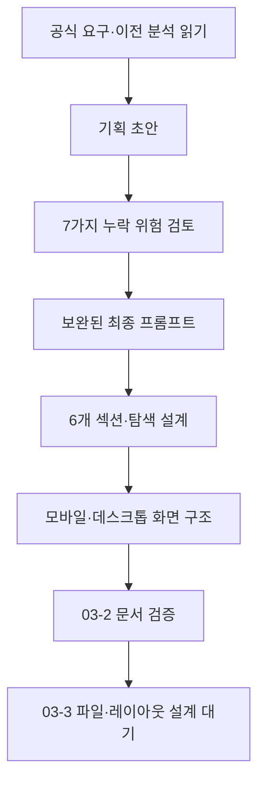
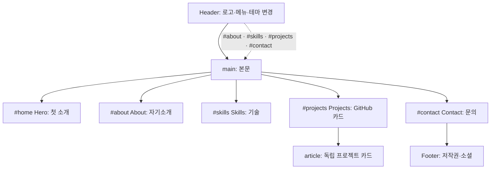
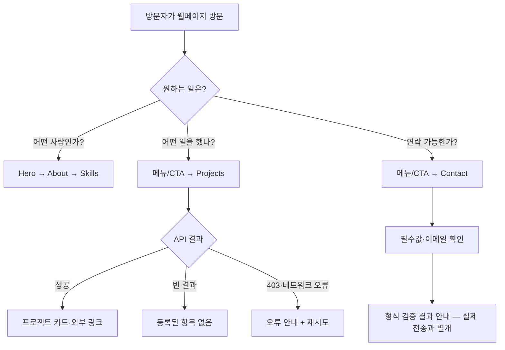

# B1-1 Round 04 — 03-2 정보 구조·화면 설계와 최종 기획 프롬프트

> **한눈에:** 이 문서는 **기획 프롬프트 초안 검토 → 수정·확정 → 화면·정보 구조 설계** 순서를 기록합니다. **새 웹페이지 코드나 디자인 시안 이미지를 생성한 결과가 아닙니다.**
>
> 단계 상태: `03-1=PASS(문서 기준)` / `03-2=PASS(기획 프롬프트·정보구조 설계 문서 정적 검증 기준)` / `03-3~03-8=NOT_STARTED` / `04 개발 승인=PENDING` / `MISSION_CLEAR=NOT_VERIFIED`.

## A. 처음 시작하기 — 30초 설명

웹페이지를 집이라고 생각하세요. **정보 구조(Information Architecture, IA)**는 방과 길을 정하는 설계도입니다. **와이어프레임(Wireframe)**은 가구와 버튼의 대략적인 위치를 표시한 밑그림이며, **사용자 흐름(User Flow)**은 방문자가 어디를 누르고 어디로 이동하는지 보여주는 길 안내입니다.

이 문서의 순서: **① 초안 작성·검토 → ② 최종 프롬프트 확정 → ③ 섹션/화면 설계 → ④ 예상 오류·접근성 검토 → ⑤ 종이 재현 → ⑥ 설계 검증**.



**이번 단계 제한:** [고정 00~09 계획](../00-plan/MASTER-PLAN.md), [03-1 설계 범위](README.md), [01 공식 요구](../01-requirements/REQUIREMENTS-CATALOG.md), [공식 평가 15문항](../01-requirements/EVALUATION-15-MAPPING.md), [02 과거 자산 검토](../02-analysis/LEGACY-ASSET-MATRIX.md)를 기준으로 합니다. 기존 Round 01~03 자료·이력은 변경하지 않습니다. `04-src/` 신규 소스 작성·실행·배포는 금지합니다.

## B. 기획 프롬프트 — 초안 → 검토 → 보완·확정

### B-1. 초기 기획 프롬프트 V0.1 (검토 대상, 사용하지 않음)

> B1-1 개인 소개 웹페이지의 Hero, About, Skills, Projects, Contact, Footer를 보기 쉽게 배치하고 모바일 메뉴와 데스크톱 화면의 구성을 정해 주세요. Mermaid로 전체 흐름을 그려 주세요. 아직 코드는 작성하지 마세요.

**검토 결과:** 이 초안은 출발점이지만 아래 중요한 조건을 강제하지 못하므로 **최종 사용 불가(보완 필요)**입니다.

| 점검 | 누락 위험 | V1.0 개선 |
|---|---|---|
| A1 | HTML 의미 요소 `article`, `label`, `alt` 미언급 | 시맨틱 랜드마크·프로젝트 카드·폼 접근성 명시 |
| A2 | 작은 화면과 키보드 읽기·탐색 흐름 누락 | 모바일/데스크톱 와이어프레임·포커스 순서 포함 |
| A3 | GitHub API의 성공 외 상태 누락 | 로딩·성공·빈 결과·403·네트워크 실패·재시도 각각 설계 |
| A4 | 폼 성공 UI가 실제 메시지 발송으로 오인될 위험 | 검증 완료/실제 전송 불가를 정직하게 구분 |
| A5 | CORE/선택 보너스·과거 Round의 경계 누락 | 필수·선택·증빙 상태·신규 소스 경로 고정 |
| A6 | 확인되지 않은 개인정보·소개 문구가 가공될 위험 | 미확정 사용자 정보는 플레이스홀더·후속 확인 |
| A7 | 설계 범위가 실제 구현·시험으로 확장될 위험 | 03-2 IA/UI 설계만 수행, 세부 흐름은 03-3~03-8에 인계 |

### B-2. 최종 기획 프롬프트 V1.0 (검토 사항 반영·재사용 가능)

> **역할:** B1-1 제2기 개인 웹 포트폴리오를 설계하는 사용자 경험(User Experience, UX) 기획자이자 입문자 교육 설계자.
>
> **목표:** 공식 필수 요구를 빠뜨리지 않고, 초보자가 그림과 쉬운 말로 설명할 수 있는 **단일 페이지 개인 소개 웹사이트**의 정보 구조(IA), 섹션별 역할, 탐색 경로, 모바일/데스크톱 와이어프레임을 설계한다.
>
> **입력 우선순위:** ① B1-1 공식 미션 PDF ② 공식 평가 15문항 ③ `01-requirements/REQUIREMENTS-CATALOG.md` 및 결정 쟁점 D01~D10 ④ `02-analysis/REQUIREMENT-GAP-MATRIX.md` ⑤ `03-design/README.md`. 모호하면 공식 요구를 임의로 바꾸지 말고 **결정 대기 또는 이후 세부 설계로 인계**한다.
>
> **불변 제약:** 기존 00~09 목차, Round 01~03 소스·이력·증빙 보존. 새 소스의 유일한 위치는 `training/round-04-agent/04-src/`이며 **04 개발 승인 PENDING**인 지금 작성·복사·실행·배포·병합하지 않는다. AWS·iMac은 보류. CORE·BONUS 혼동 금지. 과거 PASS를 새 PASS로 인정하지 않는다.
>
> **산출물 요구:**
>
> 1. Hero·About·Skills·Projects·Contact·Footer **6개 콘텐츠 영역**과 전역 Header/Navigation·Back-to-top을 구분한 사이트 맵 및 메뉴 앵커 ID 계획.
> 2. `header`, `nav`, `main`, `section`, `article`, `footer`, `form`, `label`, `alt`의 **의미상 배치와 이유**. `article`은 독립적인 프로젝트 카드에 사용하도록 설계한다.
> 3. 모바일 우선(Mobile First) 화면과 태블릿/데스크톱 화면의 **ASCII 와이어프레임(개념도)**, 가로 넘침 없는 순서와 최소 375·768·1024px 검증 지점을 명시하되 CSS 구현은 03-3에 인계한다.
> 4. 방문자 관점의 **대표 여정 3개 이상**: 소개 읽기·프로젝트 확인·문의하기. 내비게이션·Hero 행동 유도(Call To Action, CTA)·앵커 목적지를 모호하지 않게 작성한다.
> 5. 모바일 메뉴 닫힘/열림·테마 변경·위로 가기·스크롤 노출을 화면 요소 관점에서 설명한다. 상태 전이·숫자 임계값의 상세 명세는 03-4에 인계한다.
> 6. GitHub API 프로젝트 카드 영역의 **로딩/성공/빈 결과/HTTP 403/네트워크 실패/재시도**를 서로 구분한다. 데이터·비동기·보안 상세는 03-5에 인계한다.
> 7. Contact에서 이름·이메일·메시지·필드별 오류·폼 상태 안내를 배치하고, **유효성 검사 완료가 실제 메시지 발송을 뜻하지 않음**을 사용자에게 명확히 알린다. 외부 전송은 선택·별도 승인.
> 8. 키보드 포커스·Skip link·레이블·대체 텍스트·정보 전달 색상 의존 방지·감속 모션과 반응형 검증 포인트를 표로 남긴다. 실행 검증은 05 이후.
> 9. 방문자 데이터·사진·소셜 주소 등 미확인 사실은 **플레이스홀더(나중에 채울 항목)**로 표시한다. 임의 개인정보·프로젝트·실제 전송 성과를 만들지 않는다.
> 10. 각 영역마다 **R(요구 ID)·E(평가 ID)·LO(학습목표)·03-3~03-7 인계**를 연결하고, 입문자용 용어→개념→비유→Mermaid→요소→예상 흐름→오류→종이 연습→평가를 포함한다.
>
> **검토 기준:** 항목 누락/과잉 기능/시맨틱 불일치/모바일 탐색/입력·API 실패 상태/학습자 난이도/개인정보·보안/승인 경계를 확인하고 수정한다. 설계 문서만 PASS할 수 있고 실제 구현·브라우저·학습 숙달·최종 CLEAR는 `NOT_VERIFIED`로 남긴다.

**프롬프트 수정 판정:** A1~A7 누락 위험이 최종 요구사항 1~10에 모두 대응합니다. **기획 프롬프트의 내용·범위 점검 완료(문서 검토 기준)**이며 실제 웹앱 구현·사용자 테스트가 완료됐다는 의미가 아닙니다.

## C. 확정 프롬프트로 작성한 03-2 설계 산출물

### C-1. 사이트 맵(Site Map)과 앵커 ID

방문자가 한 페이지를 위에서 아래로 읽는 구조이며, 상단 메뉴를 누르면 해당 위치로 이동하도록 설계합니다.



| 페이지 영역 | 계획 ID 또는 랜드마크 | 방문자에게 보이는 내용 | 대표 행동·이동 | 요구→평가→학습 |
|---|---|---|---|---|
| Header + Nav | `header`, `nav`, 건너뛰기 링크 | 사이트 식별·소개/기술/프로젝트/문의 메뉴·테마 | `#home` 등 앵커, 모바일 메뉴 열기/닫기 | R02-01,R02-05,R03-08,R05-01 → E03,E07 → LO02,LO05 |
| Hero (첫 소개) | `section#home` | 페이지 주제·한 줄 소개·CTA 2개 | `#projects`, `#contact`로 이동 | R02-02,R05-02 → E03,E07 → LO02,LO05 |
| About (자기소개) | `section#about` | 개인 소개 요약·프로필 이미지·소개 글 | 프로필 정보 읽기 | R02-02,R02-06 → E07 → LO02 |
| Skills (기술) | `section#skills` | HTML·CSS·JS 등 실제 확인되는 기술 목록 | 기술 설명 읽기 | R02-03,R02-01 → E07 → LO02 |
| Projects (프로젝트) | `section#projects`, 카드 `article` | GitHub 공개 저장소 카드/상태 메시지·재시도 | 실제 공개된 프로젝트 상세 링크 선택 | R02-03,R08-01~R08-08 → E04,E07,E11,E12 → LO02,LO09 |
| Contact (문의) | `section#contact` 내부 `form` | 이름·이메일·메시지·각 필드 오류·결과 안내 | 폼 입력·검증 | R02-04,R02-07,R06-01~R06-05 → E05,E07 → LO02,LO07 |
| Footer (하단) | `footer` | 저작권·검증된 소셜 링크·맨 위 이동 | `#home` 또는 맨 위 버튼 | R02-04,R05-03 → E03,E07 → LO02,LO05 |

**설계 선택:** `<main>`은 페이지에 한 번만 사용하고 그 안에 Hero~Contact의 주요 섹션을 둡니다. Footer는 본문 다음에 배치합니다. `article`은 프로젝트별로 독립적인 제목과 링크를 갖는 카드에 사용합니다. 이것은 03-2의 **태그 배치 계획**이지 실제 HTML 작성이 아닙니다.

### C-2. 화면 구조 와이어프레임(Wireframe) — 교육용 개념도

**작은 화면(예: 375px, 모바일 우선) — 위에서 아래로 한 줄씩**

```text
┌─────────────────────────────┐
│ [건너뛰기] (키보드 포커스시)│
│ 로고        [테마] [☰ 메뉴] │
│ 메뉴 열림 시 세로 메뉴       │
├─────────────────────────────┤
│ Hero: 한 줄 소개            │
│ [프로젝트 보기] [문의하기]   │
├─────────────────────────────┤
│ About: 이미지 + 자기소개    │
├─────────────────────────────┤
│ Skills: 기술·설명(한 열)     │
├─────────────────────────────┤
│ Projects: 상태 안내         │
│ [프로젝트 카드 1]           │
│ [프로젝트 카드 2] ...       │
├─────────────────────────────┤
│ Contact: 이름/이메일/메시지 │
│ [필드별 오류] [검증 버튼]    │
├─────────────────────────────┤
│ Footer: 링크·저작권 [↑]      │
└─────────────────────────────┘
```

**넓은 화면(예: 1024px 이상) — 메뉴 가로 배치·카드 다열 검토**

```text
┌────────────────────────────────────────────────────┐
│ [건너뛰기] 로고 | 소개 기술 프로젝트 문의 | 테마  │
├────────────────────────────────────────────────────┤
│ Hero: 소개 문구          | 대표 설명·CTA             │
├────────────────────────────────────────────────────┤
│ About: 프로필 이미지     | 소개 본문                │
├────────────────────────────────────────────────────┤
│ Skills: 기술 항목 1  | 기술 항목 2 | 기술 항목 3│
├────────────────────────────────────────────────────┤
│ Projects: 카드 1     | 카드 2     | 카드 3     │
│ 로딩·빈 결과·오류 안내는 이 영역에서 대체 표시  │
├────────────────────────────────────────────────────┤
│ Contact: 이름 / 이메일 / 메시지 / 결과 상태     │
├────────────────────────────────────────────────────┤
│ Footer: 저작권 / 확인된 소셜 링크 / 위로 가기   │
└────────────────────────────────────────────────────┘
```

**화면 폭 설계 경계:** 375px는 읽기 쉬운 한 열 배치 후보, 768px는 메뉴·카드 배치 전환의 **시험 경계**, 1024px는 넓은 화면 배치 후보입니다. **정확한 CSS 분기와 레이아웃 확정은 03-3**, 실제 폭별 PASS는 05 테스트 후 판단합니다. 와이어프레임의 가로 폭은 실제 렌더 결과가 아닙니다.

### C-3. 방문자 여정(User Flow) 세 가지



| 사용자 여정 | 시작 | 중간 | 예상 결과·실패 대안 |
|---|---|---|---|
| 사람 알아보기 | 첫 화면 | Hero → About → Skills | 이력·기술 파악, 사진 누락 시 텍스트 소개로 의미 유지 |
| 프로젝트 보기 | 상단 메뉴 또는 Hero CTA | `#projects` → 카드/상태 영역 | 카드 링크, 없으면 빈 결과, 실패하면 오류·재시도 |
| 문의하기 | `#contact` 메뉴 또는 Hero CTA | 이름·이메일·메시지 기입 → 유효성 검사 | 필드 가까이 오류 또는 “형식 검증 완료(미전송)” 안내 |

### C-4. 컴포넌트(화면 요소)의 상태와 예외 설계

| 화면 요소 | 기본 화면 | 다른 상태·사용자 안내 | 후속 상세 설계 |
|---|---|---|---|
| 상단 메뉴 | 넓은 화면은 가로 링크, 모바일은 햄버거 버튼 | 열림/닫힘, 현재 위치, 키보드 포커스 표시 | 03-4 메뉴 상태 |
| 테마 선택 | 밝은 모드 또는 복원된 사용자 설정 | 다크 전환, 저장 실패 시 현재 화면 유지/안내 | 03-4 저장·상태 |
| 위로 가기 | 상단 가까이에서는 감춤 | 스크롤 기준 후 보임, 누르면 최상단 이동 | 03-4 300px 기준 |
| 프로젝트 목록 | 로딩 문구 | 성공: `article` 카드 / 빈 결과: 항목 없음 / 403: 요청 제한·권한 오류 안내 / 통신 실패: 네트워크 안내 / 재시도 버튼 | 03-5 데이터·오류 |
| 문의 폼 | 세 필드와 제출·검증 버튼 | 빈 값/형식 오류: 필드 가까이 메시지 / 성공 UI: **형식 검증 완료, 메시지 실제 미전송** | 03-5 폼·보안 |
| 스크롤 노출 효과 | 콘텐츠는 접근 가능하게 표시 | 동작 환경에서만 부드러운 등장, 감소된 모션 선호 시 효과 억제 | 03-4, 03-6 |

**정직한 사용자 안내 문구(초안):** “입력 형식을 확인했습니다. 이 데모에서는 메시지를 전송하지 않습니다.” 공식 문서의 성공 상태 UI를 유지하면서 **선택 사항인 실제 외부 전송이 성공한 것처럼 오인시키지 않도록** 합니다. 구체적인 폼 버튼 텍스트·동작은 03-5에서 결정합니다.

### C-5. 접근성·콘텐츠·보안 계획

| 검토 영역 | 03-2 기획 선택 | 실제 검증 시점 |
|---|---|---|
| 건너뛰기 링크(Skip Link) | 키보드 사용자가 `main`으로 바로 이동하도록 계획 | 05 키보드 검사 |
| 의미 구조(Semantic HTML) | `nav`·`main`·`section`·`article`·`form` 배치와 각 역할 구별 | 05 DOM/접근성 검사 |
| 제목 순서 | Hero에서 유일한 H1, 각 섹션 H2, 프로젝트 카드 H3 계획 | 05 DOM 검사 |
| 이미지 대체 텍스트 | About 프로필에 의미 있는 alt, 장식 이미지는 설명 중복 최소화 | 05 시각·보조기술 검사 |
| 입력 도움말 | `label for` ↔ `input id`; 오류는 필드와 시각·프로그램상 연결 | 03-5/05 |
| 색·움직임 | 대비, 포커스 표시, 색만으로 오류를 알리지 않음, 감속 모션 고려 | 03-6/05 |
| 외부 프로젝트 링크 | 실제 확인된 공개 URL만 표시, 새 창이면 안전한 링크 속성 계획 | 03-5/05 |
| 공개 개인정보 | 실명·이미지·이메일·소셜 URL은 **미확정**, 임의 추정·공개 금지 | 구현 전 콘텐츠 승인 |
| API 표시 보안 | 외부 API 응답을 HTML 코드처럼 해석하지 않도록 **교차 사이트 스크립팅(Cross-Site Scripting, XSS)** 위험을 다루고, 안전한 DOM 텍스트 삽입을 계획 | 03-5/05 |

**미확정 콘텐츠 등록부:** 실제 사용자 표시 이름, 자기소개 문구, 프로필 사진, 기술 수준, 공개 프로젝트 선별 기준, 소셜 링크, 문의 기능의 최종 설명 문구. 03-2의 **자리표시자이며 이미 확보한 개인정보가 아닙니다**. 04 구현 전 반드시 확인하고, 별도 승인이 필요한 개인정보·외부 서비스는 보류합니다.

## D. 처음 배우는 사람을 위한 설명·재현·검토

### D-1. 9요소 학습 흐름 — 상단 메뉴 한 가지를 예시로

| 9단계 | 이번 설계에서 할 수 있는 일 |
|---|---|
| 용어 | 내비게이션(Navigation)은 목적지 메뉴, 앵커(Anchor)는 같은 페이지의 이동 위치 |
| 개념 | 메뉴에서 `프로젝트`를 선택하면 `#projects` 영역으로 이동하도록 계획 |
| 쉬운 비유 | 건물 안내판에서 “3층 프로젝트 전시”를 보고 그 위치로 가는 것 |
| Mermaid | 위 사이트 맵에서 Header → Projects 경로 따라가기 |
| 주요 요소 | `nav`, 링크의 `href`, 섹션의 `id`가 일치해야 한다는 계획(코드 작성 아님) |
| 예상 흐름 | 메뉴 선택 → 대상 섹션 확인 → 화면 이동 |
| 오류 해결 | `href`와 `id`가 다르면 올바른 위치로 이동하지 못하므로 설계표 대조 |
| 종이 실습 | `소개/기술/프로젝트/문의`를 각각 `#about/#skills/#projects/#contact`로 연결 |
| 자기 평가 | “메뉴 항목과 목적지 ID는 왜 같아야 하나요?”를 두 문장으로 설명 |

### D-2. 입문자 스스로 답해 보는 질문

1. Hero와 About을 따로 둔 이유는 무엇인가요?
2. `article`을 각 프로젝트 카드에 사용하도록 설계한 이유는 무엇인가요?
3. API 결과가 빈 배열일 때와 네트워크 오류일 때 같은 문구를 보여줘도 될까요?
4. Contact 폼의 입력 검증이 끝났다고 “메일을 보냈습니다”라고 표시해도 될까요?
5. 모바일 메뉴가 열렸을 때 키보드로 선택하고 닫을 수 있는지 **실제 검증**은 어느 단계인가요?

**예상 설명:** ① 첫 인상/상세 소개 구분 ② 각 카드가 독립 콘텐츠이기 때문 ③ 다르게 안내 ④ 실제 전송이 없다면 안 됨 ⑤ 05단계 브라우저/접근성 검증. **종이 설명과 실사용 이해도는 아직 평가되지 않았습니다**.

## E. 설계 수용 기준·03-3 인계

| 03-2 문서 확인 대상 | PASS 기준(문서에 한정) |
|---|---|
| 기획 프롬프트 수정 | V0.1·누락 위험 A1~A7·보완된 V1.0·산출물을 모두 기록 |
| 필수 정보 구조 | Hero/About/Skills/Projects/Contact/Footer 6영역 + 전역 Header/Navigation |
| 시맨틱·앵커 | `#home`/`#about`/`#skills`/`#projects`/`#contact`, `article`/폼/`label`/alt/제목 위계 |
| 방문자 여정 | 소개 확인·프로젝트 보기·문의하기 3개와 실패 대안 |
| 화면 밑그림 | 모바일(375px 예시), 데스크톱(1024px 예시) 모두 작성; 768px 전환 설계 인계 |
| 주요 상태·보안 | 프로젝트 6개 상태, 폼 실제 미전송 구분, 접근성·공개 정보 미확정 표시 |
| 요구·평가 연결 | 섹션별 R/E/LO 및 03-3~03-7 상세 설계 인계 |
| 금지·승인 | 기존 Round 보존, 신규 소스 미작성, `owner_mission_development_approval=PENDING` |
| GitHub 재검증 | 새 문서·03 README 상대 링크, 새 커밋 SHA, 실제 변경 파일만 확인 |

**03-3 인계:** 위에서 정한 섹션 ID와 읽기 순서를 기준으로 실제 HTML/CSS/JS **파일 책임·연결 방식·레이아웃 상세 규칙의 설계 문서만** 만듭니다. 03-4에서 이벤트·상태·스크롤 숫자, 03-5에서 API·폼·출력 보안, 03-6에서 반응형/접근성/테스트, 03-7에서 학습 체계를 구체화합니다. 03 전체 PASS는 03-8의 별도 종합 점검 후에만 가능합니다.

### 03-2 기획·설계 독립 검증 결과 (2026-10-26)

기획 초안 V0.1의 누락 위험 **A1~A7 7개**를 확인하여 최종 프롬프트 V1.0으로 보완하고, 같은 프롬프트를 기준으로 위 C~D 설계를 도출했습니다. 단순 프롬프트 작성과 실제 설계 문서 작성을 구분하여 확인했습니다.

| 검증 항목 | 확인된 사실 | 판정 |
|---|---|---|
| 기획 초안·리뷰·수정 | V0.1 / 위험 7개 A1~A7 / V1.0 / 산출물 C~D 존재 | **PASS — 문서 구성** |
| 필수 콘텐츠·앵커 | 6개 콘텐츠 영역과 5개 `#home`·`#about`·`#skills`·`#projects`·`#contact` | **PASS — 정적 표기** |
| 화면·방문자 여정 | 375/768/1024px 계획, 모바일·데스크톱 문자 와이어프레임, 대표 여정 3개 | **PASS — 설계 자료 존재** |
| 오류·접근성·보안 | API 로딩/성공/빈/403/네트워크 실패/재시도, 폼 미전송 설명, XSS·키보드·사진·주소 미확정 | **PASS — 항목 식별** |
| Mermaid·문서 링크 | GitHub `main` `f21c448d796c9f1573b32995374708980a8be25b`에서 Mermaid 블록 3개, 내부 상대 링크 10개, 대상 누락 0개, 코드펜스 개폐 짝수 확인 | **PASS — 정적 검사** |
| 개발 금지 유지 | `04-src/` 아래 실제 파일은 `README.md` 하나. 프로그램 실행·실제 UI 시험 실시하지 않음 | **PASS — 미구현 상태 보존**, 런타임 NOT_VERIFIED |

**검증 한계:** Mermaid의 GitHub 화면 렌더 품질과 입문자 실제 이해도·접근성·웹페이지 동작은 시험하지 않았습니다. 이 검증은 **03-2 기획·설계 문서**에 한정되고 `03-3~03-8` 및 03 전체 완료를 뜻하지 않습니다.

**상태 구분:** 본 문서가 GitHub에 저장돼도 **설계 문서 정적 PASS의 후보**일 뿐입니다. 실제 페이지 화면, 브라우저, API 요청, 폼 전송, 학습자 숙달, 미션 CLEAR는 `NOT_VERIFIED`입니다.

[03단계 시작 안내](README.md) · [공식 요구 73개](../01-requirements/REQUIREMENTS-CATALOG.md) · [평가 E01~E15](../01-requirements/EVALUATION-15-MAPPING.md) · [이전 분석](../02-analysis/README.md) · [현재 승인 상태](../mission.yml)
