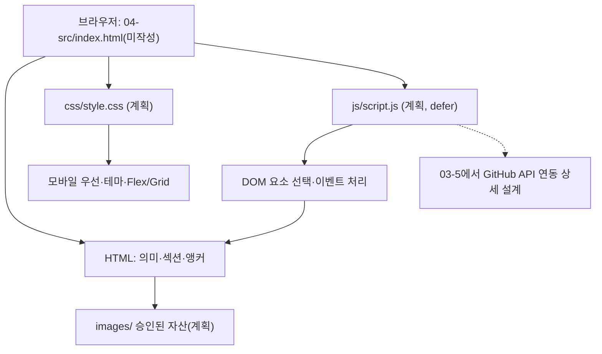
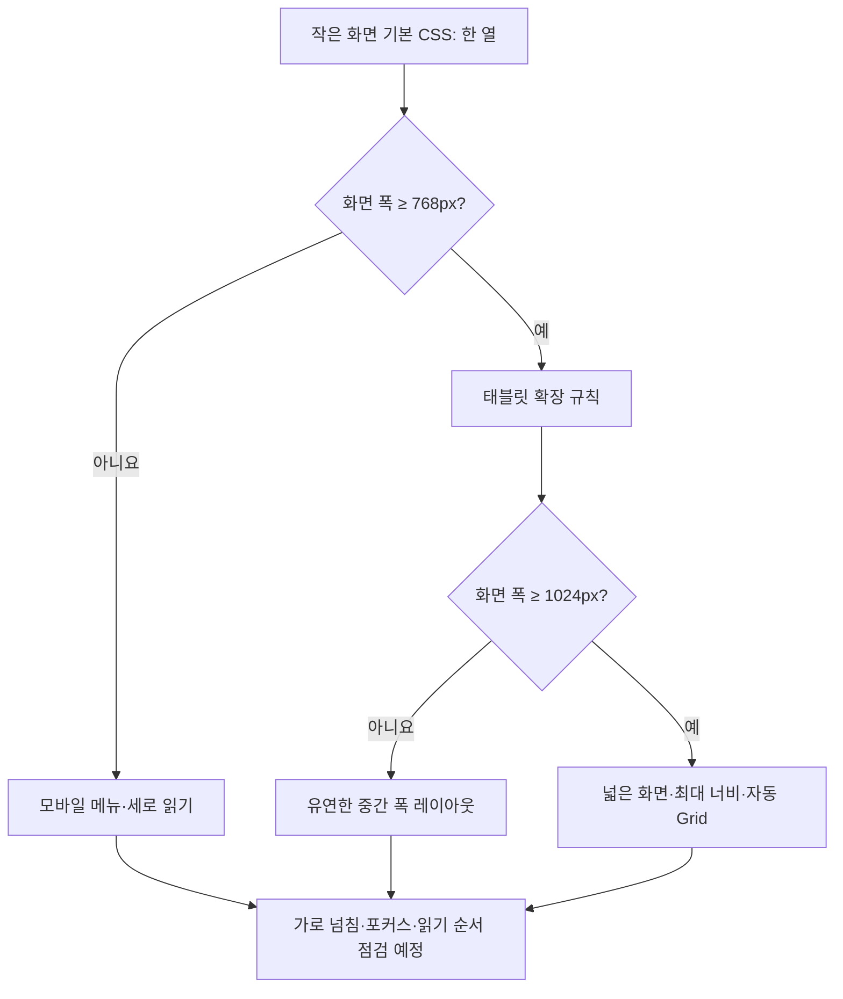

# B1-1 Round 04 — 03-3 파일 책임·연결·모바일 우선 반응형 설계

> **30초 요약:** 03-2에서 정한 한 페이지의 내용과 이동 경로를 HTML(구조), CSS(모양), JavaScript(동작), images(이미지)로 나누어 **어떤 파일이 무엇을 책임질지** 정합니다. 768px·1024px 화면 전환과 안전한 연결 방법을 설계하되 **새 코드 파일은 만들지 않습니다**.
>
> **판정 구분:** `03-1/03-2=PASS(문서 기준)` / `03-3=설계 작성 및 검증 중` / `03-4~03-8=NOT_STARTED` / `04 개발 승인=PENDING` / `실제 런타임·학습자 숙달·CLEAR=NOT_VERIFIED`.

## A. 처음 시작하기 — 설명부터 배우기

- **용어:** 하이퍼텍스트 마크업 언어(HyperText Markup Language, HTML)는 **내용·의미**, 캐스케이딩 스타일 시트(Cascading Style Sheets, CSS)는 **색·배치**, 자바스크립트(JavaScript, JS)는 **클릭·데이터 처리**입니다.
- **쉬운 비유:** HTML은 집의 방·문, CSS는 벽 색과 가구 배치, JS는 자동문 제어장치, `images/`는 집 안에 걸 그림입니다.
- **반응형 웹 디자인(Responsive Web Design, RWD):** 화면 폭에 맞추어 한 줄·여러 줄 배치가 달라지는 방식.
- **모바일 우선(Mobile First):** 작은 화면에 필요한 구조를 기본값으로 설계한 후, 넓어지면 규칙을 추가하는 방식.
- **미디어 쿼리(Media Query):** 화면 폭 같은 조건에 따라 CSS를 다르게 적용하는 규칙.
- **유연한 상자 배치(Flexible Box Layout, Flexbox):** 주로 한 줄 또는 한 방향 정렬; **그리드(Grid):** 행·열을 함께 배치하는 격자.
- **브레이크포인트(Breakpoint):** 배치가 달라지는 화면 폭의 경계.
- **상대경로(Relative Path):** 현재 파일 위치를 기준으로 연결 대상을 찾는 주소.

**종이로 따라 하는 순서:** ① 아래 파일 트리에서 이름 찾기 → ② 각 파일 역할 말하기 → ③ 375/768/1024px 카드 배치를 그림으로 그리기 → ④ 오류를 예상해 보기 → ⑤ 설계와 실행 PASS를 구별하기.

## B. 기획 프롬프트 작성 → 검토 → 보완

### B-1. 기획 초안 V0.1 — 검토 대상

> B1-1 한 페이지 포트폴리오를 HTML·CSS·JavaScript로 나누고, 모바일과 데스크톱에서 보기 좋은 레이아웃을 계획해 주세요. 신규 코드는 작성하지 마세요.

이 초안은 **명세로 채택하기에는 불충분**합니다.

| 점검 ID | 초안의 누락·위험 | 최종 V1.0에서 보완한 조건 |
|---|---|---|
| P01 | 공식 파일명·상대경로 부재 | `index.html`, `css/style.css`, `js/script.js`, `images/`와 외부 연결 계약 |
| P02 | 03-2의 고정 섹션 ID와 시맨틱 구조 누락 | `#home/#about/#skills/#projects/#contact` 및 `article`, `label`, `alt` |
| P03 | 모바일 우선·768·1024px 기준 불명확 | 기본 0~767px, 768~1023px, 1024px 이상으로 단계별 계획 |
| P04 | Flex·Grid·CSS 변수·다크 테마 설명 없음 | 사용 위치·선택 근거·변수 및 색상 상태 계약 |
| P05 | 메뉴 표시 조건·넘침·키보드·감속 모션 미고려 | 작은 화면 메뉴·`focus-visible`·가로 넘침·`prefers-reduced-motion` 검토 |
| P06 | JS 역할이 HTML/CSS와 섞이고 금지 제약 미정의 | 외부 `defer`, `const/let`, `addEventListener`와 금지 기술 명시 |
| P07 | 보안·API 동작·테스트 책임 경계 불분명 | 03-4 상태, 03-5 API·폼·XSS, 03-6 실측·접근성 및 05 실행 시험으로 인계 |
| P08 | 사용자 정보 추정 및 이전 코드 재사용 위험 | 플레이스홀더 사용, Round 01~03 원본 보존, 신규 소스 미작성 |

### B-2. 보완한 최종 기획 프롬프트 V1.0

> **역할:** 공식 B1-1 요구사항에 충실한 웹 기술 설계자이자 입문자 교사.
>
> **입력:** [공식 요구 추적표](../01-requirements/REQUIREMENTS-CATALOG.md) R01~R05 및 R12, [평가 15문항](../01-requirements/EVALUATION-15-MAPPING.md), [학습목표](../01-requirements/LEARNING-OBJECTIVES.md), [03-2 정보 구조](03-2-INFORMATION-ARCHITECTURE.md), [이슈 D01~D10](../01-requirements/SOURCE-CONFLICTS-AND-DECISIONS.md), [02 환경 조사](../02-analysis/ENVIRONMENT-BASELINE.md).
>
> **목적:** 03-2의 구조·앵커·의미 요소를 보존하면서 새로운 `04-src/` 구현이 **향후 승인되었을 때 사용할 파일 트리, 책임 경계, 리소스 연결, 모바일 우선 레이아웃, CSS 변수, 테마, 화면 경계 시험 명세**를 설계한다.
>
> **필수 결과:** (1) 경로별 파일·폴더 계약 (2) HTML에서 외부 CSS 및 `defer` JS로 이어지는 경로 그림 (3) 375/767/768/1023/1024px 화면 배치 조건 (4) 네비게이션 Flexbox·프로젝트 Grid 사용 이유와 반응형 카드 수의 유동성 (5) `:root`·다크 테마 디자인 토큰(Design Token: 공통 색·간격 값) 계약 (6) hover와 키보드 포커스·감속 모션 규칙 (7) 의존성 금지·인라인 금지·실제 이미지와 개인정보 미확정 (8) R/E/LO 추적과 03-4~03-6 및 05 테스트 인계 (9) 쉬운 비유·Mermaid·종이 재현·오류/검증 표.
>
> **절대 제한:** 기존 00~09 목차·Round 01~03·루트 파일·배포·증빙 보존. React/Vue/jQuery/Bootstrap/Tailwind 등 금지. `04-src/`에 HTML/CSS/JS 작성·복사·실행하지 않음. 서비스 설정·브랜치·Secret 변경, 패키지 설치·명령 실행·배포 금지. AWS/iMac 보류. `mission.yml` 승인 `PENDING` 보존. 문서 PASS를 실제 웹·접근성·학습자 숙달 PASS로 오인하지 않는다.
>
> **자체 품질 확인:** P01~P08이 각각 설계 산출물에 반영됐는지 확인하고, 문서 링크·Mermaid·금지 범위·미확인 사항·다음 단계 인계를 검토해 수정한다.

**검토 결론:** V0.1에서 식별한 P01~P08의 위험을 V1.0에서 모두 조건화했습니다. 아래 C~F는 **이 최종 프롬프트에 따른 설계 산출물**입니다.

## C. 파일과 리소스 연결 설계

### C-1. 04단계에서 작성할 *예정* 구조 — 현재 실재 파일 목록 아님

```text
training/round-04-agent/
└── 04-src/                  ← 승인 전에는 안내 README만 실재
    ├── README.md            ← 현재 존재하는 안내문, 이후 문서 보완 가능
    ├── index.html           ← 계획: 시맨틱 문서와 섹션
    ├── css/
    │   └── style.css        ← 계획: 모바일 우선 배치·테마
    ├── js/
    │   └── script.js        ← 계획: 이벤트·상태·폼·API
    └── images/
        └── [승인된 이미지]  ← 계획: 권한 확인된 파일만 추가
```

**중요:** `04-src/index.html`, `04-src/css/style.css`, `04-src/js/script.js`, `04-src/images/`는 **계획 경로**입니다. GitHub 현재 트리에 이 파일·폴더가 존재한다고 주장하지 않습니다. 처음부터 불필요한 `build/`, `dist/`, `node_modules/`, 패키지 도구를 추가하지 않습니다.

| 계획 대상 | 단일 책임 | 의존·연결 계약 | 공식 근거·평가 |
|---|---|---|---|
| `index.html` | 한 페이지의 문서 의미·제목·링크·폼·접근성 대상 | 헤드에서 `css/style.css` 연결, `js/script.js`를 외부 `defer`로 연결; 섹션 ID 일치 | R01-01~02,R02-01~07,R04-01 → E06,E07 |
| `css/style.css` | 반응형 배치·글자·색상·그리드·메뉴 보임·시각 전환 | HTML의 class/속성 상태를 스타일링; DOM 이벤트·데이터 요청을 대신하지 않음 | R03-01~10 → E01,E02,E08,E13,E15 |
| `js/script.js` | 이벤트 등록, 상태 처리, GitHub 공개 데이터·폼 검증·화면 갱신 | HTML에 인라인 이벤트 금지; 선택자·이벤트·안전한 DOM 책임 | R04-01~08,R05-01~06 → E02,E03,E09,E10 |
| `images/` | 승인된 프로필·장식 이미지의 보관 | 상대경로로 연결하고 HTML 이미지에 적절한 `alt`; 실물 확정 전 내용 추정 금지 | R01-01,R02-02,R02-06 → E07 |
| `04-src/README.md` | 나중에 작성할 실사용·선택 기능·변경값·배포 URL 설명 | 향후 실제 수치·시험·출처·한계만 기록; 현재 배포 성공 주장 금지 | R05-03~07,R10-03 |

**연결 설계 비유:** `index.html`이 책의 본문이라면 CSS는 글꼴·색을 정하는 편집 지침이고, JS는 버튼에 반응하는 작업 지침입니다. 파일은 나누되 같은 폴더 구조 안에서 경로를 정확히 연결합니다.



**경로 오류 예방 계약:** `index.html`이 `04-src/` 루트에 있으므로 CSS 연결 경로는 `css/style.css`, JS는 `js/script.js`, 이미지 예시는 `images/[승인된파일]`입니다. 기존 저장소 루트 `/css/style.css`처럼 **슬래시로 시작하는 절대 웹 경로는 GitHub Pages의 하위 경로 배포에서 잘못 연결될 수 있으므로** 이번 설계에서는 사용하지 않습니다. `defer`는 HTML 문서 파싱 후 외부 JS가 처리되도록 계획하는 속성이며, 실제 로딩은 05단계에서 시험합니다.

### C-2. 03-2 섹션 계약 그대로 유지

| 표시 순서 | 문서 책임 | CSS 레이아웃 | JS 책임(상세 03-4/03-5로 인계) |
|---|---|---|---|
| 전역 Header·Nav | `header`, `nav`; Skip link, 메뉴, 테마 버튼 | 모바일 메뉴 토글 표시, 넓은 화면 가로 메뉴에 Flex | 메뉴 열기·닫기, 테마 |
| Hero `#home` | 첫 소개, 유일한 H1, 프로젝트/문의 CTA | 모바일 1열→넓은 화면 2영역 가능 | 링크/스크롤 |
| About `#about` | 소개·이미지 `alt` | 모바일 세로→넓은 화면 2열 가능 | 필요 시 노출 효과 |
| Skills `#skills` | 기술 목록·섹션 H2 | 모바일 세로→폭에 따른 열 구성 | 필요 시 노출 효과 |
| Projects `#projects` | 상태 문구 및 독립 프로젝트 `article` 카드 | Grid, `auto-fit`·`minmax` 방식의 유동 카드 | 공개 API, 목록 렌더·오류·재시도 |
| Contact `#contact` | `form`, `label for`·입력 `id`, 상태·필드 오류 | 좁은 화면에서도 완전한 폼 폭 유지 | 값 검사, 안전한 메시지 |
| Footer | `footer`, 검증된 링크·저작권·맨 위로 | 한 열→넓은 화면 정렬 | 위로 이동 조건 |

**정의:** HTML 시맨틱 요소는 내용의 의미를 나타냅니다. JS가 나중에 카드를 추가하더라도 `article`의 의미를 잃지 않게 설계합니다. 첫 화면의 구체적 개인 소개·사진은 아직 미확정이며 임의 생성하지 않습니다.

## D. 모바일 우선 CSS 레이아웃 설계

### D-1. 고정된 구간과 폭별 설계

**미디어 쿼리 경계 계획:** 기본 0~767px → `min-width: 768px` → `min-width: 1024px`. 이는 공식 R03-06/07을 따르는 **03-3 계획값**이고 실제 브라우저 시험 PASS가 아닙니다.

| 화면 폭 사례 | 상단 메뉴 | Hero/About | Skills·Projects | 폼 | 검증 목적 |
|---|---|---|---|---|---|
| 375px (휴대전화) | 햄버거, 기본 접힘 | 세로 1열 | 한 열 기본, 긴 글 줄바꿈 | 가용 폭 안에 배치 | 가로 스크롤·포커스·읽기 순서 |
| 767px (첫 경계 직전) | 모바일 메뉴 유지 | 가용 폭에 맞춤 | 카드가 자연스럽게 늘어도 넘침 금지 | 필드 넘침 금지 | 768 직전 레이아웃 |
| 768px (태블릿 진입) | 가로 메뉴로 전환 **계획**, 내용이 안 맞으면 03-6에서 수정 근거 기록 | 2영역 후보, 공간 부족 시 1열 유지 | 카드 2열 후보(고정 강제 아님) | 필드의 충분한 너비 유지 | 경계 변화·긴 메뉴 확인 |
| 1023px (두 번째 경계 직전) | 가로 메뉴 | 화면 폭에 따른 배치 | Grid 자동 열 수 | 동일 | 1024 전 상태 |
| 1024px (데스크톱 진입) | 가로 메뉴 | 넓은 2영역 후보 | 프로젝트 2~3열 후보(Grid 자동 크기 우선) | 적절한 최대 폭 | 데스크톱 전환 |
| 1280px (넓은 화면) | 여백 있는 가로 메뉴 | 콘텐츠 최대 폭 사용 | 카드 폭·여백 자동 | 읽기 쉬운 폼 | 지나치게 넓은 문단 방지 |

**주의:** 표의 카드 열 수는 시각 설계 **후보**입니다. `auto-fit/minmax`는 실제 콘텐츠 길이와 가용 공간에 따라 열 수가 달라지므로, **정확한 ‘768=2열·1024=3열’ 보장을 만들지 않습니다.** 최소 카드 폭은 03-6에서 실제 콘텐츠를 보고 검증하고, 좁은 부모 안에서 넘치지 않도록 설계합니다.



### D-2. CSS 구성 순서와 책임 계약

| 순서 | CSS 영역 | 내용 |
|---|---|---|
| 1 | 기본값·리셋 | 박스 크기 계산, 기본 간격, 이미지 최대 폭, 긴 링크 줄바꿈 |
| 2 | 디자인 토큰(Design Token) | `:root`의 색상·글꼴·간격·반경·그림자 |
| 3 | 다크 테마 | 예: `[data-theme="dark"]`에서 색상 토큰 재정의(구현은 03-4 상태 선택과 일치) |
| 4 | 전역 요소 | `body`·제목·링크·버튼·폼·포커스 상태 |
| 5 | 컴포넌트 | Header/Nav, Hero, About, Skills, Projects Grid, Contact, Footer |
| 6 | 작은 화면 기본 | 세로 흐름, 모바일 메뉴, 가용 폭 기준 카드·폼 |
| 7 | `min-width:768px` | 태블릿 메뉴·2영역 후보·여백 확장 |
| 8 | `min-width:1024px` | 데스크톱 콘텐츠 최대 폭·레이아웃 조정 |
| 9 | 상태·보호 | `:hover`와 `:focus-visible`, `prefers-reduced-motion`, 오류/로딩 표시 |

**왜 Flexbox와 Grid를 나눌까요?** 네비게이션의 로고·메뉴는 한 방향으로 정렬하므로 Flexbox가 적합하고, 프로젝트 카드들은 행·열로 자동 재배치되므로 Grid가 적합합니다. `auto-fit/minmax`는 **프로젝트 카드 배치에 사용한다는 계약**이며 구체적인 CSS 구현은 04단계 별도 승인 후입니다.

**변수 계약:** 밝은 테마와 어두운 테마는 공통 색상 변수(배경, 본문, 카드, 링크·강조, 테두리, 오류)를 사용하고 **두 테마 모두** 대비와 상태 표시를 검사합니다. 테마 값 저장·복원은 JS 책임(03-4 세부 설계)이며, CSS 파일이 직접 브라우저 저장소에 접근하지 않습니다.

**안전한 기본값:** 명확한 글자 크기·줄높이, 적절한 여백, 긴 제목·링크 줄바꿈, 이미지 `max-width`와 높이 자동, 격자 자식 최소 폭 조정, 44px 이상의 누르기 쉬운 목표 크기 **권장 후보**, `:focus-visible` 표시, `prefers-reduced-motion` 사용자를 위한 전환 효과 축소. 마지막 두 항목의 상세 시험은 03-6/05에서 정의·실행합니다.

### D-3. 화면에서 실패하기 쉬운 경우

| 보이는 문제 | 설계상 가능한 이유 | 예방·검증 계획 |
|---|---|---|
| 375px에서 가로 스크롤 | 고정 폭 카드·이미지·긴 URL | 유동 폭·줄바꿈·최소 폭 조정, 05 실제 스크롤 폭 확인 |
| 768px에서 메뉴가 겹침 | 가로 메뉴 글자가 너무 김 | 경계에서 실측 후 메뉴 공간 확보 또는 결정 이유 기록 |
| 1024px에서 카드가 너무 좁음 | 고정 3열을 강제 | Grid 자동 열 수 사용, 최소 크기와 실제 가독성 검사 |
| 다크 테마에서 글자 안 보임 | 테마 토큰 일부 미정의 | 배경·본문·링크·오류 등 모든 핵심 색상 쌍 점검 |
| Tab 키로 메뉴 위치를 알 수 없음 | hover만 사용, 포커스 스타일 없음 | `:focus-visible` 계획, 05 키보드 이동 테스트 |
| 움직임에 민감한 사용자가 불편함 | 과도한 transition/스크롤 애니메이션 | 감소된 모션 선호 대응, 03-4/03-6 설계 |
| CSS/JS가 로드되지 않음 | `/css/` 절대 경로, 오타·폴더 불일치 | 04 파일 작성 후 05 네트워크/404 재검증 |
| 이미지가 깨짐 | 누락된 파일·인증 없는 외부 사진 | 확정 자산만 추가, 의미 있는 `alt` 또는 안전한 텍스트 대체 |

## E. 공식 요구·평가·학습 목표 연결

| 요구사항 | 이번 파일·레이아웃 설계 산출물 | 평가 | 학습 목표 | 후속 검증 |
|---|---|---|---|---|
| R01-01~03 | 구조 분리·상대경로·VS Code/Live Server 확인 계획 | E06 | LO01 | 03-6 환경 확인 계획, 05 실측 |
| R02-01~07 | 03-2 앵커·시맨틱·프로필/폼 요소 계약 | E05,E07 | LO02 | 03-5·03-6·05 |
| R03-01~03 | 스타일 파일·`:root`·다크 토큰 책임 | E02,E08 | LO03,LO06 | 03-4·05 |
| R03-04~05 | Flexbox 내비게이션·Grid 카드 | E13 | LO03 | 05 |
| R03-06~08 | 모바일 우선·768/1024·햄버거 표시 조건 | E01,E03,E15 | LO03,LO05 | 03-4·03-6·05 |
| R03-09~10 | hover/transition·카드 box-shadow | E01 관련 외형 평가 | LO03 | 03-6·05 |
| R04-01~08 | 외부 `defer` JS 책임·인라인 이벤트 금지·DOM 경계 | E06,E09,E10 | LO01,LO04 | 03-4·03-5·05 |
| R05-01~07 | 화면 상태만 분리, 300px/60px/Observer 0.2은 상세 설계로 인계 | E02,E03 | LO05,LO06 | 03-4·03-6 |
| R12-01~06 | 순수 HTML/CSS/JS, 금지·허용·브라우저 제약 | E06,E09,E10 | LO12 | 03-6·05 |

**선택·제약 판단:** `filter()` 등 보너스는 필수로 바꾸지 않고 03-5에 인계합니다. `article`은 각 프로젝트 카드를 독립 의미 단위로 표시하는 03-2 결정입니다. `innerHTML` 등 공식 요구를 삭제하지 않되 외부 데이터 문자열과 교차 사이트 스크립팅(Cross-Site Scripting, XSS) 위험의 안전한 처리 방안은 03-5에서 확정합니다. `style` 속성·인라인 `onclick`은 금지하고, React/Vue/jQuery/Bootstrap/Tailwind 등 금지 라이브러리를 포함하지 않습니다. Font Awesome/Google Fonts는 공식 허용 대상이지만 추가 여부는 별도 필요성과 개인정보·성능을 검토합니다.

## F. 입문자 9단계 학습과 종이 재현

**사례:** 화면 폭이 375px에서 1024px로 바뀌면 프로젝트 카드가 어떻게 달라질까요?

1. **용어:** 반응형 웹(RWD), 모바일 우선, 미디어 쿼리, Grid, Flexbox.
2. **개념:** 좁을 때 한 열 기본으로 읽다가 넓어지면 남는 폭에 따라 카드를 옆으로 배치합니다.
3. **비유:** 좁은 책장에서는 책을 한 줄에 놓고, 넓은 책장에서는 여러 칸에 나누어 정리합니다.
4. **그림:** 위의 Mermaid에서 768px와 1024px 조건을 따라갑니다.
5. **주요 요소(설계 기호만):** `section#projects` 안에 `article` 카드 목록, CSS `Grid(auto-fit/minmax)`.
6. **예상 흐름:** 375px 기본 한 열 → 768px 이상 폭 확인 → 1024px 이상 가용 폭에 맞는 자동 열 수.
7. **오류 해결:** 고정 폭 때문에 넘치면 카드 최소 폭·부모 가용 폭·긴 텍스트 줄바꿈 여부를 점검합니다.
8. **종이 실습:** 종이에 폭 375/768/1024 세 상자를 그린 뒤 같은 카드 세 개를 적합한 형태로 배치하고, 실제 열 수는 콘텐츠에 좌우될 수 있다고 설명합니다.
9. **평가 질문:** “왜 Flexbox를 메뉴에, Grid를 카드에 사용하나요? 왜 768px에서 정확히 2열이 된다고 약속하지 않나요?”

**예상 답:** 메뉴는 한 방향 정렬, 카드는 행·열 자동 배치가 필요하기 때문입니다. Grid의 자동 열 수는 **카드 최소 폭과 사용 가능한 공간**에 따라 달라집니다. 실제 학습자의 독립 설명·브라우저 동작은 `NOT_VERIFIED`입니다.

## G. 03-3 수용 기준·향후 설계 인계

| 문서 검사 | PASS 조건 |
|---|---|
| 프롬프트 검토 | V0.1, P01~P08, V1.0 및 결과 명확 |
| 파일 역할 | 계획 경로 4종, HTML/CSS/JS 책임, 이미지·README 설명 |
| 연결 계약 | 상대경로 `css/style.css`, `js/script.js`, 외부 `defer` 설명 |
| 콘텐츠 연결 | 03-2 6영역·5개 앵커 및 시맨틱 요소 유지 |
| 레이아웃 | 모바일 우선 375/767/768/1023/1024/1280px 설명 |
| CSS 핵심 | Flex·Grid, CSS 변수, 다크 토큰, hover·focus·감속 모션 |
| 제약·보안 | 금지 라이브러리/inline, 개인정보 미확정, XSS 후속 인계 |
| 학습 자료 | 용어·비유·Mermaid·오류 해결·종이 재현·자기 평가 |
| GitHub 상태 | 변경 파일은 `03-design/` 문서, 기존 소스 및 `mission.yml` 승인 PENDING 보존 |

**03-4 인계:** 메뉴 열림/닫힘, 테마와 `localStorage`, 부드러운 이동, 맨 위 버튼 300px, 상단 60px, IntersectionObserver 권장 0.2 및 **최소 3개 이벤트→상태→DOM 흐름**을 자세히 설계합니다.

**03-5 인계:** GitHub API fetch/async/await·로딩/빈 결과/403/오류/재시도, 폼 입력 검증·실제 미전송, 안전한 DOM 출력·XSS를 설계합니다.

**03-6 인계:** 375·767·768·1023·1024·1280px의 실제 반응형 시험, 키보드·대비·모션·Chrome·Live Server, GitHub Pages 하위 경로·자산 404·정적 검증 및 증빙 계획을 구체화합니다.

**아직 하지 않은 것:** 새 HTML/CSS/JS 작성, WSL2/VS Code/Live Server/Chrome 실행, 실제 렌더·접근성·학습자 평가·배포. 문서 설계 PASS가 실물 검증 PASS를 뜻하지 않습니다.

[03단계 목차](README.md) · [03-2 사이트 맵](03-2-INFORMATION-ARCHITECTURE.md) · [공식 요구](../01-requirements/REQUIREMENTS-CATALOG.md) · [기존 환경 분석](../02-analysis/ENVIRONMENT-BASELINE.md) · [개발 승인 상태](../mission.yml)
