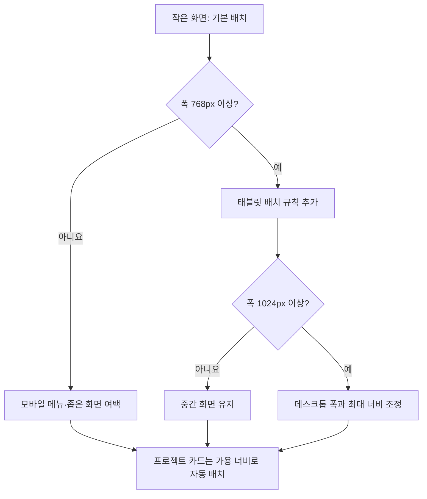
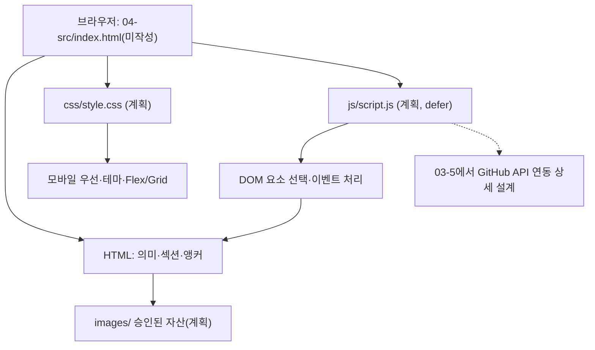
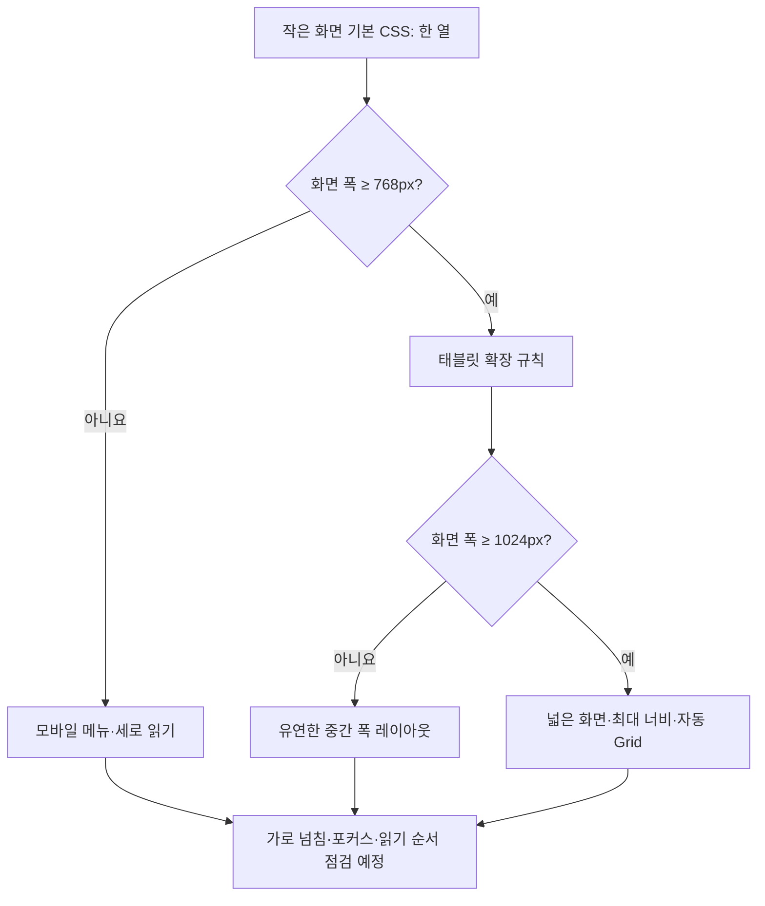

# B1-1 Round 04 — 03-3 입문자 중심 파일 구조·반응형 설계

> **30초 요약:** 03-2에서 설계한 웹페이지를 **HTML(내용)·CSS(모양)·JavaScript(동작)·images(이미지)**로 나누고, 작은 화면부터 넓은 화면까지 어떻게 보여줄지 **그림과 아주 짧은 코드**로 배웁니다. 여기 적힌 코드들은 **문서 안의 교육용 예시**이며, `04-src/`에 신규 소스를 작성하거나 브라우저에서 실행하지 않았습니다.
>
> **상태:** 03-1·03-2·03-3 **PASS(설계 문서·정적 확인 기준)** / 03-4~03-8 **NOT_STARTED** / 04 신규 개발 승인 **PENDING** / 현재 WSL2 실행·사용자 이해도·미션 CLEAR **NOT_VERIFIED**.

## 처음 5분 — 읽는 방법과 한눈에 보는 목차

1. **A:** 목표와 안전한 학습 범위를 읽습니다.
2. **B:** 휴대전화·태블릿·데스크톱에 배치할 프로젝트 카드 그림부터 봅니다.
3. **C:** HTML·CSS·JS가 각각 무엇을 담당하는지 설명합니다.
4. **D·E:** 작은 예시 코드를 읽고 파일 연결·화면 폭 변화를 예측합니다.
5. **F~H:** 오류 원인을 찾고, 종이에 재현하고, 정답과 비교합니다.
6. **I:** 기획 프롬프트 변경 이력, 공식 요구 ID, 검증표가 필요할 때만 살펴봅니다.

| 구분 | 바로 이동 | 이 부분에서 배우는 것 |
|---|---|---|
| **A. 처음 시작하기** | [범위·목표](#beginner-a) | 설계와 실제 실행의 차이 |
| **B. 완성될 화면 미리보기** | [화면 폭별 배치 그림](#beginner-b) | 375px·768px·1024px 개념 |
| **C. 기술 쉽게 배우기** | [용어·비유](#beginner-c) | HTML·CSS·JS와 자주 쓰는 용어 |
| **D. 파일과 코드 읽기** | [예시와 연결](#beginner-d) | 파일 이름·상대경로·코드 한 줄씩 |
| **E. 반응형 원리 배우기** | [CSS·Flexbox·Grid](#beginner-e) | 미디어 쿼리·자동 열 배치 |
| **F. 오류 해결하기** | [증상·원인·해결](#beginner-f) | 404·가로 넘침·포커스 |
| **G. 종이 실습하기** | [직접 재현](#beginner-g) | 화면·코드의 예상 동작 |
| **H. 이해도 점검하기** | [질문·정답](#beginner-h) | 스스로 설명·검토 |
| **I. 전문가 참고·검증** | [프롬프트·근거·PASS](#beginner-i) | P01~P08·R/E/LO·검증 이력 |

<a name="beginner-a"></a>

## A. 처음 시작하기 — 이번 단계에서 하는 일

**목표:** 03-2 [정보 구조 설계](03-2-INFORMATION-ARCHITECTURE.md)의 Hero·About·Skills·Projects·Contact·Footer 6개 영역을 **어느 파일이 맡을지**, 화면 크기가 달라질 때 **어떻게 배치할지** 계획합니다.

**비유:** 집을 실제로 짓기 전에 방 배치도(HTML), 가구 배치도(CSS), 문이 열리는 원리(JS)를 각각 정합니다.

**이번 문서에서 하는 일:** 예시 코드를 **읽고 예상 결과를 그려 보는 것**. 실제 소스 파일 생성, 명령 실행, 설치, 브라우저 시연, 배포, 기존 Round 소스 복사·편집·삭제는 하지 않습니다.

<a name="beginner-b"></a>

## B. 완성될 화면을 그림으로 먼저 보기

같은 프로젝트 카드 세 개가 **가로 공간에 따라 자연스럽게 정렬되는 모습**을 예상해 봅니다. 아래는 개념도이며 실제 브라우저 캡처가 아닙니다.

```text
[휴대전화 예: 375px]       [태블릿 예: 768px]         [데스크톱 예: 1024px]
┌───────────────┐          ┌────────┬────────┐        ┌──────┬──────┬──────┐
│ 카드 1        │          │ 카드 1 │ 카드 2 │        │ 카드1│ 카드2│ 카드3│
├───────────────┤          └────────┴────────┘        └──────┴──────┴──────┘
│ 카드 2        │          ┌────────┐
├───────────────┤          │ 카드 3 │
│ 카드 3        │          └────────┘
└───────────────┘
```

**꼭 구별할 점:** 위 그림은 카드 최소 폭과 여백이 적당한 **가상의 경우**입니다. 이번 설계는 `auto-fit/minmax` 자동 배치를 선택했기 때문에 **768px에서 무조건 2열, 1024px에서 무조건 3열이 된다고 보장하지 않습니다.** 실제 열 수는 카드 최소 폭·부모 너비·글자 길이 등에 따라 달라집니다.



<a name="beginner-c"></a>

## C. 기술 쉽게 배우기 — 용어·역할·비유

| 용어(한글·영어·약어) | 쉬운 뜻 | 생활 속 비유 |
|---|---|---|
| 하이퍼텍스트 마크업 언어(HyperText Markup Language, **HTML**) | 제목·문단·버튼 등 문서 구조와 의미 | 집의 방과 문 |
| 캐스케이딩 스타일 시트(Cascading Style Sheets, **CSS**) | 글자·색·여백·레이아웃 | 가구를 배치하고 벽 색 정하기 |
| 자바스크립트(JavaScript, **JS**) | 클릭·데이터 등 사용자 동작 처리 | 스위치를 누르면 움직이는 장치 |
| 반응형 웹 디자인(Responsive Web Design, **RWD**) | 화면 크기에 맞춰 보기 편하게 배치 | 책상 크기에 따라 물건 재배치 |
| 모바일 우선(Mobile First) | 작은 화면용 기본값부터 설계 | 작은 상자에 꼭 필요한 물건부터 담기 |
| 미디어 쿼리(Media Query) | 화면 폭 조건에 따른 CSS 분기 | "이 크기 이상이면 두 번째 규칙 적용" |
| 브레이크포인트(Breakpoint) | 배치 규칙이 바뀌는 경계 | 문턱을 넘으면 다음 방 |
| 플렉스박스(Flexible Box Layout, **Flexbox**) | 주로 한 방향으로 항목 정렬 | 가로로 놓은 책들 |
| 그리드(CSS Grid Layout, **Grid**) | 행과 열로 여러 칸 구성 | 바둑판·진열대 |
| 상대경로(Relative Path) | 현재 파일을 기준으로 다른 파일 위치 표시 | 같은 건물 안의 방 번호 |
| 지연 실행 속성(defer) | 외부 스크립트를 HTML 파싱 후 실행하도록 지시 | 방 위치를 확인한 다음 스위치 연결 |
| 루트 선택자(:root) | 공통 CSS 변수 정의에 사용 | 집 전체에서 쓰는 색상표 |
| 자동 맞춤(auto-fit) | 남는 공간에 맞춰 Grid 열을 자동 조정 | 진열대 폭에 맞춰 칸 수 조정 |
| 최소·최대 크기 함수(minmax) | Grid 열의 최소·최대 크기 범위 | 칸이 너무 작아지지 않게 제한 |
| 키보드 포커스(:focus-visible) | Tab 등 키보드 탐색 시 현재 위치 표시 | 지금 선택한 칸에 표시 붙이기 |
| 감속 모션 선호(prefers-reduced-motion) | 움직임을 줄이고 싶은 사용자의 설정 반영 | 어지러운 움직임 효과 줄이기 |

**원래 기술 정의와 자세한 설계 조건도 보존했습니다.** 아래 D·E에서 작은 코드에 연결하고, I에서 공식 요구에 대응합니다.

<a name="beginner-d"></a>

## D. 파일 구조를 보고 주요 코드 한 줄씩 이해하기

### D-1. 승인 이후에 만들 *예정* 파일 구조

```text
training/round-04-agent/
└── 04-src/                  ← 승인 전에는 안내 README만 실재
    ├── README.md            ← 현재 존재하는 안내문, 이후 문서 보완 가능
    ├── index.html           ← 계획: 시맨틱 문서와 섹션
    ├── css/
    │   └── style.css        ← 계획: 모바일 우선 배치·테마
    ├── js/
    │   └── script.js        ← 계획: 이벤트·상태·폼·API
    └── images/
        └── [승인된 이미지]  ← 계획: 권한 확인된 파일만 추가
```

**중요:** `04-src/index.html`, `04-src/css/style.css`, `04-src/js/script.js`, `04-src/images/`는 **계획 경로**입니다. GitHub 현재 트리에 이 파일·폴더가 존재한다고 주장하지 않습니다. 처음부터 불필요한 `build/`, `dist/`, `node_modules/`, 패키지 도구를 추가하지 않습니다.

| 계획 대상 | 단일 책임 | 의존·연결 계약 | 공식 근거·평가 |
|---|---|---|---|
| `index.html` | 한 페이지의 문서 의미·제목·링크·폼·접근성 대상 | 헤드에서 `css/style.css` 연결, `js/script.js`를 외부 `defer`로 연결; 섹션 ID 일치 | R01-01~02,R02-01~07,R04-01 → E06,E07 |
| `css/style.css` | 반응형 배치·글자·색상·그리드·메뉴 보임·시각 전환 | HTML의 class/속성 상태를 스타일링; DOM 이벤트·데이터 요청을 대신하지 않음 | R03-01~10 → E01,E02,E08,E13,E15 |
| `js/script.js` | 이벤트 등록, 상태 처리, GitHub 공개 데이터·폼 검증·화면 갱신 | HTML에 인라인 이벤트 금지; 선택자·이벤트·안전한 DOM 책임 | R04-01~08,R05-01~06 → E02,E03,E09,E10 |
| `images/` | 승인된 프로필·장식 이미지의 보관 | 상대경로로 연결하고 HTML 이미지에 적절한 `alt`; 실물 확정 전 내용 추정 금지 | R01-01,R02-02,R02-06 → E07 |
| `04-src/README.md` | 나중에 작성할 실사용·선택 기능·변경값·배포 URL 설명 | 향후 실제 수치·시험·출처·한계만 기록; 현재 배포 성공 주장 금지 | R05-03~07,R10-03 |

**연결 설계 비유:** `index.html`이 책의 본문이라면 CSS는 글꼴·색을 정하는 편집 지침이고, JS는 버튼에 반응하는 작업 지침입니다. 파일은 나누되 같은 폴더 구조 안에서 경로를 정확히 연결합니다.



**경로 오류 예방 계약:** `index.html`이 `04-src/` 루트에 있으므로 CSS 연결 경로는 `css/style.css`, JS는 `js/script.js`, 이미지 예시는 `images/[승인된파일]`입니다. 기존 저장소 루트 `/css/style.css`처럼 **슬래시로 시작하는 절대 웹 경로는 GitHub Pages의 하위 경로 배포에서 잘못 연결될 수 있으므로** 이번 설계에서는 사용하지 않습니다. `defer`는 HTML 문서 파싱 후 외부 JS가 처리되도록 계획하는 속성이며, 실제 로딩은 05단계에서 시험합니다.

### D-2. 짧은 HTML·CSS·JS 교육용 예시 (실제 구현 아님)

**HTML — 내용과 다른 파일의 연결을 정의합니다.**

```html
<head>
  <link rel="stylesheet" href="css/style.css">
  <script src="js/script.js" defer></script>
</head>
<body>
  <main id="main">
    <section id="projects">
      <h2>프로젝트</h2>
      <div class="projects-grid">
        <article><h3>프로젝트 카드 예시</h3></article>
      </div>
    </section>
  </main>
</body>
```

- `<head>` 안의 `link`: `css/style.css`에 적힌 꾸미기 규칙을 연결합니다.
- `<head>` 안의 `script`: `js/script.js`에 적힌 동작 지침을 연결하고 `defer`를 사용합니다.
- `main`: 페이지에서 핵심이 되는 내용을 감쌉니다.
- `section id="projects"`: 상단 메뉴의 `#projects` 링크가 도착할 목적지입니다.
- `div class="projects-grid"`: 아래 CSS의 `.projects-grid`와 같은 이름을 사용해 카드 묶음에 Grid를 적용할 위치를 지정합니다.
- `article`: 개별 프로젝트 하나를 독립적인 정보 단위로 표현합니다.

**CSS — 카드의 배치를 정의합니다.**

```css
:root {
  --page-gap: 1rem;
}
.projects-grid {
  display: grid;
  gap: var(--page-gap);
  grid-template-columns:
    repeat(auto-fit, minmax(min(100%, 16rem), 1fr));
}
```

- `:root`: 공통 간격 변수 `--page-gap`을 정의합니다.
- `display: grid`: 카드를 행과 열로 배치합니다.
- `gap`: 카드 사이 간격을 줍니다.
- `auto-fit`: 공간에 따라 열 수를 조정합니다.
- `minmax(..., 1fr)`: 최소 폭과 나머지 사용 가능 공간을 반영합니다. `min(100%, 16rem)`은 부모가 좁을 때 최소 폭 때문에 넘치는 일을 줄이려는 교육용 설계입니다.

**JS — 동작 처리를 담당한다는 사실만 관찰합니다.**

```javascript
const projectSection = document.querySelector("#projects");
// 요소를 찾는 읽기 예시입니다.
// 이벤트·상태 갱신 구현은 03-4, API·폼은 03-5에서 설계합니다.
```

- `document.querySelector("#projects")`는 HTML의 `id="projects"` 요소를 찾으려는 표현입니다.
- 해당 요소가 없으면 결과는 `null`일 수 있어 이후 코드에서 존재 여부 확인이 필요합니다.
- 지금은 **코드를 실행하지 않으며**, 이것만으로 카드·메뉴·API가 동작하지 않습니다.

**학습 예시와 최종 구현의 차이:** HTML의 `class="projects-grid"`와 CSS의 `.projects-grid`가 서로 대응하는 것을 확인하세요. 위 코드는 `<!doctype html>` 등 문서 전체 뼈대를 생략한 **교육용 부분 코드**이며, 이것만으로 완성된 웹페이지가 되지 않습니다.

### D-3. 03-2 섹션과 파일 책임을 연결하기

| 표시 순서 | 문서 책임 | CSS 레이아웃 | JS 책임(상세 03-4/03-5로 인계) |
|---|---|---|---|
| 전역 Header·Nav | `header`, `nav`; Skip link, 메뉴, 테마 버튼 | 모바일 메뉴 토글 표시, 넓은 화면 가로 메뉴에 Flex | 메뉴 열기·닫기, 테마 |
| Hero `#home` | 첫 소개, 유일한 H1, 프로젝트/문의 CTA | 모바일 1열→넓은 화면 2영역 가능 | 링크/스크롤 |
| About `#about` | 소개·이미지 `alt` | 모바일 세로→넓은 화면 2열 가능 | 필요 시 노출 효과 |
| Skills `#skills` | 기술 목록·섹션 H2 | 모바일 세로→폭에 따른 열 구성 | 필요 시 노출 효과 |
| Projects `#projects` | 상태 문구 및 독립 프로젝트 `article` 카드 | Grid, `auto-fit`·`minmax` 방식의 유동 카드 | 공개 API, 목록 렌더·오류·재시도 |
| Contact `#contact` | `form`, `label for`·입력 `id`, 상태·필드 오류 | 좁은 화면에서도 완전한 폼 폭 유지 | 값 검사, 안전한 메시지 |
| Footer | `footer`, 검증된 링크·저작권·맨 위로 | 한 열→넓은 화면 정렬 | 위로 이동 조건 |

**정의:** HTML 시맨틱 요소는 내용의 의미를 나타냅니다. JS가 나중에 카드를 추가하더라도 `article`의 의미를 잃지 않게 설계합니다. 첫 화면의 구체적 개인 소개·사진은 아직 미확정이며 임의 생성하지 않습니다.

<a name="beginner-e"></a>

## E. 반응형 레이아웃 배우기 — 작은 화면 먼저

### E-1. 고정된 구간과 폭별 설계

**미디어 쿼리 경계 계획:** 기본 0~767px → `min-width: 768px` → `min-width: 1024px`. 이는 공식 R03-06/07을 따르는 **03-3 계획값**이고 실제 브라우저 시험 PASS가 아닙니다.

| 화면 폭 사례 | 상단 메뉴 | Hero/About | Skills·Projects | 폼 | 검증 목적 |
|---|---|---|---|---|---|
| 375px (휴대전화) | 햄버거, 기본 접힘 | 세로 1열 | 한 열 기본, 긴 글 줄바꿈 | 가용 폭 안에 배치 | 가로 스크롤·포커스·읽기 순서 |
| 767px (첫 경계 직전) | 모바일 메뉴 유지 | 가용 폭에 맞춤 | 카드가 자연스럽게 늘어도 넘침 금지 | 필드 넘침 금지 | 768 직전 레이아웃 |
| 768px (태블릿 진입) | 가로 메뉴로 전환 **계획**, 내용이 안 맞으면 03-6에서 수정 근거 기록 | 2영역 후보, 공간 부족 시 1열 유지 | 카드 2열 후보(고정 강제 아님) | 필드의 충분한 너비 유지 | 경계 변화·긴 메뉴 확인 |
| 1023px (두 번째 경계 직전) | 가로 메뉴 | 화면 폭에 따른 배치 | Grid 자동 열 수 | 동일 | 1024 전 상태 |
| 1024px (데스크톱 진입) | 가로 메뉴 | 넓은 2영역 후보 | 프로젝트 2~3열 후보(Grid 자동 크기 우선) | 적절한 최대 폭 | 데스크톱 전환 |
| 1280px (넓은 화면) | 여백 있는 가로 메뉴 | 콘텐츠 최대 폭 사용 | 카드 폭·여백 자동 | 읽기 쉬운 폼 | 지나치게 넓은 문단 방지 |

**주의:** 표의 카드 열 수는 시각 설계 **후보**입니다. `auto-fit/minmax`는 실제 콘텐츠 길이와 가용 공간에 따라 열 수가 달라지므로, **정확한 ‘768=2열·1024=3열’ 보장을 만들지 않습니다.** 최소 카드 폭은 03-6에서 실제 콘텐츠를 보고 검증하고, 좁은 부모 안에서 넘치지 않도록 설계합니다.



### D-2. CSS 구성 순서와 책임 계약

| 순서 | CSS 영역 | 내용 |
|---|---|---|
| 1 | 기본값·리셋 | 박스 크기 계산, 기본 간격, 이미지 최대 폭, 긴 링크 줄바꿈 |
| 2 | 디자인 토큰(Design Token) | `:root`의 색상·글꼴·간격·반경·그림자 |
| 3 | 다크 테마 | 예: `[data-theme="dark"]`에서 색상 토큰 재정의(구현은 03-4 상태 선택과 일치) |
| 4 | 전역 요소 | `body`·제목·링크·버튼·폼·포커스 상태 |
| 5 | 컴포넌트 | Header/Nav, Hero, About, Skills, Projects Grid, Contact, Footer |
| 6 | 작은 화면 기본 | 세로 흐름, 모바일 메뉴, 가용 폭 기준 카드·폼 |
| 7 | `min-width:768px` | 태블릿 메뉴·2영역 후보·여백 확장 |
| 8 | `min-width:1024px` | 데스크톱 콘텐츠 최대 폭·레이아웃 조정 |
| 9 | 상태·보호 | `:hover`와 `:focus-visible`, `prefers-reduced-motion`, 오류/로딩 표시 |

**왜 Flexbox와 Grid를 나눌까요?** 네비게이션의 로고·메뉴는 한 방향으로 정렬하므로 Flexbox가 적합하고, 프로젝트 카드들은 행·열로 자동 재배치되므로 Grid가 적합합니다. `auto-fit/minmax`는 **프로젝트 카드 배치에 사용한다는 계약**이며 구체적인 CSS 구현은 04단계 별도 승인 후입니다.

**변수 계약:** 밝은 테마와 어두운 테마는 공통 색상 변수(배경, 본문, 카드, 링크·강조, 테두리, 오류)를 사용하고 **두 테마 모두** 대비와 상태 표시를 검사합니다. 테마 값 저장·복원은 JS 책임(03-4 세부 설계)이며, CSS 파일이 직접 브라우저 저장소에 접근하지 않습니다.

**안전한 기본값:** 명확한 글자 크기·줄높이, 적절한 여백, 긴 제목·링크 줄바꿈, 이미지 `max-width`와 높이 자동, 격자 자식 최소 폭 조정, 44px 이상의 누르기 쉬운 목표 크기 **권장 후보**, `:focus-visible` 표시, `prefers-reduced-motion` 사용자를 위한 전환 효과 축소. 마지막 두 항목의 상세 시험은 03-6/05에서 정의·실행합니다.

### E-3. 화면 폭 조건을 작은 코드로 읽어보기 (교육용, 미실행)

```css
/* ① 휴대전화 등 작은 화면용 기본 규칙 */
.page {
  padding-inline: 1rem;
}

/* ② 태블릿 구간 시작 */
@media (min-width: 768px) {
  .page { padding-inline: 2rem; }
}

/* ③ 넓은 화면 구간 시작 */
@media (min-width: 1024px) {
  .page { max-width: 72rem; margin-inline: auto; }
}
```

**읽기 순서:** 먼저 작은 화면 여백을 `1rem`으로 정합니다. 화면 폭이 768px 이상이면 여백을 `2rem`으로 넓힙니다. 1024px 이상이면 본문이 끝없이 넓어지지 않도록 최대 폭을 제한합니다.

**주의:** 이 예시는 카드 열 수를 1·2·3열로 고정하지 않습니다. 카드 자동 배치는 D-2의 `auto-fit/minmax` 계약을 따릅니다. 또한 `@media` 숫자는 **CSS 배치 조건**이지 실제 화면 품질 PASS가 아닙니다.

<a name="beginner-f"></a>

## F. 자주 생기는 오류 — 증상 → 원인 → 해결 방향

### F-1. 화면에서 실패하기 쉬운 경우

| 보이는 문제 | 설계상 가능한 이유 | 예방·검증 계획 |
|---|---|---|
| 375px에서 가로 스크롤 | 고정 폭 카드·이미지·긴 URL | 유동 폭·줄바꿈·최소 폭 조정, 05 실제 스크롤 폭 확인 |
| 768px에서 메뉴가 겹침 | 가로 메뉴 글자가 너무 김 | 경계에서 실측 후 메뉴 공간 확보 또는 결정 이유 기록 |
| 1024px에서 카드가 너무 좁음 | 고정 3열을 강제 | Grid 자동 열 수 사용, 최소 크기와 실제 가독성 검사 |
| 다크 테마에서 글자 안 보임 | 테마 토큰 일부 미정의 | 배경·본문·링크·오류 등 모든 핵심 색상 쌍 점검 |
| Tab 키로 메뉴 위치를 알 수 없음 | hover만 사용, 포커스 스타일 없음 | `:focus-visible` 계획, 05 키보드 이동 테스트 |
| 움직임에 민감한 사용자가 불편함 | 과도한 transition/스크롤 애니메이션 | 감소된 모션 선호 대응, 03-4/03-6 설계 |
| CSS/JS가 로드되지 않음 | `/css/` 절대 경로, 오타·폴더 불일치 | 04 파일 작성 후 05 네트워크/404 재검증 |
| 이미지가 깨짐 | 누락된 파일·인증 없는 외부 사진 | 확정 자산만 추가, 의미 있는 `alt` 또는 안전한 텍스트 대체 |

**오류 예시를 하나 더 풀어보기:** `index.html`에서 `href="/css/style.css"`처럼 슬래시로 시작하는 경로를 쓰면 GitHub Pages의 하위 경로에서는 파일을 못 찾을 수 있습니다. 이번 계획 위치에서는 `href="css/style.css"`가 상대경로입니다. 05단계의 실제 로딩·404 검사 전에는 오류가 해결되었다고 PASS를 선언하지 않습니다.

<a name="beginner-g"></a>

## G. 종이에 직접 재현하기 — 실행 없이 확인

1. **파일 책임:** `index.html`, `css/style.css`, `js/script.js`, `images/` 네 칸을 그리고 "구조/꾸미기/동작/이미지"를 선으로 연결하세요.
2. **파일 연결:** `index.html`에서 CSS와 JS 파일로 화살표를 그리세요. 연결 주소 앞에 `/`를 붙이지 않는 이유를 설명하세요.
3. **화면 폭:** 종이에 375px, 768px, 1024px의 세 상자를 그리고, 같은 카드 3개를 위 B의 **가상 배치 예시**처럼 그려 보세요. 그다음 "실제 자동 열 수는 카드 최소 폭에 따라 달라질 수 있다"라고 적으세요.
4. **오류 찾기:** HTML에서 `id="projects"`인데 선택자가 `"#project"`라면 어떤 문제가 생길까요?
5. **경계 구분:** 종이에 화면 배치를 잘 그린 일이 **브라우저 테스트 PASS**인지 아니면 **학습용 예상 결과**인지 말해 보세요.

**기대 답안:** ① 구조·스타일·동작·이미지 저장 ② 현재 폴더 기준 상대경로이기 때문 ③ 화면이 넓어질수록 여러 열이 가능하지만 항상 고정은 아님 ④ 대상 선택 결과가 `null`일 수 있음 ⑤ 예상 결과이며 실제 브라우저 검증은 아님.

<a name="beginner-h"></a>

## H. 이해 → 설명 → 재현 자기 점검표

| 질문 | 정답의 핵심 | 스스로 확인 |
|---|---|---|
| HTML·CSS·JS는 무엇이 다른가요? | 구조와 의미 / 화면의 모양 / 동작 처리 | □ |
| Flexbox와 Grid는 왜 다르게 쓰나요? | 메뉴는 주로 한 방향, 카드 배치는 행·열 | □ |
| `768px`이 되면 카드가 반드시 2열인가요? | 아니요. `auto-fit/minmax`와 가용 공간에 따라 달라짐 | □ |
| `defer`는 무슨 역할인가요? | 외부 JS를 문서 파싱 후 실행되도록 함 | □ |
| `#projects` 링크가 작동하려면? | 같은 이름의 섹션 `id="projects"`가 필요 | □ |
| 오래된 PASS는 새 Round의 실행 PASS인가요? | 아니요. 수행 차수·소스·환경·증거가 다름 | □ |

**자가 채점 규칙(학습 보조용):** 질문당 (0) 아직 설명 불가, (1) 힌트/문서 도움을 받아 설명, (2) 코드나 답 없이 자기 말로 설명. 이는 **공식 07단계 평가 점수나 학습자 숙달 확정 기준이 아닙니다**. 실제 평가를 실시한 결과는 현재 없습니다.

<a name="beginner-i"></a>

## I. 전문가 참고자료 — 프롬프트·요구 추적·검증

처음 배우는 사람은 **A~H를 먼저 읽고**, 설계 배경이 궁금할 때만 I를 참고해도 됩니다. 기존 기획 프롬프트·공식 요구 대응·검증 증거는 삭제하지 않고 여기 보존합니다.

### I-1. 프롬프트 초안 V0.1 → 위험 P01~P08 → 최종 V1.0

#### I-1-1. 기획 초안 V0.1 — 검토 대상

> B1-1 한 페이지 포트폴리오를 HTML·CSS·JavaScript로 나누고, 모바일과 데스크톱에서 보기 좋은 레이아웃을 계획해 주세요. 신규 코드는 작성하지 마세요.

이 초안은 **명세로 채택하기에는 불충분**합니다.

| 점검 ID | 초안의 누락·위험 | 최종 V1.0에서 보완한 조건 |
|---|---|---|
| P01 | 공식 파일명·상대경로 부재 | `index.html`, `css/style.css`, `js/script.js`, `images/`와 외부 연결 계약 |
| P02 | 03-2의 고정 섹션 ID와 시맨틱 구조 누락 | `#home/#about/#skills/#projects/#contact` 및 `article`, `label`, `alt` |
| P03 | 모바일 우선·768·1024px 기준 불명확 | 기본 0~767px, 768~1023px, 1024px 이상으로 단계별 계획 |
| P04 | Flex·Grid·CSS 변수·다크 테마 설명 없음 | 사용 위치·선택 근거·변수 및 색상 상태 계약 |
| P05 | 메뉴 표시 조건·넘침·키보드·감속 모션 미고려 | 작은 화면 메뉴·`focus-visible`·가로 넘침·`prefers-reduced-motion` 검토 |
| P06 | JS 역할이 HTML/CSS와 섞이고 금지 제약 미정의 | 외부 `defer`, `const/let`, `addEventListener`와 금지 기술 명시 |
| P07 | 보안·API 동작·테스트 책임 경계 불분명 | 03-4 상태, 03-5 API·폼·XSS, 03-6 실측·접근성 및 05 실행 시험으로 인계 |
| P08 | 사용자 정보 추정 및 이전 코드 재사용 위험 | 플레이스홀더 사용, Round 01~03 원본 보존, 신규 소스 미작성 |

### B-2. 보완한 최종 기획 프롬프트 V1.0

> **역할:** 공식 B1-1 요구사항에 충실한 웹 기술 설계자이자 입문자 교사.
>
> **입력:** [공식 요구 추적표](../01-requirements/REQUIREMENTS-CATALOG.md) R01~R05 및 R12, [평가 15문항](../01-requirements/EVALUATION-15-MAPPING.md), [학습목표](../01-requirements/LEARNING-OBJECTIVES.md), [03-2 정보 구조](03-2-INFORMATION-ARCHITECTURE.md), [이슈 D01~D10](../01-requirements/SOURCE-CONFLICTS-AND-DECISIONS.md), [02 환경 조사](../02-analysis/ENVIRONMENT-BASELINE.md).
>
> **목적:** 03-2의 구조·앵커·의미 요소를 보존하면서 새로운 `04-src/` 구현이 **향후 승인되었을 때 사용할 파일 트리, 책임 경계, 리소스 연결, 모바일 우선 레이아웃, CSS 변수, 테마, 화면 경계 시험 명세**를 설계한다.
>
> **필수 결과:** (1) 경로별 파일·폴더 계약 (2) HTML에서 외부 CSS 및 `defer` JS로 이어지는 경로 그림 (3) 375/767/768/1023/1024px 화면 배치 조건 (4) 네비게이션 Flexbox·프로젝트 Grid 사용 이유와 반응형 카드 수의 유동성 (5) `:root`·다크 테마 디자인 토큰(Design Token: 공통 색·간격 값) 계약 (6) hover와 키보드 포커스·감속 모션 규칙 (7) 의존성 금지·인라인 금지·실제 이미지와 개인정보 미확정 (8) R/E/LO 추적과 03-4~03-6 및 05 테스트 인계 (9) 쉬운 비유·Mermaid·종이 재현·오류/검증 표.
>
> **절대 제한:** 기존 00~09 목차·Round 01~03·루트 파일·배포·증빙 보존. React/Vue/jQuery/Bootstrap/Tailwind 등 금지. `04-src/`에 HTML/CSS/JS 작성·복사·실행하지 않음. 서비스 설정·브랜치·Secret 변경, 패키지 설치·명령 실행·배포 금지. AWS/iMac 보류. `mission.yml` 승인 `PENDING` 보존. 문서 PASS를 실제 웹·접근성·학습자 숙달 PASS로 오인하지 않는다.
>
> **자체 품질 확인:** P01~P08이 각각 설계 산출물에 반영됐는지 확인하고, 문서 링크·Mermaid·금지 범위·미확인 사항·다음 단계 인계를 검토해 수정한다.

**검토 결론:** V0.1에서 식별한 P01~P08의 위험을 V1.0에서 모두 조건화했습니다. 아래 C~F는 **이 최종 프롬프트에 따른 설계 산출물**입니다.

### I-2. 공식 요구·평가·학습목표 연결

| 요구사항 | 이번 파일·레이아웃 설계 산출물 | 평가 | 학습 목표 | 후속 검증 |
|---|---|---|---|---|
| R01-01~03 | 구조 분리·상대경로·VS Code/Live Server 확인 계획 | E06 | LO01 | 03-6 환경 확인 계획, 05 실측 |
| R02-01~07 | 03-2 앵커·시맨틱·프로필/폼 요소 계약 | E05,E07 | LO02 | 03-5·03-6·05 |
| R03-01~03 | 스타일 파일·`:root`·다크 토큰 책임 | E02,E08 | LO03,LO06 | 03-4·05 |
| R03-04~05 | Flexbox 내비게이션·Grid 카드 | E13 | LO03 | 05 |
| R03-06~08 | 모바일 우선·768/1024·햄버거 표시 조건 | E01,E03,E15 | LO03,LO05 | 03-4·03-6·05 |
| R03-09~10 | hover/transition·카드 box-shadow | E01 관련 외형 평가 | LO03 | 03-6·05 |
| R04-01~08 | 외부 `defer` JS 책임·인라인 이벤트 금지·DOM 경계 | E06,E09,E10 | LO01,LO04 | 03-4·03-5·05 |
| R05-01~07 | 화면 상태만 분리, 300px/60px/Observer 0.2은 상세 설계로 인계 | E02,E03 | LO05,LO06 | 03-4·03-6 |
| R12-01~06 | 순수 HTML/CSS/JS, 금지·허용·브라우저 제약 | E06,E09,E10 | LO12 | 03-6·05 |

**선택·제약 판단:** `filter()` 등 보너스는 필수로 바꾸지 않고 03-5에 인계합니다. `article`은 각 프로젝트 카드를 독립 의미 단위로 표시하는 03-2 결정입니다. `innerHTML` 등 공식 요구를 삭제하지 않되 외부 데이터 문자열과 교차 사이트 스크립팅(Cross-Site Scripting, XSS) 위험의 안전한 처리 방안은 03-5에서 확정합니다. `style` 속성·인라인 `onclick`은 금지하고, React/Vue/jQuery/Bootstrap/Tailwind 등 금지 라이브러리를 포함하지 않습니다. Font Awesome/Google Fonts는 공식 허용 대상이지만 추가 여부는 별도 필요성과 개인정보·성능을 검토합니다.

### I-3. 03-3 수용 기준·다음 단계 인계

| 문서 검사 | PASS 조건 |
|---|---|
| 프롬프트 검토 | V0.1, P01~P08, V1.0 및 결과 명확 |
| 파일 역할 | 계획 경로 4종, HTML/CSS/JS 책임, 이미지·README 설명 |
| 연결 계약 | 상대경로 `css/style.css`, `js/script.js`, 외부 `defer` 설명 |
| 콘텐츠 연결 | 03-2 6영역·5개 앵커 및 시맨틱 요소 유지 |
| 레이아웃 | 모바일 우선 375/767/768/1023/1024/1280px 설명 |
| CSS 핵심 | Flex·Grid, CSS 변수, 다크 토큰, hover·focus·감속 모션 |
| 제약·보안 | 금지 라이브러리/inline, 개인정보 미확정, XSS 후속 인계 |
| 학습 자료 | 용어·비유·Mermaid·오류 해결·종이 재현·자기 평가 |
| GitHub 상태 | 변경 파일은 `03-design/` 문서, 기존 소스 및 `mission.yml` 승인 PENDING 보존 |

**03-4 인계:** 메뉴 열림/닫힘, 테마와 `localStorage`, 부드러운 이동, 맨 위 버튼 300px, 상단 60px, IntersectionObserver 권장 0.2 및 **최소 3개 이벤트→상태→DOM 흐름**을 자세히 설계합니다.

**03-5 인계:** GitHub API fetch/async/await·로딩/빈 결과/403/오류/재시도, 폼 입력 검증·실제 미전송, 안전한 DOM 출력·XSS를 설계합니다.

**03-6 인계:** 375·767·768·1023·1024·1280px의 실제 반응형 시험, 키보드·대비·모션·Chrome·Live Server, GitHub Pages 하위 경로·자산 404·정적 검증 및 증빙 계획을 구체화합니다.

### 03-3 실제 문서 검증 결과 (2026-10-26)

**기준 GitHub `main` HEAD:** `ab2e9a16b915a6394f18e4e0b194d050fc33fa76` — 첫 독립 재조회 결과. 후속 문서 상태 반영으로 HEAD가 달라지더라도 이 결과는 **그 시점 스냅샷**입니다.

| 확인 항목 | 실제 확인 내용 | 판정 |
|---|---|---|
| 기획 프롬프트 수정 | V0.1·P01~P08·최종 V1.0·산출물 C~F 존재 | **PASS — 문서 검토** |
| 파일·연결 계약 | 계획 파일 `index.html`, `css/style.css`, `js/script.js`, `images/`와 상대경로·`defer` 설명 | **PASS — 계획 문서** |
| 03-2와 일치 | 5개 앵커, 6개 콘텐츠 영역, `article`/label/alt 책임 기록 | **PASS — 문서 대조** |
| 반응형·화면 폭 | 기본·768px·1024px 경계와 375/767/768/1023/1024/1280px 점검 대상 | **PASS — 설계 명세** |
| CSS·제약·교육 | Flex/Grid·변수·다크 토큰·포커스·감속 모션, 금지 기술, 9단계 설명·오류·종이 재현 | **PASS — 문서 항목** |
| 문서 문법·링크 | 상대 파일 링크 **11개**, 대상 누락 **0개**, 코드 펜스 **6개(3쌍)**, Mermaid 블록 **2개** | **PASS — 정적 검사**, 실제 GitHub 시각 렌더는 별도 |
| 신규 구현 금지 | `04-src/`는 `README.md` 하나, `mission.yml` 개발 승인 `PENDING`, 미션 실행 `NOT_STARTED` | **PASS — 상태 보존** |
| 브라우저·사용자·배포 | 실제 CSS 로드·화면 넘침·VS Code·Live Server·Chrome·실제 학습자 반응 측정 안 함 | **NOT_VERIFIED** |

**PASS의 정확한 의미:** 본 단계는 **03-3 파일 책임 및 레이아웃 설계의 문서 검증 PASS**입니다. 구현·실행·반응형 렌더링·접근성·학습자 숙달·전체 03 완료 및 미션 CLEAR는 PASS가 아닙니다.

**아직 하지 않은 것:** 새 HTML/CSS/JS 작성, WSL2/VS Code/Live Server/Chrome 실행, 실제 렌더·접근성·학습자 평가·배포. 문서 설계 PASS가 실물 검증 PASS를 뜻하지 않습니다.

[03단계 목차](README.md) · [03-2 사이트 맵](03-2-INFORMATION-ARCHITECTURE.md) · [공식 요구](../01-requirements/REQUIREMENTS-CATALOG.md) · [기존 환경 분석](../02-analysis/ENVIRONMENT-BASELINE.md) · [개발 승인 상태](../mission.yml)

### I-4. 이번 입문자 문서 보완 사항 (2026-10-26)

| 보완 요구 | 반영 위치 | 근거의 범위 |
|---|---|---|
| 기획 프롬프트보다 학습 설명 먼저 | A~H 학습, I 전문가 참고 | 문서 순서 |
| 모바일·태블릿·데스크톱 차이를 그림으로 | B 문자 도식 및 Mermaid | 교육용 예상 화면 |
| HTML·CSS·JS 주요 예시와 해설 | D 교육용 짧은 코드 | 실제 구현 아님 |
| `@media`, `auto-fit/minmax`, `defer`, `:root`의 의미 | C·D·E 용어와 한 줄 해설 | 개념 설명 |
| 증상·원인·해결, 자기 재현·정답 | F·G·H | 실제 학습자 평가 미실시 |
| 오래된 단계 상태 안내 정합성 | [03단계 최신 README](README.md) 및 [03-2 설계 기록](03-2-INFORMATION-ARCHITECTURE.md) | 현재 상태와 역사적 스냅샷 구별 |

**보존 원칙:** 변경한 것은 `03-design/`의 문서뿐입니다. `04-src/` 신규 HTML/CSS/JS, 과거 Round 소스·증빙, 서비스·브랜치·운영 환경은 변경하지 않습니다. 계획과 실제 PASS를 혼동하지 않습니다.

[03단계 시작](README.md) · [03-2 정보 구조](03-2-INFORMATION-ARCHITECTURE.md) · [01 공식 요구](../01-requirements/REQUIREMENTS-CATALOG.md) · [02 환경·증빙 분석](../02-analysis/README.md) · [미션 승인 상태](../mission.yml)
