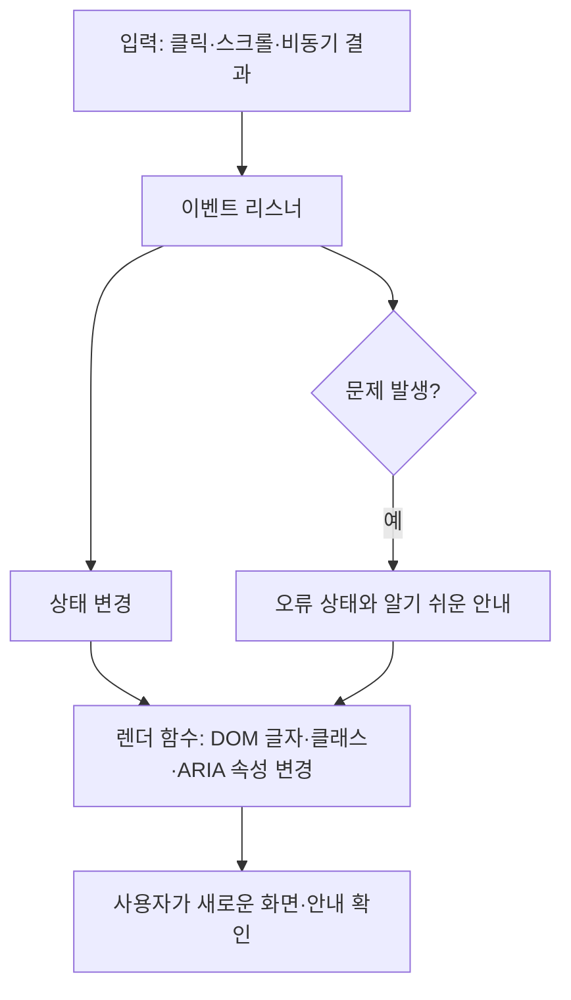
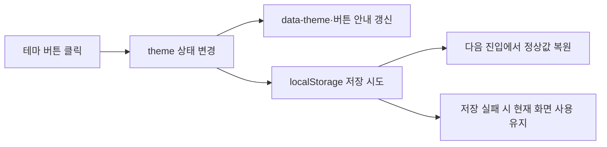
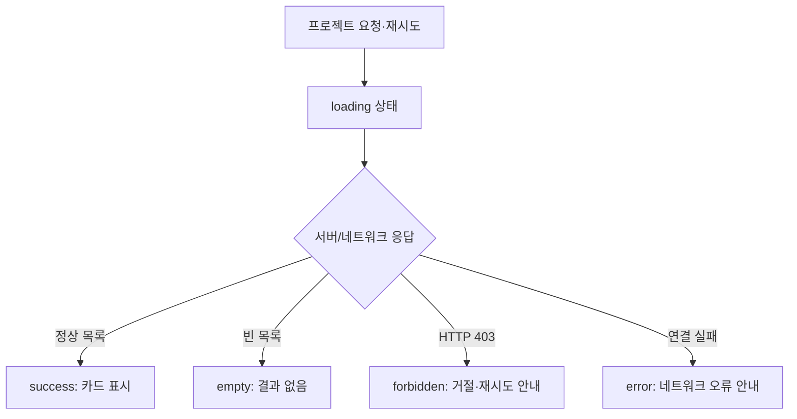
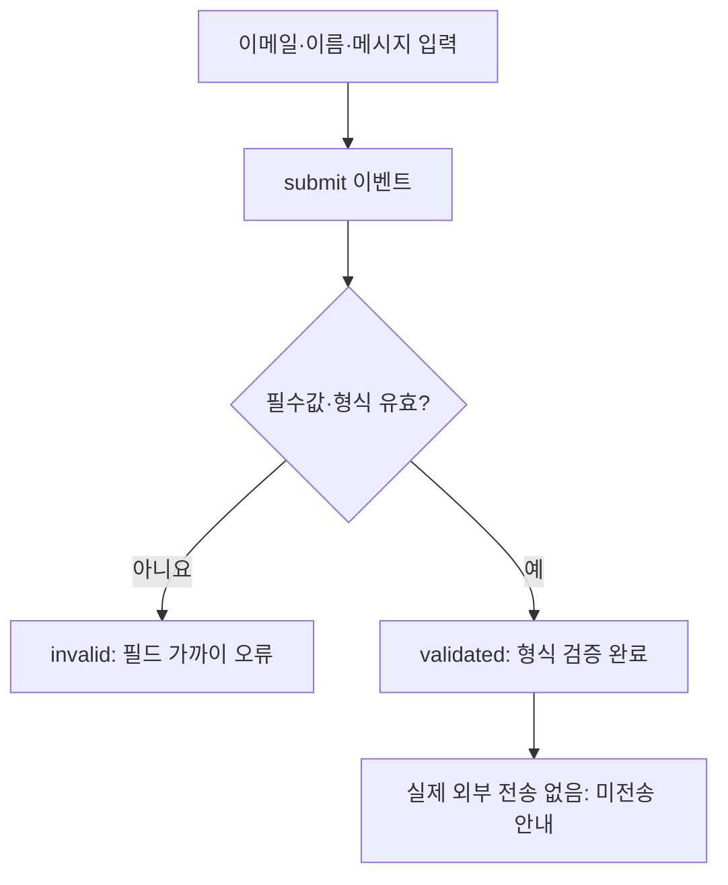

# B1-1 Round 04 — 03-4 이벤트·상태·DOM 흐름 설계

> **30초 요약:** 방문자가 버튼을 누르거나 화면을 스크롤하면 **이벤트(Event) → 상태(State) → 문서 객체 모델(Document Object Model, DOM) 갱신 → 화면 표시(Rendering)** 순서로 반응하도록 설계합니다. 이 문서에는 **계획·교육용 코드 예시만** 있으며, 실제 신규 HTML/CSS/JavaScript 파일을 만들거나 실행하지 않았습니다.
>
> **03-4 완료 당시 판정(역사적 스냅샷):** 03-1~03-3 **PASS(문서 기준)** · 03-4 **PASS(설계 문서·정적 검증 기준)** · 03-5~03-8 **NOT_STARTED** · 04 신규 구현 승인 **PENDING** · WSL2/Chrome 실행·학습자 숙달·MISSION CLEAR **NOT_VERIFIED**.

**최신 단계 상태는 [03단계 통합 README](README.md)를 기준으로 확인합니다.** 이 문서의 03-5 대기는 03-4 완료 당시의 인계 기록이며 이후 03-5 문서 설계 결과를 부정하지 않습니다.

## 처음 5분 — 어디부터 읽나요?

1. **A**에서 클릭·상태·화면이 서로 다른 역할임을 이해합니다.
2. **B**의 세 단계 그림에서 무엇이 바뀌는지 예측합니다.
3. **C**에서 교육용 짧은 코드를 한 줄씩 읽어 봅니다.
4. **D~F**에서 필수 상호작용 6종, 상태 전이, 스크롤 숫자·예외를 비교합니다.
5. **G**에서 종이에 그려 보고 **H**의 예상 정답으로 스스로 설명합니다.
6. **I~J**의 기획 프롬프트·공식 요구 대응·검증 및 다음 단계 인계는 더 자세히 확인할 때 읽습니다.

| 구간 | 입문자 학습 내용 |
|---|---|
| A. 개념 | 용어·비유·역할 구분 |
| B. 그림 | 이벤트 → 상태 → DOM의 결과 예상 |
| C. 코드 독해 | 메뉴·테마 작은 코드 예시 |
| D. 필수 기능 | 모바일 메뉴·앵커·위로 가기·상단·테마·등장 애니메이션 |
| E. 독립 흐름 | 메뉴·테마·API·폼·스크롤 상태 전이표 |
| F. 예외·접근성 | 오류·키보드·모션·성능 위험 |
| G. 실습 | 종이로 흐름 재현 |
| H. 자가 평가 | 정답과 도움 수준 구분 |
| I. 전문가 자료 | V0.1→V1.0 기획 프롬프트·요구 추적 |
| J. 검증·인계 | 문서 PASS 기준과 후속 단계 안내 |

## A. 용어 → 개념 → 비유

| 용어(한글·영어·약어) | 입문자용 설명 | 비유 |
|---|---|---|
| 이벤트(Event) | 사용자가 클릭하거나 입력하거나 스크롤한 **사건** | 초인종을 누름 |
| 이벤트 리스너(Event Listener) | 사건이 일어날 때 처리할 함수를 등록하는 방법 | 초인종 소리를 듣는 장치 |
| 상태(State) | 지금 메뉴가 열렸는지·테마가 어두운지 등의 **현재 값** | 문 옆 '열림/닫힘' 표시 |
| 문서 객체 모델(Document Object Model, DOM) | 브라우저가 HTML 요소를 관리하는 객체 구조 | 방과 물건의 위치표 |
| 화면 갱신(Rendering) | 바뀐 상태를 글자·클래스·속성·색상에 반영하는 과정 | 문이 실제로 열린 모습을 보여줌 |
| 지역 저장소(Local Storage, `localStorage`) | 같은 사이트의 브라우저에 선택값을 보존 | 다음 방문에도 남는 메모 |
| 관찰자(Intersection Observer, `IntersectionObserver`) | 요소가 화면에 들어오는지 브라우저에 관찰 요청 | 전시물 앞에 사람이 나타나는지 확인 |
| 접근성 상태(Accessible Rich Internet Applications, ARIA) | 보조기술이 버튼 상태·관계를 알도록 표현 | 문이 열렸는지 음성 안내하는 표지 |
| 부드러운 이동(Smooth Scroll) | 원하는 위치로 갑자기 뛰지 않고 이동 | 엘리베이터가 목적지로 이동 |

**구분할 질문:** '클릭'은 사건이고 '메뉴 열림'은 상태이며 '메뉴가 보임'은 결과입니다. 사건·값·화면 결과를 하나로 섞지 않습니다.

## B. 전체 흐름을 그림으로 먼저 이해하기



**종이로 먼저 예상:** 모바일 메뉴를 두 번 누르면 `닫힘 → 열림 → 닫힘`. 다크 모드 버튼을 두 번 누르면 `밝음 → 어두움 → 밝음`. 그러나 **두 흐름은 서로 다른 상태값**입니다.

## C. 주요 교육용 코드 읽기 (파일 생성·실행 없음)

> 다음 조각은 **원리를 배우는 문서 속 작은 예시**입니다. 완성된 프로그램, 새 Round 04 구현, 실제 브라우저 테스트 결과가 아닙니다.

### C-1. 모바일 메뉴에서 클릭→상태→DOM

```html
<button id="menuButton" type="button"
        aria-expanded="false" aria-controls="siteMenu">메뉴</button>
<nav id="siteMenu" hidden>소개 · 기술 · 프로젝트 · 문의</nav>
```

```javascript
const menuButton = document.querySelector("#menuButton");
const siteMenu = document.querySelector("#siteMenu");
let menuOpen = false;

if (menuButton && siteMenu) {
  menuButton.addEventListener("click", () => {
    menuOpen = !menuOpen;
    siteMenu.hidden = !menuOpen;
    menuButton.setAttribute("aria-expanded", String(menuOpen));
  });
}
```

- `querySelector`: HTML의 해당 `id` 요소를 찾습니다. 없으면 `null`일 수 있습니다.
- `menuOpen=false`: 처음의 메뉴 상태는 **닫힘**입니다.
- `addEventListener("click", ...)`: 버튼 클릭 사건이 발생했을 때 실행할 처리 함수를 등록합니다.
- `!menuOpen`: 클릭 때마다 상태를 반전합니다.
- `siteMenu.hidden`: 메뉴 내용을 보여주거나 숨깁니다.
- `aria-expanded`: 보조기술에 열림·닫힘을 알려주기 위한 속성입니다.

**교육 예시의 한계:** 실제 모바일/데스크톱 전환 시 `hidden` 상태와 CSS 표시가 충돌하지 않도록 해야 하며, Escape 키·메뉴 링크 선택 시 닫기·키보드 포커스 등은 아래 D/F에서 설계합니다. 위 `nav` 문구는 실제 링크·완성된 메뉴가 아닙니다.

### C-2. 테마는 화면 외에 저장 상태가 필요합니다

```javascript
const themeButton = document.querySelector("#themeButton");
let theme = "light"; // 예시 시작 상태

if (themeButton) {
  themeButton.addEventListener("click", () => {
    theme = theme === "light" ? "dark" : "light";
    document.documentElement.dataset.theme = theme;
  });
}
```

**읽는 법:** 버튼 클릭(Event) → `theme` 값 변경(State) → 루트 요소의 `data-theme` 변경(DOM) → CSS 테마에 따른 화면 표시. **이 예시에는 `localStorage` 저장·복원이 구현되지 않았습니다.** 정식 설계에서는 아래 표와 같이 저장/복원을 필수로 추가해야 R05-05를 충족합니다.

## D. 공식 필수 상호작용 6종의 동작 계약

| ID / 기능 | 입력 사건 | 바뀌는 상태 | 사용자가 확인할 화면·속성 | 예외·후속 검증 |
|---|---|---|---|---|
| R05-01 모바일 메뉴 | 햄버거 클릭·Escape·메뉴 링크 선택 | `menuOpen=false/true` | 메뉴 표시, `aria-expanded` 일치 | Tab/Escape·화면 폭 전환, 03-6/05 |
| R05-02 앵커 이동 | `#about`·`#projects` 등 메뉴 클릭 | 현재 목적지(필요한 경우) | 대상 섹션 이동, 포커스/탐색 가능 | 대상 ID 없음·감속 모션, 03-6/05 |
| R05-03 맨 위 버튼 | 스크롤, 맨 위 버튼 클릭 | `showTop` | **기본 기준 300px** 이후 버튼 노출·최상단 이동 | 경계 299/300/301px, 05 |
| R05-04 상단 디자인 변화 | 스크롤 이벤트 | `headerScrolled` | **기본 기준 60px** 이후 상단 클래스 변화 | 경계 59/60/61px, 05 |
| R05-05 테마 변경·유지 | 테마 클릭, 페이지 최초 진입 | `theme=light/dark` | `data-theme` 값과 CSS, 새로고침 후 복원 | 저장소 접근 실패·비정상 값, 03-6/05 |
| R05-06 등장 애니메이션 | 요소 화면 진입(`IntersectionObserver`) | `revealed` 집합·표시 상태 | 등장 상태 클래스. **threshold 0.2 이상 권장** | 옵저버 미지원·감속 모션·요소 보임 보장, 03-6/05 |

**수치 결정 D03·D04:** `scrollY >= 300`에서 위로 가기 표시, `scrollY >= 60`에서 상단 상태 변화로 **설계 기준을 명시**합니다. IntersectionObserver `threshold: 0.2`를 **권장값으로 채택하는 설계안**이며 공식 필수 수치로 승격하지 않습니다. 04 구현에서 실제 적용값을 바꾼다면 README에 변경값과 이유를 기록해야 합니다. 05단계에서 실제 경계를 시험합니다.

### 이동·메뉴 접근성 세부 계약

- `#home/#about/#skills/#projects/#contact`는 [03-2 앵커](03-2-INFORMATION-ARCHITECTURE.md)와 일치해야 합니다.
- 진짜 링크는 `href="#projects"` 같은 **기본 HTML 이동 기능을 보존**하고, 부드러운 이동은 점진적 향상으로 구현합니다. JavaScript 실패에도 기본 탐색이 남도록 설계합니다.
- 모바일 메뉴가 열리면 `aria-expanded=true`, 닫히면 `false`. Escape·링크 선택으로 닫고, 메뉴 버튼의 포커스 표시와 닫힌 메뉴의 키보드 접근 가능 여부를 후속 시험합니다.
- 화면 폭이 모바일에서 데스크톱으로 바뀌어도 `hidden` 속성이 데스크톱 메뉴를 잘못 숨기지 않도록 **반응형 표시 계약**을 03-3·03-6과 통합합니다.
- `prefers-reduced-motion: reduce`가 지정된 사용자는 부드러운 스크롤·등장 모션을 줄이거나 생략하되 콘텐츠는 계속 볼 수 있게 설계합니다.

## E. 독립적인 이벤트→상태→DOM 흐름 5개

공식 R09-02는 **최소 3개 독립 흐름**을 요구합니다. 이 문서는 서로 다른 상태와 렌더 책임을 갖는 **5개 설계 흐름**을 명시하지만, **실제 구현한 흐름은 0개**입니다.

| 흐름 | 입력/이벤트 | 상태와 전환 | 렌더될 요소 | 평가·후속 |
|---|---|---|---|---|
| **F1 메뉴** | 메뉴 버튼 클릭 | `menuOpen: false→true→false` | 메뉴 `hidden`, 버튼 `aria-expanded` | E03,E10; 03-4/05 |
| **F2 테마** | 테마 버튼 클릭 / 초기 읽기 | `theme: light↔dark`, 저장된 값 복원 | `html[data-theme]`, 버튼 문구/접근성 상태 | E02,E10; 03-4/05 |
| **F3 프로젝트 목록** | 초기 요청/재시도, 요청 결과 | `projects.status: idle→loading→success/empty/forbidden/error` | 로딩·카드·빈 문구·오류·재시도 | E04,E10,E11; **상세 03-5** |
| **F4 문의 폼** | 입력/제출 | `form.status: idle→invalid/validated` | 필드 옆 오류, **형식 검증 완료·미전송** 안내 | E05,E10; **상세 03-5** |
| **F5 스크롤·위로 가기** | 스크롤/맨 위 버튼 | `showTop`, `headerScrolled` 임계값 갱신 | 위로 가기 버튼·상단 클래스 | E03,E10; 03-4/05 |

**학습자의 비교 포인트:** F1과 F2는 각각 다른 버튼·상태이며, F3은 **네트워크 결과**, F4는 **입력 검증**, F5는 **스크롤 위치**라는 다른 원인으로 바뀝니다. `F3/F4`는 03-5에서 상태·예외·개인정보를 더 상세히 설계합니다.

### E-0. 입문자가 구별할 세 가지 독립 흐름 그림

**첫째: 테마 F2 — 선택값을 저장해야 새로고침 후에도 유지됩니다.**



**둘째: 프로젝트 F3 — 네트워크 결과에 따라 상태가 나뉩니다. (상세는 03-5)**



**셋째: 문의 F4 — 입력 검증 성공과 실제 메시지 발송은 다릅니다. (상세는 03-5)**



**그림의 의미:** 서로 다른 입력 사건과 상태 분기, 다른 화면 안내가 있습니다. **모두 설계 그림이며 실제 새 웹페이지의 구현 및 작동을 검증한 것은 아닙니다.**

### E-1. 별도 STATE 객체가 필수인가요? (쟁점 D02)

공식 요구는 **상태→화면 흐름 최소 3개**이며, 별도의 `STATE` 객체 사용 자체를 강제하지 않습니다. 평가 E14의 질문에 답할 수 있도록 다음 **설계 대안**을 비교합니다.

| 선택 | 장점 | 단점 | 03-4 설계 판정 |
|---|---|---|---|
| 개별 변수 `menuOpen`, `theme` | 처음 배우기 쉽고 코드가 짧음 | 상태가 늘면 전체 상태를 추적하기 어려움 | 교육용 예제에 적합 |
| 하나의 `state` 객체 | 메뉴·테마·프로젝트·폼 상태를 한 장소에서 추적 | 중첩 객체와 렌더 책임을 설명해야 함 | **신규 구현 설계안으로 선택**, 실제 파일 구현은 승인 후 |

**명확한 계약:** `state.menuOpen`, `state.theme`, `state.projects.status`, `state.form.status`, `state.showTop`, `state.headerScrolled`를 계획된 책임으로 구분합니다. 이벤트 처리 함수가 상태를 변경하고 각각의 렌더 함수가 필요한 DOM만 갱신합니다. 과거 Round의 `STATE` 코드를 복사한다는 뜻이 아닙니다.

### E-2. 상태 전이와 기대 결과를 종이에 확인하기

| 시험 조건(미실행) | 변경 전 | 예상 상태 | 화면 결과 |
|---|---|---|---|
| 메뉴 버튼 1회 | 닫힘 | 열림 | 메뉴 노출, `aria-expanded=true` |
| 메뉴 버튼 2회 | 열림 | 닫힘 | 메뉴 숨김, `aria-expanded=false` |
| 테마 버튼 1회 | light | dark | CSS 테마 적용 및 저장 계획 |
| 테마 재방문 | 저장된 dark | dark | 초기 DOM에 저장된 테마 복원 |
| 스크롤 59px | `headerScrolled=false` | false | 상단 기본 상태 |
| 스크롤 60px | false | true | 상단 디자인 변화 |
| 스크롤 299px | `showTop=false` | false | 맨 위 버튼 감춤 |
| 스크롤 300px | false | true | 맨 위 버튼 표시 |
| 프로젝트 HTTP 403 | loading | forbidden | 실제 API 접근 거절 안내, 재시도 |
| 문의 이메일 오류 | 입력 중 | invalid | 이메일 필드 가까이에 오류 설명 |

**후속 경계 테스트:** 스크롤 59/60/61px 및 299/300/301px, 메뉴 두 번 클릭, 새로고침, 저장소 차단, 403·빈 배열, 폼 오류, 감속 모션에서 실제 브라우저 결과와 문서 설계를 대조합니다. 실제 시험은 아직 **NOT_STARTED**입니다.

## F. 오류·안전·접근성·성능 고려

| 오류·위험 | 가능한 원인 | 설계 대응 | 아직 미검증 |
|---|---|---|---|
| 메뉴 버튼 클릭해도 반응 없음 | 잘못된 ID, `querySelector` 결과 `null` | 요소 확인 후 리스너 등록, 오류 경로 제공 | 실제 DOM |
| 메뉴는 닫혔는데 Tab으로 링크 이동 | CSS만 시각적 숨김 또는 속성 충돌 | 숨김 상태와 포커스 접근성을 일치, 폭 전환 시험 | 키보드 실제 시험 |
| 다크 테마가 재방문 때 사라짐 | `localStorage` 읽기 실패·값 비정상·저장 불가 | `try/catch`, light 기본값, 정상값만 수용, 저장 실패 시 화면은 사용 가능 | 저장소 실패 시험 |
| 위로 가기 버튼이 안 나타남 | 임계값 비교 연산자 오류 | `>=300` 선택과 299/300/301 경계 검증 | 실제 scrollY |
| 스크롤이 너무 버벅거림 | 모든 scroll 이벤트에서 고비용 작업 | 상태 변화 시에만 렌더, 필요 시 `requestAnimationFrame`로 갱신 빈도 조절 | 실제 성능 |
| 애니메이션 때문에 글자가 보이지 않음 | JS·Observer 미지원, CSS 기본 hidden | 기본은 **보임**, 준비된 환경에서만 선택적 모션 적용, 미지원 시 모두 보이게 | 보조기술·브라우저 |
| API 데이터로 HTML 실행 | `innerHTML`에 미신뢰 문자열 직접 삽입 | 외부 데이터는 `textContent` 등 안전한 출력, 필요한 정적 HTML만 제한적으로 사용 | 03-5 XSS 상세/05 |
| 문의 폼이 보냈다고 거짓 표시 | 검증 성공과 실제 발송 혼동 | “입력 형식 확인, 이 데모에서는 미전송” 표시; 실제 전송은 BONUS·별도 승인 | 03-5 상세/05 |

**CSS/JS 책임 구분:** 03-3 CSS는 `hidden`, `data-theme`, `is-scrolled`, `is-visible` 상태에 따른 모양을 제공하고, 03-4 JS는 DOM 속성·클래스·상태를 갱신하는 역할입니다. 두 설계가 서로 다른 속성 이름을 사용하지 않도록 후속 구현 전에 계약을 검토합니다.

## G. 입문자 9단계 실습 — 메뉴 열기

1. **용어:** 사건(Event), 상태(State), DOM, 화면 갱신(Rendering).
2. **개념:** 한 번 누르면 열리고 다시 누르면 닫힙니다.
3. **비유:** 스위치를 누를 때마다 문이 열리고 닫힙니다.
4. **그림:** B의 전체 흐름과 E의 F1 메뉴 상태표를 따라갑니다.
5. **주요 코드:** C-1의 `addEventListener`, `!menuOpen`, `hidden`, `aria-expanded`.
6. **예상 결과:** false→true→false, `aria-expanded`는 false→true→false.
7. **오류 대응:** 버튼 ID와 선택자 불일치로 `null`이 되는 경우를 예상합니다.
8. **종이 재현:** `초기 상태 / 첫 클릭 / 두 번째 클릭 / Escape` 네 칸을 그리고 상태·화면·접근성 안내 값을 적어 보세요. **Escape 처리 자체는 C-1에 구현돼 있지 않으므로 설계상 기대 동작으로 구분합니다.**
9. **자가 평가:** “이벤트와 상태가 왜 다른가요?”와 “열림인데 `aria-expanded=false`이면 무엇이 잘못됐나요?”를 자기 말로 답합니다.

**해설:** 초기 닫힘/false, 1회 열림/true, 2회 닫힘/false, Escape는 열려 있을 때 닫힘/false가 되어야 한다는 **설계 목표**입니다. Escape 지원은 04 구현·05 시험 전에는 실제 동작이라고 주장하지 않습니다.

## H. 자기 설명·재현 평가 계획 (실제 학습자 평가 아님)

| 질문 | 답안 핵심 |
|---|---|
| 클릭과 상태는 같은가요? | 클릭은 사건, 상태는 현재의 값 |
| 메뉴 버튼 두 번 누르면 상태는? | 닫힘→열림→닫힘 |
| 테마는 화면만 바꾸면 끝인가요? | 아니요. localStorage로 저장·재방문 복원 필요 |
| `scrollY=300`이면? | 선택한 `>=300` 설계 기준에서 위로 가기 버튼 표시 |
| `threshold:0.2`는 필수 숫자인가요? | 아니요. 공식 권장 기준이므로 변경 시 기록 |
| API 오류·폼 오류는 메뉴와 같은 상태인가요? | 서로 다른 입력·상태·렌더 책임을 갖습니다 |
| 종이 실습을 잘하면 신규 앱 기능 PASS인가요? | 아니요. 실제 코드·브라우저·증빙 검증은 별개 |

**자가 도움 수준:** H1 질문 힌트 → H2 개념 힌트 → H3 절차 힌트 → H4 해설; 도움 없이는 설명할 수 있었는지도 구분합니다. 실제 학습자 답변·L1~L5 숙달·공식 15개 평가의 PASS는 아직 `NOT_VERIFIED`입니다.

## I. 기획 프롬프트 초안·검토·최종 수정 V1.0

### I-1. 기획 초안 V0.1

> B1-1의 모바일 메뉴, 테마 변경과 스크롤 효과를 이벤트→상태→DOM 흐름으로 설계하고 Mermaid 다이어그램으로 설명하세요. 코드는 만들지 마세요.

**초안 결함:** 흐름 수·상호작용 전체·수치 경계·ARIA·저장소 실패·모션 접근성·과거 코드 금지·검증 시점을 충분히 명시하지 않았습니다.

| 보완 ID | 확인한 빠진 조건 | V1.0에 넣은 수정 |
|---|---|---|
| Q01 | 공식 R04/R05/R09 및 E02/E03/E10/E14 연결 불분명 | 요구·평가 ID별 책임과 미래 테스트 연결 |
| Q02 | 필수 상호작용 6개 누락 위험 | 메뉴·앵커·맨 위·상단·테마·Observer 6개 동작 계약 |
| Q03 | 독립 상태→렌더 3개 미명시 | F1~F5 5개 설계·최소 3개 구현/증빙 게이트 |
| Q04 | 60/300/0.2 숫자 조건 혼동 | `>=60`, `>=300` 결정, `0.2`는 RECOMMENDED |
| Q05 | `STATE` 객체 강제 해석 위험 | 상태 객체 사용을 설계 선택으로 기록, 개별 변수와 비교 |
| Q06 | localStorage 복원·에러 분기 미반영 | 정상값 검증, 읽기/쓰기 실패 대비 |
| Q07 | 모바일 메뉴 포커스·ARIA·반응형 표시 충돌 | `hidden`과 CSS·키보드·Escape 계약 |
| Q08 | API·폼과 03-5 설계 경계 불명확 | F3/F4는 인터페이스 수준, 상세는 03-5 |
| Q09 | 감속 모션·Observer 미지원 시 콘텐츠 감춤 위험 | 기본 콘텐츠 보임·reduced motion 대체 |
| Q10 | 과거 소스 복사·실행 및 허위 PASS 위험 | 03 문서만 변경, 런타임·숙달은 NOT_VERIFIED |

### I-2. 최종 기획 프롬프트 V1.0 (재사용본)

> **역할:** B1-1의 입문자 친화적 JavaScript 이벤트·상태·DOM 아키텍처 설계자.
>
> **근거 우선순위:** [공식 01 요구](../01-requirements/REQUIREMENTS-CATALOG.md) R04-01~08, R05-01~07, R09-01~03, [평가 E02/E03/E04/E05/E10/E14](../01-requirements/EVALUATION-15-MAPPING.md), [쟁점 D02~D04·D07~D10](../01-requirements/SOURCE-CONFLICTS-AND-DECISIONS.md), [03-2 정보 구조](03-2-INFORMATION-ARCHITECTURE.md), [03-3 파일 구조](03-3-FILE-RESPONSIBILITIES-AND-RESPONSIVE-LAYOUT.md).
>
> **설계 출력:** ① 6개 필수 상호작용의 입력·상태·DOM 계약 ② 테마·메뉴·프로젝트·폼·스크롤 독립 흐름 5개 중 공식 최소 3개가 어떤 흐름인지 추적 ③ `state` 객체 채택의 이유·단점과 개별 변수 대안 ④ 60/300px 경계와 Observer 0.2 권장값/변경 기록 기준 ⑤ 저장소 오류·API 실패·폼 미전송·키보드·감속 모션·Observer 미지원 시 안전한 결과 ⑥ Mermaid·짧은 교육용 코드·종이 실습·자기 설명 ⑦ R/E/LO/05 테스트 매핑·03-5 인계.
>
> **반드시 지킬 조건:** 기존 00~09 목차·Round 01~03 소스·증빙·이력 보존. `04-src/`의 신규 코드 작성·실행·배포 금지. `mission.yml`의 소스 개발 승인 `PENDING` 유지. 프레임워크 추가 및 보너스 강제 금지. AWS·iMac 보류. 검증 근거 없이 기능 PASS·학습자 MASTER·CLEAR 선언 금지.
>
> **작성 순서:** 용어 → 개념 → 쉬운 비유 → Mermaid → 코드 해설 → 상태 전이·예상 결과 → 오류 해결 → 종이 재현 → 스스로 평가. 초안 V0.1의 결함 Q01~Q10을 반영했는지 최종 점검하고, 실제 파일·상대 링크·변경 SHA는 GitHub에서 확인한다.

**I-2 검토 결과:** Q01~Q10 위험을 각각 설계 항목으로 환원했습니다. 이는 프롬프트의 **문서 검토 결과**이며, 프로그램 실행과 실제 학습자 성취의 검증 결과가 아닙니다.

## J. 03-4 수용 기준과 다음 단계 인계

| 문서 검증 대상 | PASS 가능 조건 |
|---|---|
| 최종 프롬프트 | V0.1, Q01~Q10 위험 및 V1.0 존재 |
| 필수 R05 상호작용 | R05-01~R05-06 6개 설계·R05-07 권장 구별 |
| R09 흐름 | 최소 3개 독립 이벤트→상태→DOM 설계(여기서는 5개) |
| D02/D03/D04 | STATE 객체 선택 이유, 60/300 임계값, Observer 권장 0.2 구별 |
| 학습·접근성 | 쉬운 비유·Mermaid·교육용 코드·오류·종이 재현, 키보드·감속 모션 |
| 인계 책임 | 03-5 API·폼·XSS 상세 / 03-6 실제 시험 설계 / 04 구현 승인 별개 |
| 저장소 | GitHub 변경 파일·상대경로 검증, 이전 Round 원본 보존, `mission.yml` 승인 보존 |

### 03-4 독립 검증 기록 — 2026-10-26

> 최초 독립 재조회 기준 `main` SHA: `68e22e47b0ac3d9c70fb0d39e468afec21bdf217`. 이후 기록·목차 갱신은 별도 커밋으로 진행하므로 **이 SHA는 검사 당시의 스냅샷**입니다.

| 검사 항목 | 실제 확인 | 판정 |
|---|---|---|
| 기획 프롬프트 | V0.1·Q01~Q10 검토·최종 V1.0 존재 | **PASS — 문서 범위** |
| R05 필수 상호작용 | R05-01~06의 6개 동작 설계와 R05-07 권장 수치 구별 | **PASS — 정적 추적** |
| R09 독립 흐름 | F1~F5 5개 설계, 그중 테마·프로젝트·폼 3개 개별 Mermaid 표시 | **PASS — 설계 문서**, 실제 구현 0개 |
| 쟁점 D02~D04 | STATE 객체는 설계 선택, 60/300px 경계, Observer 0.2 권장값 명시 | **PASS — 설계 판단** |
| 학습·오류 | 용어·비유·코드 해설·키보드/모션·표·종이 평가·오류 대응 | **PASS — 문서 존재** |
| Markdown 파일 링크 | 상대 링크 **11개 검사**, 대상 경로 누락 **0개** | **PASS — 파일 경로 정적 검사** |
| 다이어그램·코드 블록 | Mermaid **4개**, 코드 펜스 **14개(7쌍)** 확인 | **PASS — 텍스트 구조**, 시각 렌더 미확인 |
| 신규 코드 개발 | `04-src/`에는 `README.md`만 존재 | **PASS — 미구현 상태 확인** |
| 실제 학습·브라우저 실행 | WSL2·Chrome·상호작용 실행 및 학습자 시험 미실시 | **NOT_VERIFIED** |

**판정의 한계:** 본 보고의 PASS는 **03-4 설계 문서·정적 확인에 한정**합니다. 실제 3개 이상 이벤트 흐름 실행, 기능 성공, 접근성, GitHub API 및 폼 사용, 03 전체 단계 완료, 공식 평가, 학습 숙달, 미션 CLEAR는 인정하지 않습니다.

**03-5 인계:** GitHub API를 `idle/loading/success/empty/forbidden/error`로 전이시키는 상세 처리, `fetch/async/await/try/catch` 예외, 안전한 DOM 카드 출력, `input/submit` 폼 검증·메시지·미전송 및 개인정보 조건을 새로 **설계만** 합니다.

**03-6 인계:** scrollY 59/60/61 및 299/300/301, 2회 메뉴 토글·Escape, 모바일/데스크톱 상태, 다크 모드 저장 실패·재방문, Observer/감속 모션, Chrome 브라우저·접근성·프로젝트 API 상태의 실제 시험 계획을 세웁니다. **실행은 아직 승인되지 않았습니다**.

**최종 제한:** 03-4 문서 PASS는 03 전체 PASS도 04 개발 승인도 아닙니다. 기능 구현·브라우저 실행·공식 평가·학습자 독립 수행·배포 및 MISSION CLEAR는 계속 `NOT_VERIFIED/NOT_STARTED`입니다.

[03단계 목차](README.md) · [03-2 사이트 맵](03-2-INFORMATION-ARCHITECTURE.md) · [03-3 파일 설계](03-3-FILE-RESPONSIBILITIES-AND-RESPONSIVE-LAYOUT.md) · [01 요구](../01-requirements/REQUIREMENTS-CATALOG.md) · [미션 승인 상태](../mission.yml)
