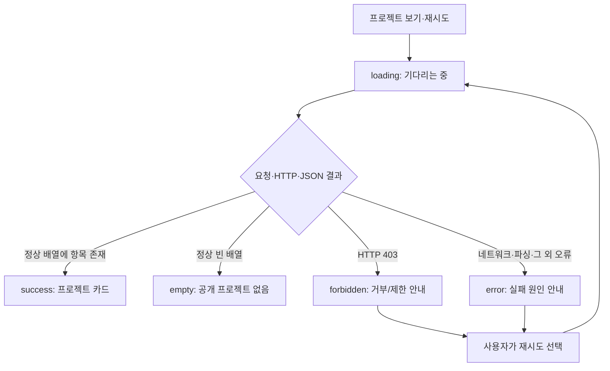
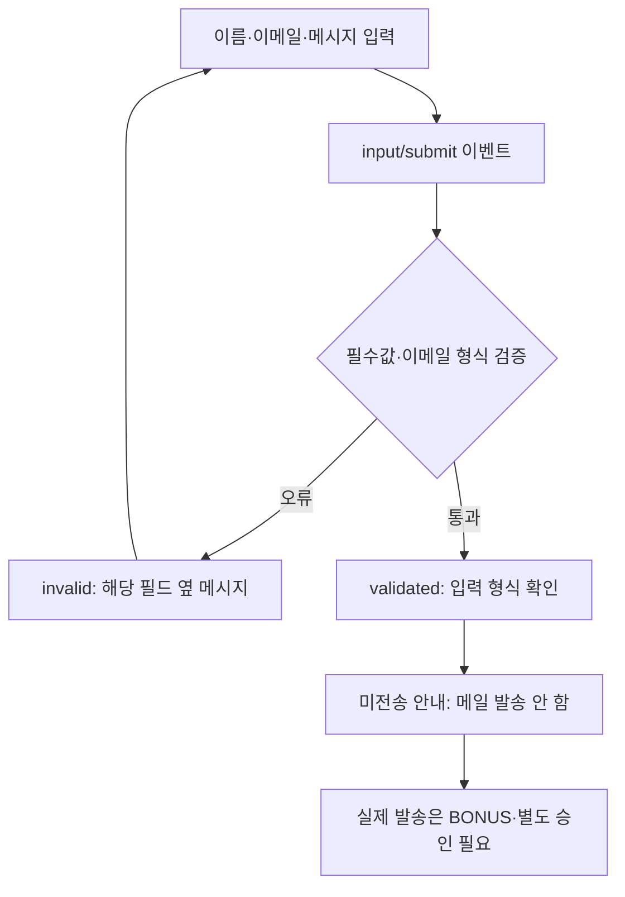

# B1-1 Round 04 — 03-5 GitHub API·문의 폼·보안 설계

> **30초 요약:** GitHub의 공개 프로젝트를 가져올 때와 문의 폼에 글을 입력할 때, **성공뿐 아니라 빈 결과·오류·보안 위험까지** 먼저 설계합니다. 이 파일은 교육·설계 문서이며 신규 웹페이지의 소스 파일이나 실제 실행 기록이 아닙니다.
>
> **단계 상태:** 03-1~03-4 **PASS(문서 기준)** · 03-5 **PASS(설계 문서·정적 검증 기준)** · 03-6~03-8 **NOT_STARTED** · 04 신규 구현 승인 **PENDING** · 실제 API/폼/브라우저/학습자 숙달/CLEAR **NOT_VERIFIED**.

## 처음 5분 — 입문자 학습 경로

**학습 구역과 상세 근거 구분:** **A~G는 처음 배우는 사람이 순서대로 읽는 학습 자료**, **H~K는 시험 계획·공식 요구·기획 프롬프트·검증 근거가 필요할 때 찾아보는 전문가 참고자료**입니다. 처음에는 영어로 된 코드와 모든 표를 외울 필요가 없습니다.

**오늘 스스로 확인할 세 가지:** (1) 정상 빈 목록과 오류가 왜 다른지 (2) 문의 폼의 입력 형식이 맞는 것과 실제 이메일 발송이 왜 다른지 (3) 외부 프로젝트 이름을 HTML 명령이 아닌 글자로 다뤄야 하는 이유. **아래 모든 코드는 문서에만 존재하는 교육용 예시이며 실행하지 않습니다.**

1. **A 용어:** API·비동기·검증·XSS가 무엇인지 일상 비유로 이해합니다.
2. **B 그림:** 정상 목록, 빈 결과, 서버 거부, 네트워크 오류, 입력 오류가 왜 다르게 나타나야 하는지 봅니다.
3. **C~E 설계:** GitHub 요청 → 화면 카드, 폼 입력 → 오류 안내, 안전한 출력의 책임을 구별합니다.
4. **F 교육용 코드:** 작은 코드 예시를 한 줄씩 읽습니다. **실행·새 파일 작성은 하지 않습니다.**
5. **G 종이 실습:** 예상 상태와 화면 문구를 직접 적고 답을 확인합니다.
6. **H~K 전문가 참고:** 미래 시험표·공식 요구 연결·프롬프트 수정 이력·문서 검증 결과는 필요할 때만 펼쳐 봅니다.

| 구역 | 처음 배우는 사람에게 필요한 것 |
|---|---|
| **A** 용어·비유 | API, fetch, async/await, HTTP, XSS, 유효성 |
| **B** 두 개의 Mermaid | 데이터 요청·폼 제출 흐름 |
| **C** GitHub API 상태 | 로딩·성공·빈 결과·403·네트워크·재시도 |
| **D** 폼 동작 | 필수 입력·이메일 검증·필드별 안내·미전송 |
| **E** 보안 원칙 | 외부 텍스트 안전한 삽입·주소 확인·비밀키 금지 |
| **F** 짧은 코드 | 예상 동작을 읽고 설명하는 교육용 예시 |
| **G** 종이 실습·정답 | 자신의 말로 오류·성공 구분하기 |
| **H** 미래 시험 계획 | 승인 후에 무엇을 실제로 시험할지 |
| **I** 요구·평가·학습목표 | R/E/LO 및 상태 책임·다음 단계 |
| **J** 기획 프롬프트 V0.1→V1.0 | 검토·보완 기록 및 승인 경계 |
| **K** 문서 검증·인계 | GitHub 근거와 03-6 인계 |

## A. 용어 → 뜻 → 쉬운 비유

### A-0. 코드를 읽다가 바로 찾는 미니 용어사전

| 코드·용어 | 처음 배우는 사람이 알아야 할 뜻 | 놓치기 쉬운 점 |
|---|---|---|
| `response.ok` | 서버 응답이 정상 범위(HTTP 200~299)인지 알려 주는 참/거짓 값 | HTTP 403은 자동으로 `catch` 처리되지 않습니다 |
| `response.status` | 서버가 보내온 결과 번호(예: 200·403·404) | **403 자체만으로 요청 제한이라고 확정하지 않습니다** |
| `Array.isArray(data)` | 내려온 자료가 목록(배열) 형태인지 확인 | HTTP 200이어도 자료형이 다르면 오류로 처리 |
| `requestId` | 여러 번 요청했을 때 최신 요청을 구별하기 위한 자체 번호 | 늦게 온 옛 응답이 새 화면을 덮는 문제 예방 |
| 요청 취소 제어기(Abort Controller, `AbortController`) | 더는 필요하지 않은 요청을 중단시키는 브라우저 기능 | 취소를 일반 네트워크 실패처럼 표시하지 않음 |
| `aria-invalid` | 입력 필드가 잘못되었는지 보조기술에 알리는 속성 | 글자를 빨갛게 만드는 CSS와는 역할이 다름 |
| `aria-describedby` | 입력 필드와 도움말·오류 문구의 ID를 연결하는 속성 | 실제 오류 문구 요소의 ID가 일치해야 함 |
| `required` | 빈 입력을 허용하지 않도록 설정하는 HTML 속성 | `type="email"`만으로는 빈 값까지 반드시 막지 못함 |
| `textContent` | 문자열을 HTML 명령이 아닌 **글자**로 넣음 | 문자열 자체가 안전해도 링크 주소는 따로 확인 |
| `innerHTML` | 문자열을 HTML 요소 구조로 해석해 삽입 | 외부에서 받은 미신뢰 문자열에는 쓰지 않음 |
| `trim()` | 문자열 양끝 공백 제거 | 공백만 입력한 이름·메시지를 빈 값으로 인식 |
| `??` | 값이 `null` 또는 `undefined`일 때 대체값 사용 | 다른 조건을 검사하는 연산은 아님 |

**비유:** `response.ok`는 접수 가능 표시, `response.status`는 사유가 적힌 번호표, `requestId`는 최신 접수번호라고 생각하면 됩니다.

| 한글·영어·약어 | 초보자용 개념 | 쉬운 비유 |
|---|---|---|
| 응용 프로그램 프로그래밍 인터페이스(Application Programming Interface, **API**) | 다른 서비스에 데이터를 요청하는 통로 | 도서관 안내 창구 |
| 요청 가져오기(Fetch API) | 웹 서버에 데이터를 달라고 요청하는 브라우저 기능 | 대출 신청 |
| 비동기 처리(Asynchronous Processing) | 응답이 올 때까지 다른 화면 작업이 가능함 | 책을 찾는 동안 대기 번호 확인 |
| 비동기 함수(`async`)·응답 기다리기(`await`) | 요청 완료를 순서대로 다루는 JavaScript 구문 | 내 차례를 기다림 |
| 하이퍼텍스트 전송 규약(Hypertext Transfer Protocol, **HTTP**) | 서버와 주고받는 웹 요청·응답 규칙 | 창구의 응답표 |
| 응답 코드(HTTP Status Code) | 200·403·404·429·500 등 서버 결과를 알려 주는 번호 | 정상·거부·문제 발생 표시 |
| 자바스크립트 객체 표기법(JavaScript Object Notation, **JSON**) | 서버가 보낸 구조화된 데이터 표현 | 책 목록이 담긴 표 |
| 유효성 검사(Validation) | 입력값이 필요한 규칙을 만족하는지 확인 | 신청서 빈칸·형식 검사 |
| 문서 객체 모델(Document Object Model, **DOM**) | 브라우저에서 글자·버튼·카드를 표시하는 객체 구조 | 안내판 칸 |
| 교차 사이트 스크립팅(Cross-Site Scripting, **XSS**) | 악의적 문자열이 웹페이지 코드로 해석되는 취약점 | 책 제목에 적은 명령을 직원이 실행하는 실수 |
| 상태(State) | 로딩·성공·오류처럼 현재 화면이 어떤 단계인지 나타내는 값 | 안내 창구의 상태판 |
| 접근 가능한 실시간 알림(Accessible Live Region, `aria-live`) | 상태 메시지 변화를 보조기술에도 전달하도록 돕는 속성 | 바뀐 안내를 음성으로 알려주는 표지 |

**핵심 질문:** 서버가 정상적으로 “항목 0개”를 보낸 것과 아예 서버에 연결할 수 없었던 일은 같은가요? **아니요.** 하나는 정상 빈 목록이고, 다른 하나는 요청 실패입니다.

## B. 먼저 그림으로 보는 요청·폼 흐름

### B-1. GitHub 공개 프로젝트 목록



### B-2. 문의 폼 — 검사와 실제 발송을 구별



**그림의 상태는 설계 예측일 뿐입니다.** 프로그램 API 요청, 폼 제출, 발송, 보조기술 점검은 아직 실행하지 않았습니다.

## C. GitHub API 설계 — 입력→상태→카드·안내

### C-1. 요청 및 데이터 계약

- **공식 경로 모양:** `https://api.github.com/users/{username}/repos` — `{username}`은 향후 확정할 공개 GitHub 사용자 이름을 나타내는 **자리표시자**입니다. 이 문서에서 실제 인물의 사용자명·프로젝트·이메일을 임의로 확정하지 않습니다.
- **데이터 출처:** 공개 GitHub 저장소 목록. 브라우저에 개인 접근 토큰(Personal Access Token, PAT)이나 비밀키를 넣지 않습니다.
- **사용할 핵심 기술:** `fetch`, `async/await`, `try/catch`, `response.ok`, `response.status`, JSON 데이터, `map`, `forEach`의 역할을 구분합니다.
- **배열 변환:** `map`은 목록 데이터 → 카드에 필요한 안전한 속성으로 변환합니다. `forEach`는 그 목록을 화면 노드에 반영할 때 사용합니다. 언어별 `filter`는 **BONUS**이며 구현을 강제하지 않습니다.
- **보안 경계:** 표시 가능한 이름·설명·언어는 일반 텍스트로 처리하고 링크는 `https:` 프로토콜과 허용된 GitHub 도메인인지 확인합니다. 응답에 없는 속성에는 기본 텍스트를 사용합니다. 외부 API 문자열을 실행 가능한 HTML로 해석하지 않습니다.

### C-2. 정확히 구분하는 상태표

| 상태 | 발생 조건(계획) | 화면에 표시할 문구 예시 | 재시도·주의 |
|---|---|---|---|
| `idle` | 아직 요청하지 않음 | “프로젝트 목록을 준비합니다.” | 요청 시작 전 |
| `loading` | 요청 진행 중 | “공개 프로젝트를 불러오는 중입니다.” | 중복 클릭 방지, `aria-busy` 후보 |
| `success` | 정상 HTTP, 파싱 성공, 항목 1개 이상 | 카드 목록과 개수 | API에서 받은 안전한 텍스트만 출력 |
| `empty` | 정상 HTTP, 빈 배열 | “표시할 공개 프로젝트가 없습니다.” | **실패 아님** |
| `forbidden` | HTTP 403 | “요청이 거부되었습니다. 잠시 뒤 다시 시도하세요.” | 403의 원인을 **반드시 요청 제한으로 단정하지 않음** |
| `error` | 네트워크 단절·JSON 파싱 실패·다른 비정상 HTTP | “프로젝트를 불러오지 못했습니다.” | 실패 사유 구분, 수동 재시도 제공 |

**추가 HTTP 오류:** HTTP 429(요청 과다), 404(경로 또는 사용자 없음), 5xx(서버 오류)는 `error`의 구체적 원인으로 기록합니다. 필요하면 429만 별도 제한 안내로 보여줄 수 있으나 **새 CORE 상태를 만들지 않습니다**.

**중요한 기술 차이:** `fetch`는 HTTP 403·404·500 응답을 받았다는 이유만으로 자동으로 `catch`에 들어가지 않습니다. `response.ok` 또는 `response.status`를 먼저 확인해야 합니다. 연결 실패 등은 `catch`에서 처리하고, 응답이 정상이지만 JSON 형식이 잘못된 경우도 오류 상태로 구분합니다.

### C-3. 요청 순서·중복·재시도 책임

- 시작: `state.projects.status = "loading"`, 이전 오류 숨김, 안내 표시.
- 요청 처리: 성공 응답이 배열인지 확인한 뒤, 0개면 `empty`, 1개 이상이면 `success`. HTTP 403이면 `forbidden`, 그 외 오류는 `error`.
- 렌더: 프로젝트 카드와 상태 문구가 서로 모순되지 않도록 상태별로 한 결과만 표시합니다. `role="status"`·`aria-live`는 사용성을 고려하되 실제 보조기술 시험은 05단계입니다.
- 재시도: 실패 후 사용자가 버튼을 눌렀을 때만 다시 요청. 403에서 무한 자동 재시도·과도한 API 호출을 하지 않습니다.
- 경쟁 응답: 연속 요청에서 **오래된 응답이 나중에 도착하여 새 결과를 덮지 않게** 요청 번호(`requestId`) 또는 취소 신호(`AbortController`) 방식 중 하나를 04 구현에 적용하도록 설계합니다. 취소 오류는 새로운 사용자 오류로 오인하지 않습니다.
- 시간당 60회라는 수치는 공식 문서 작성 당시의 **안내값**입니다. 현재 사용자의 실시간 호출 한도는 미측정이며, 이후 실제 응답 헤더에서 확인합니다.

## D. Contact 문의 폼 설계 — 검증은 CORE, 실제 전송은 BONUS

### D-1. 입력 필드·상태·안내

| 필드 또는 동작 | 요구된 내용 | 사용자에게 보여줄 것 |
|---|---|---|
| 이름(`name`) | 공백만 있는 값도 빈 값으로 보고 필수값 확인 | “이름을 입력해 주세요.” |
| 이메일(`email`) | 필수값·기본 이메일 형식 확인 | “올바른 이메일 주소를 입력해 주세요.” |
| 메시지(`message`) | 비어 있거나 공백만 있는 값 차단 | “메시지를 입력해 주세요.” |
| 입력 중(`input`) | 변경된 필드를 다시 검사해 오류 안내 갱신 | 해당 필드 근처 메시지 업데이트 |
| 제출(`submit`) | `event.preventDefault()`로 원치 않는 전송 방지, 전체 검사 | 오류가 있으면 첫 오류 안내·포커스 이동 |
| 검사 통과(`validated`) | 사용자 입력의 **형식만** 통과 | “입력 형식을 확인했습니다. 이 데모에서는 메시지를 전송하지 않습니다.” |

**이메일 검증의 범위:** `type="email"` 및 합리적인 기본 형식 검사를 사용합니다. 형식이 맞다는 것은 **주소가 실제 존재하거나 메일이 도달한다는 보증이 아닙니다**. 강력한 정규식으로 모든 이메일을 판정하겠다는 과도한 약속은 하지 않습니다.

### D-2. 접근성·개인정보 계약

- `label for`와 `input id`를 일치시킵니다. 오류 문구는 해당 필드 인접 위치에 표시하고 `aria-describedby`, `aria-invalid` 등을 통해 화면읽기 프로그램과 연결할 계획입니다.
- 키보드만으로 입력·제출·오류 복귀가 가능하게 설계하고, 첫 오류 필드에 적절히 포커스를 이동합니다. 실제 키보드·보조기술 검사는 후속 단계입니다.
- 기존 폼의 `action`에 승인되지 않은 외부 전송 주소를 넣지 않습니다. **실제 전송 API, Formspree/EmailJS 계정, 개인정보 제3자 제공은 별도 승인**이 필요합니다.
- 사용자 이름·이메일·메시지 원문을 콘솔·로그·URL·`localStorage`·GitHub 저장소에 기록하지 않습니다. 검사 통과 뒤 사용자가 입력한 문구를 공개 페이지에 그대로 표시하지 않습니다.
- 실제 전송 기능이 없으므로 **“보냈습니다”나 “접수되었습니다” 같은 문구를 사용하지 않습니다**. 검증 완료 문구와 미전송 사실을 함께 표시합니다.

## E. 안전한 렌더링·보안 설계

### E-0. 눈으로 비교하는 안전하지 않은 출력과 안전한 출력

외부 프로젝트 제목이 문자 `<b>예시 제목</b>`로 전달됐다고 가정합니다. **다음은 위험을 설명하기 위한 교육용 대조 예시**입니다. 악성 스크립트를 실행하거나 실험하지 않습니다.

```javascript
// ❌ 사용 금지: 외부 문자열을 HTML 명령으로 해석할 위험
// projectTitle.innerHTML = repository.name;

// ✅ 교육용 설계 원칙: 외부 문자열을 '글자'로 표시
projectTitle.textContent = repository.name ?? "이름 없는 프로젝트";
```

| 비교 | `<b>예시 제목</b>`를 넣었을 때의 의미 |
|---|---|
| `innerHTML`에 미신뢰 문자열 직접 사용 | HTML 태그로 해석할 수 있어 XSS 등의 위험을 발생시킴 |
| `textContent` 사용 | `<b>`까지 문자 그대로 표시해 실행 가능한 HTML로 해석하지 않음 |

**주의:** 위 `projectTitle`과 `repository`는 설명용 가상 변수입니다. 실제 앱에서는 요소 존재 확인·신뢰할 수 있는 URL 검사·오류 상태 처리가 추가로 필요합니다. `innerHTML` 자체를 공식 요구에서 제거하지 않고, **신뢰된 고정 마크업에만 제한적으로 사용하는 설계**는 유지합니다.

| 위험 | 잘못된 접근 | 채택한 설계 원칙 | 후속 검증 |
|---|---|---|---|
| XSS: 악성 저장소 이름 | 외부 데이터 문자열을 `innerHTML`로 직접 조립 | 미신뢰 이름·설명은 `textContent`로 출력; DOM 노드 생성 | 공격 문자열이 HTML로 실행되지 않는지 |
| 공식 `innerHTML` 요구 | 모든 사용을 무조건 삭제 또는 외부 데이터를 그대로 삽입 | **신뢰한 정적 HTML 템플릿에만 제한**하여 사용; 외부 문자열과 혼합 금지 | 코드 위치 및 출력 점검 |
| 링크 위·변조 | API의 `html_url`을 검증 없이 `href`에 사용 | URL 파싱 후 `https:`, 허용 도메인 `github.com` 여부 확인; 실패 시 링크 생략 | `javascript:`·외부 도메인 거부 |
| 외부 링크 새 창 | 보호 속성 없는 `target="_blank"` | 필요 시 `rel="noopener noreferrer"` | 링크 검사 |
| 개인정보 유출 | 입력한 이메일·문의 내용을 콘솔·URL·저장소에 남김 | 최소 수집·메모리 내 검사·실제 미전송, 비밀정보 마스킹 | 로그·네트워크·저장소 점검 |
| 인증 토큰 노출 | 공개 `script.js`에 PAT·API 키 포함 | 공개 API는 무인증 접근; 토큰·비밀키 소스 삽입 금지 | 문자열·배포 리소스 검사 |
| 요청 폭주 | 403마다 자동 반복 호출 | 사용자 수동 재시도, 진행 중 중복 방지·한도 존중 | 요청 횟수 및 상태 확인 |
| 잘못된 응답 | 응답이 배열이라고 가정 | 배열·필수 필드 검사, 빈 설명 처리, 예외 안내 | 잘못된 JSON·필드 누락 시험 |
| 경쟁 응답 | 느린 이전 응답이 새로운 결과 덮어씀 | 요청 번호 또는 취소 신호, 최신 요청 결과만 갱신 | 역순 도착 시험 |

**공식 기술 제약 유지:** React/Vue/jQuery/Bootstrap/Tailwind 같은 프레임워크를 새로 도입하지 않습니다. 외부 HTML 문자열을 실행하는 기능, 인라인 `onclick`, 인라인 `style`을 추가하지 않습니다. 브라우저의 콘텐츠 보안 정책(Content Security Policy, CSP)은 배포 환경에 맞춰 03-6에서 추가 검토하되, 이번 단계에 새 서비스 설정을 적용하지 않습니다.

## F. 교육용 코드 조각 — 읽기만 하고 실행하지 않습니다

### F-0. 코드 → 상태 → 예상 화면을 먼저 비교

| 교육용 입력·응답 | 코드에서 확인할 조건 | 계획된 상태 | 사용자 안내 |
|---|---|---|---|
| HTTP 200, 프로젝트가 2개인 배열 | `response.ok=true`, `data.length=2` | `success` | 카드 2개 표시 |
| HTTP 200, 빈 배열 `[]` | `Array.isArray=true`, `data.length=0` | `empty` | 공개 프로젝트가 없다고 알림 |
| HTTP 403 | `response.status === 403` | `forbidden` | 요청 거부 안내·수동 재시도 |
| 네트워크 연결 실패 | `fetch` 예외 → `catch` | `error` | 데이터 요청 실패 안내 |
| 이메일 입력값이 빈 문자열 | `Boolean(email)=false` | `invalid` | 이메일은 필수임을 필드 근처에 표시 |
| 형식상 정상 입력 3개 | 빈 값·형식 검사 모두 통과 | `validated` | 검증 완료, **메일은 미전송** |

위 표는 **미래 구현의 예상 결과**입니다. 실제 API·브라우저·폼에서 실행해 얻은 결과는 아닙니다.

### F-1. 서버가 403을 보냈을 때 `catch`로 자동 이동할까요?

```javascript
// 교육용 의사 구현: 실제 프로젝트 파일에 작성하지 않았습니다.
async function fetchRepositories(url) {
  try {
    const response = await fetch(url);       // 요청 후 응답을 기다림
    if (response.status === 403) {           // HTTP 403 직접 분기
      return { status: "forbidden", data: [] };
    }
    if (!response.ok) {                      // 404, 429, 5xx 등 비정상 응답
      return { status: "error", data: [] };
    }
    const data = await response.json();      // JSON 해석, 실패 시 catch
    if (!Array.isArray(data)) {               // 배열 여부 검사
      return { status: "error", data: [] };
    }
    return data.length
      ? { status: "success", data }
      : { status: "empty", data: [] };
  } catch (error) {                          // 연결 오류·파싱 오류 등
    return { status: "error", data: [] };
  }
}
```

**한 줄씩 확인:** `async/await`는 요청이 끝날 때까지 해당 함수 내 순서를 기다립니다. `response.status === 403`은 서버 거부를 분리하고, `response.ok`는 200번대 정상 응답인지 확인합니다. `Array.isArray`는 목록 자료형인지 검사합니다. 정상 응답이지만 빈 배열이면 `empty`이며 `error`가 아닙니다.

**제한:** 교육용 분기만 보여주는 코드입니다. 실제 API URL·DOM 카드 렌더링·재시도·취소·인증·저장소 처리 등을 갖춘 완성품이 아닙니다.

### F-2. 외부 문자열은 HTML 명령이 아닌 **글자**로 표시하기

```javascript
// 교육용 안전한 DOM 출력 원리
const title = document.createElement("h3");
title.textContent = repository.name ?? "이름 없는 프로젝트";

// 외부 데이터는 textContent로 표시합니다.
// 공식 innerHTML 연습은 신뢰할 수 있는 고정 마크업에만 별도 사용합니다.
```

**왜 안전한가요?** `textContent`는 문자열 속의 `<script>` 등을 **실행할 HTML이 아니라 글자**로 넣습니다. 단, 이것만으로 링크 주소·외부 자산의 안전성이 보장되지는 않으므로 별도 검사해야 합니다.

### F-3. 폼 입력 검증은 전송이 아닙니다

**HTML 입력 필드 설정 예시(독립적으로 실행하지 않음):**

```html
<label for="contact-email">이메일</label>
<input id="contact-email" type="email" required>
```

- `type="email"`은 이메일 형식을 검사하는 단서입니다.
- `required`는 **빈 값을 허용하지 않는 필수 입력 조건**입니다.
- `for`와 `id`가 같아야 레이블이 해당 입력과 연결됩니다.

**JavaScript 교육용 조건식(폼 전체가 아니므로 단독 실행 불가):**

```javascript
// nameInput, emailInput, messageInput은 향후 DOM에서 찾을 입력 요소입니다.
const name = nameInput.value.trim();       // 공백만 있는 이름을 거부
const email = emailInput.value.trim();     // 빈 이메일도 확인
const message = messageInput.value.trim();// 공백만 있는 메시지를 거부
const emailValid = Boolean(email) && emailInput.validity.valid;
const fieldsValid = Boolean(name && message && emailValid);
// fieldsValid가 true여도 실제 이메일 전송은 일어나지 않습니다.
```

| 줄·표현 | 뜻 | 기대 결과 |
|---|---|---|
| `nameInput.value.trim()` | 양쪽 공백을 없앤 이름 | 공백만 있다면 빈 문자열 |
| `emailInput.value.trim()` | 이메일 입력값을 읽어 빈 값인지 확인 | `""`이면 필수 조건 실패 |
| `Boolean(email) && validity.valid` | **이메일이 비어 있지 않고 형식도 유효한지** 확인 | 빈 값·잘못된 형식이면 `false` |
| `Boolean(name && message && emailValid)` | 모든 필수값과 이메일 형식 충족 확인 | 통과 시 검증 안내, **미전송** |

**정확성 경계:** `validity.valid`는 요소의 `type`·`required` 등 HTML 제약 조건에 영향을 받습니다. 따라서 단순히 `emailInput.validity.valid`만 확인하고 이메일이 반드시 입력됐다고 결론 내려서는 안 됩니다. 실제 제출 처리에는 `event.preventDefault()`, 필드 인접 오류, `aria-invalid`·`aria-describedby`, 오류 필드로의 포커스 이동을 추가 설계합니다. **이 코드는 실행하지 않았고 현재 프로젝트의 신규 소스가 아닙니다.**

## G. 입문자 종이 실습 → 예상 정답

### G-0. 스스로 먼저 풀고 아래 예상 답 확인하기

**답안을 보기 전에 종이에 3분 동안 적어 보세요.** 종이를 ① API 입력·결과 ② 폼 입력·결과 ③ 외부 문자열 표시의 세 칸으로 나눕니다.

| 연습 문제 | 힌트 없이 직접 쓸 것 | 답안 확인 위치 |
|---|---|---|
| API가 `[]`을 반환한다면? | 정상 빈 결과인가, 통신 오류인가? | G의 상태표 2번 |
| HTTP 403 응답이라면? | 어떤 상태와 문구가 필요한가? | G의 상태표 3번 |
| 빈 이메일·정상 메시지라면? | `emailValid`·`fieldsValid` 값은? | F-3, G의 상태표 5번 |
| 세 입력이 유효하다면? | 검증 완료와 메시지 발송을 구분해 안내해 보세요 | G의 상태표 6번 |
| 저장소 제목에 HTML 태그가 들어온다면? | 어떤 출력 속성을 사용할까요? | E-0 및 G의 상태표 7번 |

**자기 이해도 확인:** 각 답을 (0) 아직 못 설명함, (1) 힌트를 보고 설명함, (2) 자료 없이 자기 말로 설명함 중 하나로 표시합니다. 이는 **교육용 자체 점검**이지 공식 평가나 실제 학습자 숙달 결과가 아닙니다.

| 순서 | 직접 그려 볼 상황 | 예상 상태와 화면 |
|---|---|---|
| 1 | 공개 저장소 2개를 정상으로 받음 | `success`, 카드 2개 |
| 2 | 서버가 빈 배열 `[]`을 보냄 | `empty`, “표시할 공개 프로젝트가 없습니다.” |
| 3 | 서버가 HTTP 403을 보냄 | `forbidden`, 요청 거부 안내·재시도 |
| 4 | 인터넷 연결이 끊김 | `error`, 네트워크 실패 안내 |
| 5 | 이메일이 비어 있고 제출함 | `invalid`, 이메일 필드 근처 필수 입력 안내 |
| 6 | 이름·이메일·메시지가 형식상 유효함 | `validated`, **형식 확인·미전송** 안내 |
| 7 | 저장소 설명이 ``로 내려옴 | **문자열로만 표시**, HTML 이벤트로 실행되면 안 됨 |

**자기 설명 질문:** 정상적인 빈 데이터와 네트워크 오류는 왜 다를까요? `fetch`의 403은 왜 `response.ok`로 확인해야 할까요? 입력값이 맞다고 “메일 보냈습니다”라고 말하면 왜 안 될까요? 악성 문자열을 `textContent`로 보여줘야 하는 이유는 무엇일까요?

**예상 답:** 정상 빈 결과는 서버 응답 성공이며 오류가 아닙니다. `fetch`는 HTTP 실패 상태를 자동으로 예외 처리하지 않습니다. 폼은 **형식 검증만 완료**했기 때문에 메일 전송 성공이라 말할 수 없습니다. 미신뢰 문자열이 HTML 명령으로 해석되지 않게 하기 위해 텍스트 출력을 사용합니다.

**9요소 학습 연결:** 용어(A) → 원리(C/D) → 비유(A) → Mermaid(B) → 코드(F) → 상태와 결과(C/D) → 오류(E) → 종이 실습(G) → 자기 평가(이 질문). **실제 학습자 점수·숙달 여부는 평가하지 않았습니다.**

## H. 전문가 참고 — 05단계 이후 실행할 수용 시험 설계 (현재 미실행)

**여기부터 K까지는 전문가 참고·검증 구역입니다.** A~G에서 개념을 이해한 뒤 필요할 때만 읽으세요. 아래 테스트 표는 실행 계획이지 실제 시험 결과가 아닙니다.

| 시험 ID | 주입·사용자 조건 | 기대 상태·검증 방법 |
|---|---|---|
| API-01 | 공개 JSON 배열, 프로젝트 2개 | loading→success, 카드 2개, 텍스트·링크 안전 확인 |
| API-02 | HTTP 200 + `[]` | loading→empty, 오류 메시지 아님 |
| API-03 | HTTP 403 | loading→forbidden, 요청 제한 **단정 금지**, 수동 재시도 |
| API-04 | HTTP 404/429/500 | error, 상태 코드에 맞는 안전한 안내 |
| API-05 | 연결 실패·시간 초과 | error, 페이지 전체 사용 가능 |
| API-06 | 잘못된 JSON·비배열 데이터 | error, 빈 프로젝트 목록과 혼동 금지 |
| API-07 | 재시도 두 번 빠르게 클릭 | 중복 요청 방지, 오래된 응답 최신 상태 덮어쓰기 방지 |
| API-08 | 악성 저장소 이름·설명·조작된 `html_url` | 태그 실행 0, 허용하지 않는 링크 생성 0 |
| FORM-01 | 세 필드 모두 빈 값·공백만 입력 | invalid, 각각 가까운 오류·접근성 안내 |
| FORM-02 | 올바르지 않은 이메일 + 정상 나머지 | invalid, 이메일 필드로 안내 |
| FORM-03 | 형식상 올바른 세 필드 | validated + **미전송** 문구, 네트워크 전송 없음 |
| FORM-04 | 키보드 Tab·오류 복귀·다른 입력 | 포커스·label·aria-describedby·aria-invalid 동작 |
| SEC-01 | 웹 리소스·콘솔·로그 확인 | 공개 토큰·개인 입력·비밀키 노출 0 |
| SEC-02 | 새 창 프로젝트 링크 | HTTPS·허용 GitHub 주소·noopener/noreferrer 검증 |

**검증 증빙 계획:** 브라우저/네트워크 상태, 실행 날짜, 소스 SHA, 화면 메시지, 콘솔 오류와 비밀정보 비노출, 사용자 접근성 결과를 05~06단계에 별도로 확보합니다. 이 표의 PASS는 아직 부여하지 않습니다.

## I. 공식 요구·평가·학습목표 대응

| 공식 기준 | 이번 설계의 책임 | 평가 | 학습목표 |
|---|---|---|---|
| R06-01~05 | 세 필드·필수 입력·이메일 형식·오류 인접·submit 성공 안내와 실제 전송 분리 | E05 | LO07 |
| R07-01~04,R07-06 | 화살표 함수·템플릿 리터럴·구조분해·map/forEach 역할 | E12 | LO08 |
| R07-05,R11-01 | `filter` 언어별 선택 기능은 BONUS, 미구현도 CORE 실패가 아님 | E12 (설명) | LO14 |
| R08-01~08 | fetch/async/await/try/catch, loading/success/empty/forbidden/error/재시도 | E04,E11,E12 | LO09,LO13 |
| R08-09 | 과거 60회/시간 안내값을 현재 호출 한도로 확정하지 않음 | E04 관련 | LO09 |
| R09-01~02 | [03-4 이벤트·상태](03-4-EVENT-STATE-DOM-FLOW.md)의 F3 API·F4 폼 2개 흐름 상세화, 실제 구현 0개 | E10 | LO10 |
| R09-03,R11-03 | 필터 상태·Formspree/EmailJS 실제 전송은 BONUS, 승인 전 미실시 | E12 관련 | LO14 |
| R04-05,R12-03~04 | textContent/신뢰된 정적 innerHTML 구별, 인라인 style·onclick 금지 | E10 | LO04,LO13 |

**보류·결정 쟁점:** D01 `filter`는 선택, D07 외부 폼 발송은 별도 승인, D08의 API 한도는 실측 전 미확인, D09의 외부 HTML 문자열은 안전한 DOM 처리, D10의 문서/실행 PASS는 별개입니다. 03-5의 선택을 공식 미션 필수 조건으로 확대하지 않습니다.

## J. 기획 프롬프트 초안 → 검토 → 보완·완성

### J-1. 초안 V0.1 (채택하지 않음)

> GitHub의 공개 저장소를 fetch로 가져와 프로젝트 카드를 표시하고, 문의 폼의 이름·이메일·메시지를 검사하는 웹페이지를 설계하세요. 보안도 고려하세요. 아직 새 코드는 만들지 마세요.

이 초안은 정상 상황만 다루고 **빈 결과·HTTP 실패·비동기·접근성·개인정보·실제 전송 여부**의 중요 경계가 불충분해 그대로 채택하지 않았습니다.

| 개선 ID | 초안에서 빠진 부분 | 최종 V1.0 반영 |
|---|---|---|
| **S01** | 정상·빈 결과 혼동 | success/empty 별도 상태 |
| **S02** | 403을 항상 rate limit으로 해석 | HTTP 403은 거부, 원인 단정 금지 |
| **S03** | HTTP 오류가 `catch`에 자동 진입한다고 오해 | `response.ok/status`와 네트워크 예외 구분 |
| **S04** | 재시도·중복 요청·느린 응답 경합 | 수동 재시도·요청번호/취소 계약 |
| **S05** | HTML 속 악성 문자열 처리 미정 | textContent·안전한 링크 검사·신뢰된 정적 innerHTML |
| **S06** | 폼 성공이 실제 발송으로 보임 | 검증/미전송 별도 문구·BONUS 경계 |
| **S07** | 이름·이메일·메시지 접근성 부족 | label/aria-describedby/aria-invalid·포커스 |
| **S08** | 비밀정보·PII 노출 | 공개 토큰 금지, 입력값 콘솔·URL·저장소 비기록 |
| **S09** | 필수 배열 메서드와 선택 필터 혼동 | map/forEach CORE, filter BONUS 구분 |
| **S10** | 공식 R/E/LO·후속 실행 근거 누락 | 수용 시험 ID와 실제 증빙 책임 연결 |

### J-2. 최종 기획 프롬프트 V1.0 (재사용본)

> **역할:** B1-1 입문자용 GitHub 공개 API, 폼 검증 및 안전한 DOM 렌더링 설계자.
>
> **근거:** [01 요구사항](../01-requirements/REQUIREMENTS-CATALOG.md) R06·R07·R08·R09·R11·R12, [평가 E04/E05/E10/E11/E12](../01-requirements/EVALUATION-15-MAPPING.md), [학습목표 LO07~LO10](../01-requirements/LEARNING-OBJECTIVES.md), [이슈 D01/D07/D08/D09/D10](../01-requirements/SOURCE-CONFLICTS-AND-DECISIONS.md), [03-4 상태 설계](03-4-EVENT-STATE-DOM-FLOW.md), [03-2 화면](03-2-INFORMATION-ARCHITECTURE.md).
>
> **목표:** 공개 저장소 카드의 `idle/loading/success/empty/forbidden/error` 상태와 수동 재시도, 정상·오류 HTTP/JSON·네트워크 예외, 위험한 외부 문자열 안전 출력, 문의 폼의 필수값·이메일·접근성 오류 안내·미전송 성공 UI를 문서로 설계한다.
>
> **필수 산출물:** 상태/전이표, 2개 이상의 Mermaid, 9단계 초보자 학습 경로, 설명용 작은 코드 예시·한 줄 해설, 공격·경계 사례, 보안 위험/완화표, R/E/LO 추적표, 05~06 증빙 예정 조건, 03-6 인계, S01~S10 반영 검토.
>
> **제약:** 00~09 목차와 Round 01~03 보존. `04-src/` 신규 HTML/CSS/JS 작성·복사·실행·배포 금지. `mission.yml` `owner_mission_development_approval: PENDING`, `mission_execution: NOT_STARTED` 유지. AWS·iMac 보류. filter·Formspree/EmailJS는 BONUS이며 별도 승인 전 미실시. 개인정보·Secret 조회/출력/하드코딩 금지. 과거 결과를 Round 04 PASS로 재사용하지 않는다.
>
> **품질 판정:** S01~S10이 모두 설계에 대응하는지 검토하고, 상대경로 링크·Mermaid 코드 블록·기존 소스 SHA·현재 HEAD·변경 파일·승인 상태를 다시 확인한다. **문서 PASS와 기능 PASS를 엄격히 구분한다.**

**프롬프트 검토 결론:** S01~S10을 문제→요구→산출물로 변환했으며, C~I에 실제 설계 내용과 테스트 계획을 작성했습니다. 초안 검토가 실제 API 호출 성공·웹 구현·학습자 이해도 PASS를 뜻하지 않습니다.

## K. 검증 게이트와 03-6 인계

| 검사 기준 | PASS 조건(문서 정적 확인에 한정) |
|---|---|
| 기획 프롬프트 개선 | V0.1·S01~S10·최종 V1.0·산출물 구비 |
| 공식 CORE/선택 | R06 5개, R07 6개(선택 포함), R08 9개(안내 포함), R09 상태·R11 BONUS 구별 |
| 상태·데이터 | 로딩/성공/빈/403/실패/재시도, `response.ok`, 안전한 카드 데이터 설계 |
| 문의 폼 | 이름·이메일·메시지, 필드별 오류, input/submit, validated≠sent |
| 보안·개인정보 | XSS, 검증된 HTTPS 링크, Secret 금지, 개인정보 미보관 |
| 교육·시험 | 그림·코드·종이 실습·답, API/FORM/SEC 미래 시험 사례 |
| GitHub·보존 | 실재 변경 문서만 확인, 상대링크·SHA·승인·이전 Round 보존 |

### 03-5 독립 재조회 검증 결과 — 2026-10-26

> 본 검증은 GitHub `main` 커밋 `d0f30400ef872e4170a7d5c21b087fb7a7d1dae8`의 **03-5 문서 정적 검사 당시 스냅샷**입니다. 이 보고 이후 상태 갱신 커밋은 따로 기록합니다.

| 검사 | 실제 근거 | 판정 |
|---|---|---|
| 프롬프트 초안·검토·완성 | V0.1 → S01~S10 개선 → V1.0 및 C~I 설계 존재 | **PASS — 문서 근거** |
| 공식 범위 | R06·R07·R08·R09와 R11 BONUS, E04/E05/E10/E11/E12·LO 학습 항목 연결 | **PASS — 설계 연결** |
| API 분기 | idle/loading/success/empty/forbidden/error, 403·429 차이, 수동 재시도, 경합·파싱 예외 | **PASS — 문서 항목** |
| 문의 폼 | 이름·이메일·메시지, 필드별 오류/ARIA, 입력 검증과 미전송의 분리 | **PASS — 설계 항목** |
| 안전·개인정보 | textContent/신뢰된 정적 innerHTML 구분, XSS·HTTPS 링크, 토큰·개인정보 기록 금지 | **PASS — 설계 항목** |
| 입문자 학습 | 용어·비유·Mermaid 2개·교육용 코드·오류·종이 실습·정답·미래 시험 사례 | **PASS — 교육 문서 구성** |
| GitHub 링크·구문 | 상대 파일 링크 **12개** 검사, 대상 누락 **0**. 코드 펜스 **10개(5쌍)**, Mermaid **2개** | **PASS — 정적 확인** |
| 개발 미착수·승인 | `04-src/` 내 `README.md`만 존재, 승인 `PENDING` 유지 | **PASS — 현재 파일/승인 경계** |
| 실제 API·폼·보안 시험 | 새 웹페이지 실행, HTTP 응답/전송, 학습자 수행, 브라우저 보안 검증 미실시 | **NOT_VERIFIED** |

**검증 범위 주의:** 본 PASS는 프롬프트와 설계 문서의 정적 존재·경로 확인에 한정합니다. XSS 공격 방어가 실제 실행에서 검증되었거나, API·이메일 발송·브라우저 접근성이 통과한 것은 아닙니다.

### 03-5 입문자 자료 보완 재검증 — 2026-10-26

**독립 재조회 기준 GitHub `main` HEAD: `cb2fb77a34f3d467689fbde8ae9a1c8c94963731`.** 이 값은 아래 정적 검사 시점이며 이후 보고서 갱신 커밋은 별도로 생깁니다.

| 점검 | 독립적으로 확인한 사실 | 판정 |
|---|---|---|
| 학습 순서 | A~G 입문 학습 / H~K 전문 근거 분리, 목차 A~K 전부 존재 | **PASS — 문서 구조** |
| 기술 용어 | `response.ok/status`, `requestId`, `AbortController`, `aria-invalid/describedby`, `required`, `textContent/innerHTML` 등 풀이 | **PASS — 용어 설명 존재** |
| 코드별 결과 | HTTP 200 배열·빈 결과·403·네트워크 실패·빈 이메일·미전송의 상태·문구 비교 | **PASS — 교육용 예상 결과** |
| 폼 검사 보완 | `type="email" required` 및 `Boolean(email) && emailInput.validity.valid` 확인 | **PASS — 빈 값 검사 명시**, 실제 입력 테스트 미실시 |
| 보안 대조 | 위험한 `innerHTML` 사용은 **금지 예시 주석**으로, `textContent`는 교육용 출력 비교로 표시 | **PASS — 문서 표현**, XSS 공격 방어 실증 미실시 |
| 독립 설명·종이 실습 | 답을 보기 전 자가 문제, 예상 답, 도움 수준 0/1/2 구분 | **PASS — 계획 자료**, 학습자 결과 미확인 |
| 범위 보존 | V0.1·V1.0, S01~S10 위험 목록, 공식 R/E/LO 및 기존 설계·시험 계획 보존 | **PASS — 정적 존재 확인** |
| 변경 범위·링크 | 위 HEAD에서 03-5와 03 README **문서 2개만 변경**; 내부 상대 링크 총 **37개 검사**, 대상 누락 0, 미닫힘 코드 펜스 0, Mermaid 총 4개(두 문서 합계) | **PASS — 저장소 정적 재조회** |
| 실행·기존 자료 | `mission.yml` 승인 `PENDING`, 실행 `NOT_STARTED`; `04-src/`는 README만 존재, 기존 Round 01/03 주요 파일 Blob SHA 동일 | **PASS — 보존 및 승인 경계** |

**주의:** 자료가 초보자 친화적으로 정리되었다는 것은 **실제 학습자가 이해·설명·재현에 성공했다는 증명은 아닙니다**. 코드 실행, 보안 공격 시험, API 호출, 폼 전송, Chrome/WSL2 환경, 학습자 숙달·미션 CLEAR는 여전히 `NOT_VERIFIED`입니다.

**03-6 인계:** 프로젝트 API의 성공/빈/403/네트워크 실패·악성 데이터, 폼 필드별 오류/미전송/접근성, 375/768/1024 화면, 키보드·감속 모션, GitHub Pages 자산 경로, Chrome/Live Server의 **미래 정적·브라우저·안전 시험 계획**을 통합합니다.

**금지 경계:** 현재 문서에서 적은 짧은 소스 예시는 **교육용**이며, `training/round-04-agent/04-src/`의 신규 실행 코드는 04단계 **별도 개발 승인 후** 작성할 수 있습니다. 현재 원격 API 요청, 실제 입력 수집·전송, 배포, 테스트, 공식 학습자 진단은 모두 미실시입니다.

[03단계 시작 안내](README.md) · [03-4 이벤트 상태 설계](03-4-EVENT-STATE-DOM-FLOW.md) · [01 공식 요구](../01-requirements/REQUIREMENTS-CATALOG.md) · [02 환경 분석](../02-analysis/ENVIRONMENT-BASELINE.md) · [미션 승인 정보](../mission.yml)
