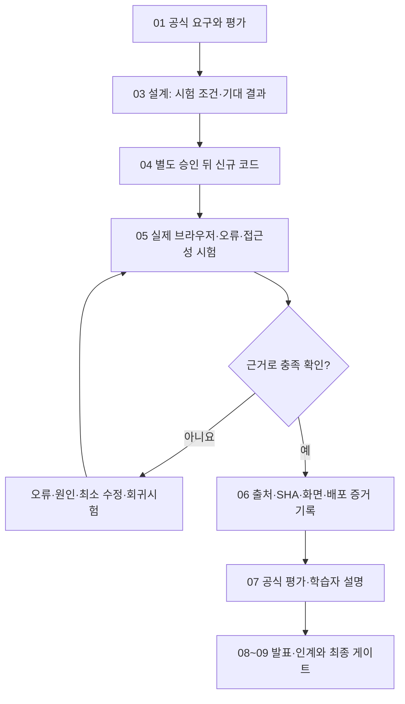
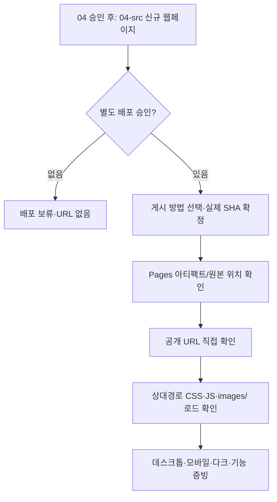

# B1-1 Round 04 — 03-6 품질·접근성·테스트 및 배포 증빙 설계

> **30초 요약:** 프로그램을 만든 다음 **무엇을, 어떻게, 어떤 증거로 확인할지** 미리 정하는 단계입니다. 현재는 **시험 계획을 만들 뿐 시험·설치·명령 실행·배포를 하지 않습니다.**
>
> **현재 상태:** 03-1~03-5 `PASS(문서 설계 범위)` · 03-6 `PASS(기획·품질·접근성·시험 설계 문서 정적 검증 기준)` · 03-7~03-8 `NOT_STARTED` · 04 신규 코드 개발 승인 `PENDING` · 현 WSL2·브라우저·학습자 숙달·배포·미션 CLEAR `NOT_VERIFIED`.

## 처음 5분 — 입문자용 읽기 안내

1. **A. 개념:** '테스트'와 '증빙'이 무엇인지 비유로 이해합니다.
2. **B. 전체 그림:** 요구사항부터 시험·근거·PASS 판정까지의 과정을 봅니다.
3. **C. 화면·접근성:** 모바일/태블릿/데스크톱, 키보드만으로 조작 가능한지 알아봅니다.
4. **D. 동작·오류·보안:** 버튼·API·문의 폼의 성공뿐 아니라 실패도 구분합니다.
5. **E. 환경·배포:** 어떤 실행 환경과 배포 주소를 나중에 검증할지 확인합니다.
6. **F~G. 증거·연습:** 무엇을 캡처하고 어떻게 판정할지 종이에 예상합니다.
7. **H~J. 전문가 참고:** 기획 프롬프트 수정 이력, 상세 시험 ID·공식 요구 추적과 문서 검증을 봅니다.

**핵심 구분:** *검사할 방법을 정함* = **설계 문서 완료**. *실제로 검사해서 기대 결과를 확인함* = 미래 **실행 PASS 후보**. 이번 단계에서 둘을 혼동하지 않습니다.

## A. 용어 → 뜻 → 쉬운 비유

| 한글(영어·약어) | 입문자용 설명 | 쉬운 비유 |
|---|---|---|
| 품질 보증(Quality Assurance, QA) | 요구한 기능·설명이 신뢰 가능하도록 기준을 마련함 | 출고 전 자동차 검사 계획 |
| 테스트 사례(Test Case, TC) | 입력·행동·예상 결과·판정 기준을 한 묶음으로 적은 것 | 버튼을 눌러 무엇을 볼지 적은 시험지 |
| 수용 기준(Acceptance Criteria) | 제대로 됐다고 판단할 관찰 조건 | 운전면허 시험의 채점 기준 |
| 증빙(Evidence) | 실제 확인했다는 것을 뒷받침할 화면·로그·시점·코드 버전 | 날짜와 번호가 있는 검사 기록 |
| 회귀 시험(Regression Test) | 변경 뒤 전에 잘 되던 기능이 여전히 되는지 확인 | 수리 뒤 다른 장치도 확인 |
| 반응형 웹(Responsive Web Design, RWD) | 화면 폭에 따라 배치가 자연스럽게 변함 | 작은 책상과 큰 책상에 물건 배치 |
| 브레이크포인트(Breakpoint) | 화면 배치 규칙이 전환되는 폭 | 문턱을 넘으면 다음 구역 |
| 웹 접근성(Web Accessibility, a11y) | 키보드·화면읽기 도구 등 다양한 방식으로 이용 가능하게 설계 | 계단 외에도 이용 가능한 출입 방법 |
| 키보드 포커스(Keyboard Focus) | 현재 Tab 이동 대상으로 선택된 항목 | 커서가 있는 칸 표시 |
| 감속 모션 선호(`prefers-reduced-motion`) | 화면 효과 움직임을 줄이도록 지정한 사용자 설정 | 멀미 방지를 위한 효과 축소 |
| 문서 객체 모델(Document Object Model, DOM) | 브라우저가 HTML 화면 요소를 관리하는 구조 | 가게 진열표 |
| 엔드투엔드 시험(End-to-End, E2E) | 공개 웹주소에서 방문자 행동 전체를 검증 | 출발부터 목적지까지 길 점검 |
| 깃 커밋 해시(Git Commit SHA) | 검사 당시 어떤 코드 버전이었는지 구별하는 식별값 | 검사 대상 제품의 일련번호 |
| PASS / FAIL / NOT_VERIFIED | 실제 기준 충족 / 실제 기준 미충족 / 아직 확인 전 | 시험 결과 / 불합격 / 미응시 |

**먼저 스스로 답해 보기:** 375px 화면을 확인하기로 *계획했다*는 사실은 375px 화면이 실제로 정상 동작한다는 뜻일까요? **아닙니다.**

## B. 왜 설계 단계부터 검증 계획을 만들까요?



**입문자 예시:** '휴대전화에서 가로 스크롤이 나오지 않아야 한다'는 **기대 결과**입니다. 실제 Chrome에서 화면 너비와 문서 너비를 비교해 가로 넘침이 없다는 증거를 확보하기 전에는 `PASS`라고 적지 않습니다.

**단계 경계:** 03-6은 설계 문서를 검증할 수 있지만 `05-tests/`, `06-evidence/`의 **실제 실행 결과를 미리 작성하지 않습니다**.

## C. 화면·접근성 시험 설계 (R01~R03·R05·R12)

### C-1. 모바일 → 태블릿 → 데스크톱을 한눈에

```text
375px   [메뉴 버튼]  [카드1]
                   [카드2]
                   [카드3]

768px   [가로 메뉴 후보] [카드1] [카드2]
                        [카드3]

1024px  [넓은 메뉴] [카드1] [카드2] [카드3]
```

**그림의 한계:** 768px에서 정확히 2열, 1024px에서 정확히 3열이라는 보장은 없습니다. `Grid auto-fit/minmax`의 실제 열 수는 사용 가능한 폭과 카드 최소 너비에 따라 달라집니다. 위 배치는 **설명용 예상 사례**입니다.

### C-2. 시험할 화면 크기와 경계

| ID | 화면 너비(미래 실제 시험) | 행동·검사 | PASS로 기록하려면 확인할 것 |
|---|---|---|---|
| RES-01 | **375px** | 메뉴·Hero·About·카드·문의 폼을 스크롤 | 가로 넘침 0, 내용을 읽고 조작 가능, 모바일 메뉴 토글 가능 |
| RES-02 | **767px** | 768 직전 화면 | 본문·메뉴·카드 겹침 없음 |
| RES-03 | **768px** | 첫 `min-width` 경계 | 전환 규칙 적용, 가로 메뉴·카드 배치에 깨짐 없음 |
| RES-04 | **1023px** | 1024 직전 | 전환 전 상태에서 누락·넘침 없음 |
| RES-05 | **1024px** | 두 번째 `min-width` 경계 | 넓은 화면 규칙 적용, 내용 가독성 유지 |
| RES-06 | **1280px** | 넓은 화면 | 최대 콘텐츠 폭·여백·카드 자동 정렬 적절 |
| RES-07 | 위 폭 각각 + 긴 제목/긴 URL | 예외 콘텐츠 검사 | 이미지·카드·폼·링크가 부모 너비를 밀지 않음 |
| RES-08 | 밝은·어두운 테마 각각 | 색상·링크·오류 메시지 가독성 | 텍스트·배경 대비, 상태가 색만으로 표현되지 않음 |

**시험 매체:** 향후 실행 허가 뒤 최신 Chrome의 DevTools(Device Toolbar) 또는 실제 화면 폭으로 검사합니다. 03-3의 `768px/1024px`은 설계 기준이고, 검증 당시 브라우저 버전·운영체제·소스 SHA를 함께 남깁니다. 가로 넘침은 눈대중만 보지 않고 **뷰포트 폭과 문서 콘텐츠 폭**을 비교하도록 설계합니다.

### C-3. 키보드·시맨틱 HTML·보조기술·감속 모션

| ID | 실제 수행할 점검 | 미래 PASS 수용 기준 |
|---|---|---|
| A11Y-01 | 페이지 첫 Tab부터 Skip Link → 주요 콘텐츠 접근 | Skip Link가 포커스를 받았을 때 보이고 `main`으로 이동 |
| A11Y-02 | Tab/Shift+Tab으로 메뉴·테마·CTA·폼 조작 | 순서가 자연스럽고 포커스 표시가 명확; 키보드 함정 없음 |
| A11Y-03 | 모바일 메뉴 열고 Escape·링크 선택 후 닫기 | `aria-expanded`와 실제 표시·포커스 이동 일치 |
| A11Y-04 | 화면 폭을 모바일↔데스크톱으로 바꾸면서 메뉴 조작 | `hidden`/CSS 충돌 없이 탐색 가능 |
| A11Y-05 | `header/nav/main/section/article/footer` 의미·제목 확인 | 하나의 핵심 `main`, 유일한 주제 `h1`, 논리적 제목 순서 |
| A11Y-06 | About 이미지 및 장식 이미지 확인 | 의미 있는 이미지 `alt`, 장식은 중복 설명 방지 |
| A11Y-07 | 폼 `label for`·`id`, 오류 `aria-describedby/aria-invalid` 검사 | 입력-레이블·오류 문구가 시각 및 프로그램상 연결 |
| A11Y-08 | 프로젝트 로딩·빈 결과·403·폼 오류 상태 변경 | `role="status"`/`aria-live` 등의 갱신이 이해 가능하고 과도한 중복 발표 없음 |
| A11Y-09 | 밝은/어두운 테마, hover·focus-visible 확인 | 키보드 포커스 및 오류가 색만으로 표시되지 않음 |
| A11Y-10 | 브라우저/OS의 `prefers-reduced-motion: reduce` 지정 | 스크롤·등장 효과를 줄여도 내용·기능 사용 가능 |
| A11Y-11 | JavaScript 지연/Observer 미지원 상황 | 중요한 콘텐츠가 화면에서 영구적으로 숨겨지지 않음 |

**명시:** 위 수용 기준은 웹 접근성 시험 **설계안**입니다. 보조기술의 실제 호환·색상 대비 숫자·스크린리더 음성 안내는 실행 후 증빙으로 판정합니다. CSS 속성·ARIA 텍스트 존재만으로 PASS 선언하지 않습니다.

## D. 상호작용·API·폼·보안 및 회귀 시험 설계

### D-1. 03-4의 필수 6개 상호작용

| 시험 ID | 구체적 시험 입력 | 기대 동작 | 관련 요구 |
|---|---|---|---|
| INT-01 | 모바일 메뉴 1회→2회 클릭, Escape | 닫힘→열림→닫힘, 접근성 상태 동기화 | R05-01 |
| INT-02 | `#home/#about/#skills/#projects/#contact` 메뉴·CTA 클릭 | 대응 ID로 이동, 기본 앵커 기능 유지, 모션 선호 반영 | R02-05,R05-02 |
| INT-03 | 스크롤 **299/300/301px** 및 맨 위 버튼 클릭 | 기준 `>=300`이면 버튼 노출, 클릭 시 상단으로 이동 | R05-03 |
| INT-04 | 스크롤 **59/60/61px** | 기준 `>=60`이면 상단 배경 상태 변화 | R05-04 |
| INT-05 | 테마 두 번 토글·새로고침·저장소 사용 제한 | light/dark 전환·정상값 복원; 저장 실패 시 사용 가능 | R03-03,R05-05 |
| INT-06 | 콘텐츠 화면 진입/이탈, `threshold:0.2`, 감속 모션 | 등장 효과 조건·내용 노출; **0.2는 권장**이며 변경하면 README 기록 | R05-06,R05-07 |

**D03/D04 해석 고정:** 60px·300px은 해당 설계의 시험 기준이며 변경 시 실제 구현 README에 이유와 값을 적습니다. `IntersectionObserver` 0.2는 **RECOMMENDED(권장)**로 취급합니다. 숫자 임계값을 공식 필수로 과장하지 않습니다.

### D-2. 독립 이벤트→상태→DOM 흐름 검증(최소 3개)

| ID | 사건·상태 변화 | 예상 DOM·화면 결과 | 실제 증거 예정 |
|---|---|---|---|
| FLOW-01 | 메뉴 클릭 → `menuOpen` 반전 | 메뉴 표시·`aria-expanded` 변화 | 버튼·메뉴·상태 로그/캡처 |
| FLOW-02 | 테마 클릭 → `theme` 변경·저장 | `data-theme`·문구·재방문 복원 | 요소 속성·저장 값·화면 |
| FLOW-03 | API 결과 → `projects.status` 변경 | 로딩/카드/빈/403/오류 영역 변화 | 모의 응답·DOM·네트워크·화면 |
| FLOW-04 | 폼 입력·제출 → `form.status` 변경 | 필드 오류/validated 미전송 안내 | 입력 조건·오류 문구·화면 |
| FLOW-05 | 스크롤 → `showTop/headerScrolled` 변경 | 맨 위 버튼·헤더 상태 | scrollY 경계·DOM 속성 |

**판정 규칙:** 03-4에는 **다섯 개 설계 흐름**이 있지만 실제 구현은 0개입니다. 05단계에서는 독립적인 세 흐름 이상을 실제 코드·입력·상태 변화·화면 증거로 연결해야만 R09-02 실행 PASS를 줄 수 있습니다.

### D-3. 프로젝트 API·폼·보안 시험

| ID | 미래 시험 조건 | 기대 결과 |
|---|---|---|
| API-01 | HTTP 200 + 정상 저장소 2개 | `loading→success` 카드 2개 표시 |
| API-02 | HTTP 200 + `[]` | `empty`, **정상 빈 결과** 안내 |
| API-03 | HTTP 403 | `forbidden`, 거절 안내 및 사용자의 수동 재시도; 403 원인 단정 금지 |
| API-04 | HTTP 404/429/5xx·네트워크 실패 | `error`와 구별 가능한 안전한 안내 |
| API-05 | JSON 파싱 실패·배열 아닌 응답 | `error`, 예외 처리 뒤 다른 기능 사용 가능 |
| API-06 | 빠른 재시도·응답 순서 역전 | 이전 응답이 최신 결과를 덮지 않음 |
| API-07 | 외부 데이터 중 HTML처럼 보이는 문자열·결측값 | 태그는 글자로 출력, 카드 정상 표시 또는 안전한 기본값 |
| FORM-01 | 이름·이메일·메시지 빈 값·공백만 입력 | 모든 필수값 검사와 필드별 오류·포커스 |
| FORM-02 | 이메일에 `@` 없는 값과 유효한 형식 비교 | 이메일 형식 오류 구별, `required`와 빈 이메일 검사 확인 |
| FORM-03 | 세 필드 모두 형식상 정상 값 | `validated`, **“검증 완료·미전송”** 정확한 안내, 실제 네트워크 전송 없음 |
| FORM-04 | 오류 수정·Tab·Enter·키보드만 사용 | 오류 메시지·포커스·레이블이 유효하게 변경 |
| SEC-01 | 보안 테스트용 무해한 문자열 `<b>예시</b>` 출력 | 글자 그대로 표시, HTML 태그로 실행/해석되지 않음 |
| SEC-02 | 링크 `javascript:`·허용하지 않은 도메인·정상 HTTPS GitHub URL | 위험한 링크 거부, 정상 링크의 안전한 속성 |
| SEC-03 | 배포 리소스·콘솔·브라우저 저장소·요청 확인 | 토큰/비밀키·개인 입력값 비의도적 공개 없음 |
| SEC-04 | 임의의 403 반복 상황 | 자동 무한 재시도 없이 사용자가 제어; 실제 한도는 응답 헤더 검토 |

**위험 테스트의 안전 원칙:** 실제 타인 계정에 반복 호출하거나 개인 이메일·실제 문의 데이터를 수집하지 않습니다. 가능한 **고정된 모의 응답과 무해한 문자열**로 먼저 시험하고, 필요한 승인 범위에서만 공개 API를 최소 호출합니다. XSS 설계 검증에서는 위험한 코드 실행을 목표로 하지 않습니다.

## E. 현재 환경 확인·GitHub Pages 배포 검증 계획

### E-1. 로컬 개발 도구 검사 — 실제로 실행한 것은 아님

| 대상 | 나중에 확인할 항목 | 현재 판정 |
|---|---|---|
| Windows 11 Pro / WSL2 Ubuntu | 사용 OS·배포판·작업 경로·권한·코드 SHA | **NOT_VERIFIED** |
| Git·Codex CLI·Python | 필요한 도구의 실재 여부·버전 | **NOT_VERIFIED** |
| VS Code + Live Server | 공식 요구의 설치·동작, 로컬 접속 URL·포트 | **NOT_VERIFIED** |
| Chrome/Chromium | 실행 가능·버전·개발자 도구·콘솔 오류 | **NOT_VERIFIED** |
| GitHub 원격 `main` | 설계 파일·원본·커밋 내용 | **별도 GitHub 정적 조회만 가능** |
| 인증·네트워크 | GitHub 공개 API/Pages 접근·권한·호출 제한 | **현재 런타임 NOT_VERIFIED** |

**D05 주의:** 저장소의 `.vscode/extensions.json`에 Live Server 추천이 있더라도 지금 WSL2에 실제 설치·동작한다는 뜻이 아닙니다. 04 구현·05 검증 단계에 필요한 최소 점검만 따로 수행합니다.

### E-2. Pages 게시 구조에서 놓치기 쉬운 점

현재 저장소의 루트 `index.html`은 **기존 상태 안내용**이며, 신규 웹페이지의 작성 예정 위치는 `training/round-04-agent/04-src/index.html`입니다.

GitHub Pages의 통상적인 브랜치 게시 원본 설정에서 **임의의 깊은 하위 폴더를 바로 게시 루트로 선택할 수 있다고 가정하지 않습니다**. 현재 미션을 위한 별도의 게시 경로·워크플로가 승인되어야 하며, 예를 들면 **승인된 GitHub Actions가 `04-src/`를 배포 아티팩트로 묶어 Pages에 게시하는 방식**을 설계 후보로 기록합니다. **지금 Actions 수정·배포는 하지 않습니다.**



| ID | 게시 검증 항목 | 미래 PASS 수용 기준 |
|---|---|---|
| PUB-01 | 별도 배포 승인·게시 원본·설정 검토 | 사용자 승인과 변경 범위, 선택한 Pages 원본·워크플로의 출처 기록 |
| PUB-02 | 공개 URL 열기 | 신규 Round 04 웹페이지가 공개 URL에서 로드됨; **옛 루트 안내와 혼동하지 않음** |
| PUB-03 | `css/style.css`, `js/script.js`, `images/` 상대경로 | 하위 경로 배포에서 404 없이 신규 파일 로드 |
| PUB-04 | URL에서 메뉴·테마·API·폼·모바일·스크롤 조작 | 로컬뿐 아니라 실제 공개 주소에서 핵심 기능 사용 가능 |
| PUB-05 | 데스크톱/375px 모바일/다크모드 화면 | 세 종류 화면의 실제 출처·시각·소스 SHA 일치 |
| PUB-06 | 공개 저장소·README·실제 배포 연결 | Pages URL, GitHub 저장소 URL, 당시 배포 SHA, 버전과 변경 기록 일치 |

**R10 분리:** `PUB` 항목을 작성하는 것은 배포 성공이 아닙니다. 지금 **신규 공개 URL·배포 SHA·실제 화면 캡처는 없습니다.** GitHub Pages의 기존 이전 차수 URL·PASS를 Round 04 성공으로 재사용하지 않습니다.

## F. 증거 수집·PASS/FAIL 판정 규칙

### F-1. 시험 한 건을 기록하는 표준 필드

| 기록 항목 | 기록 방법 |
|---|---|
| 시험 ID | 위 표의 `RES-01`, `API-03`, `PUB-02` 같은 고유 ID |
| 요구·평가 ID | `R03-06`·`E01` 등 관련 항목 |
| 수행 시각·환경 | 날짜(KST), WSL2/Chrome 버전, 화면 너비·테마·네트워크 조건 |
| 코드 출처 | Round 04 실제 파일 경로와 Git 커밋 SHA |
| 입력·예상 출력 | 스크롤 위치·HTTP 모의 응답·폼 입력 조건·키보드 조작 |
| 실제 관찰 | 화면·DOM·네트워크/로그·오류 출력(비밀값·PII 마스킹) |
| 증거 파일 | 이후 `05-tests/` 실행 보고와 `06-evidence/` 캡처·로그 위치 |
| 최종 판정 | 기대와 실제가 일치하면 PASS, 재현된 불일치는 FAIL, 미실시는 NOT_VERIFIED |
| 실패·재검증 | 재현 절차·최소 수정 범위·수정 SHA·회귀시험 결과 연결 |

**규칙:** `PASS`는 개별 시험 항목마다 **실제 결과·출처 SHA·환경이 기록**될 때만 줄 수 있습니다. 05단계 시험과 06단계 증빙은 **다른 산출물**입니다. HTML 태그·CSS 속성·README 내용만 존재하는 것은 실제 사용성 PASS가 아닙니다.

### F-2. 기능·교육·최종 CLEAR는 다른 축입니다

- **03 설계 문서 게이트:** 문서 내용/추적표/시험 기준/링크 정적 검증만 가능한 범위.
- **05 기능·접근성 게이트:** 신규 Round 04 실제 소스 실행·브라우저 재현·오류 경로 검증.
- **06 증빙·배포 게이트:** 공개 URL·화면·로그·날짜·SHA 대응 확인.
- **07 학습자 숙달 게이트:** AI 도움 수준을 구분한 실제 자기 설명·독립 재현 점검.
- **09 최종 인계/CLEAR:** 모든 필수 게이트 실증 뒤에만 후보.

## G. 입문자 종이 실습 → 예상 정답

**종이에 먼저 써 보기(아직 프로그램 실행하지 않음):**

1. 화면 폭 **767px과 768px**에서 어떤 CSS 경계가 달라지는지 화살표로 그립니다.
2. 사용자가 스크롤을 **299px → 300px**로 이동했을 때 맨 위 버튼이 어떻게 변해야 하나요?
3. GitHub 서버가 HTTP 200과 `[]`를 보낸다면 정상인가요? HTTP 403과 무엇이 다른가요?
4. 이메일 주소가 비어 있는 문의 폼을 제출하면 어떤 메시지를 **어디에** 보여줘야 하나요?
5. 프로젝트 제목에 `<b>예시</b>`가 들어와도 글자로 표시하려면 어떤 DOM 방법을 선택하나요?
6. 새 소스를 배포하지 않고 이전 Round URL을 열어 본 결과를 이번 미션의 `PUB-02 PASS`로 기록해도 되나요?

**예상 정답:** ① 768px 이상에서 태블릿 CSS 규칙이 적용되나 실제 카드 열 수는 자동 폭에 좌우됨 ② 설계상 `>=300`이면 버튼 보임 ③ 200+`[]`는 정상 빈 결과, 403은 거절 ④ 이메일 입력 근처 오류 및 보조기술 연결 ⑤ `textContent` ⑥ 아니요, 수행 차수·코드 SHA·URL 출처가 다릅니다.

**스스로 점검:** 도움 없이 이유와 예상 결과까지 설명했는가? 못 했다면 A(용어)→C(화면)→D(실패/상태)를 다시 읽습니다. 실제 학습자의 답·점수·L1~L5 숙달 판정은 아직 **NOT_VERIFIED**입니다.

## H. 기획 프롬프트 초안 → 자체 검토 → 수정·완성

### H-1. 초안 V0.1 (채택하지 않음)

> B1-1 새 포트폴리오가 모바일·데스크톱에서 잘 보이고, 메뉴·API·폼이 정상인지 테스트하고, GitHub Pages에 배포됐는지 확인하는 테스트 계획을 작성해 주세요. 코드는 작성하지 마세요.

**초안 검토:** "잘 보인다", "정상"이 추상적이고 입력·기대값·증거 기준·승인 경계가 없어 **이대로 사용하면 PASS를 과장할 위험**이 있습니다.

| 개선 ID | 초안 누락·위험 | 최종 V1.0 보완 |
|---|---|---|
| **T01** | 화면 폭 수치·경계 누락 | 375/767/768/1023/1024/1280px, 가로 넘침·카드 기준 |
| **T02** | 모바일 키보드·보조기술·감속 모션 누락 | Skip link·Tab·Escape·ARIA·alt·label·reduced motion |
| **T03** | 테마/스크롤/Observer 숫자 빠짐 | 59/60/61px, 299/300/301px, threshold 0.2 권장 |
| **T04** | 기능 6종·상태→DOM 최소 3개 미연결 | INT 6개와 FLOW 5개, 구현 0개 구분 |
| **T05** | API·폼의 빈 결과/오류 혼동 | 정상·빈·403·네트워크·파싱·미전송 개별 시험 |
| **T06** | 보안·비밀정보·링크 및 리플레이 누락 | 무해한 XSS 문자열·URL·토큰·요청 경합 모의 테스트 |
| **T07** | 실측 환경을 검증했다고 오인 | WSL2·VS Code·Live Server·Chrome 미확인 명시 |
| **T08** | GitHub Pages 하위 경로/게시 방식 미검토 | `04-src/`와 루트 안내 구별·별도 배포 승인·URL/상대경로 |
| **T09** | 스크린샷만 남기고 버전 출처 상실 | 시험 ID·기대/실제·KST·환경·SHA·화면·로그·증거 경로 |
| **T10** | 문서 PASS=프로그램/CLEAR PASS 혼동 | 03/05/06/07/09 게이트 분리 및 제한 |
| **T11** | 입문자 설명과 실제 수행 경계 불명 | 한글·영어·약어·비유·Mermaid·종이 예측·정답 |
| **T12** | 요구·평가 누락·CORE/BONUS 혼합 | R01~R12·E01~E15·LO 매핑, 선택 기능 별도 |

### H-2. 최종 기획 프롬프트 V1.0 (재사용 가능)

> **역할:** B1-1 입문자 친화적 웹 품질·접근성·보안·브라우저 검증 설계자.
>
> **근거 순서:** [01 요구 추적](../01-requirements/REQUIREMENTS-CATALOG.md) R01~R12, [평가 15개](../01-requirements/EVALUATION-15-MAPPING.md), [학습목표 14개](../01-requirements/LEARNING-OBJECTIVES.md), [출처 쟁점](../01-requirements/SOURCE-CONFLICTS-AND-DECISIONS.md), [03-2 정보 구조](03-2-INFORMATION-ARCHITECTURE.md), [03-3 반응형](03-3-FILE-RESPONSIBILITIES-AND-RESPONSIVE-LAYOUT.md), [03-4 상태](03-4-EVENT-STATE-DOM-FLOW.md), [03-5 API·폼·보안](03-5-API-FORM-SECURITY-DESIGN.md).
>
> **목표:** 웹페이지의 모든 필수 요구사항을 **시험 ID → 입력/조건 → 기대 결과 → 증빙 파일·코드 SHA → PASS/FAIL/NOT_VERIFIED 기준**으로 추적 가능한 설계 문서로 작성하라. 교육 자료만으로 실제 실행 성공을 주장하지 말라.
>
> **산출물:** ① 입문자 학습 A~G·비유·Mermaid·종이 재현 ② 화면 375/767/768/1023/1024/1280px 및 테마 시험 ③ 키보드·시맨틱·ARIA·감속 모션 체크리스트 ④ 6개 필수 상호작용·최소 3개 상태 흐름 ⑤ API/폼/XSS/링크·개인정보·실패/재시도·회귀 조건 ⑥ VS Code·Live Server·Chrome·WSL2 미확인과 후속 최소 진단 ⑦ GitHub Pages `04-src/` 배포 경로 후보·승인·공개 URL·리소스 404·캡처 ⑧ TEST/EVIDENCE SHA·시점·환경 양식 ⑨ 공식 R/E/LO 매핑·03-7 인계 ⑩ 프롬프트 초안 V0.1과 T01~T12 보완 이력.
>
> **금지:** 이전 Round 01~03 코드·이력·증빙·기존 루트 수정/복제/삭제 금지. `04-src/` 신규 코드 작성, 패키지 설치, WSL2 명령 실행, 실제 브라우저/API 시험, Actions 변경, Pages 배포·병합·프로덕션 변경 금지. `owner_mission_development_approval=PENDING` 유지. AWS·iMac 보류.
>
> **품질 판정:** 문서 자체의 누락·모순·링크·코드펜스·Mermaid·공식 요구 대응을 GitHub 재조회로 검증하고, 실제 미실시 항목은 무조건 `NOT_VERIFIED`로 표시한다. 03-7 학습 설계와 03-8 종합 QA에 인계하되 04 개발을 시작하지 않는다.

**프롬프트 검토 결론:** V0.1이 가진 T01~T12 누락을 V1.0으로 구체화했고, C~G·I~J에 실제 설계 명세와 교육 내용을 반영했습니다. 이는 **문서 내 구성 검토**이며 실제 실행 시험의 근거가 아닙니다.

## I. 공식 요구·평가·학습 목표 추적

| 공식 요구 영역 | 이번 시험·증빙 계획 | 평가 연결 | 다음 실제 게이트 |
|---|---|---|---|
| R01 파일·Live Server | 정적 파일 연결·설치/실행 조건 | E06 / LO01 | 04 승인 후 05 |
| R02 섹션·시맨틱·label·alt | A11Y-01~07 및 RES | E07,E05 / LO02 | 05 |
| R03 모바일·테마·Flex/Grid | RES-01~08, INT-05 | E01,E02,E08,E13,E15 / LO03,LO06 | 05 |
| R04 JS·DOM·이벤트 | 정적 금지 항목·FLOW-01~05 | E06,E09,E10 / LO04 | 05 |
| R05 메뉴·앵커·스크롤·Observer | INT-01~06, A11Y-10~11 | E02,E03 / LO05,LO06 | 05 |
| R06 필수 폼·오류 안내 | FORM-01~04 | E05 / LO07 | 05 |
| R07 ES6+·배열·BONUS `filter` | 정적 코드 검토·API 카드·옵션 식별 | E12 / LO08,LO14 | 05 |
| R08 GitHub 공개 API | API-01~07, SEC-04 | E04,E11,E12 / LO09,LO13 | 05 |
| R09 이벤트·상태·화면 | FLOW-01~05 중 최소 3개 실증 | E10,E14 / LO10 | 05,07 |
| R10 Pages·README·캡처 | PUB-01~06 및 TEST/EVIDENCE 양식 | E01~05 / LO11 | 06 |
| R11 BONUS | `filter`·타이핑·실제 외부 전송·OS 테마는 선택 | E12(조건부) / LO14 | 별도 결정 |
| R12 금지 기술·Chrome | 정적 의존성·인라인 금지·실제 최신 Chrome | E06,E09 / LO12 | 05 |

**평가 E01~E15 전체 범위:** E01~E05 화면·동작, E06~E09 구조·선택 이유, E10~E13 원리 설명, E14~E15 대안·모바일 우선 설명으로 분류합니다. **시험 계획은 질문을 연결할 뿐 실제 평가 완료가 아닙니다.** 독립 학습 성취·도움 수준은 03-7에서 설계하고 07에서 검증합니다.

## J. 03-6 수용 기준·후속 인계

| 문서 게이트 | PASS를 주기 위한 조건 |
|---|---|
| 기획 프롬프트 검토 | V0.1 → T01~T12 → V1.0과 실제 설계 대응 존재 |
| R01~R12·E01~E15 | 기능·제약·BONUS를 범위에 맞춰 테스트로 연결 |
| 반응형·접근성 | RES·A11Y의 구체적 조건·기대 결과·미확인 표시 |
| 상호작용·API·폼·보안 | INT/FLOW/API/FORM/SEC의 정상·경계·오류 시험 |
| Pages·증빙 | 게시 방식·별도 승인·실제 공개 URL·SHA·캡처·E2E |
| 입문자 학습 | 용어·비유·2개 Mermaid·종이 실습·예상 답 |
| 변경·상태 | GitHub `main`의 실제 파일·상대 링크·승인 PENDING·기존 Round 보존 확인 |

### 03-6 독립 재조회 검증 기록 — 2026-10-26

**첫 독립 확인 기준 GitHub `main` 커밋:** `75a5a36f5e3bec1ccc50adaff588c2c0601d7329`. 후속 README·보고서 갱신 커밋과 구분하는 **정적 검사 시점 스냅샷**입니다.

| 확인 항목 | 직접 확인한 결과 | 판정 |
|---|---|---|
| 기획 프롬프트 작성·보완 | 초안 V0.1, 누락·위험 T01~T12 **12개**, 최종 V1.0과 실제 설계 B~I 포함 | **PASS — 문서 구성** |
| 시험 ID 전수 | RES **8**, A11Y **11**, INT **6**, FLOW **5**, API **7**, FORM **4**, SEC **4**, PUB **6**: 총 **51개** 시험 ID | **PASS — 설계 추적 ID** |
| 공식 범위 대응 | R01~R12 영역·평가 E01~E15, CORE/BONUS/권장 구별 | **PASS — 문서 연결** |
| 정확한 경계값 | 767/768px, 1023/1024px, 299/300/301px, 59/60/61px, Observer 0.2 **권장** | **PASS — 수용 기준 문서** |
| 접근성·오류·보안 | Tab/Escape, 화면읽기 안내, 감속 모션, API/폼 정상·오류, XSS·URL·비밀값 보호 | **PASS — 미래 시험 조건** |
| 배포·증빙 | `04-src/`와 루트 구분, 배포 사전 승인, 상대경로·URL·코드 SHA·실제 화면·날짜 연결 | **PASS — 계획 내용** |
| 입문자 학습 | 용어·비유·Mermaid **2개**, 종이 실습·예상 답 및 상세 전문가 참고 구분 | **PASS — 교육 문서 구성** |
| 링크·Markdown | 상대 파일 링크 **14개** 확인, 누락 **0**, 코드 펜스 **6개(3쌍)**, 미닫힘 **0**, Mermaid **2개**, 용어 표 Markdown 수정 | **PASS — 정적 경로·구문 검사** |
| 권한·신규 코드 | GitHub에서 `04-src/`의 실제 파일은 `README.md` 하나, `mission.yml` 개발 승인 `PENDING` | **PASS — 미구현·승인 경계** |
| 실제 실행·시험·사용자 숙달 | 코드·Chrome/WSL2·공개 URL·API·보안·키보드 시험과 실제 학습자 평가 **미실시** | **NOT_VERIFIED** |

**최종 판정 범위:** `STAGE_03_6_TEST_DESIGN_DOCS=PASS`는 **시험 설계 문서의 검증**만 뜻합니다. 51개의 시험을 실제 실시했다는 뜻이 아니므로 **`STAGE_05_TESTS=NOT_VERIFIED`, `STAGE_06_EVIDENCE=NOT_VERIFIED`, `MISSION_CLEAR=NOT_VERIFIED`**를 유지합니다.

**03-7 인계:** [학습 목표](../01-requirements/LEARNING-OBJECTIVES.md) LO01~LO14, 공식 E01~E15, 16개 학습 방법 M01~M16, 도움 수준 H1~H4, 독립 숙달 L1~L5, 품질 게이트 QG-01~08을 바탕으로 각 시험 사례의 **입문자 설명·예측·수정·재현·오답 피드백 및 사전/사후 평가**를 설계합니다. 입문자가 실제 시험에 응시했다고 표기하지 않습니다.

**03-8 인계:** 03-1~03-7 설계·공식 73개 세부 항목·문서 링크·교육자료·승인 경계·불확실성과 배포 방식 등을 종합 검토한 뒤 **문서 설계 완료 가능 여부만** 판정합니다. 04 구현은 사용자 **명시적 별도 승인** 후입니다.

**현 상태(변경 금지):** `mission_execution: NOT_STARTED`, `owner_mission_development_approval: PENDING`, `runtime: NOT_VERIFIED`, `clear: NOT_VERIFIED`.

[03단계 전체 안내](README.md) · [03-5 API·폼·보안](03-5-API-FORM-SECURITY-DESIGN.md) · [01 공식 요구](../01-requirements/REQUIREMENTS-CATALOG.md) · [02 환경 조사](../02-analysis/ENVIRONMENT-BASELINE.md) · [미션 승인 정보](../mission.yml)
