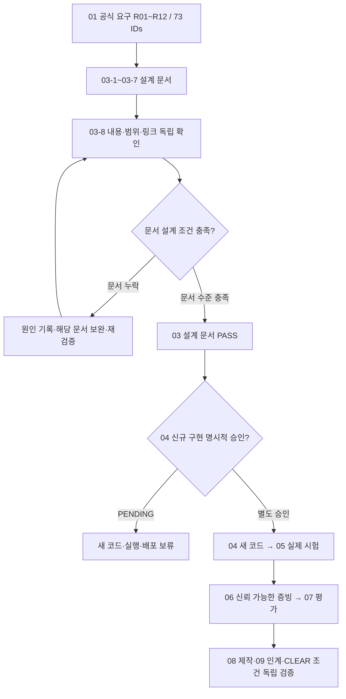

# B1-1 Round 04 — 03-8 종합 설계 검증·04 인계

> **30초 요약:** 지금까지 03-1~03-7에서 작성한 설계도를 **공식 요구 73개·평가 15개·학습목표 14개·시험 예정 51개·파일·링크·승인**과 대조합니다. 이 단계는 신규 웹페이지를 실행하는 작업이 아닙니다. **기획 프롬프트 초안→검토→최종본→실제 자료 점검→입문자 검토→문서 QA** 순서입니다.
>
> **Owner 적용:** [B1-1~B7-2 전체 15개 미션 공통 필수 프로세스](https://github.com/MetaStudy999/codyssey-basic/blob/main/standards/ROUND-04-AGENT-MISSION-PROCESS-STANDARD.md)를 따릅니다. 모든 미션에 적용되는 것은 *프로세스*이며, B1-1의 HTML/CSS/JS 필수 기능은 다른 미션에 그대로 적용하지 않습니다.
>
> **현재 판정:** 03-1~03-7 `PASS(DOC_ONLY)`, 03-8 `DESIGN_AUDIT_RUNNING`, 04 구현 승인 `PENDING`, 실제 코드·브라우저·API·출력·배포·학습 숙달·CLEAR `NOT_VERIFIED`. 종합 문서 검증을 마친 뒤 03-8 **문서 기준** 판정을 갱신합니다.

## 처음 5분 — 입문자 Quick Start

1. **0~1분:** A에서 검증이라는 말이 **실제 프로그램 실행**과 어떻게 다른지 확인합니다.
2. **1~2분:** B의 단계별 파일 7개를 찾고 README가 진입점이라는 사실을 확인합니다.
3. **2~3분:** C의 Mermaid에서 공식 요구→문서→시험 설계→승인 흐름을 읽습니다.
4. **3~4분:** E에서 '코드 작성·브라우저 실행·학생 평가를 아직 못 한 상태'가 왜 `NOT_VERIFIED`인지 이해합니다.
5. **4~5분:** G에서 답을 덮고 **두 문장으로** “03 문서 PASS와 미션 CLEAR의 차이”를 설명합니다.

**시간은 학습용 가이드이지 실제 초보자의 수행시간 실측값은 아닙니다.** H~J의 73개 상세표와 프롬프트 검토 이력은 필요할 때만 읽습니다.

| 먼저 볼 구간 | 하는 일 |
|---|---|
| A. 쉬운 용어 | 요구·근거·위험·승인 |
| B. 7개 이전 단계 | 어떤 MD가 어디 있는지 찾기 |
| C. 전체 흐름 | Mermaid 개념·판정 순서 |
| D. 핵심 요약 | 필수 요구/시험/입문자 관점의 교차 확인 |
| E. PASS·보류 | 실제 안 한 일 구별 |
| F. 04 인계 | 승인 뒤 순서/담당/정확한 다음 행동 |
| G. 자기 평가 | 종이 예측·두 문장 설명 |
| H. 공식 상세 추적 | R01~R12의 **73개 고유 ID 전수** |
| I. 프롬프트 검토 | V0.1→Z01~Z12→V1.0 |
| J. 최종 문서 QA | 읽기·링크·SHA·파일 무결성·최종 판정 |

## A. 용어와 비유 — 03-8은 무엇을 하나요?

| 용어(영어·약어) | 쉬운 뜻 | 비유 |
|---|---|---|
| 요구사항(Requirement, **R**) | 만들어야 할 것과 하지 말아야 할 조건 | 건축 의뢰서 |
| 수용 기준(Acceptance Criteria) | 실제로 확인했을 때 합격이라 말할 조건 | 도면 검사표 |
| 증빙(Evidence) | 실제 확인 결과의 일시·소스 SHA·화면·로그 | 검사 날짜가 찍힌 기록 |
| 정적 검증(Static Review) | **실행 없이 문서·코드 구조만 검사** | 설계도 검사 |
| 실행 검증(Runtime Verification) | 승인된 코드를 실제 구동하고 결과 관찰 | 문이 진짜 열리는지 검사 |
| 회귀 시험(Regression Test) | 오류를 고친 후 이전 정상 기능도 다시 확인 | 수리 후 전체 문 점검 |
| 인계(Handoff) | 다음 단계가 시작할 수 있게 근거·남은 일 전달 | 다음 담당자에게 설계도 전달 |
| 승인 보류(Pending Approval, **PENDING**) | Owner의 다음 별도 승인이 필요 | 시공 허가를 받기 전 |

**오해하지 않기:** 73개 요구 ID를 표로 정리했다고 73개 기능이 이미 작동하는 것이 아닙니다. 51개 시험 사례를 설계했다고 51번 시험을 통과한 것이 아닙니다.

## B. 03-1~03-7의 독립 문서와 역할

| 하위 단계 | 독립 MD 파일 | 학습자에게 의미 | 확인한 범위 |
|---|---|---|---|
| 03-1 | [공식 요구·범위](03-1-REQUIREMENTS-AND-SCOPE.md) | 무엇을 해야 할까? | 요구 12영역·73개 공식 추적·D01~D10 |
| 03-2 | [정보 구조·화면](03-2-INFORMATION-ARCHITECTURE.md) | 어디에 무엇을 배치할까? | Hero/About/Skills/Projects/Contact/Footer |
| 03-3 | [파일·반응형](03-3-FILE-RESPONSIBILITIES-AND-RESPONSIVE-LAYOUT.md) | 어떤 파일에 담을까? | HTML/CSS/JS·375/768/1024px |
| 03-4 | [이벤트·상태·DOM](03-4-EVENT-STATE-DOM-FLOW.md) | 클릭 후 왜 화면이 바뀔까? | 필수 6개 상호작용·독립 상태 흐름 5개 계획 |
| 03-5 | [GitHub API·폼·보안](03-5-API-FORM-SECURITY-DESIGN.md) | 네트워크 오류나 잘못된 입력은? | 성공·빈값·403·오류·미전송·XSS |
| 03-6 | [품질·접근성·시험 설계](03-6-QUALITY-ACCESSIBILITY-TEST-PLAN.md) | 어떻게 검사하고 근거를 남길까? | 시험 사례 51개·배포 증거 조건 |
| 03-7 | [입문자 학습·평가](LEARNING-DESIGN.md) | 이해·설명·독립 재현하려면? | LO14·E15·M16·QG8·힌트·숙달·사전사후 |

**판정:** 위 파일들은 **GitHub에 설계 문서로 존재**하지만, 각 파일의 예상 결과·종이 예제는 실제 신규 소스와 브라우저에서 검증된 기능이 아닙니다.

## C. 공식 요구에서 실제 PASS까지 — 흐름도

### C-1. 공식 ID·평가 수를 무엇과 비교했나요?

| 검토 대상 | 공식 파일 또는 설계 근거 | 현재 문서상 내용 | 실제 실행 |
|---|---|---|---|
| **73개 고유 요구** | [01 공식 요구 카탈로그](../01-requirements/REQUIREMENTS-CATALOG.md) | R01~R12, CORE/BONUS/제약 원문 보존, 세부 ID별 H 추적표 | NOT_VERIFIED |
| **E01~E15 15개** | [01 평가](../01-requirements/EVALUATION-15-MAPPING.md) | 03-6·03-7 문서에 질문별 확인 근거·예상 활동 매핑 | NOT_VERIFIED |
| **LO01~LO14 14개** | [01 학습목표](../01-requirements/LEARNING-OBJECTIVES.md) | 03-7에서 학습활동·평가·기대 설명으로 매핑 | NOT_VERIFIED |
| **D01~D10 10개** | [01 공식 출처 쟁점](../01-requirements/SOURCE-CONFLICTS-AND-DECISIONS.md) | 미해결·선택·한계 및 후속 실증 책임 | NOT_VERIFIED |
| **예정 시험 51개** | [03-6 시험 설계](03-6-QUALITY-ACCESSIBILITY-TEST-PLAN.md) | RES/A11Y/INT/FLOW/API/FORM/SEC/PUB | NOT_VERIFIED |
| **교육 규칙** | [중앙 15개 공통 프로세스](https://github.com/MetaStudy999/codyssey-basic/blob/main/standards/ROUND-04-AGENT-MISSION-PROCESS-STANDARD.md) | 기획→검토→보완→설계→검증, 03-1~03-8 독립 파일 | 학생 숙달 NOT_VERIFIED |

### C-2. 시험 예정 51개 — **실제 실행 건수 0**

| 고유 ID 범위 | 건수 | 검사할 개념 | 설계 근거 | 실제 상태 |
|---|---:|---|---|---|
| RES-01 ~ RES-08 | 8 | 반응형·색상·경계 | 03-6-QUALITY-ACCESSIBILITY-TEST-PLAN.md | 미래 실행·증빙 `NOT_VERIFIED` |
| A11Y-01 ~ A11Y-11 | 11 | 키보드·의미·보조기술 | 03-6-QUALITY-ACCESSIBILITY-TEST-PLAN.md | 미래 실행·증빙 `NOT_VERIFIED` |
| INT-01 ~ INT-06 | 6 | 사용자 상호작용 | 03-6-QUALITY-ACCESSIBILITY-TEST-PLAN.md | 미래 실행·증빙 `NOT_VERIFIED` |
| FLOW-01 ~ FLOW-05 | 5 | 독립 이벤트→상태→DOM | 03-6-QUALITY-ACCESSIBILITY-TEST-PLAN.md | 미래 실행·증빙 `NOT_VERIFIED` |
| API-01 ~ API-07 | 7 | GitHub 공개 API 정상·오류 | 03-6-QUALITY-ACCESSIBILITY-TEST-PLAN.md | 미래 실행·증빙 `NOT_VERIFIED` |
| FORM-01 ~ FORM-04 | 4 | 폼 검증·미전송 | 03-6-QUALITY-ACCESSIBILITY-TEST-PLAN.md | 미래 실행·증빙 `NOT_VERIFIED` |
| SEC-01 ~ SEC-04 | 4 | 보안·개인정보 | 03-6-QUALITY-ACCESSIBILITY-TEST-PLAN.md | 미래 실행·증빙 `NOT_VERIFIED` |
| PUB-01 ~ PUB-06 | 6 | 배포·증빙 | 03-6-QUALITY-ACCESSIBILITY-TEST-PLAN.md | 미래 실행·증빙 `NOT_VERIFIED` |
| **합계** | **51** | 사전 계획한 미래 실행 검사 | [03-6](03-6-QUALITY-ACCESSIBILITY-TEST-PLAN.md) | **NOT_VERIFIED** |

**중요:** 51개 시험은 여덟 계열의 기능·오류·접근성·보안·게시 증빙 계획이며, 일부 **정적 소스 구조·교육 평가 요건은 별도 정적 체크리스트/평가 항목**으로 보완해야 합니다. '51개가 모든 학습자 성취까지 실제 검증했다'고 주장하지 않습니다.

## D. 종합 위험·모순·중복 점검

| ID | 실제 확인한 위험 또는 차이 | 설계 결정·개선 | 아직 남은 조건 |
|---|---|---|---|
| **A01** | 이전 03-1이 README 내부에 있어 찾기 어려웠음 | [03-1 독립 문서](03-1-REQUIREMENTS-AND-SCOPE.md)에 본문·과거 QA 스냅샷 보존 | 실제 입문자 사용성 미실시 |
| **A02** | 03-2 역사적 상태표가 03-3까지 완료된 것처럼 보임 | 03-2 당시 03-1~03-2 완료로 정정 | 각 상세문서 과거 QA 날짜는 스냅샷 |
| **A03** | 03-7의 독립파일 이름이 순서와 다름 | 기존 `LEARNING-DESIGN.md`로 바로 연결, 중복 생성 금지 | 다른 미션도 독립 문서 원칙 |
| **A04** | 03-8 파일은 이 문서가 최초 | 새 `03-8-COMPREHENSIVE-DESIGN-AUDIT-AND-HANDOFF.md` 독립 작성 | GitHub 실제 저장·링크 검증 필요 |
| **A05** | 51개 계획과 실제 시험·학습자 결과가 혼동될 위험 | DOC_GATE vs RUNTIME/LEARNER/CLEAR 분리 | 실제 05~07 단계 미실시 |
| **A06** | `04-src/`는 현재 안내 `README.md`만 있음 | 계획 경로로만 안내, 구현 승인 `PENDING` | 04 별도 승인 필요 |
| **A07** | Pages의 현재 루트 안내와 신규 `04-src/` 경로가 다름 | 배포 후보·상대 경로·PUB-01~06로 추적 | 게시 방식 선택·실제 URL NOT_VERIFIED |
| **A08** | GitHub 403을 항상 API rate limit이라고 단정할 위험 | 03-5는 원인 단정 금지·수동 재시도·정상 빈 배열 별도 | 실제 API 응답/한도 미확인 |
| **A09** | 입력 검증을 메시지 발송으로 오인할 위험 | 필드 검사·검증 완료/미전송 문구를 설계 | 실제 전송은 BONUS·추가 승인 |
| **A10** | 다크/모바일/Observer의 경계 구현 및 키보드 시험 미실시 | 03-6의 767/768·1023/1024, 59/60·299/300, 감속 모션 시험 | 실제 브라우저 NOT_VERIFIED |
| **A11** | 신뢰되지 않은 API 데이터가 HTML로 실행될 위험 | `textContent`, 링크 검사·정적 innerHTML 제한 | 실제 보안 테스트 NOT_VERIFIED |
| **A12** | AI 생성 학습 답안·설명으로 MASTER 선언 위험 | H1~H4, L1~L5, QG01~08·사전사후 계획; 독립 검증 필요 | 실제 학습자 평가 NOT_VERIFIED |

**문서 구조 개선:** 03 README는 **단계별 진입 목차**이고 상세 내용은 독립 MD에 보존합니다. 기존 00~09 전체 목차·역사적 PASS·원본 파일·슬라이드 수량·미션 범위는 유지합니다.

## E. 이번 단계에서 PASS를 말할 수 있는 범위

| 축 | 무엇을 실제로 확인했는가/할 것인가 | 현재 가능한 판정 |
|---|---|---|
| **설계 문서** | 파일 존재·요구 추적·목차·상대 링크·검증 기록·승인/원본 유지 | 정적 재검증이 모두 충족되면 **PASS** |
| **신규 프로그램** | `04-src/` 실제 신규 HTML/CSS/JS 파일·기능 실행 | **NOT_STARTED/NOT_VERIFIED** |
| **시험/접근성/보안** | Chrome·WSL2·모의 응답·보안/키보드·회귀 51개 | **NOT_VERIFIED** |
| **배포·증빙** | 신규 Pages URL·배포 SHA·데스크톱/모바일/다크 캡처 | **NOT_VERIFIED** |
| **학습자 성취** | 사전/사후·독립 L1~L5·QG 실제 운영·공식 평가 | **NOT_VERIFIED** |
| **최종 미션 CLEAR** | 04~09 모든 필수 증거와 정직한 판정 | **NOT_VERIFIED** |

**검증 원칙:** '일부 항목이 아직 미실시'는 자동 FAIL도 PASS도 아닙니다. 원문 조건·후속 게이트·미실시 책임을 기록하고 **`NOT_VERIFIED`**로 남깁니다.

## F. 승인 전 인계서 — 다음 사람이 무엇을 하면 되나요?

1. [03단계 통합 README](README.md)에서 **03-1~03-8 개별 MD 링크**와 미션 상태를 확인합니다.
2. [01 공식 요구 카탈로그](../01-requirements/REQUIREMENTS-CATALOG.md)를 CORE/BONUS·제약으로 나누고, H의 73개 ID가 자신의 상세 시험에 대응하는지 읽습니다.
3. 실제 개발 승인은 [미션 승인 정보](../mission.yml)의 `owner_mission_development_approval: PENDING`이므로 **현 시점 신규 코드 작성 금지**입니다.
4. 개발 승인이 별도 부여되면 04 `04-src/` 신규 구현 → 05 실제 51개 관련 시험·정적 검사 → 06 URL·스크린샷·SHA 증빙 → 07 학습자 평가 → 08 4종 실물 교육/발표 자료 → 09 인계로 진행합니다.
5. API 실제 사용자명·외부 서비스 토큰·Pages 게시 방식·미확인 운영환경은 **실제 수행 직전 안전하게 확인**합니다. 인증 토큰·개인정보를 출력하지 않습니다.

**현재 인계 상태:** `04_IMPLEMENTATION=BLOCKED_OWNER_APPROVAL`; 문서 정적 QA PASS와 별개입니다. 타 프로젝트/다른 14개 미션의 개발까지 자동 승인하지 않습니다.

## G. 입문자 종이 학습·정답

**정답을 보기 전에 종이에 작성해 보세요.**

1. 03-1 문서는 무엇을 설명하는 파일인가요?
2. `RES-01`은 실제 375px 화면 검사를 **계획한 것**인가요, 수행한 것인가요?
3. `owner_mission_development_approval: PENDING`이면 신규 파일을 작성해도 될까요?
4. B1-1의 03-1~03-7 문서 PASS를 B2-1 설계 PASS로 옮겨도 될까요?
5. 실제 `PUB-02`를 통과하려면 어떤 사실이 필요하나요?

**예상 답:** ① 공식 요구·범위·수용 기준 ② 계획만, 실제 시험 `NOT_VERIFIED` ③ 안 됨, 04 별도 승인 필요 ④ 다른 미션 요구/기술/평가는 다르므로 불가 ⑤ **이번 Round 신규 코드**로 배포된 공개 URL·당시 소스 SHA·화면 동작 근거.

**두 문장 자기 설명:** “03-8은 새 코드를 실행하는 과정이 아니라 설계 문서와 공식 기준의 연결을 확인하는 과정입니다. 실제 웹페이지 개발·실험·학습자 평가·미션 CLEAR는 별도의 승인과 실증이 필요합니다.”

**자가 도움 수준:** (0) 설명 불가, (1) 표를 보고 설명, (2) 자료 없이 설명. 이 수치는 공식 E01~E15 점수·L1~L5 결과가 아닙니다.

## H. 공식 73개 고유 요구사항 — 세부 추적 감사표

> 표의 **해당 설계 단계와 향후 시험/평가**는 *계획된 책임 매핑*입니다. `STATIC`/ `ENV`는 51개의 실행 시험 ID가 아닌 별도 정적 코드·환경 점검 예정 항목입니다. 한 요구가 여러 문서·테스트에 대응할 수 있으며, 이 표는 실제 실증 PASS 판정이 아닙니다.

| 공식 요구 ID | 공식 분류 | 공식 내용(간략) | 설계 책임 | 향후 수용 시험·설명 후보 |
|---|---|---|---|---|
| `R01-01` | CORE | index.html / css/ / js/ / images/ 역할을 분리 | 03-3 → 03-6 | ENV/STATIC·E06 |
| `R01-02` | CORE | HTML에서 외부 CSS·JS를 올바르게 연결 | 03-3 → 03-6 | ENV/STATIC·E06 |
| `R01-03` | CORE | VS Code + Live Server 기반 실시간 개발 환경 구성 | 03-3 → 03-6 | ENV/STATIC·E06 |
| `R02-01` | CORE | header/nav/main/section/article/footer 등 의미 있는 구조 사용 | 03-2 → 03-6 | A11Y-01~07·E05/E07 |
| `R02-02` | CORE | Hero(인사·CTA) / About(자기소개·사진) 포함 | 03-2 → 03-6 | A11Y-01~07·E05/E07 |
| `R02-03` | CORE | Skills(기술 목록) / Projects(GitHub 카드) 포함 | 03-2 → 03-6 | A11Y-01~07·E05/E07 |
| `R02-04` | CORE | Contact(문의 폼) / Footer(저작권·소셜 링크) 포함 | 03-2 → 03-6 | A11Y-01~07·E05/E07 |
| `R02-05` | CORE | 탐색 링크가 각 섹션 ID로 이동 | 03-2 → 03-6 | A11Y-01~07·E05/E07 |
| `R02-06` | CORE | 이미지에 의미에 맞는 alt 속성 | 03-2 → 03-6 | A11Y-01~07·E05/E07 |
| `R02-07` | CORE | 폼 label의 for와 입력 id 연결 | 03-2 → 03-6 | A11Y-01~07·E05/E07 |
| `R03-01` | CORE | css/style.css 외부 스타일시트 사용 | 03-3 → 03-6 | RES-01~08·INT-05·E01/E13/E15 |
| `R03-02` | CORE | :root에서 색상·글꼴·간격 등 CSS 변수 정의 | 03-3 → 03-6 | RES-01~08·INT-05·E01/E13/E15 |
| `R03-03` | CORE | [data-theme="dark"] 등 별도 다크 모드 CSS 변수 | 03-3 → 03-6 | RES-01~08·INT-05·E01/E13/E15 |
| `R03-04` | CORE | 네비게이션 로고 왼쪽·메뉴 오른쪽에 Flexbox 사용 | 03-3 → 03-6 | RES-01~08·INT-05·E01/E13/E15 |
| `R03-05` | CORE | 프로젝트 카드에 Grid(auto-fit/minmax) 적용 | 03-3 → 03-6 | RES-01~08·INT-05·E01/E13/E15 |
| `R03-06` | CORE | 모바일 퍼스트 CSS 작성 | 03-3 → 03-6 | RES-01~08·INT-05·E01/E13/E15 |
| `R03-07` | CORE | 768px 태블릿·1024px 데스크톱 분기 | 03-3 → 03-6 | RES-01~08·INT-05·E01/E13/E15 |
| `R03-08` | CORE | 모바일에서 메뉴 숨김·햄버거 버튼 표시 | 03-3 → 03-6 | RES-01~08·INT-05·E01/E13/E15 |
| `R03-09` | CORE | 버튼·카드 hover/transition 적용 | 03-3 → 03-6 | RES-01~08·INT-05·E01/E13/E15 |
| `R03-10` | CORE | 카드 box-shadow 적용 | 03-3 → 03-6 | RES-01~08·INT-05·E01/E13/E15 |
| `R04-01` | CORE | JavaScript 외부 파일을 defer로 연결 | 03-4 → 03-5 | FLOW-01~05·STATIC·E09/E10 |
| `R04-02` | CORE | var 대신 const/let 사용 | 03-4 → 03-5 | FLOW-01~05·STATIC·E09/E10 |
| `R04-03` | CORE | 인라인 onclick 대신 addEventListener 사용 | 03-4 → 03-5 | FLOW-01~05·STATIC·E09/E10 |
| `R04-04` | CORE | querySelector/querySelectorAll로 요소 선택 | 03-4 → 03-5 | FLOW-01~05·STATIC·E09/E10 |
| `R04-05` | CORE | textContent와 innerHTML로 내용 변경 | 03-4 → 03-5 | FLOW-01~05·STATIC·E09/E10 |
| `R04-06` | CORE | classList.add/remove/toggle 활용 | 03-4 → 03-5 | FLOW-01~05·STATIC·E09/E10 |
| `R04-07` | CORE | click/submit/scroll/input 이벤트 다룸 | 03-4 → 03-5 | FLOW-01~05·STATIC·E09/E10 |
| `R04-08` | CORE | event.preventDefault로 기본 동작 제어 | 03-4 → 03-5 | FLOW-01~05·STATIC·E09/E10 |
| `R05-01` | CORE | 모바일 햄버거 메뉴 열기/닫기(toggle active) | 03-4 → 03-6 | INT-01~06·A11Y-03~04·E03 |
| `R05-02` | CORE | 네비게이션 클릭 시 부드러운 스크롤 | 03-4 → 03-6 | INT-01~06·A11Y-03~04·E03 |
| `R05-03` | CORE | 스크롤 탑 버튼: 기준 300px, 변경 시 README 명시 | 03-4 → 03-6 | INT-01~06·A11Y-03~04·E03 |
| `R05-04` | CORE | 네비게이션 배경 변화: 기준 60px, 변경 시 README 명시 | 03-4 → 03-6 | INT-01~06·A11Y-03~04·E03 |
| `R05-05` | CORE | 테마 토글 및 localStorage 저장·새로고침 복원 | 03-4 → 03-6 | INT-01~06·A11Y-03~04·E03 |
| `R05-06` | CORE | IntersectionObserver 기반 스크롤 애니메이션 | 03-4 → 03-6 | INT-01~06·A11Y-03~04·E03 |
| `R05-07` | RECOMMENDED | IntersectionObserver threshold 0.2 이상 권장; 변경 가능, README 기록 | 03-4 → 03-6 | INT-01~06·A11Y-03~04·E03 |
| `R06-01` | CORE | Contact 문의 폼에 이름·이메일·메시지 포함 | 03-5 → 03-6 | FORM-01~04·A11Y-07~08·E05 |
| `R06-02` | CORE | 필수값 누락 시 제출 제한 | 03-5 → 03-6 | FORM-01~04·A11Y-07~08·E05 |
| `R06-03` | CORE | 이메일 형식 오류 검출 | 03-5 → 03-6 | FORM-01~04·A11Y-07~08·E05 |
| `R06-04` | CORE | 필드 가까이 오류 메시지 표시 | 03-5 → 03-6 | FORM-01~04·A11Y-07~08·E05 |
| `R06-05` | CORE | submit의 preventDefault와 성공 메시지 | 03-5 → 03-6 | FORM-01~04·A11Y-07~08·E05 |
| `R07-01` | CORE | 화살표 함수 적절히 사용 | 03-5 → 03-6 | STATIC·API-01/07·E12 |
| `R07-02` | CORE | 템플릿 리터럴로 HTML 동적 생성 | 03-5 → 03-6 | STATIC·API-01/07·E12 |
| `R07-03` | CORE | 구조분해 할당으로 객체/배열 값 추출 | 03-5 → 03-6 | STATIC·API-01/07·E12 |
| `R07-04` | CORE | map으로 GitHub 데이터 카드 변환 | 03-5 → 03-6 | STATIC·API-01/07·E12 |
| `R07-05` | BONUS | filter로 언어·조건별 프로젝트 필터링 (PDF 명시 '선택') | 03-5 → 03-6 | STATIC·API-01/07·E12 |
| `R07-06` | CORE | forEach로 배열 순회 | 03-5 → 03-6 | STATIC·API-01/07·E12 |
| `R08-01` | CORE | fetch + async/await로 GitHub 공개 API 요청 | 03-5 → 03-6 | API-01~07·SEC-04·E04/E11 |
| `R08-02` | CORE | 본인 계정의 /users/{id}/repos 엔드포인트 사용 | 03-5 → 03-6 | API-01~07·SEC-04·E04/E11 |
| `R08-03` | CORE | 요청 중 로딩 표시(문구 또는 스피너) | 03-5 → 03-6 | API-01~07·SEC-04·E04/E11 |
| `R08-04` | CORE | 성공 결과를 Projects 카드 목록으로 표시 | 03-5 → 03-6 | API-01~07·SEC-04·E04/E11 |
| `R08-05` | CORE | 실패 시 안내 메시지와 재시도 버튼 | 03-5 → 03-6 | API-01~07·SEC-04·E04/E11 |
| `R08-06` | CORE | 빈 저장소 결과는 '항목 없음' 상태 표시 | 03-5 → 03-6 | API-01~07·SEC-04·E04/E11 |
| `R08-07` | CORE | try/catch로 오류 예외 분기 | 03-5 → 03-6 | API-01~07·SEC-04·E04/E11 |
| `R08-08` | CORE | 요청 제한(rate limit) 시 403 오류 UI 처리 | 03-5 → 03-6 | API-01~07·SEC-04·E04/E11 |
| `R08-09` | GUIDANCE | PDF의 인증 없는 요청 60회/시간 설명은 작성 시점 안내값; 실제 한도는 실행 시 확인 | 03-5 → 03-6 | API-01~07·SEC-04·E04/E11 |
| `R09-01` | CORE | 이벤트→상태 변경→DOM/화면 갱신 경로가 분명함 | 03-4 → 03-6 | FLOW-01~05·E10/E14 |
| `R09-02` | CORE | 독립적인 상태→렌더 흐름 최소 3개 증명 | 03-4 → 03-6 | FLOW-01~05·E10/E14 |
| `R09-03` | BONUS | 선택 프로젝트 필터 기능의 상태→렌더 흐름 | 03-4 → 03-6 | FLOW-01~05·E10/E14 |
| `R10-01` | CORE | GitHub Pages 공개 배포 URL 확보 | 03-6 → 03-8 | PUB-01~06·E01~E05 |
| `R10-02` | CORE | 공개 사이트에서 반응형·메뉴·테마·스크롤·API·폼 작동 | 03-6 → 03-8 | PUB-01~06·E01~E05 |
| `R10-03` | CORE | README에 프로젝트·기술·배포 URL 기록 | 03-6 → 03-8 | PUB-01~06·E01~E05 |
| `R10-04` | CORE | 데스크톱·모바일·다크모드 스크린샷 제출 | 03-6 → 03-8 | PUB-01~06·E01~E05 |
| `R10-05` | CORE | GitHub 저장소 URL 제출 | 03-6 → 03-8 | PUB-01~06·E01~E05 |
| `R11-01` | BONUS | 언어별 프로젝트 필터링(filter) | 03-5 → 03-8 | BONUS 기록/별도 승인 |
| `R11-02` | BONUS | Hero 타이핑 효과 | 03-5 → 03-8 | BONUS 기록/별도 승인 |
| `R11-03` | BONUS | Formspree/EmailJS 실제 메시지 전송 | 03-5 → 03-8 | BONUS 기록/별도 승인 |
| `R11-04` | BONUS | prefers-color-scheme 시스템 테마 감지 | 03-5 → 03-8 | BONUS 기록/별도 승인 |
| `R12-01` | CONSTRAINT | React/Vue/jQuery/Bootstrap/Tailwind 등 외부 라이브러리 금지 | 03-3 → 03-6 | STATIC·A11Y·ENV/Chrome |
| `R12-02` | ALLOWED | Font Awesome 아이콘, Google Fonts 웹 폰트는 허용 | 03-3 → 03-6 | STATIC·A11Y·ENV/Chrome |
| `R12-03` | CONSTRAINT | HTML 인라인 style 속성 금지 | 03-3 → 03-6 | STATIC·A11Y·ENV/Chrome |
| `R12-04` | CONSTRAINT | var 대신 const/let, 인라인 onclick 금지 재확인 | 03-3 → 03-6 | STATIC·A11Y·ENV/Chrome |
| `R12-05` | CONSTRAINT | 최신 Chrome 브라우저 동작 필요 | 03-3 → 03-6 | STATIC·A11Y·ENV/Chrome |
| `R12-06` | PRIORITY | 고품질 UI보다 이벤트·상태·렌더 흐름 이해 우선 | 03-3 → 03-6 | STATIC·A11Y·ENV/Chrome |

**공식 카탈로그에서 실제로 읽어온 R01~R12의 73개 고유 ID와 CORE/BONUS 등 유형을 보존한 계획표**입니다. 원본이 바뀌면 이 표만 믿고 진행하지 말고 [공식 요구 카탈로그](../01-requirements/REQUIREMENTS-CATALOG.md)를 다시 확인해야 합니다.

## I. 기획 프롬프트 V0.1 → 문제점 검토 → 최종 V1.0

### I-1. 첫 기획 프롬프트 V0.1 — 그대로 채택하지 않음

> B1-1 설계 03-1~03-7을 확인해 공식 요구와 평가를 연결하고 부족한 부분을 수정하세요. 초보자도 쉽게 이해하도록 하고 04 구현에 넘길 자료를 만드세요. 신규 코드는 작성하지 마세요.

**검토 결과:** 이 문장만으로는 73개 세부 ID·15개 평가·14개 LO·51 시험·문서/런타임 상태·04 승인·전 미션 공통 표준을 분리하기 어렵습니다.

| 보완 ID | 첫 초안의 문제·누락 | V1.0에 반영할 필수 조건 |
|---|---|---|
| Z01 | 공식 73개 ID 중 일부 누락 | 카탈로그 73개 **고유 번호 전수** + 유형·설계·시험 책임 표 |
| Z02 | E15/LO14·D01~10의 매핑 불명 | 평가·학습·쟁점·교육 문서 링크 구분 |
| Z03 | 시험 설계 51개를 실행 PASS로 오인 | 여덟 시험 계열·시험 ID·실제 미실시 명시 |
| Z04 | 03-1~03-8 독립 MD 일부 빠짐 | 각 단계 독립 파일과 통합 목차 연결 |
| Z05 | 문서 링크·기획 프롬프트 V1.0 근거 소실 | GitHub `main` 조회·코드펜스·Mermaid·SHA·원본 보존 |
| Z06 | 입문자가 처음부터 73개 표를 읽어야 함 | A~G 5분 안내, H~J 전문가 참조, 한 개념씩 |
| Z07 | 기존 Round 01~03 소스/증거 훼손 | 기존 SHA/루트/트래픽/배포 미수정 검증 |
| Z08 | Pages 신규 경로·게시 방식 미정 | 후보/승인·PUB-01~06, 옛 화면 재사용 금지 |
| Z09 | 폼·API·XSS·접근성 위험 미인계 | 03-4~03-6 오류·보안·경계·회귀 책임 유지 |
| Z10 | 문서 PASS/코드/평가/CLEAR 혼동 | 결과 축별 `DOC_GATE` vs `RUNTIME/LEARNER/CLEAR` |
| Z11 | 타 미션에 B1-1만의 세부 기능 강요 | B1-1~B7-2 **공통 절차만 의무** 적용, 공식 기술 기준 우선 |
| Z12 | 04 개발 자동 착수 가능성 | `mission.yml` 개발 승인 `PENDING` 보존·별도 승인 의무 |

### I-2. 검토를 반영한 최종 기획 프롬프트 V1.0

> **역할:** B1-1의 03-8 독립 설계 품질 감사자 및 입문자 인계 문서 작성자.
>
> **공식 기준:** [73개 공식 추적](../01-requirements/REQUIREMENTS-CATALOG.md), [15개 평가](../01-requirements/EVALUATION-15-MAPPING.md), [14개 학습목표](../01-requirements/LEARNING-OBJECTIVES.md), [출처 쟁점 D01~D10](../01-requirements/SOURCE-CONFLICTS-AND-DECISIONS.md), 03-1~03-7 개별 설계 문서, [15개 미션 공통 필수 프로세스](https://github.com/MetaStudy999/codyssey-basic/blob/main/standards/ROUND-04-AGENT-MISSION-PROCESS-STANDARD.md).
>
> **검토→산출물:** ① 03-1~03-8 독립 MD·README 경로 ② R01~R12 73개 개별 요구 고유 ID/유형 전수·설계 책임/미래 시험 ③ E01~E15·LO01~LO14·D01~D10·51개 시험의 범위와 빈틈 ④ 드러난 모순/중복/과거 상태·미실시·실증 부재 ⑤ 입문자 5분 시작·Mermaid·종이 재현·답안 ⑥ 04 `PENDING` 승인·이전 Round SHA·신규 코드 부재 ⑦ GitHub 실제 `main`·상대링크·앵커·코드펜스·수정범위 독립 확인 ⑧ 최종 PASS/FAIL/NOT_VERIFIED 및 04 인계.
>
> **제약:** 이전 Round·루트·미션 설정·실제 소스·서비스·AWS·iMac·배포·브랜치 병합·실행 명령 변경 금지. 개별 미션의 CORE/BONUS 분류 임의 변경 금지. 표준화는 15개 미션 **프로세스만** 적용.
>
> **판정:** 문서 게이트만 정적 기준이 확인될 때 `PASS`를 기록하고, 실제 `04-09` 구현·테스트·배포·평가 및 `CLEAR`는 신규 실제 증거가 있기 전 `NOT_VERIFIED/NOT_STARTED`로 둔다. 누락되면 반드시 보완·재검증 후 다음 단계.

**V1.0 검토:** Z01~Z12의 12개 요구를 B~H 및 J 검증 기준과 연결했습니다. 미해결 사항·예상 문제를 숨기지 않습니다.

## J. 독립 검증 결과·04 인계 게이트

| 검사 ID | 실제로 확인할 근거 | 문서 PASS 조건 |
|---|---|---|
| Q01 | R01~R12의 73개 고유 ID·유형·단계/시험 책임 | 73/73 고유, 원본 수·분류와 일치 |
| Q02 | E01~E15·LO01~LO14·D01~D10 | 각 ID 연결 파일 존재·범위 확인 |
| Q03 | 03-1~03-8 독립 MD + `README.md` | 실제 GitHub 트리에 파일 존재·README 직접 링크 |
| Q04 | 51개 미래 시험 ID 8계열 | 개별 이름 전수, 중복·누락 0 |
| Q05 | 프롬프트 V0.1·Z01~Z12·V1.0 | 검토 항목 누락 없이 설계·오류 보고 |
| Q06 | README/7개 문서의 상대 링크·앵커·Mermaid·코드펜스 | 존재·구문 구조/최종 README 검증 |
| Q07 | `04-src/` 신규 코드 부재·mission 승인 | `README.md`만 있고 `PENDING/NOT_STARTED` 보존 |
| Q08 | Round 01~03 SHA·기존 루트·변경 파일 | 이번 변경이 `03-design/`에만 존재 |
| Q09 | 입문자 A~G·전문 H~J 분리, 비유·그림·예상 답 | 문서 구성 확인; **실제 입문자 관찰은 별도** |
| Q10 | 미실행·보류 사항과 04/05/06/07/08/09 경계 | 문서 PASS를 런타임 PASS로 전이하지 않음 |
| Q11 | 중앙 15개 미션 표준 참조 | 공통 절차 적용·미션별 요건 분리 |
| Q12 | 독립 QA·오류 수정·재조회 이력 | 검사 당시 HEAD/SHA·오류 0 및 재검증 기록 |

**검증 결과는 실제 GitHub 재조회 후 이 문서의 J절에 추가합니다.** 검증할 근거가 존재하지 않는 대상은 `NOT_VERIFIED`로 유지하고 허위 PASS를 기록하지 않습니다.

[03단계 전체 README](README.md) · [중앙 15개 미션 표준](https://github.com/MetaStudy999/codyssey-basic/blob/main/standards/ROUND-04-AGENT-MISSION-PROCESS-STANDARD.md) · [04 개발 승인 상태](../mission.yml)
