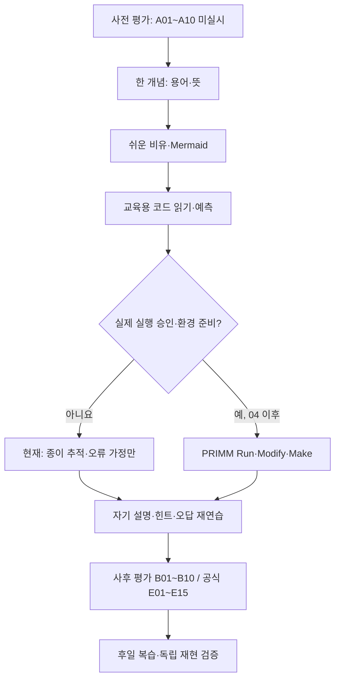
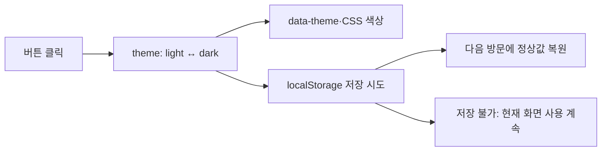
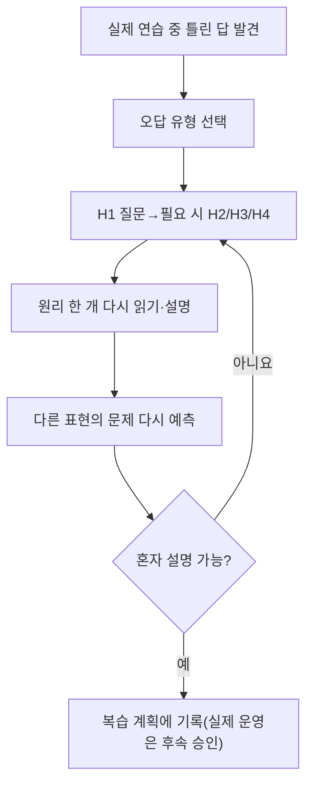

# B1-1 Round 04 — 03-7 입문자 중심 학습·실습·독립 평가 설계

> **30초 요약:** 단순히 웹페이지를 만들어 끝내지 않고, 학습자가 **이해한다 → 두 문장으로 설명한다 → 그림으로 예상한다 → 오류를 찾아본다 → (승인 후) 직접 구현·검증한다**를 수행할 수 있도록 교육 내용을 설계합니다. 이것은 **학습 계획·연습문항·평가기준 문서**이며 실제 학습자 평가나 새 코드 실행 결과가 아닙니다.
>
> **현재 상태:** 03-1~03-6 `PASS(해당 설계 문서 기준)` · 03-7 `PASS(학습·평가 설계 문서 정적 검증 기준)` · 03-8 `NOT_STARTED` · 개발 승인 `PENDING` · 신규 웹·브라우저 실행·학습자 숙달·실제 CLEAR `NOT_VERIFIED`.
>
> **기준 고정:** [공통 학습자 중심 교육 표준](https://github.com/MetaStudy999/codyssey-basic/blob/main/standards/LEARNER-CENTERED-AI-LEARNING-STANDARD.md), [B1-1 승인 교육계획](../00-plan/LEARNING-SYSTEM-PLAN.md), [01 학습목표](../01-requirements/LEARNING-OBJECTIVES.md), [공식 평가](../01-requirements/EVALUATION-15-MAPPING.md). 기존 00~09 목차·과거 Round 파일·평가 원문·슬라이드 4종 목표를 변경하지 않습니다.

## 처음 5분 — 입문자 Quick Start

**처음 보는 사람은 A~G만 먼저 읽으세요.** H~K에는 전문가용 공식 문항 연결·기획 프롬프트·검증 이력이 있습니다. 터미널이나 설치가 필요하지 않습니다.

**정말 처음이라면 5분 동안은 아래 네 가지만** 하세요. 모든 A~K를 한 번에 이해할 필요는 없습니다.

1. **0~1분:** A에서 '이벤트=발생한 일, 상태=지금의 값'을 읽습니다.
2. **1~2분:** B의 화살표 그림을 따라갑니다.
3. **2~4분:** C-1의 테마 버튼을 종이에 **0회·1회·2회 클릭**한 결과로 그립니다.
4. **4~5분:** 답을 보지 않고 “클릭은 사건, 테마는 상태”를 **두 문장으로** 설명합니다.

**이어서 배우기:** 첫 실습에 익숙해지면 D(힌트) → E(오답 복습) → F(사전/사후) → G(자기 설명)로 진행합니다. H~K는 관리·공식 근거가 필요할 때만 읽습니다. 시간은 편의를 위한 **권장 학습 예시**이지 실제 학습자 수행시간 측정 결과가 아닙니다.

| 배우는 부분 | 바로 이동 | 확인할 핵심 |
|---|---|---|
| A. 무엇을 배우나요? | [목표·용어](#learn-a) | 이해/설명/재현과 평가 분리 |
| B. 어떤 순서로 배우나요? | [한눈에 보는 그림](#learn-b) | 웹 기술 7개 단원·9요소 학습법 |
| C. 직접 해보기 | [테마·메뉴 교육용 문제](#learn-c) | 예상 결과·Mermaid·Parsons 퍼즐 |
| D. AI 힌트 | [H1~H4](#learn-d) | 힌트 도움과 독립 수행 구분 |
| E. 틀린 문제·복습 | [오답 처방](#learn-e) | 원인→힌트→재학습 |
| F. 사전/사후·숙달 | [채점 양식](#learn-f) | 10문항·60점·L1~L5 |
| G. 스스로 말하기 | [정답·자가 체크](#learn-g) | WHY·HOW·VERIFY |
| H. 공식 근거 | [14개 LO·15개 E](#learn-h) | 추적 ID, M01~M16, QG |
| I. 학습자료 운영 | [워크북·실습 경로](#learn-i) | 4종 슬라이드 설계 인계 |
| J. 기획·검토 | [초안→최종 프롬프트](#learn-j) | 보완 항목 U01~U12 |
| K. 검증·인계 | [PASS 기준](#learn-k) | 교육 문서 QA와 실제 결과 구분 |

<a name="learn-a"></a>

## A. 목표·한글/영어/약어와 생활 비유

| 용어 | 입문자용 한 문장 | 비유 |
|---|---|---|
| 학습목표(Learning Objective, **LO**) | 공부한 뒤 스스로 할 수 있어야 할 일 | 여행의 목적지 |
| 평가문항(Evaluation Item, **E**) | 배운 것을 확인하는 질문 | 목적지에 도착했는지 묻는 시험 |
| 사전 평가(Pre-assessment) | 배우기 전에 알고 있는 정도를 확인 | 출발 전 길을 아는지 점검 |
| 사후 평가(Post-assessment) | 배운 뒤 **같은 역량**을 다른 표현으로 확인 | 공부 뒤 같은 길을 설명해 보기 |
| 코드 추적(Code Tracing) | 입력부터 값·화면이 바뀌는 순서를 따라가기 | 택배 이동 경로 표시 |
| 단계별 코드학습(**PRIMM**) | 예측(Predict)→실행(Run)→조사(Investigate)→수정(Modify)→제작(Make) | 먼저 예상하고 검증·수정한 뒤 혼자 만들기 |
| 자기 설명(Teach-back) | 문서를 덮고 배운 원리를 다른 사람에게 말하듯 설명 | 친구에게 길 알려주기 |
| 재현(Reconstruction) | 그림·조건·코드 흐름을 다시 구성 | 설명서를 덮고 레고 구조 다시 그리기 |
| 오류 해결(Debugging) | 현상→근거→원인→최소 수정→재시험 | 고장 난 스위치의 원인 찾기 |
| 간격 복습(Spaced Retrieval) | 시간이 지난 뒤 답을 안 보고 다시 떠올리기 | 외운 길을 며칠 뒤 다시 찾아가기 |
| 도움 수준(Hint Level, **H1~H4**) | AI가 질문부터 해설까지 얼마나 도왔는지 구별 | 길 안내를 한마디 듣는지, 지도를 보는지 |
| 숙달 단계(**L1~L5**) | 설명→자료 없이 설명→빈 환경 구현→새 문제 응용의 관찰 수준 | 지도를 보고 설명→혼자 길 찾기→새 길 찾기 |

**중요한 차이:** 종이에 테마 버튼 변화를 잘 그리면 **예측 연습**을 수행한 것이지 코드 실행·독립 구현 L4 PASS가 아닙니다. AI 도움을 받은 답을 독립 수행으로 기록하지 않습니다.

<a name="learn-b"></a>

## B. 학습 순서와 9요소를 한눈에



### B-1. 7개 단원, 쉬운 것부터

| 순서 | 단원 | 먼저 아는 것 | 이해→설명→종이 재현 |
|---|---|---|---|
| U01 | 웹 구조 | HTML/CSS/JS | 세 파일의 역할을 집에 비유하고 연결하기 |
| U02 | 의미 있는 요소 | header/nav/main/section/article·label·alt | 페이지 부분과 의미 연결하기 |
| U03 | 화면 배치 | 모바일·Flexbox·Grid·CSS 변수 | 375/768/1024px 배치 예상하기 |
| U04 | 이벤트·DOM | 클릭·리스너·상태 | 메뉴 닫힘→열림→닫힘 그리기 |
| U05 | 테마·저장 | data-theme·localStorage | 클릭 2회·새로고침 후 색 예측 |
| U06 | API·폼 | fetch·async/await·HTTP 403·검증 | 빈 목록·거부·연결 오류와 폼 미전송 구별 |
| U07 | 품질·증빙 | 접근성·오류·PASS/NOT_VERIFIED | 테스트 입력·예상 결과·증거 SHA 분리 |

기존 [학습 지도](../00-plan/LEARNING-MAP.md)의 U01~U07을 **그대로 유지**하며 세부 공부 순서만 제시합니다.

### B-2. 모든 주요 기술에 사용하는 9요소

| 순서 | 한 개념을 배울 때의 질문 | 테마 예시 |
|---|---|---|
| K01 용어 | 무엇인가요? | State(상태), Event(클릭 사건) |
| K02 개념 | 왜 필요한가요? | 지금 색상 선택을 기억 |
| K03 비유 | 생활 속 무엇과 비슷한가요? | 전등 스위치(단, 전등은 설정 저장 기능이 없음) |
| K04 구조도 | 무엇이 어디로 흐르나요? | 클릭→테마 값→DOM/CSS→저장 |
| K05 주요 코드 | 어떤 구문이 쓰이나요? | `addEventListener`, `data-theme`, `localStorage` |
| K06 실행 흐름 | 누르면 무엇이 달라질까요? | 첫 클릭 dark, 두 번째 light |
| K07 오류 해결 | 저장 실패하면 어떻게 될까요? | 현재 화면은 계속 사용, 재방문 기본값 설명 |
| K08 실습 | 직접 따라 그릴 수 있나요? | 클릭/새로고침 4칸 표 |
| K09 평가 | 문서를 덮고 설명할 수 있나요? | 왜 상태와 사건이 다른지 말하기 |

**교육용 예시·계획 상태:** K01~K09는 기술학습 9요소이며 본 문서에 내용이 있다고 실제 교육 운영 QG-01~08 PASS가 되지는 않습니다.

<a name="learn-c"></a>

## C. 입문자 실습 — 클릭·테마·API의 예상 결과

**주의:** 아래 문제와 코드는 **EDUCATIONAL_EXAMPLE / NOT_EXECUTED**입니다. `04-src/` 신규 소스를 만들거나 실행하지 않고, 문서에서 예측·재현 연습만 합니다.

### C-1. 연습 1: 테마 스위치를 누른 다음 새로고침



**짧은 코드 조각 — 단계 설명용이며 저장·복원 구현이 빠져 있습니다.**

```javascript
let theme = "light";
theme = theme === "light" ? "dark" : "light";
// 현재 값은 dark. 화면 변경과 저장은 이 두 줄만으로 일어나지 않습니다.
```

| 질문(종이에 먼저 답) | 예상 답 |
|---|---|
| 클릭 전 값은? | light |
| 1회 클릭 후 값은? | dark |
| 2회 클릭 후 값은? | light |
| 새로고침하면 이 변수만으로 기억될까요? | 아니요. 실제 미션은 `localStorage` 정상값 저장·복원이 추가로 필요 |
| `theme`이 변하면 색도 자동 변경될까요? | 아니요. DOM/CSS에 적용하는 코드가 별도로 필요 |

**자기 설명 두 문장:** “클릭은 일어난 사건이고 theme는 지금 저장된 값입니다. 새로고침 뒤에도 선택을 유지하려면 별도 브라우저 저장소를 이용합니다.” 실제 클릭/새로고침을 수행한 결과는 아닙니다.

### C-2. 연습 2: 프로젝트 API가 빈 목록을 보낸다면?

| 입력 조건(가상) | 예상 화면 상태 | 오류 여부 |
|---|---|---|
| HTTP 200 + 프로젝트 2개 | success, 카드 2개 | 정상 |
| HTTP 200 + `[]` | empty, 항목 없음 안내 | **정상 빈 목록** |
| HTTP 403 | forbidden, 거절 안내 | 실패 원인을 숫자만 보고 요청 한도로 단정 금지 |
| 인터넷이 끊김 | error, 네트워크 실패 안내 | 비동기 실패 |
| 이메일 빈 값·제출 | invalid, 필드 옆 오류 | 입력 검증 실패 |
| 세 필드 형식상 유효 | validated + **미전송 안내** | 실제 메시지 발송 아님 |

**자기 설명:** “빈 데이터는 성공 응답이고 403은 거부된 응답입니다. 폼의 검증 성공이 실제 이메일 발송을 뜻하지는 않습니다.”

### C-3. 연습 3: 코드 순서 맞추기 — Parsons Problem (M08)

아래 네 문장을 **가장 자연스러운 처리 순서로 정렬**하세요. 실제 컴퓨터 명령이 아닙니다.

| 카드 | 섞인 순서의 단계 |
|---|---|
| ① | 화면의 메뉴 보임 여부·ARIA 표시를 갱신 |
| ② | 현재 메뉴 상태의 참/거짓을 반전 |
| ③ | 메뉴 버튼 클릭 이벤트가 발생 |
| ④ | 변경된 화면·상태를 사용자가 확인 |

**예상 정답:** ③ → ② → ① → ④. **이유:** 클릭은 사건, 상태 변화는 처리, DOM/화면 갱신은 결과입니다. 만약 ①의 ARIA 값과 화면의 메뉴 표시가 다르면 접근성 오류가 발생할 수 있습니다.

### C-4. 4컷 비유 스토리보드(텍스트)

| 컷 | 그림으로 표현할 장면 | 정확한 기술 의미 |
|---|---|---|
| 1 | 문 앞 스위치를 누른 사람 | 이벤트 감지 |
| 2 | 제어판 표시가 '닫힘'→'열림' | 상태 변경 |
| 3 | 실제 문이 열리고 안내등도 켜짐 | DOM 표시·접근성 정보 갱신 |
| 4 | 다시 누르면 원래 상태로 돌아옴 | 두 번째 사건→재렌더 |

**비유의 한계:** 실제 웹 메뉴는 문처럼 물리적으로 움직이지 않고, 키보드·스크린리더와 반응형 CSS 상태까지 동기화해야 합니다. 이 4컷은 **그림 제작 계획/텍스트 장면**이지 완성된 이미지 산출물이 아닙니다.

<a name="learn-d"></a>

## D. AI 튜터의 H1~H4 도움 수준과 평가의 경계

| 도움 단계 | AI가 해 주는 일 | 테마 문제에서 말하는 예 | 기록할 것 |
|---|---|---|---|
| 도움 없음 | 학습자가 먼저 혼자 예측 | “dark 다음은 어떤 값이죠?”에 스스로 답 | `NONE` |
| **H1 질문** | 정답을 주지 않고 생각을 유도 | “클릭하기 직전 상태는 무엇이죠?” | H1 |
| **H2 개념** | 관련 원리를 상기 | “클릭은 이벤트, light/dark는 상태입니다.” | H2 |
| **H3 절차** | 풀어나갈 단계만 안내 | “처음 값 → 조건 비교 → 변경값을 적어 보세요.” | H3 |
| **H4 해설** | 연습 문제의 답·비슷한 사례 제공 | “light에서 한 번 클릭하면 dark입니다.” | H4 |

**힌트 운영 설계:** 학습자가 먼저 자신의 예측을 기록 → 요청한 수준의 힌트 한 단계 제공 → 다시 답하도록 유도 → 오답 이유를 기록합니다. 학습자가 H4 정답을 본 뒤 따라 말했더라도 **무도움 독립 설명이나 L4/L5 숙달로 승격하지 않습니다**. 공식 사전/사후나 독립 평가 때는 실제 도움 여부를 반드시 기록하고 공개 정답 노출 조건을 분리합니다.

**오답 피드백은 사람이 불편하지 않게:** '틀림'만 반복하지 않고, *어떤 조건을 놓쳤는지* 구체적으로 설명하며 기초 용어/그림/코드 중 다시 볼 한 곳만 제안합니다. 비난·모욕·과도한 힌트 반복을 하지 않습니다.

<a name="learn-e"></a>

## E. 오답 분석 → 최소 학습 처방 → 간격 복습

| 오답 유형 | 예시 오해 | 돌아가 볼 영역 | 다시 확인할 질문 |
|---|---|---|---|
| C01 용어 혼동 | Event=State라고 답함 | [03-4 이벤트](03-4-EVENT-STATE-DOM-FLOW.md) | 클릭·현재 값·화면 변화는 서로 무엇이 다른가? |
| C02 조건·경계 | 299px에서도 위로 버튼을 보인다고 함 | [03-6 테스트](03-6-QUALITY-ACCESSIBILITY-TEST-PLAN.md) | 기본 `>=300`에서 299/300의 예상 차이는? |
| C03 비동기·HTTP | `fetch`의 HTTP 403은 자동 `catch`라고 답함 | [03-5 API·보안](03-5-API-FORM-SECURITY-DESIGN.md) | `response.ok/status`가 필요한 이유는? |
| C04 보안 | 외부 이름을 `innerHTML`로 넣어도 된다고 함 | [03-5 API·보안](03-5-API-FORM-SECURITY-DESIGN.md) | `textContent`와 다른 점은? |
| C05 평가 혼동 | 종이 예상 결과가 실제 실행 PASS라고 함 | [03-6 테스트](03-6-QUALITY-ACCESSIBILITY-TEST-PLAN.md) | 실제 시험·증빙·SHA가 아직 없는 상태는? |



**간격 복습의 시작안:** 학습 직후 → 1일 → 3일 → 7일 → 14일 → 30일. **최적의 강제 일정이 아닙니다.** 실제 학습 성취·오답·피로·시간 제약에 따라 조정합니다. 현재 자동 알림·학생 개인정보 수집·학습자 추적 작업을 시작하지 않았습니다.

<a name="learn-f"></a>

## F. 사전/사후 문제·채점과 독립 숙달 기준

### F-1. 기존 A01~A10/B01~B10 계획과 정확하게 연결

[02 사전·사후 진단](../02-analysis/BASELINE-ASSESSMENT.md)의 **A01~A10 사전 10문항 / B01~B10 사후 10문항**을 **재작성·교체하지 않고** 그대로 사용합니다. 동일 역량을 서로 다른 표현으로 측정한다는 의도는 있으나 **문항의 실제 난도 동등성은 NOT_VERIFIED**입니다.

| 영역 | 사전/사후 ID | 이번 03-7 교육 실습 연결 |
|---|---|---|
| 웹 역할·시맨틱 | A01/A02 ↔ B01/B02 | HTML/CSS/JS와 main/nav의 역할 비교 |
| 화면 배치 | A03 ↔ B03 | Flexbox/Grid 비교와 화면 폭별 예측 |
| 이벤트·테마 | A04/A05/A06 ↔ B04/B05/B06 | 클릭·상태·DOM·저장소·null 오류 |
| API·폼 | A07/A08 ↔ B07/B08 | 정상 빈/403/네트워크 실패, 이메일 필수값 |
| 배열·증빙 | A09/A10 ↔ B09/B10 | map CORE·filter BONUS, SHA·출처 구분 |

### F-2. 채점 기준 — 기존 10문항×6점=60점 보존

| 문항당 영역 | 0점 | 1점 | 2점 |
|---|---|---|---|
| 정의·용어 | 뜻을 설명하지 못함/명백히 틀림 | 핵심 일부 맞지만 조건 부족 | 뜻과 범위를 정확히 설명 |
| 원리·이유 | 원인·이유 설명 없음 | 일부 순서만 설명 | 이유·조건·한계까지 설명 |
| 예상 결과·오류 재현 | 흐름 설명 없음 | 단계 일부 연결 | 입력→처리→결과와 실패 경로 연결 |

**한 문제 최대 6점, 10문항 최대 60점**입니다. 이것은 02단계 사전 진단의 **예정 채점표**이고 실제 점수·향상도·합격 기준이 아닙니다. 사전/사후 점수만으로 공식 E01~E15 실제 기능 평가를 대신하지 않습니다.

### F-3. 기록 양식 (실제 수행 전이라 빈 칸만)

| 필드 | 아직 평가 전의 값 |
|---|---|
| 평가·문항 ID | `A04` 또는 `B04` (예시) |
| 수행 시점·검증자 | 미기록·평가 미실시 |
| 답안·설명·종이 그림 | **미수집** |
| 정의 점수 /2 | 미채점 |
| 원리 점수 /2 | 미채점 |
| 결과·오류 점수 /2 | 미채점 |
| 합계 /6, 전체 /60 | 미채점 |
| 도움 수준 | 미실시 / NONE 또는 H1~H4(미래 기록) |
| 자료·도구·실행 환경 | 실제 시험 시 확인 |
| 증빙·문항 버전 | 실제 시험 시 확인 |
| 현재 판정 | **NOT_VERIFIED** |

**검증 전 절차:** 평가를 실제로 운영할 때에는 문항 정답·난도 동등성·점수 일치도를 **독립 검토**하고, 필요한 학습자 동의·자료 접근권한·보관기간을 먼저 정합니다. 이 문서의 예시 답안을 독립 공식 평가용 정답으로 공개하는 방식은 피해야 합니다.

### F-4. L1~L5는 단순 점수 순서가 아닙니다

| 수준 | 실제 관찰해야 할 수행 | 현재 설계 단계 판정 |
|---|---|---|
| **L1** | 신규 실제 코드를 보면서 원리 설명 | NOT_VERIFIED |
| **L2** | 구조도만 보고 동작 순서 재구성 | NOT_VERIFIED |
| **L3** | 코드를 보지 않고 원리·선택 이유 구술 | NOT_VERIFIED |
| **L4** | 승인된 빈 실행 환경에서 주요 기능 독립 구현·실행·검증 | NOT_VERIFIED |
| **L5** | 새로운 문제에 배운 기술을 응용·독립 검증 | NOT_VERIFIED |

**독립성 기록:** 각 단계의 실제 수행 조건·AI 힌트·자료 참고·코드 SHA·검증자·증거를 함께 기록해야 합니다. **힌트 받은 결과와 무도움 결과를 같은 L4/L5로 계산하지 않습니다.** 실제 학습자의 능력을 이번 설계 문서만으로 판단할 수 없습니다.

<a name="learn-g"></a>

## G. 설명·재현·평가 전에 스스로 답하기

**먼저 아래 질문을 자료를 덮고 풀어 보세요.** 실제 학습자의 답을 수집하거나 판정하지 않습니다.

| 질문 | 스스로 해 볼 행동 | 기대 답·근거 |
|---|---|---|
| 1. HTML/CSS/JS의 차이는? | 두 문장으로 설명 | 구조와 의미 / 표현 / 이벤트·동작 |
| 2. 메뉴 버튼을 두 번 누르면? | 열림/닫힘 화살표 | false→true→false, 화면·ARIA 일치 |
| 3. 빈 API 목록은 오류인가요? | 카드/안내 상태 그림 | HTTP 200 `[]`는 정상 빈 결과 |
| 4. 테마를 새로고침 뒤 유지하려면? | 클릭→화면→저장 그림 | `data-theme`와 `localStorage` 복원 |
| 5. 빈 이메일을 어떻게 검사하나요? | 빈 값·형식 두 조건 구별 | `required`와 비어 있지 않음/형식 검사 |
| 6. 왜 예전 PASS를 다시 쓰면 안 되나요? | 차수·소스·시점 답하기 | 새 소스·브라우저·증빙이 별도 |

**미니 자기 점검(연습용):** 각 질문에 (0) 설명 불가, (1) 문서/힌트 보고 설명, (2) 도움 없이 정확히 두 문장 설명을 표시해 보세요. 이것은 사전/사후 60점 공식 계획이나 실제 L1~L5 판정과 **다른 연습 기록**입니다.

**다음 하나만 해보기:** 질문 2가 어려우면 [03-4 메뉴 흐름 그림](03-4-EVENT-STATE-DOM-FLOW.md)만 다시 보고, 답을 덮고 **클릭 → 값 변경 → DOM 화면**을 새 종이에 그리세요. 이후 설명 한 문장과 비유의 한계를 덧붙여 보세요.

<a name="learn-h"></a>

## H. 공식 LO01~LO14 ↔ 학습활동 ↔ E01~E15 설계 추적

아래는 **교육설계 연결표**입니다. 공식 [01 학습목표 14개](../01-requirements/LEARNING-OBJECTIVES.md)와 [15개 평가문항](../01-requirements/EVALUATION-15-MAPPING.md)을 변경하거나 채점 완료로 주장하지 않습니다.

| LO | 학습자가 할 설명·재현 | 활동 유형(선별) | 공식 평가 E | 미래 검증 |
|---|---|---|---|---|
| **LO01** | HTML/CSS/JS 파일 책임·외부 연결 설명 | M01,M05,M13 | E06 | 05 소스 연결 + 07 자기 설명 |
| **LO02** | main/nav/article/label/alt 배치 이유 | M02,M04,M13 | E05,E07 | 05 DOM·키보드 |
| **LO03** | 모바일 우선·Flex/Grid·CSS 변수 비교 | M03,M05,M06 | E01,E08,E13,E15 | 05 폭별 시험 |
| **LO04** | click→listener→state→DOM 추적 | M06,M07,M08 | E09,E10 | 05 이벤트 실증 |
| **LO05** | 메뉴·앵커·스크롤 60/300·Observer | M06,M07,M11 | E03 | 05 경계 시험 |
| **LO06** | 테마 저장·새로고침 후 복원 | M02,M06,M10 | E02,E10 | 05 저장 시험 |
| **LO07** | 폼 필수값·이메일·오류·접근성 | M05,M06,M11 | E05 | 05 필드별 검증 |
| **LO08** | 구조분해·템플릿·map/forEach·선택 filter 설명 | M07,M09,M13 | E12 | 05 배열→카드 추적 |
| **LO09** | async/await·try/catch·200 빈/403/실패 구별 | M06,M07,M11 | E04,E11 | 05 응답 주입 |
| **LO10** | 테마/API/폼 등 독립 3개 상태→DOM 흐름 | M02,M07,M13 | E10,E14 | 05 흐름 실증 + 07 |
| **LO11** | Pages URL·증빙 SHA·차수 분리 | M04,M05,M13 | E01~E05(증빙 관련) | 06 URL/캡처 |
| **LO12** | 금지 프레임워크/인라인 vs 허용 아이콘·폰트 | M05,M11,M13 | E06,E09 | 05 의존성 |
| **LO13** | 오류→근거→원인→최소 수정→재시험 | M10,M11,M14 | E03,E04,E11 | 05 회귀 |
| **LO14** | map CORE, filter·실제 전송은 BONUS 구별 | M04,M05,M13 | E12,E14(설명) | 07 요구 해석 |

**누락 점검:** 이 표는 LO01~LO14 모두와 공식 E01~E15의 설명 범위를 포함합니다. 다만 `E`는 **공식 평가 질문**이지 각 활동을 만들었다는 이유로 답을 평가했다는 뜻이 아닙니다. 특히 `filter`는 선택 기능이며 R07-05를 CORE로 승격하지 않습니다.

### H-1. 16개 학습 방법 M01~M16 — 필요할 때 선택

| 방법 묶음 | 기존 M ID | 예시 활동 | 이번 단계에서의 범위 |
|---|---|---|---|
| 용어·비유·관계 | **M01,M02,M03** | HTML/CSS/JS 역할 카드·개념 관계·4컷 | 텍스트 계획 |
| 이유·비교·예측 | **M04,M05,M06** | Flex/Grid 선택 근거·테마 상태 예측 | 질문·예상 답 |
| 코드 추적·퍼즐·빈칸 | **M07,M08,M09** | Event→State→DOM·Parsons·코드 빈칸 | 종이 문제 |
| 수정·오류·백지 구현 | **M10,M11,M12** | 오류 원인 추론, 승인 뒤 작은 변경·독립 코딩 | 실제 실행·코딩 보류 |
| 설명·전이·복습·AI 힌트 | **M13,M14,M15,M16** | Teach-back·새 조건·간격 회상·H1~H4 | 운영 정책 설계 |

**표준 준수:** M01~M16은 사용 가능한 학습 방법 목록이며 **매 기술·매 문제에 16개 전부를 억지로 적용하지 않습니다**. 어떤 방법이 유효한지는 학습자의 선행지식·오답·수행 증거를 보고 나중에 판단합니다.

### H-2. 품질 게이트 QG-01~QG-08 — 계획 연결과 실제 PASS는 별개

| QG | 이번 03-7 설계에 마련한 자료 | 실제 운영 PASS |
|---|---|---|
| QG-01 요구↔목표↔실습↔평가 | LO/E/활동 표 H | **NOT_VERIFIED** |
| QG-02 사전/사후 평가 | A/B 10쌍·60점·동등성 검토 계획 | **NOT_VERIFIED** |
| QG-03 AI 콘텐츠 정확성 | 모범 답/실제 코드·독립 검증 필요 기록 | **NOT_VERIFIED** |
| QG-04 PRIMM 수행 | Predict 종이 연습 + 승인 후 R/I/M/M 게이트 | **NOT_VERIFIED** |
| QG-05 오답 피드백 | C01~C05 유형·힌트·재학습 절차 | **NOT_VERIFIED** |
| QG-06 독립 재현 | L1~L5·H1~H4 독립성 기록 | **NOT_VERIFIED** |
| QG-07 접근성·부담 | A~G 우선·긴 표 전문가 구분·가독성 점검 | **NOT_VERIFIED** |
| QG-08 개인정보·안전 | 최소 기록·승인 없는 실행/비밀 수집 금지 | **NOT_VERIFIED** |

**AI 자기검토만으로 QG-03을 PASS 처리하지 않습니다.** 실제 신규 소스·학습자 응답·문항 동등성·코드 예시·접근성 품질은 05~07의 독립 검증 근거가 필요합니다.

<a name="learn-i"></a>

## I. PRIMM의 실행 경계·학습자료/슬라이드 인계

### I-1. PRIMM의 5단계별 현재 가능한 범위

| PRIMM 단계 | 지금 03-7에서 할 수 있는 것 | 실제 실행/독립 능력 확인 시점 |
|---|---|---|
| Predict(예측) | 교육용 코드·종이 흐름·기대값 작성 | 문서 예측 계획만 |
| Run(실행) | 향후 어떤 결과를 수집할지 설계 | **04 별도 승인 뒤 신규 코드/05 실제 실행** |
| Investigate(조사) | 값 변화·예상 오류를 종이로 추적 | 실제 런타임 분석은 05 |
| Modify(수정) | 수정 시 예상 결과와 회귀 조건 설명 | 실제 코드는 04 승인 후 |
| Make(제작) | 빈 환경 재현 과제·판정 기준 작성 | **L4/L5 실제 독립 구현은 07 증빙** |

현재 승인된 것은 PRIMM **수행 계획**이지 Run/Modify/Make 실제 실행이 아닙니다.

### I-2. 기존 학습 산출물 위치·목표 유지

| 미래 학습 자료 | 연결할 내용 | 현재 상태 |
|---|---|---|
| [용어 카드](../08-presentation/06-learning-activities/README.md) | M01, HTML·CSS·JS·DOM·API·HTTP | 자료실 구조만 존재 |
| 개념 관계도·4컷 | M02/M03, 메뉴·테마·API Mermaid | 기획·텍스트 스토리보드 |
| 코드 추적·Parsons·빈칸 | M07/M08/M09, C-3 종이 퍼즐 | 일부 문서 예시 작성 |
| 코드랩·디버깅 | M10/M11/M12, 승인된 신규 Round 실제 코드 | 미실행 |
| 문제은행·복습 | A01~A10/B01~B10, E01~E15, 오답 코드 | 기준 문서·계획 |
| 학습 슬라이드 45장 | 개념/코드/실습/평가 장 구성 | PPTX/PDF 실물 미제작 |

**원래 발표 패키지 유지:** 발표 16장·학습 45장·기술 부록 15~25장·복습 1~2장. [00 학습 시스템 계획](../00-plan/LEARNING-SYSTEM-PLAN.md)에 인계하며 현재 슬라이드 생성·학습자 개인정보 수집·자동 스케줄링은 **보류**합니다.

**개인정보 설계:** 미래 평가 기록은 미션/문항/오답 유형/힌트 수준/익명화된 결과/시각 등 목적에 필요한 최소 필드만 사용합니다. 실제 답안 원문·실명·대화 기록·토큰·비밀키를 기본 수집하지 않습니다. 실시 전 동의·접근권한·보관기간을 별도 정합니다.

<a name="learn-j"></a>

## J. 기획 프롬프트 작성 → 점검 → 보완 → 확정

### J-1. 초안 V0.1 — 검토용, 그대로 사용하지 않음

> B1-1 웹페이지 학습자를 위해 개념·코드 실습과 시험 문항을 준비하고 AI 힌트를 제공하는 교육 계획을 작성하세요. 쉽게 설명하고 평가 방법도 포함하세요. 코드는 실행하지 마세요.

**초안의 문제:** '쉽게', '평가'의 의미가 모호하고 기존 14개 LO·15개 E·16개 방법·도움 수준/숙달·사전사후 난도·승인 경계가 빠져 **학습 효과나 실제 코드 PASS를 과장할 위험**이 있습니다.

| 개선 ID | 초안의 누락 위험 | 최종 V1.0 보완 기준 |
|---|---|---|
| U01 | 공식 14개 학습목표·15개 평가 누락 | LO01~14 ↔ E01~15 전범위 추적 |
| U02 | 16개 방법을 무조건 모든 수업에 적용할 위험 | M01~M16은 목표별 선별 사용 |
| U03 | PRIMM Run/Modify/Make를 승인 전 실행할 위험 | Predict·종이 조사만, 실제 실행은 04 이후 |
| U04 | 학습 흐름이 어려운 용어·관리표부터 시작 | A~G 입문 학습 먼저, H~K 전문 근거 분리 |
| U05 | AI 힌트 답안 노출·독립 숙달 혼동 | NONE/H1~H4 기록·평가 독립성 |
| U06 | 사전·사후 문항과 점수 임의 변경 | 기존 A01~A10/B01~B10, 10×6=60점 보존 |
| U07 | L1~L5를 계획 존재만으로 달성 선언 | 증거 기반 실제 독립 수행 후 판정 |
| U08 | 오답 처리·재학습·간격 복습 없음 | C01~C05 분류·힌트·직후/1·3·7·14·30일 후보 |
| U09 | 종이 예제·실제 코드·실제 결과 혼동 | 모든 예시 `EDUCATIONAL_EXAMPLE/NOT_EXECUTED` 명시 |
| U10 | 공식 CORE/BONUS 해석 변경 | `map` 필수·`filter`/실제 전송 선택 구별 |
| U11 | QG-01~08·세 축 판정 누락 | 설계 자료와 운영 QG/기능/숙달 3축 분리 |
| U12 | 개인정보·기존 Round/슬라이드 목표 훼손 | 최소 기록·00~09/4종 패키지·승인 PENDING 보존 |

### J-2. 검토·보완한 최종 기획 프롬프트 V1.0

> **역할:** B1-1 웹개발 입문자 교육설계자·평가 문항 검증자.
>
> **근거 우선:** [공통 학습 표준](https://github.com/MetaStudy999/codyssey-basic/blob/main/standards/LEARNER-CENTERED-AI-LEARNING-STANDARD.md), [01 LO14개](../01-requirements/LEARNING-OBJECTIVES.md)·[E15개](../01-requirements/EVALUATION-15-MAPPING.md), [00 M16/QG8 계획](../00-plan/LEARNING-SYSTEM-PLAN.md), [02 A/B 사전사후](../02-analysis/BASELINE-ASSESSMENT.md), [03-2~03-6 기술/시험 설계](README.md). 공식 요구 CORE/BONUS 변경 금지.
>
> **목표:** 사용자가 한 개념을 **한글·영어·약어 용어 → 원리 → 생활 비유와 한계 → Mermaid → 짧은 교육용 코드 → 결과 예측/오류 → 종이 재현 → 두 문장 자기 설명**으로 배운 후, 승인된 미래 신규 코드에서 PRIMM과 독립 수행으로 연결하도록 설계하라.
>
> **필수 산출물:** ① 입문자 5분 Quick Start 및 A~G 쉬운 학습·H~K 전문 참고 ② U01~U07 단원/LO01~14/E01~15 추적 ③ 테마/메뉴/API 실습·Parsons·답안과 흔한 오해 ④ M01~M16 목표별 선별 표 ⑤ H1~H4 힌트 대화 예시·정답 공개 경계 ⑥ A01~A10/B01~B10 동등역량·10×6=60점 채점 계획 ⑦ L1~L5 증빙·AI 도움 독립성 ⑧ QG-01~08 수행·검증 시점 ⑨ 오답 유형·복습 기간 후보·개인정보 안전 ⑩ PRIMM 단계별 실행 승인 경계 ⑪ 4종 발표·학습 패키지와 활동 자료 위치 인계 ⑫ 문서 링크·Mermaid·SHA·미착수 상태의 독립 확인.
>
> **절대 제한:** 00~09 고정, 이전 Round 01~03 및 기존 프로그램/배포·평가 이력 변경 금지. `04-src/` 신규 HTML/CSS/JS 작성·실행, 학습자 평가 시행·개인정보 수집, 코드 실습·툴/서비스 재시작, 배포·병합·슬라이드 실물 생성 금지. 사용자 별도 개발 승인 `PENDING` 보존. AWS·iMac 보류.
>
> **완료 기준:** U01~U12 빠짐없이 반영·자료 정확성·오답/힌트/평가의 제한·시험과 실제 숙달 분리, GitHub 문서 링크·경로·변경 범위·SHA를 실제 재조회하고 `03-7 문서 PASS`와 `07 실제 학습 성취 NOT_VERIFIED`를 따로 기록하라.

**초안→최종본 검토 결론:** U01~U12를 각각 공식 기준·입문자 활동·향후 실증 책임에 연결했습니다. 본 설계는 실제 교육이 효과적이라는 실험 결과가 아니며, AI가 스스로 작성했다고 QG-03을 통과한 것도 아닙니다.

<a name="learn-k"></a>

## K. 설계 문서 검증 기준과 03-8 인계

| 문서 검사 대상 | PASS 조건 |
|---|---|
| 기획 검토 | V0.1·U01~U12·최종 V1.0·설계 산출물의 일치 |
| 학습 지도 | U01~U07과 9요소 K01~K09, 쉬운 비유·Mermaid·교육용 예시 |
| 공식 연결 | LO01~LO14·E01~E15·M01~M16·QG-01~QG-08 누락 없음 |
| 실제 수행 경계 | PRIMM Run/Modify/Make·L4/L5·실제 사전사후 실행 미실시 명시 |
| 평가 정확성 | 기존 A/B 10쌍·10×6=60점, 답안·힌트·독립성·동등성 재검토 조건 |
| 도움·오답·복습 | H1~H4, C01~C05, 1/3/7/14/30일 후보 |
| 자료·보안 | 4종 슬라이드 계획·학습자료 구조 보존, 민감정보 수집·실제 실행 없음 |
| GitHub 재조회 | 현재 HEAD·변경 파일·원본 SHA·상대 링크·펜스·Mermaid·승인 상태 확인 |

### 03-7 독립 검증·입문자 자체 점검 기록 — 2026-10-27

> 재조회 기준 GitHub `main` 커밋 `33a2067b8f78c04b3445f51fe7d08a0dfc5ed1a2`. 아래는 이 시점의 **교육자료 정적 확인 결과**이며 실제 학생의 학습 성과는 아닙니다.

| 검증 조건 | 확인한 근거 | 판정 |
|---|---|---|
| 프롬프트 초안·보완 | V0.1→U01~U12 **12가지 위험** 검토→V1.0과 설계 A~K | **PASS — 문서 구성** |
| 공식 목표·평가 | **LO01~LO14 14개**, **E01~E15 15개** 추적표 및 관련 설명 확인 | **PASS — 정적 ID 확인** |
| 교수학습·품질 | **M01~M16 16개**, **QG-01~08 8개**, AI 힌트 H1~H4, L1~L5 기록 | **PASS — 설계 연결**, QG 실제 운영은 NOT_VERIFIED |
| 사전·사후·채점 | 기존 A01~A10/B01~B10 각 10문항, 10×6점=60점, 도움 수준·빈 점수표 | **PASS — 계획 일치**, 난도 동등성·점수는 NOT_VERIFIED |
| 학습 첫 화면 | 초보자에게 A~G 우선, H~K 선택; **5분에 개념 하나**만 예측·두 문장 설명 | **PASS — 읽기 흐름 설계** |
| 코드·그림·실습 | 교육용 테마 코드·API 상태·Parsons 정렬·4컷 텍스트, Mermaid **3개**, 자기 정답 | **PASS — 문서 존재**, 코드 실행 및 실제 이미지 미실시 |
| 오답·힌트·안전 | 유형 C01~C05, H1~H4, 복습 시점 후보, 개인정보 최소 기록·실행 승인 경계 | **PASS — 절차 문서**, 실제 운영 미실시 |
| 링크·Markdown | 이 문서 내부 상대 링크 **37개**, 대상 누락 **0**, 코드 펜스 **8개(4쌍)** 및 Mermaid **3개** | **PASS — 정적 파일 구조**, GitHub 시각 렌더링은 별도 |
| 개발 승인 | `mission.yml` 개발 승인 `PENDING`; 신규 04 코드·실행·배포 없음 | **PASS — 경계 보존** |
| 학습자 독립 수행·정답 검증 | 실제 사전/사후 점수, QG-03 독립 코드 검증, L1~L5 성취·숙달 평가는 미실시 | **NOT_VERIFIED** |

**입문자 가독성 자체 검토의 한계:** 첫 5분의 분량을 한 개념으로 축소하고 긴 전문표를 H~K로 분리했지만, **실제 입문자를 관찰한 사용성·교육 효과 검증은 하지 않았습니다**. 교육 설계 문서 PASS와 사람의 실제 이해도·MASTER는 서로 다른 판정입니다.

**03-8 인계:** 본 03-7 교육 문서와 [03-2~03-6 설계](README.md)를 전체 73개 공식 세부 요구·E01~E15·LO01~LO14·시험 51개·승인 경계와 대조합니다. 전체 03단계 문서의 누락·모순·오래된 상태·문서 링크·독립 증거·미실행 구분을 검토합니다.

**반드시 남기는 NOT_VERIFIED:** 실제 학습자 사전·사후 평가 시행, 답안 난도 동등성, PRIMM 실제 Run/Modify/Make, 새 소스 독립 구현, L1~L5/MASTER, QG-01~08 **실제 운영 통과**, 브라우저·GitHub Pages·실제 4종 PPTX/PDF 및 MISSION CLEAR.

**04 신규 구현 승인:** `owner_mission_development_approval: PENDING`. 이번 교육 설계는 이를 변경하지 않습니다. 실제 명령 실행·배포·브랜치 병합은 수행하지 않습니다.

[03단계 통합 README](README.md) · [B1-1 교육계획](../00-plan/LEARNING-SYSTEM-PLAN.md) · [사전/사후 진단](../02-analysis/BASELINE-ASSESSMENT.md) · [07 독립 숙달 평가 대기](../07-evaluation/LEARNING-MASTERY.md) · [미션 승인](../mission.yml)
