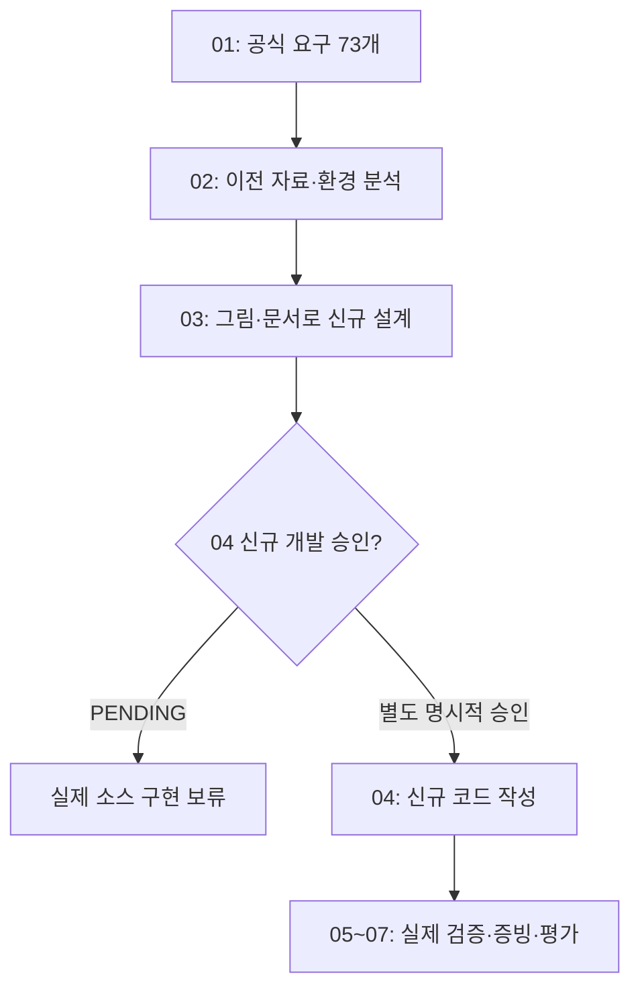

# B1-1 — 03단계 | 새 웹페이지를 만들기 전에 설계부터 배우기

> **30초 요약:** 01단계의 공식 요구사항과 02단계의 기존 코드 분석을 바탕으로 **새 Round 04 웹페이지를 어떻게 만들지 그림과 문서로 설계하는 단계**입니다. 과거 구현의 코드를 가져오지 않고, 신규 구현·명령 실행·배포 없이 설계합니다.
>
> **상태(2026-10-26):** 00~02 **문서 기준 PASS** · 03-1 **설계 범위 문서 작성 및 검증 진행** · 03-2~03-8 **NOT_STARTED** · 03 전체 설계 완료 **NOT_VERIFIED** · 신규 소스 개발 승인 **PENDING** · 실제 기능/학습자 숙달/CLEAR **NOT_VERIFIED**.

## 처음 시작하기 — 명령어 없이 읽는 3분 길잡이

1. **A. 목표 확인:** 이전 코드를 참고하는 것과 새 코드를 만드는 것이 다른 이유를 읽습니다.
2. **B. 설계 순서:** 03-1부터 03-8까지 **한 단계씩** 살펴봅니다.
3. **C. 03-1 공식 요구 연결:** R(요구사항) → E(평가) → LO(학습목표) → 설계/시험의 연결을 확인합니다.
4. **D. 점검·인계:** 무엇이 문서 기준 PASS이고, 무엇이 아직 검증되지 않았는지 확인합니다.

| 구분 | 바로 이동 | 읽으면 이해할 내용 |
|---|---|---|
| **A. 처음 시작하기** | [목표와 비유](#stage03-start) | 지금 무엇을 하고 무엇을 하지 않는가 |
| **B. 기술·설계 순서 배우기** | [03-1~03-8 목차](#stage03-roadmap) | 설계 작업이 어떤 순서로 연결되는가 |
| **C. 03-1 직접 살펴보기** | [요구→설계→평가](#stage03-scope) | 무엇을 반드시 설계해야 하는가 |
| **D. 진행·검증 확인하기** | [PASS 조건과 다음 순서](#stage03-next) | 문서 검증과 실제 프로그램 실행의 차이 |

## A. 이번 단계의 의미 — 집을 짓기 전에 설계도 그리기

**쉬운 비유:** HTML(방과 문)은 구조, CSS(페인트·가구)는 표현, JavaScript(문을 여는 스위치)는 동작입니다. **03단계는 집을 실제로 짓는 것이 아니라 설계도를 그리는 일**입니다. 04단계는 별도 승인 후 설계대로 집을 짓고, 05단계는 실제 문이 열리는지 시험합니다.

**고정 작업 범위**

- 저장소: `MetaStudy999/codyssey-basic-web-portfolio`.
- 설계 문서 위치: `training/round-04-agent/03-design/`.
- 향후 신규 소스 전용 위치: `training/round-04-agent/04-src/`. **현재 새 소스 작성·실행은 금지**입니다.
- Round 01~03, 루트의 과거 소스, 문서, 배포·스크린샷·Git 이력은 **수정·복제·삭제하지 않습니다**.
- Windows 11 Pro의 WSL2 Ubuntu를 우선 검토하고, AWS·iMac 범위는 보류합니다.
- 신규 코드 개발·실행·배포와 Git 브랜치 병합은 **사용자 별도 승인 이전에는 수행하지 않습니다**.

**용어 풀이:** 요구사항(Requirement)은 반드시 만족할 조건, 설계(Design)는 만들기 전 구조와 동작을 정하는 일, 수용 기준(Acceptance Criteria)은 기준을 충족했는지 나중에 판정할 방법, 증빙(Evidence)은 실행 또는 문서 확인의 근거입니다.

## B. 고정된 03단계의 세부 순서 — 한 번에 한 단계씩

아래 03-1~03-8은 **03단계 안에서만 사용하는 세부 작업 번호**이며, 기존 00~09 공식 목차를 변경하지 않습니다.

| 세부 단계 | 무엇을 설계하나요? | 이번에 확인할 완료 기준 | 현재 상태 |
|---|---|---|---|
| **03-1** 공식 요구·범위 | 필수·선택·제약·평가 연결 및 설계 경계 | R01~R12, E01~E15, LO01~LO14 범위·보류·PASS 기준 추적 | **검증 진행** |
| **03-2** 정보 구조·화면 | Hero/About/Skills/Projects/Contact/Footer, 메뉴·탐색 | 섹션·시맨틱 태그·앵커·이용 흐름 설계 | NOT_STARTED |
| **03-3** 파일·레이아웃 | HTML·CSS·JS 역할 분리, 모바일 퍼스트, Flex/Grid·변수 | 폴더 구조·CSS 분기·금지 기술 구별 | NOT_STARTED |
| **03-4** 이벤트·상태 | 메뉴·테마·스크롤·애니메이션·상태→DOM 최소 3개 흐름 | 상태 전이 표·Mermaid·수치 경계 설계 | NOT_STARTED |
| **03-5** 데이터·폼·보안 | GitHub API, 비동기 상태, 폼 오류·안전한 출력 | 성공·빈 결과·403·오류·재시도·XSS·정보 보호 | NOT_STARTED |
| **03-6** 품질·접근성·시험 | 반응형, 키보드, 감속 모션, 브라우저·배포 증빙 | 미래 정적/브라우저/배포 테스트와 증빙 기준 | NOT_STARTED |
| **03-7** 학습자 교육 | 9요소 기술 학습·PRIMM·사전사후 평가 | 이해→설명→재현 계획, 평가 E01~E15 및 LO 연결 | NOT_STARTED |
| **03-8** 종합 검증·인계 | 설계 전 범위 검토 및 04 승인 경계 | 누락·모순·상대 링크·SHA·승인 보존 확인 | NOT_STARTED |

**진입 게이트:** 각 단계는 바로 앞 단계의 **문서 검증 증거**를 확인하고 진행합니다. 문서 PASS는 실제 웹 기능 PASS가 아닙니다.

## C. 03-1 공식 요구·설계 범위·수용 기준 확정

### 1. 가장 먼저 기준 문서를 연결합니다

| 우선순위 | 실제 근거 | 이번 설계에서 하는 일 |
|---|---|---|
| 1 | [공식 B1-1 미션 PDF](https://drive.google.com/file/d/1YC6KKj-hCi54FzOhivZmetX0EQXFXXNy/view) | 필수 기능과 제약의 최우선 근거 |
| 2 | [공식 평가 15문항 원본](https://drive.google.com/file/d/1tRJdh0a2cX8x3nAkpKYM9b6aVfPKed6q/view) | 학습자가 설명·시연할 질문 확인 |
| 3 | [01 요구사항 73개 추적](../01-requirements/REQUIREMENTS-CATALOG.md) · [E01~E15](../01-requirements/EVALUATION-15-MAPPING.md) · [LO01~LO14](../01-requirements/LEARNING-OBJECTIVES.md) | 공식 원문의 해석을 ID로 연결 |
| 4 | [01 이슈 D01~D10](../01-requirements/SOURCE-CONFLICTS-AND-DECISIONS.md) | 상충하거나 선택 사항인 조건을 따로 처리 |
| 5 | [02 신규 공백 분석](../02-analysis/REQUIREMENT-GAP-MATRIX.md) · [02 검증](../02-analysis/VALIDATION-REPORT.md) | 예전 구현의 참고 지식과 이번 구현 필요 범위 구별 |

**공식 요구 추적의 의미:** **73개는 개별 기능 73개가 아니라 공식 문장을 쪼갠 검증 항목 73개**입니다. 01단계의 집계: CORE 59, BONUS 6, RECOMMENDED 1, GUIDANCE 1, CONSTRAINT 4, ALLOWED 1, PRIORITY 1. 이 분류를 변경하지 않습니다.

### 2. 요구 12개 영역 → 설계·시험 연결표

| 구분 | 이번 설계에서 누락하면 안 될 것 | 주요 평가 연결 | 후속 세부 단계 |
|---|---|---|---|
| R01 파일·도구 | index.html/css/js/images, 외부 연결, VS Code + Live Server | E06 | 03-3, 03-6 |
| R02 HTML·접근성 | header/nav/main/section/article/footer, Hero·About·Skills·Projects·Contact, alt·label | E05,E07 | 03-2, 03-6 |
| R03 CSS·반응형 | 변수·테마, Flex/Grid, 모바일 우선 768/1024px, hover | E01,E02,E08,E13,E15 | 03-3, 03-6 |
| R04 JS·DOM | const/let, defer, addEventListener, querySelector, classList, textContent/innerHTML | E09,E10 | 03-4, 03-5 |
| R05 상호작용 | 메뉴, 앵커, 맨 위 버튼, 60px 상단, 테마 저장, IntersectionObserver | E02,E03 | 03-4 |
| R06 문의 폼 | 이름·이메일·메시지, 필수값/형식 검사, 인접 오류, 성공 안내 | E05 | 03-5 |
| R07 ES6+·배열 | 화살표 함수, 템플릿·구조분해, map/forEach, 선택 filter | E12 | 03-5 |
| R08 GitHub API | fetch·async/await, 로딩/성공/빈값/403/오류/재시도 | E04,E11,E12 | 03-5, 03-6 |
| R09 상태→렌더 | 최소 3개 독립 이벤트→상태→화면 갱신 흐름 | E10,E14 | 03-4 |
| R10 Pages·제출 | URL·README·데스크톱/모바일/다크 캡처와 신규 SHA | E01~E05 | 03-6, 03-8 |
| R11 선택 보너스 | filter·타이핑·외부 전송·시스템 테마는 선택 취급 | E12 관련(선택 구현 여부 설명) | 03-5, 03-8 |
| R12 제약·우선순위 | UI 프레임워크/inline 금지, Chrome 검증, 기능·개념 이해 우선 | E06,E09,E10 | 03-3, 03-6 |

**검증 시점 구별:** 위 표는 미래 설계와 검증 대상을 연결한 **수용 계획**입니다. 코드·화면·API·배포 시험에서 실제 기능이 동작한 증거가 아닙니다.

### 3. 01단계 D01~D10 결정 쟁점 그대로 인계

| 쟁점 | 03-1 범위·선행 원칙 | 상세 결정 시점 |
|---|---|---|
| **D01** filter | `map` 필수, `filter` 선택. 임의로 CORE로 바꾸지 않음 | 03-5 |
| **D02** 별도 STATE 객체 | 이벤트→상태→렌더 3개 흐름은 필수. 상태 객체 사용 형태는 선택 설계 | 03-4 |
| **D03** 스크롤 기준 | 맨 위 300px, 상단 변화 60px을 기준으로 잡고 변경 시 README 기록 | 03-4 |
| **D04** Observer 임계값 | 0.2 이상 권장. 변화 시 이유·값 기록, 감속 모션 고려 | 03-4, 03-6 |
| **D05** Live Server | 공식 도구 조건 보존. 설치·동작은 현재 미확인이므로 자동 면제 아님 | 03-3, 03-6 |
| **D06** 기술·자산 제약 | React/Vue/jQuery/Bootstrap/Tailwind 금지, 공식 허용 자산은 구별 | 03-3 |
| **D07** 실제 폼 전송 | 필수는 유효성 검사·성공 안내, 외부 실제 전송은 별도 승인 보너스 | 03-5 |
| **D08** API 제한 숫자 | 과거 문서의 60회/시간 안내를 현재 실측값으로 주장하지 않음 | 03-5, 03-6 |
| **D09** innerHTML/XSS | 외부 데이터의 안전한 문자열 삽입 대책 필요; 공식 메서드 요구 임의 삭제 금지 | 03-5 |
| **D10** 실행·증빙 | 문서 PASS ≠ 신규 프로그램·평가 PASS; 테스트는 04 승인 후 05~07 단계 | 03-6, 03-8 |

### 4. 처음 배우는 사람을 위한 9단계 설계 사례 — 테마 변경

| 학습 순서 | 내용 |
|---|---|
| ① 용어 | 상태(State): 현재 테마 값, 이벤트(Event): 클릭 |
| ② 개념 | 클릭하면 상태가 바뀌고 페이지의 모양이 바뀜 |
| ③ 쉬운 비유 | 전등 스위치를 누르면 켜짐/꺼짐 표시와 밝기가 바뀜 |
| ④ 그림 | 아래 Mermaid 참고 |
| ⑤ 주요 코드 | `addEventListener`(클릭 감지), `classList`(스타일 상태 반영), `localStorage`(테마 저장)는 **향후 사용할 기술의 이름** |
| ⑥ 예상 흐름 | 클릭 → light/dark 변경 → CSS/DOM 반영 → 저장 → 새로고침 복원 |
| ⑦ 오류 | 버튼 누락, 저장소 사용 실패, 색상 대비 부족을 미리 고려 |
| ⑧ 종이 실습 | 첫 클릭·두 번째 클릭·새로고침 뒤 예상 색과 상태를 화살표로 표시 |
| ⑨ 평가 | “클릭과 상태는 왜 다른가요?”를 자기 말로 두 문장 설명 |

**참고:** [02단계 테마 버튼 교육용 코드](../02-analysis/README.md#stage02-review)는 읽기 연습에만 사용합니다. 그 예시는 **새로고침 상태 저장을 구현하지 않았으므로** 이번 설계의 필수 `localStorage` 복원 요건을 충족한 소스라고 판단하지 않습니다.

## D. 03-1 검증 조건과 다음 순서

**03-1 문서 범위 PASS를 내릴 수 있는 조건**

1. 공식 추적 영역 R01~R12, 평가 E01~E15, 학습목표 LO01~LO14가 [01단계 근거](../01-requirements/README.md)에 연결돼 있고, 03-1 문서에서는 설계 범위와 누락 위험을 모두 식별했는가?
2. 필수(CORE), 선택(BONUS), 권장(RECOMMENDED), 제약(CONSTRAINT)을 섞지 않았는가?
3. D01~D10 해석 쟁점을 빠짐없이 다음 세부 설계의 결정 시점에 넘겼는가?
4. README 링크·Mermaid 코드 펜스·상대 파일 경로에 정적 오류가 없는가?
5. 이전 코드·증빙·Git 기록을 보존하고, `mission.yml` 개발 승인 `PENDING`, `04-src/` 소스 미작성 상태를 유지했는가?
6. GitHub 커밋 후 실제 `main` 파일을 다시 읽어 변경 범위와 SHA를 확인했는가?

**미검증을 남기는 항목:** 실제 학습자 이해·설명 능력, WSL2·VS Code·Chrome 실행, 새 코드 동작, 배포·공식 평가·최종 CLEAR는 **NOT_VERIFIED / NOT_STARTED**입니다.

**다음 세부 단계:** 03-1 문서 게이트 검증이 끝난 뒤 **03-2 정보 구조·화면 설계**를 시작합니다. 03 전체 설계 완료는 03-8의 별도 종합 검증 후에만 판정합니다.

[00~09 고정 개발계획](../00-plan/MASTER-PLAN.md) · [01 공식 요구](../01-requirements/README.md) · [02 분석 결과](../02-analysis/README.md) · [학습 설계(후속 03-7)](LEARNING-DESIGN.md) · [신규 개발 승인 상태](../mission.yml)
