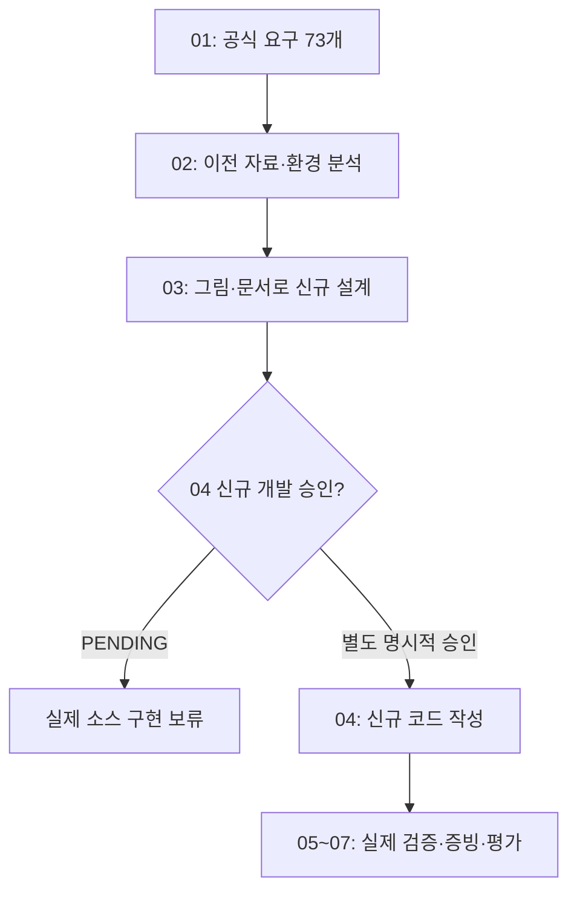

# B1-1 — 03단계 | 새 웹페이지를 만들기 전에 설계부터 배우기

> **30초 요약:** 01단계의 공식 요구사항과 02단계의 기존 코드 분석을 바탕으로 **새 Round 04 웹페이지를 어떻게 만들지 그림과 문서로 설계하는 단계**입니다. 과거 구현의 코드를 가져오지 않고, 신규 구현·명령 실행·배포 없이 설계합니다.
>
> **상태(2026-10-26):** 00~02 **문서 기준 PASS** · 03-1 **PASS(설계 범위 문서·정적 검증 기준)** · 03-2 **PASS(기획·IA/화면 설계 문서 기준)** · 03-3 **PASS(파일·반응형 설계 문서 기준)** · 03-4 **PASS(이벤트·상태·DOM 설계 문서 기준)** · 03-5 **PASS(API·폼·보안 설계 문서 기준)** · 03-6 **PASS(접근성·시험·배포 증빙 설계 문서 기준)** · 03-7 **PASS(학습·평가 설계 문서 기준)** · 03-8 **PASS(종합 감사 문서 기준)** · 03 전체 설계 문서 **PASS(정적 검증 범위)** · 신규 소스 개발 승인 **PENDING** · 실제 기능/학습자 숙달/CLEAR **NOT_VERIFIED**.

**전 미션 의무 적용(Owner 2026-10-27):** [B1-1~B7-2 전체 15개 미션 공통 단계·교육·검증 표준](https://github.com/MetaStudy999/codyssey-basic/blob/main/standards/ROUND-04-AGENT-MISSION-PROCESS-STANDARD.md)에 따라 공식 근거 확인 → 기획 프롬프트 V0.1 → 누락·위험 검토 → V1.0 보완 → 입문자 중심 설계 → 독립 검증·오류 수정 → 다음 단계 인계를 적용합니다. **각 03-1~03-8은 개별 MD 파일**로 찾을 수 있어야 하며, 현재 B1-1의 결과를 다른 미션 PASS로 옮기지 않습니다.

## 처음 시작하기 — 명령어 없이 읽는 3분 길잡이

1. **A. 목표 확인:** 이전 코드를 참고하는 것과 새 코드를 만드는 것이 다른 이유를 읽습니다.
2. **B. 설계 순서:** 03-1부터 03-8까지 **한 단계씩** 살펴봅니다.
3. **C. 03-1 공식 요구 연결:** [03-1 독립 문서](03-1-REQUIREMENTS-AND-SCOPE.md)에서 R(요구사항) → E(평가) → LO(학습목표)를 따라 읽습니다.
4. **D. 점검·인계:** 무엇이 문서 기준 PASS이고, 무엇이 아직 검증되지 않았는지 확인합니다.

| 구분 | 바로 이동 | 읽으면 이해할 내용 |
|---|---|---|
| **A. 처음 시작하기** | [목표와 비유](#stage03-start) | 지금 무엇을 하고 무엇을 하지 않는가 |
| **B. 기술·설계 순서 배우기** | [03-1~03-8 목차](#stage03-roadmap) | 설계 작업이 어떤 순서로 연결되는가 |
| **C. 03-1 직접 살펴보기** | [독립 03-1 문서](03-1-REQUIREMENTS-AND-SCOPE.md) | 73개 요구 추적·D01~D10·당시 검증 결과 |
| **D. 진행·검증 확인하기** | [PASS 조건과 다음 순서](#stage03-next) | 문서 검증과 실제 프로그램 실행의 차이 |

## A. 이번 단계의 의미 — 집을 짓기 전에 설계도 그리기

**쉬운 비유:** HTML(방과 문)은 구조, CSS(페인트·가구)는 표현, JavaScript(문을 여는 스위치)는 동작입니다. **03단계는 집을 실제로 짓는 것이 아니라 설계도를 그리는 일**입니다. 04단계는 별도 승인 후 설계대로 집을 짓고, 05단계는 실제 문이 열리는지 시험합니다.

**고정 작업 범위**

- 저장소: `MetaStudy999/codyssey-basic-web-portfolio`.
- 설계 문서 위치: `training/round-04-agent/03-design/`.
- 향후 신규 소스 전용 위치: `training/round-04-agent/04-src/`. **현재 새 소스 작성·실행은 금지**입니다.
- Round 01~03, 루트의 과거 소스, 문서, 배포·스크린샷·Git 이력은 **수정·복제·삭제하지 않습니다**.
- Windows 11 Pro의 WSL2 Ubuntu를 우선 검토하고, AWS·iMac 범위는 보류합니다.
- 신규 코드 개발·실행·배포와 Git 브랜치 병합은 **사용자 별도 승인 이전에는 수행하지 않습니다**.

**용어 풀이:** 요구사항(Requirement)은 반드시 만족할 조건, 설계(Design)는 만들기 전 구조와 동작을 정하는 일, 수용 기준(Acceptance Criteria)은 기준을 충족했는지 나중에 판정할 방법, 증빙(Evidence)은 실행 또는 문서 확인의 근거입니다.

## B. 고정된 03단계의 세부 순서 — 한 번에 한 단계씩

아래 03-1~03-8은 **03단계 안에서만 사용하는 세부 작업 번호**이며, 기존 00~09 공식 목차를 변경하지 않습니다.

| 세부 단계 | 무엇을 설계하나요? | 이번에 확인할 완료 기준 | 현재 상태 |
|---|---|---|---|
| **03-1** 공식 요구·범위 | 필수·선택·제약·평가 연결 및 설계 경계 | R01~R12, E01~E15, LO01~LO14 범위·보류·PASS 기준 추적 | **PASS — [독립 03-1 설계 문서](03-1-REQUIREMENTS-AND-SCOPE.md) (문서 기준)** |
| **03-2** 정보 구조·화면 | Hero/About/Skills/Projects/Contact/Footer, 메뉴·탐색 | 섹션·시맨틱 태그·앵커·이용 흐름 설계 | **PASS — [기획 프롬프트·정보구조 설계](03-2-INFORMATION-ARCHITECTURE.md) (문서 기준)** |
| **03-3** 파일·레이아웃 | HTML·CSS·JS 역할 분리, 모바일 퍼스트, Flex/Grid·변수 | 폴더 구조·CSS 분기·금지 기술 구별 | **PASS — [파일 책임·반응형 설계](03-3-FILE-RESPONSIBILITIES-AND-RESPONSIVE-LAYOUT.md) (문서 기준)** |
| **03-4** 이벤트·상태 | 메뉴·테마·스크롤·애니메이션·상태→DOM 최소 3개 흐름 | 상태 전이 표·Mermaid·수치 경계 설계 | **PASS — [이벤트·상태·DOM 설계](03-4-EVENT-STATE-DOM-FLOW.md) (문서 기준)** |
| **03-5** 데이터·폼·보안 | GitHub API, 비동기 상태, 폼 오류·안전한 출력 | 성공·빈 결과·403·오류·재시도·XSS·정보 보호 | **PASS — [API·폼·보안 설계](03-5-API-FORM-SECURITY-DESIGN.md) (문서 기준)** |
| **03-6** 품질·접근성·시험 | 반응형, 키보드, 감속 모션, 브라우저·배포 증빙 | 미래 정적/브라우저/배포 테스트와 증빙 기준 | **PASS — [품질·접근성·시험 설계](03-6-QUALITY-ACCESSIBILITY-TEST-PLAN.md) (문서 기준)** |
| **03-7** 학습자 교육 | 9요소 기술 학습·PRIMM·사전사후 평가 | 이해→설명→재현 계획, 평가 E01~E15 및 LO 연결 | **PASS — [학습자 교육·평가 설계](LEARNING-DESIGN.md) (문서 기준)** |
| **03-8** 종합 검증·인계 | 설계 전 범위 검토 및 04 승인 경계 | 73개 세부 요구·51 시험 설계·링크·SHA·승인 보존 확인 | **PASS — [03-8 종합 독립 검증](03-8-COMPREHENSIVE-DESIGN-AUDIT-AND-HANDOFF.md) (문서 기준)** |

**진입 게이트:** 각 단계는 바로 앞 단계의 **문서 검증 증거**를 확인하고 진행합니다. 문서 PASS는 실제 웹 기능 PASS가 아닙니다.

## C. 03-1 공식 요구·설계 범위 문서

**03-1은 이제 독립된 Markdown 문서입니다.** 공식 요구사항 R01~R12·73개 세부 추적, 평가 E01~E15, 학습목표 LO01~LO14, D01~D10 결정 쟁점, 9단계 테마 교육 예시와 **03-1 당시 정적 검증 기록 원문**까지 [03-1 공식 요구·설계 범위·수용 기준 문서](03-1-REQUIREMENTS-AND-SCOPE.md)에서 확인하세요.

**입문자 읽기 순서:** ① [03-1 3분 시작](03-1-REQUIREMENTS-AND-SCOPE.md) → ② 공식 요구 12개 영역 → ③ D01~D10 결정 쟁점 → ④ 9단계 테마 예시 → ⑤ 역사적 검증 결과. **03-1은 문서 기준 PASS이고 실제 신규 기능·학습자 숙달은 NOT_VERIFIED**입니다.

## C-2. 03-2 기획 프롬프트를 만들고, 검토·보완해서 실제 설계로 연결하기

**30초 설명:** 03-2에서는 “웹페이지를 어떤 순서로 보여줄까?”를 기획합니다. 프롬프트 초안 V0.1을 작성한 뒤 필수 요구·접근성·API 오류·모바일 탐색·폼 실제 전송 여부 등 **7가지 누락 위험을 점검**하고, 최종 V1.0을 확정해 **웹페이지 화면 구조 설계**까지 연결했습니다.

**읽는 순서:** [① 초안·리뷰 → ② 완성 프롬프트 V1.0 → ③ 화면 6영역·모바일·데스크톱 와이어프레임 → ④ 사용자 여정·예외·입문 실습 → ⑤ 검증 결과](03-2-INFORMATION-ARCHITECTURE.md). 문서에 순서대로 정리되어 있으며 소스 작성이나 터미널 작업은 필요하지 않습니다.

- **정보 구조(Information Architecture, IA):** 웹페이지에서 어떤 내용을 어떤 순서로 보여주는지 정하는 설계도.
- **와이어프레임(Wireframe):** 버튼·글·메뉴를 어디에 둘지 나타내는 단순한 밑그림. 실제 디자인 이미지·브라우저 실행 화면은 아님.
- **시맨틱 HTML(Semantic HTML):** 내용이 가진 의미에 맞게 `nav`, `main`, `section`, `article` 같은 요소를 선택하는 원칙.
- **03-2 문서 결과:** 사이트 맵, 5개 앵커 ID, 6개 콘텐츠 영역, 3개 방문자 흐름, 2종 화면 문자 개념도, 로딩·오류·접근성 및 보안 계획.
- **다음 03-3 인계:** 위 구조를 기준으로 HTML/CSS/JavaScript 파일별 책임과 레이아웃 분기를 설계하되 **코드는 작성하지 않습니다**.

**이번 단계 자체가 증명하지 않은 것:** 화면 렌더링, API 연결, 폼 전송, WSL2·브라우저 동작, 실제 입문자 독립 수행 및 공식 평가 합격은 계속 `NOT_VERIFIED`입니다. 03-2의 PASS는 **문서 설계·정적 검사에 한정**됩니다.

## C-3. 03-3 기획 프롬프트 검토·보완과 파일·레이아웃 설계

**30초 요약:** 03-2에서 정한 화면 설계를 **HTML(내용), CSS(스타일), JavaScript(행동), 이미지 자산**으로 나누었습니다. 초안 V0.1의 8개 위험 P01~P08을 점검하고, 최종 프롬프트 V1.0을 바탕으로 외부 파일 연결과 모바일 우선 배치를 설계했습니다.

**입문자 추천 경로:** [① 5분 길잡이 → ② 휴대전화·태블릿·데스크톱 그림 → ③ 한글·영어·약어와 쉬운 비유 → ④ HTML·CSS·JS 주요 코드 해설 → ⑤ 오류 해결 → ⑥ 종이 실습·정답 → ⑦ 전문가용 프롬프트·검증](03-3-FILE-RESPONSIBILITIES-AND-RESPONSIVE-LAYOUT.md).

| 기술 | 쉬운 설명 | 이번 03-3 설계 결과 |
|---|---|---|
| 하이퍼텍스트 마크업 언어(HyperText Markup Language, HTML) | 웹페이지의 방·문 같은 구조 | 시맨틱 6영역과 5개 앵커 책임 |
| 캐스케이딩 스타일 시트(Cascading Style Sheets, CSS) | 글자·색·가구 배치 | `:root` 테마 토큰·모바일 우선·Grid/Flex |
| 자바스크립트(JavaScript, JS) | 버튼·데이터 처리 장치 | 외부 `defer` 연결 및 03-4/03-5 역할 인계 |
| 브레이크포인트(Breakpoint) | 배치 방식이 달라지는 화면 폭 | 기본 0~767px, 768px·1024px 두 분기 **계획** |

**학습자료 보완:** 03-3 문서를 입문자 학습 A~H와 상세 참고 I로 구분하고, 예시 코드·예상 화면 비교·자기 점검표를 추가했습니다. **실제 학습자의 이해·숙달은 평가하지 않았습니다.**

**상태:** 03-3 파일 구조·레이아웃 **문서 정적 검증 PASS**, 실제 HTML/CSS/JS 신규 소스 생성·WSL2·브라우저 시험은 `NOT_STARTED/NOT_VERIFIED`. `04-src/`는 기존 README만 존재하며 승인 `PENDING`을 유지합니다.

**다음:** 03-4에서 모바일 메뉴·테마·스크롤·애니메이션과 **3개 이상 이벤트→상태→DOM** 경로를 상세히 설계합니다. 03-3 예시를 04 소스로 복제하지 않습니다.

## C-4. 03-4 이벤트→상태→DOM을 입문자도 설명할 수 있게 설계하기

**30초 요약:** “버튼을 누른다(이벤트) → 열림·닫힘 값이 바뀐다(상태) → 메뉴가 보인다(DOM 갱신)”라는 흐름을 설계했습니다. 필수 상호작용 6종과 독립 상태 흐름 5개를 구분하고, 60px/300px 스크롤 기준과 Observer 0.2 권장값을 혼동하지 않도록 정리했습니다.

**읽는 순서:** [① 5분 학습 안내 → ② 그림·쉬운 비유 → ③ 메뉴·테마 교육용 코드 해설 → ④ 상태 전이표와 오류 → ⑤ 종이 재현·자가 점검 → ⑥ 기획 프롬프트 V1.0·검증·03-5 인계](03-4-EVENT-STATE-DOM-FLOW.md).

| 기술 개념 | 쉬운 설명 |
|---|---|
| 이벤트(Event) | 클릭처럼 발생한 사건 |
| 상태(State) | 메뉴 열림·테마 값처럼 지금 기억하는 값 |
| 문서 객체 모델(Document Object Model, DOM) | 브라우저가 화면 요소를 다루는 구조 |
| 렌더링(Rendering) | 현재 값을 글자·클래스·표시 속성에 반영 |
| `localStorage` | 다음 방문에도 테마 값을 기억하는 브라우저 저장소 |
| `IntersectionObserver` | 요소가 화면에 들어오는지 확인하는 브라우저 관찰 기능 |

**PASS 경계:** 03-4 **설계 문서·정적 근거 PASS**이며, 실제 새 소스와 이벤트 실행·학습자 숙달·공식 평가 결과는 `NOT_STARTED/NOT_VERIFIED`입니다. `04-src/` 새 코드 작성 승인 `PENDING` 유지.

**다음:** 03-5에서는 프로젝트 API의 로딩/빈 결과/403/실패/재시도와 문의 폼의 실제 미전송·입력 오류·보안(XSS) 처리를 상세 설계합니다.

## C-5. 03-5 API·문의 폼·보안을 그림과 예시로 배우기

**30초 요약:** 프로젝트 자료를 요청하면 “불러오는 중 → 정상 목록·정상 빈 목록·접근 거부·연결 오류”로 결과가 달라집니다. 문의 폼은 **입력 형식 검증**과 **실제 이메일 발송**을 구분하며, 외부 문자열은 HTML 명령으로 실행되지 않도록 설계합니다.

[**03-5 학습 바로 가기: 용어·비유 → API/폼 Mermaid → 상태표 → 교육용 코드 → XSS·개인정보 오류 → 종이 재현·정답 → 프롬프트 V1.0·검증표**](03-5-API-FORM-SECURITY-DESIGN.md)

| 새로 배우는 기술 | 한 문장 비유 |
|---|---|
| 응용 프로그램 프로그래밍 인터페이스(Application Programming Interface, API) | 공개 프로젝트를 요청하는 안내 창구 |
| 비동기 처리(Asynchronous Processing) | 요청을 보내고 답이 올 때까지 기다리는 과정 |
| HTTP 403 | 서버가 요청을 거부했지만 원인은 응답 확인이 필요한 상황 |
| 유효성 검사(Validation) | 신청서에 빈칸과 잘못된 형식이 있는지 살펴보기 |
| 교차 사이트 스크립팅(Cross-Site Scripting, XSS) | 외부에서 받은 글을 실행 명령으로 잘못 취급하는 보안 문제 |

**입문자 학습 보완(2026-10-26):** 03-5의 A~G를 기본 학습 경로, H~K를 기술·검증 참고로 구분하고, `response.ok`·`aria-invalid`·`AbortController` 등 용어 풀이, 코드→상태→화면 결과표, **빈 이메일 필수값 검사**, `innerHTML`과 `textContent` 안전성 비교, 종이 재현 질문을 보완했습니다. **교육용 코드 실행 및 실제 학습자 평가 결과는 없습니다.**

**이번의 확인 범위:** 03-5 설계 문서의 기획 V0.1→V1.0·위험 S01~S10·상대경로·승인 보존 **PASS**. 실제 HTTP 요청·폼 전송·XSS 방어 실행·학습자 독립 설명·미션 CLEAR는 **NOT_VERIFIED**입니다.

**다음 03-6:** 지금까지의 화면·반응형·상태·API·폼 설계를 **어떻게 실제로 시험할지 계획**합니다. 04 신규 코드 개발 승인은 여전히 별도로 필요합니다.

## C-6. 03-6 입문자 관점에서 품질·접근성·실제 시험 방법 설계하기

**30초 요약:** 새 웹페이지를 구현한 뒤 **무슨 동작을 어떤 입력으로 확인하고 어떤 증거를 남길지** 설계했습니다. 기획 초안 V0.1의 12개 누락 위험 T01~T12를 검토·보완하여 V1.0을 확정하고, **총 51개 미래 시험 ID**의 입력·기대 결과·실증 시점·보호 조건을 정리했습니다.

[**입문자 읽기 순서: 용어 → Mermaid → 화면·키보드 → 버튼/API·폼 오류 → 배포 경로 → 증빙 기준 → 종이 실습·정답 → 최종 프롬프트·검증**](03-6-QUALITY-ACCESSIBILITY-TEST-PLAN.md)

| 구분 | 문서에 마련한 시험 ID |
|---|---|
| 반응형·테마(`RES`) | 8건 |
| 접근성(`A11Y`) | 11건 |
| 상호작용(`INT`)·상태 흐름(`FLOW`) | 6건·5건 |
| API·문의 폼(`API`, `FORM`) | 7건·4건 |
| 보안(`SEC`)·게시·증빙(`PUB`) | 4건·6건 |

**PASS 경계:** 위 **51건은 설계된 사례**이지 실제 성공한 테스트 수가 아닙니다. 03-6의 **문서 정적 검증 PASS**와 05 실제 브라우저 테스트·06 증빙 검증·07 학습자 평가 `NOT_VERIFIED`를 구분합니다. 신규 코드·배포·병합은 하지 않았고 04 개발 승인 `PENDING`을 유지합니다.

**03-6 입문자 교육 보완(2026-10-27):** 원래 **51개 시험 ID**와 A~J 목차·프롬프트 V0.1/T01~T12/V1.0은 보존하면서, [03-6 상세 문서](03-6-QUALITY-ACCESSIBILITY-TEST-PLAN.md)에 다음 다섯 가지를 추가했습니다: **기초→응용→심화 학습 순서, RES-01 6단계 따라 하기(미래 절차), 키보드 Tab/Enter/Escape Mermaid, 가상 FAIL 문제 해결·회귀 확인, NOT_VERIFIED 상태의 빈 시험 기록표·수준별 정답 확인**. 이 교육자료의 **구성·정적 검증은 PASS**이지만 실제 학생의 독립 이해와 시험 수행은 **NOT_VERIFIED**입니다.

**다음은 03-7**로, 01 학습목표 LO01~LO14·평가 E01~E15를 토대로 이해·설명·재현·PRIMM 활동·사전사후 평가 설계를 진행합니다.

## C-7. 03-7 입문자 학습·평가를 직접 설명할 수 있게 설계하기

**30초 요약:** 용어·원리 암기를 넘어 **두 문장 설명 → 입력·상태·결과 종이 재현 → (별도 승인 후) 실제 코드 실행·독립 구현**으로 연결합니다. 기획 초안 V0.1을 U01~U12 12개 기준으로 검토한 다음 최종 V1.0을 확정하고 학습·평가 문서에 반영했습니다.

**입문자 5분 시작:** [A 이벤트/상태 용어 → B 그림 → C 테마 두 번 클릭 예상 → 두 문장 자기 설명](LEARNING-DESIGN.md). 어려운 공식 추적표는 H~K에서 나중에 확인할 수 있습니다.

| 핵심 활동 | 초보자가 기억하면 좋은 의미 |
|---|---|
| 학습목표(Learning Objective, LO) | 공부 뒤 할 수 있게 될 일을 정한 것 — **14개** |
| 공식 평가(Evaluation Item, E) | 실제로 이해·기능을 확인할 질문 — **15개** |
| PRIMM | 예측(Predict)→실행(Run)→조사(Investigate)→수정(Modify)→제작(Make); 실제 실행은 **미승인** |
| AI 힌트 H1~H4 | 질문→개념→절차→해설, 도움을 받은 답을 독립 수행으로 오인 금지 |
| 숙달 L1~L5 | 실제 설명·재현·응용 증거로 판정, **현재 전부 NOT_VERIFIED** |
| 사전/사후 A/B | 각 10개 문항, 문제당 6점, 총 60점 계획 유지; 실제 점수 없음 |

**정적 설계 PASS:** 학습 방법 M01~M16, 품질 게이트 QG-01~08, 기존 A01~A10/B01~B10, 공식 LO01~LO14/E01~E15를 연결하고 Mermaid·종이 실습·오답·복습·5분 Quick Start를 확인했습니다. **QG 실제 운영·학습자 이해도·PRIMM 실제 실행·L4/L5·기능·CLEAR는 NOT_VERIFIED**입니다.

**다음 03-8:** 03-1~03-7 전체 설계·공식 73개 요구사항·문서 링크·검증 증거·승인 경계를 통합 점검하되 **04 새 소스 개발은 시작하지 않습니다**.

## C-8. 03-8 종합 설계 검증·04 개발 승인 전 인계

**검증 결과:** [03-8 종합 설계 독립 검증 및 73개 공식 요구 추적 파일](03-8-COMPREHENSIVE-DESIGN-AUDIT-AND-HANDOFF.md)을 독립 MD로 작성하고 73개 요구·51개 미래 시험·9개 설계 파일·승인 보존 상태를 재조회했습니다. 본문은 **A~G 입문자 설명→H 73개 공식 요구 상세 감사→I 기획 V0.1/Z01~Z12/V1.0→J 독립 검증** 순서입니다.

**정확한 판정:** **03-8=PASS(DOC_ONLY)**, 03-1~03-8 **전체 설계 문서 정적 게이트 PASS**. 실제 04 코드·51개 시험 실행·배포·학습자 평가와 CLEAR는 별도 승인과 증거가 없으므로 `NOT_STARTED/NOT_VERIFIED`입니다.

## D. 단계별 검증 기록과 현재 다음 순서

**03-1 문서 검증 기록(2026-10-26):** 당시 수용 기준·원본 코드/근거 보존·GitHub 정적 확인·PASS/NOT_VERIFIED 표는 [독립 03-1 문서 D절](03-1-REQUIREMENTS-AND-SCOPE.md#stage03-history)로 **원문을 옮겨 보존**했습니다. 이전 검증 횟수와 당시 SHA는 역사적 스냅샷이며, 최신 저장소 상태·검증은 아래 안내와 각 단계 문서를 우선합니다.

**현재 다음 단계:** 03-1~03-8 **설계 문서 기준 PASS**. 다음은 **04 신규 구현**이지만 `mission.yml` 개발 승인 **PENDING**으로 **아직 시작할 수 없습니다**. 승인 이후에도 05~09 기능·증빙·학습자 평가를 실제로 검증해야 합니다. 03-1의 예전 검증 표는 **독립 문서로 이전**했으며, 최신 진행 판정은 문서 상단의 상태표를 우선합니다.

[00~09 고정 개발계획](../00-plan/MASTER-PLAN.md) · [01 공식 요구](../01-requirements/README.md) · [02 분석 결과](../02-analysis/README.md) · [학습 설계(후속 03-7)](LEARNING-DESIGN.md) · [신규 개발 승인 상태](../mission.yml)
