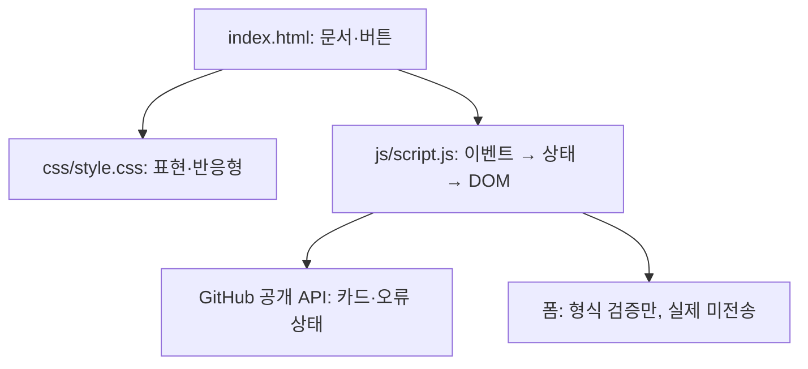

# B1-1 Round 04 — 04단계 신규 포트폴리오 구현

> **개발 상태:** `04_IMPLEMENTATION=IN_PROGRESS`, `04_STATIC_STRUCTURE_QA=PASS`, `05_RUNTIME=NOT_VERIFIED`, `06_PAGES=NOT_STARTED`, `MISSION_CLEAR=NOT_VERIFIED`.
> **개발 브랜치:** `feature/b1-1-round04-implementation-20261027` (운영 `main`과 분리).
> **승인 기록:** 사용자의 2026-10-27 후속 “진행 부탁 드립니다”를 04단계 신규 소스 착수 승인으로 해석하여 **이 브랜치의 `../mission.yml`에만** `APPROVED_2026-10-27_STAGE_04_ONLY`를 기록했습니다. `main`의 기존 승인값 `PENDING`은 유지했습니다. **배포·병합 승인 `PENDING`**.

## A. 입문자 3분 안내

| 파일 | 쉬운 설명 | 예상 화면·동작 |
|---|---|---|
| [index.html](index.html) | 하이퍼텍스트 마크업 언어(HyperText Markup Language, HTML): 제목·내용·메뉴·폼 구조 | Hero/About/Skills/Projects/Contact/Footer |
| [css/style.css](css/style.css) | 캐스케이딩 스타일 시트(Cascading Style Sheets, CSS): 색·배치·반응형 | 375/768/1024px, 모바일 메뉴·Flex/Grid·다크 테마 |
| [js/script.js](js/script.js) | 자바스크립트(JavaScript, JS): 사용자 행동·상태·화면 갱신 | 메뉴·테마·스크롤·GitHub API·폼 검증 |
| [images/profile-placeholder.svg](images/profile-placeholder.svg) | 벡터 이미지(Scalable Vector Graphics, SVG) | 실제 사진이 아닌 교체 가능한 추상 인물 |

**읽기 순서:** ① HTML의 `id="projects"` 찾기 → ② CSS의 `.projects-grid` 찾기 → ③ JS의 `loadProjects` 이해 → ④ `04` 정적 QA와 `05` 브라우저 시험 차이 설명하기.

## B. 기획 프롬프트 V0.1 → 검토 → 최종 V1.0

**V0.1 초안:** “순수 HTML/CSS/JavaScript로 개인 소개 포트폴리오와 프로젝트 카드, 문의 폼을 구현하고 초보자도 이해하도록 설명하라.”

**검토 및 보완 12개:**

| ID | 빠질 수 있는 것 | V1.0 보완 |
|---|---|---|
| O01 | 확인되지 않은 이름·경력·사진 | 실명·개인경력 창작 금지, 교체 가능한 예시 표시 |
| O02 | 시맨틱·접근성 | nav/main/section/article/alt/label/skip link |
| O03 | 외부 파일·기술 제약 | HTML/CSS/JS/SVG 분리, UI 프레임워크 금지 |
| O04 | 반응형 | mobile-first, 768/1024, Grid/Flex |
| O05 | 필수 상호작용 | 모바일 메뉴·앵커·60/300 스크롤·Observer·테마 유지 |
| O06 | 상태 흐름 | menu/theme/projects/form/scroll 독립 렌더 |
| O07 | API 오류와 빈 결과 혼동 | idle/loading/success/empty/forbidden/error, 재시도 |
| O08 | 외부 HTML 삽입 위험 | textContent, 검증된 https GitHub 링크, 고정 innerHTML |
| O09 | 폼 미전송·개인정보 | 이메일 필수/형식, 입력 이벤트, JS 실패 시 제출 비활성 |
| O10 | 본인 GitHub 계정 미확인 | 저장소 소유자 MetaStudy999를 기본 계정으로 기록, 실제 주체 확인 전 R08-02 NOT_VERIFIED |
| O11 | 실제 기능 PASS로 오인 | 정적 코드 검증과 05 브라우저/51개 시험 구분 |
| O12 | 무승인 운영 배포 | 격리 브랜치만 사용, main·기존 Round·Pages 보존 |

**최종 기획 프롬프트 V1.0 (재사용):**

> B1-1 Round 04의 [공식 요구 73개](../01-requirements/REQUIREMENTS-CATALOG.md)와 [03-1~03-8 설계](../03-design/README.md)를 기준으로 `04-src/`에 별도 HTML/CSS/JS와 예시 이미지를 구현하라. 시맨틱 태그, 모바일 우선 Flex/Grid 768/1024, CSS 변수·다크 모드, 이벤트→상태→DOM 흐름 최소 3개, 메뉴·60/300px 스크롤·0.2 Observer 권장·localStorage, 공개 GitHub API의 오류·빈값·재시도, 문의 폼의 필수값·이메일 검증·**미전송**을 포함한다. React/Vue/jQuery/Bootstrap/Tailwind/인라인 `onclick`·`style`을 사용하지 않는다. 외부 데이터는 안전한 텍스트로 렌더하고 실제 이름·비밀정보·프로필을 창작하지 않는다. V0.1 결함 O01~O12를 각각 코드/문서/검증 결과로 대조한다. 기존 Round·루트·`main`·배포·병합은 건드리지 않는다. 정적 구현 결과와 실제 Chrome/WSL2·학습자 검증을 구분해 보고하라.

## C. 주요 동작을 종이에 재현하기

1. 메뉴 버튼 0회: `menuOpen=false`, 메뉴 닫힘, `aria-expanded=false`.
2. 1회 클릭: `true`로 변경, 메뉴 열림, `aria-expanded=true`.
3. 2회 클릭: `false`, 메뉴 닫힘, `aria-expanded=false`.
4. 테마 버튼: `light`↔`dark` 상태 변경, 브라우저 저장소에 시도, 재방문 시 정상값 복원.
5. API 결과: HTTP 200 `[]`는 `empty`, HTTP 403은 `forbidden`, 통신 실패는 `error`.
6. 폼: 필수값이 맞아도 **검증만 완료**, 이메일 발송과 저장은 하지 않습니다.

## D. 검증 상태와 운영 제한

| 게이트 | 실행 전 수용 조건 | 지금 상태 |
|---|---|---|
| IMPL-01 | HTML/CSS/JS/SVG 경로·내용·선택자 검사 | **PASS — GitHub 정적 구조 검사** |
| IMPL-02 | JavaScript 괄호·문자열 구조, 보안·금지 인라인 규칙 검사 | **PASS — 문자열/구조 범위**. 실제 JS 파서·Node `--check`는 NOT_VERIFIED |
| IMPL-03 | HTML/JS/CSS 주요 CORE 소스 대응, 미확정 사용자 계정·환경·Pages 제한 기록 | **PASS — 명시적 소스 매핑**. 전체 59 CORE 실증은 NOT_VERIFIED |
| IMPL-04 | 전용 브랜치·main 불변·기존 Round와 소스/승인 보존 | **브랜치 diff 최종 점검 예정** |
| RUN-01 | 실제 WSL2·Live Server·Chrome 사용성 | **NOT_VERIFIED** |
| TEST-51 | [51개 계획된 시험](../03-design/03-6-QUALITY-ACCESSIBILITY-TEST-PLAN.md) 실제 수행 | **NOT_VERIFIED** |
| PUB-01~06 | Pages 신규 게시·URL·스크린샷 | **NOT_STARTED** |
| CLEAR | 공식 평가·교육 자료·최종 인계 | **NOT_VERIFIED** |

### D-1. 최초 소스 정적 점검 기록 — 2026-10-27

| 검사 | 실제 확인 결과 | 판정 |
|---|---|---|
| 신규 파일 | `index.html`, `css/style.css`, `js/script.js`, `images/profile-placeholder.svg`와 이 README의 원격 GitHub Blob 조회 | **PASS — 저장소 파일** |
| 상대경로 | HTML의 `css/style.css`, `js/script.js`, `images/profile-placeholder.svg` 참조가 해당 파일과 일치 | **PASS — 문자열·경로 정적 확인** |
| HTML | Hero/About/Skills/Projects/Contact 5개 ID 및 시맨틱 header/nav/main/section/article/footer, 중복 ID 0 | **PASS — 구조 문자열 검사** |
| 선택자 | JS에 나타난 직접 ID 선택자 중 HTML에 누락된 ID 0 | **PASS — 정적 비교** |
| CSS | `:root`/dark 변수, 768/1024 분기, Flex/Grid/auto-fit/minmax, 감속 모션 경계 존재 | **PASS — 소스 존재** |
| JS | 분리된 menu/theme/projects/form/scroll 상태, API 403·빈 목록·예외·재시도, form preventDefault, textContent·허용 호스트 확인 | **PASS — 코드 구조 존재** |
| JS/CSS 기초 구문 균형 | 문자열·주석 구분 후 괄호·중괄호·대괄호 균형과 미닫힘 문자열 오류 0 | **PASS — 간이 구조 검사**. **정식 파서·실행 구문 검증 미실시** |
| 개인정보·무JS 안전 | 개인 신원/사진은 예시로 표시, API 토큰 없음, JS 비활성 상태 폼 버튼 비활성·메뉴 링크 탐색 가능 | **PASS — 정적 조건**. 실제 보안/접근성 시험 미실시 |
| WSL2 전송 연결 | Agent Codyssey 읽기 요청이 `FILE_TRANSPORT_ERROR`로 실패, 무자동 재시도 | **NOT_VERIFIED — WSL2/Chrome 런타임** |
| 사용자 본인 계정 | 공개 GitHub `MetaStudy999`를 저장소 소유자로 사용, 실제 개인 계정 동일성 증거 없음 | **NOT_VERIFIED — R08-02** |
| 배포·합격 | Pages 신규 URL·실제 Chrome·51 시험·학생 숙달·09 인계 미실시 | **NOT_VERIFIED/NOT_STARTED** |

**검증 제약:** 간이 괄호·문자열 검사는 Node의 `--check`, 브라우저 JavaScript 파싱·실행, 테스트 프레임워크와 동일하지 않습니다. 브라우저·API·키보드·접근성·반응형 실증은 05단계에서 별도로 기록해야 합니다.

**허위 PASS 금지:** 파일이 존재하더라도 런타임·API 응답·입문자 숙달은 실제 실행 증거를 수집한 뒤에만 판정합니다. 개발 브랜치의 코드 변경과 배포·병합을 별개로 승인합니다.

[03 설계](../03-design/README.md) · [01 공식 요구](../01-requirements/REQUIREMENTS-CATALOG.md) · [미션 승인](../mission.yml)
