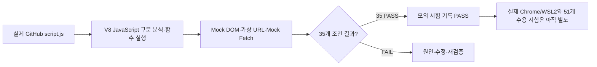

# B1-1 Round 04 — 05-1 V8 모의 DOM 기능 검사 보고서 (2026-10-27)

> **30초 요약:** 신규 `04-src/js/script.js`를 **실제 V8 JavaScript 엔진**으로 구문 분석하고, 가짜 브라우저 요소(Mock DOM)·가짜 공개 API 응답(Mock Fetch)을 연결하여 **35개 작은 동작 검사에서 PASS 35 / FAIL 0**을 관찰했습니다. **실제 Chrome·WSL2·GitHub API·51개 정식 수용 테스트가 PASS한 것은 아닙니다.**
>
> **대상:** `feature/b1-1-round04-implementation-20261027` 브랜치에 한정. `main` 및 기존 Round/Pages·운영환경은 그대로 보존. 배포·병합 및 실제 개인정보 수집 금지.

## A. 입문자를 위한 3분 요약

**비유:** 자동차를 실제 도로에서 달리기 전에 작은 모형 코스에서 방향 전환·브레이크 원리를 살펴보는 것입니다. **모형 코스를 통과해도 실제 도로 주행에 합격한 것은 아닙니다.**

- **1분:** V8(자바스크립트 실행 엔진)이 실제 `script.js` 문장을 읽을 수 있는지 확인합니다.
- **2분:** 가짜 버튼·입력칸을 만들고 클릭·입력·저장·API 응답을 흉내 내서 원래 JavaScript의 **실제 함수**를 실행합니다.
- **3분:** 기대 상태·표시 문구가 맞으면 해당 **모의 시험만 PASS**, 진짜 Chrome 화면·키보드·네트워크는 `NOT_VERIFIED`로 둡니다.



## B. 출처와 정확한 실행 범위

| 항목 | 실제 관찰·도구 근거 |
|---|---|
| 대상 JS | [`../04-src/js/script.js`](../04-src/js/script.js) |
| 대상 JS Git Blob SHA | `61e3477fa1480825d6803e531e6f289fba08c99c` |
| 재현 시험 파일 | [`v8-mock-checks.cjs`](v8-mock-checks.cjs) |
| 재현 시험 Git Blob SHA | `9d12fdb053e1485159ab70e2ec29ebb7ebf62194` |
| 평가 엔진 | 도구 내 V8 `new Function`으로 GitHub 파일 내용을 컴파일·실행 |
| 격리 장치 | 실제 DOM 대신 모의 요소, 실제 Fetch 대신 미리 정한 HTTP·예외, 실제 URL 대신 단순 `URLShim` |
| 실행 기록 | 실제 테스트 원본을 GitHub에서 재조회 → 같은 검증 코드를 V8에서 실행 → `cases=35, passed=35, failed=0` 응답 확인 |
| 명령 실행 | **WSL2/Node/Chrome 명령 실행 없음**; V8 격리 시험 코드 평가만 수행 |
| 승인 | 별도 브랜치 04 소스 개발 승인 범위; `main` 병합·운영 배포 `PENDING` |

**정확한 설명:** 이 결과는 테스트 대상 JavaScript가 *모의 DOM·모의 응답과 결합한 경우* 해당 조건에서 예상 상태로 움직였다는 뜻입니다. CSS 렌더링·스크린리더 호환·브라우저 저장소 정책·실제 GitHub API와 소스 파일 로드 경로를 검증하지 않았습니다. 특히 `URLShim`은 진짜 브라우저 `URL`이 아니므로 URL 안전성의 **실제 브라우저 검증**으로 승격하지 않습니다.

## C. 실제 모의 시험 35개와 관찰 결과

| 시험 묶음 | 확인한 사례 | 관찰 결과 |
|---|---|---|
| 외부 링크·데이터 7 | 허용 GitHub HTTPS, javascript URL·가짜 도메인·HTTP·서브도메인 차단, 누락 API 필드 기본값, `<b>` 제목의 글자 처리 | **7/7 PASS — Mock** |
| 화면 상태·메뉴 5 | 정상 빈 목록, 403 재시도 안내, 메뉴 열기·닫기, Escape로 닫고 포커스 반환 | **5/5 PASS — Mock** |
| 테마·스크롤 11 | 다크/라이트 저장, localStorage 쓰기 예외, 스크롤 59·60·61·299·300·301·0, 위로 가기 | **11/11 PASS — Mock** |
| 문의 폼 3 | 필수값 누락/기본 submit 차단, 잘못된 이메일, 검사 통과 후 '미전송' 문구 | **3/3 PASS — Mock** |
| 공개 API 9 | 정상 빈 배열, HTTP 403, 네트워크 예외, 성공 저장소 1개, 배열 아닌 JSON, HTTP 404·429·500, JSON 파싱 실패 | **9/9 PASS — Mock** |
| **합계** | **35개의 독립 검사** | **35/35 PASS, FAIL 0 — 모의 환경** |

**참고:** 첫 모의 실행의 중단은 가짜 요소에 `dataset`을 제공하지 않은 시험환경 오류였습니다. **테스트 하네스에 `dataset`을 추가한 뒤 실제 소스를 다시 실행했고 30건 PASS**, 이후 실제 파일로 재사용할 수 있는 `v8-mock-checks.cjs`를 작성해 **35건 전수 PASS**를 별도로 확인했습니다. 실제 웹사이트의 FAIL이나 고쳐진 코드 버그라고 허위 기록하지 않습니다.

## D. 재현 방법 — 후속 실행 시에만

정식 Node 설치·실행 환경이 준비된 시점에, 해당 저장소 루트에서 **다음 명령 하나로** 모의 시험을 다시 수행할 수 있도록 시험 파일을 작성했습니다.

```bash
node training/round-04-agent/05-tests/v8-mock-checks.cjs
```

**이 명령의 Node CLI 실행은 이번 검증에서 수행하지 않았습니다**(`NOT_VERIFIED`). 현재 관찰된 PASS는 V8 격리 환경에서 GitHub의 실제 스크립트+시험파일을 평가한 결과입니다. Node 실행 시에는 네이티브 `URL`을 사용하므로 `URLShim`과 다른 실제 런타임의 결과를 추가 검증해야 합니다.

## E. 정식 05 수용 시험 게이트 — 아직 미실시

| 시험 영역 | 공식 설계 ID | 실제 Chrome/WSL2/배포 PASS |
|---|---|---|
| 반응형/화면 | RES-01~08 | NOT_VERIFIED |
| 접근성·키보드·스크린리더 | A11Y-01~11 | NOT_VERIFIED |
| 실제 사용자 상호작용 | INT-01~06 | NOT_VERIFIED |
| 실제 DOM 이벤트→상태→화면 | FLOW-01~05 | NOT_VERIFIED |
| 실제 GitHub API·오류 모의 브라우저 실증 | API-01~07 | NOT_VERIFIED |
| 실제 입력 폼 동작 | FORM-01~04 | NOT_VERIFIED |
| 브라우저 보안·개인정보·링크 | SEC-01~04 | NOT_VERIFIED |
| 공개 Pages URL·캡처·증빙 | PUB-01~06 | NOT_STARTED |
| **총 51개 계획 사례** | 03-6 정식 설계 기준 | **실제 수용 시험 0건 확인 / NOT_VERIFIED** |

35개 모의 시험은 일부 예상 동작을 선별 검증한 **별도 작은 검사들**이며, 51개 정식 수용 항목과 1:1 대응·합산하지 않습니다.

## F. 차단·보존·다음 진행

- **WSL2 상태 조회:** Agent Codyssey 기존 작업 상태 조회가 `UNKNOWN / STATUS_UNAVAILABLE`로 반환. 도구가 명시한 **STOP / 자동 재실행 금지** 지침을 따르며, WSL2 신규 명령 실행·토큰 교체·서비스 재시작·배포를 하지 않았습니다.
- **개발 브랜치:** 원본 `main`의 실행·배포 이력 변경하지 않음. 04 신규 소스는 전용 개발 브랜치에만 존재.
- **정식 통과 조건:** 실제 승인된 환경에서 Node 구문 검사/실행, Chrome 375/768/1024 반응형, 키보드·ARIA·API·폼 보안·모션 및 실패/회귀 시험을 수행하고 당시 코드 SHA·날짜·스크린샷·실제 결과를 기록해야 합니다.
- **개발 승인 경계:** 04 개발 브랜치에서 구현 작업은 진행했으나 **main merge·Pages 배포·프로덕션 변경은 별도 승인 전 금지**.

> **후속 실제 WSL2 로컬 검증(2026-10-27):** 이 05-1 보고서가 기록한 최초 V8 내부 모의 시험 이후, 실제 Ubuntu Node v18.19.1에서 Git Blob SHA 2개 일치 확인 및 Node 구문 검사와 **35/35 모의 시험 PASS**를 추가 확인했습니다. [05-2 WSL2 로컬 검증 보고서](05-2-WSL2-LOCAL-NODE-VALIDATION-20261027.md) 참조. 아래 05-1의 'Node 명령 미실행'은 **05-1 당시 역사적 기록**입니다. 51개 Chrome 수용 시험은 여전히 NOT_VERIFIED입니다.

## G. 미션 판정

| 축 | 현재 판정 |
|---|---|
| 실제 소스 JS의 V8 구문 분석 | **PASS** |
| 실제 JS의 모의 DOM·API 35개 동작 검사 | **PASS (MOCK_ONLY)** |
| 05 Chrome/WSL2 기반 51개 수용 시험 | **NOT_VERIFIED** |
| 신규 Pages URL·실제 증빙 | **NOT_STARTED / NOT_VERIFIED** |
| 공식 학습자 독립 숙달 L1~L5 | **NOT_VERIFIED** |
| 04/05 전체 PASS·MISSION CLEAR | **NOT_VERIFIED** |

[05단계 안내](README.md) · [03-6 시험 설계](../03-design/03-6-QUALITY-ACCESSIBILITY-TEST-PLAN.md) · [04 개발 소스](../04-src/README.md) · [승인 상태](../mission.yml)
