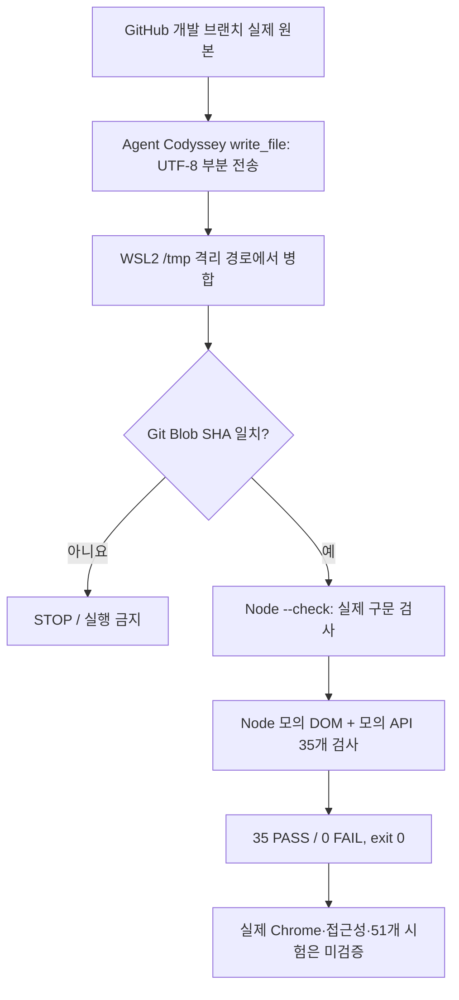

# B1-1 Round 04 — 05-2 WSL2 로컬 Node.js 실제 검증 보고

> **검증일:** 2026-10-27 KST. **판정:** `LOCAL_WSL2_NODE_SYNTAX=PASS` · `LOCAL_WSL2_MOCK_TEST=35_PASS_0_FAIL` · `SOURCE_INTEGRITY=PASS` · `CHROME_REAL_BROWSER=NOT_VERIFIED` · `51_ACCEPTANCE_CASES=NOT_VERIFIED`. 이 문서의 PASS는 **실제 WSL2 Node.js 실행 + 모의 DOM·모의 HTTP** 범위입니다. 신규 Pages 게시, 실사용 화면·접근성 검사, 공식 51개 시험을 통과한 것은 아닙니다.

## 처음 3분 — 무엇이 어떻게 확인됐나요?

1. **원본:** [04 실제 JS](../04-src/js/script.js)와 [05 모의 검사 파일](v8-mock-checks.cjs)을 GitHub 개발 브랜치에서 읽었습니다.
2. **WSL2 전송:** 네트워크 DNS가 작동하지 않아 `git clone`이 중단됐습니다. 재시도·네트워크 설정 변경 없이 **Agent Codyssey `write_file`**로 원본을 작은 UTF-8 부분 파일 **5+4개**로 안전하게 전달했습니다.
3. **변조 확인:** WSL2의 격리 경로 `/tmp/b1-1-r04-qa-20261027-0504/`에서 다시 합친 뒤, Git Blob SHA가 **GitHub 원본 SHA와 정확히 일치**할 때만 시험했습니다.
4. **실제 Node.js:** `node --check`로 두 파일 문법 검사 후, 로컬 Node.js v18.19.1이 동일한 35개 모의 테스트를 수행했습니다.
5. **결과:** `MOCK_TOTAL=35`, `MOCK_PASS=35`, `MOCK_FAIL=0`, 실제 셸 exit code **0**.



## 검증 근거 — 실제 작업 ID·해시·출력

| 항목 | WSL2 실제 응답 또는 확인 |
|---|---|
| 연결 환경 | Agent Codyssey MCP → WSL2 Ubuntu → Codex → `node v18.19.1` |
| 로컬 기존 저장소 | `/home/ubuntu/codyssey/codyssey-basic-web-portfolio`, 기존 체크아웃 보존 |
| 원본 JS Git Blob SHA | `61e3477fa1480825d6803e531e6f289fba08c99c` |
| 원본 모의 검사 Git Blob SHA | `9d12fdb053e1485159ab70e2ec29ebb7ebf62194` |
| 격리 WSL2 시험 경로 | `/tmp/b1-1-r04-qa-20261027-0504` |
| Task 05-02 | `20261027000000000000000000000502` — 원본 체크아웃과 브라우저/Node 환경 읽기 점검 exit `0` |
| Task 05-03 | `20261027000000000000000000000503` — 외부 Git clone DNS 실패, **실제 셸 exit `128`**, 코드 시험 **미실시** |
| Task 05-04 | `20261027000000000000000000000504` — 파일 SHA 대조 및 로컬 Node 실행 **exit `0`** |
| Task 05-05 | `20261027000000000000000000000505` — WSL/Windows 브라우저 경로 읽기 조사 exit `0`, 실행 자체는 미실시 |

### Task 05-04의 핵심 표준 출력

```text
JS_BLOB_SHA=61e3477fa1480825d6803e531e6f289fba08c99c
TEST_BLOB_SHA=9d12fdb053e1485159ab70e2ec29ebb7ebf62194
SOURCE_SHA_MATCH=PASS
NODE_SOURCE_SYNTAX=PASS
NODE_TEST_SYNTAX=PASS
MOCK_TOTAL=35
MOCK_PASS=35
MOCK_FAIL=0
WSL2_NODE_MOCK_TEST=PASS
```

**정확한 환경 구분:** 앞선 [05-1 도구 내부 V8 검증](05-1-V8-MOCK-TEST-REPORT.md)과 **이번 05-2 WSL2 Node 검증은 서로 다른 실행 환경**입니다. 이번에는 실제 Ubuntu에서 Node 프로세스를 실행했으며, 테스트 코드가 만든 **Mock DOM/Mock HTTP**를 사용했습니다. 따라서 진짜 Chrome 렌더·접근성·외부 GitHub API까지 합격했다고 확대 해석하지 않습니다.

## 발견 사항·블로커 및 조치

| ID | 실제 관찰 | 분류·처리 |
|---|---|---|
| WSL-01 | 기존 로컬 저장소는 이전 작업 브랜치, 신규 Round04 브랜치·JS·테스트 파일은 아직 없음 | **환경 차이**, 기존 체크아웃을 수정하지 않고 격리 시험 사용 |
| WSL-02 | `github.com` 호스트 이름을 해석하지 못해 clone 실패, exit `128` | **FAIL — 네트워크 다운로드만**, 자동 재시도·DNS 수정 금지 |
| WSL-03 | Agent Codyssey 파일 전송 9개 조각 → Git Blob SHA 2개 일치 | **PASS — 소스 무결성** |
| WSL-04 | `node --check` 2개 + 모의 시험 35개, exit `0` | **PASS — Node 및 Mock 범위** |
| WSL-05 | WSL Linux Chrome/Chromium/Firefox 실행 파일 발견되지 않음 | **NOT_AVAILABLE — 해당 경로에서의 브라우저 검사** |
| WSL-06 | Windows Chrome·Edge 실행 파일은 `/mnt/c/...` 경로에서 발견되지만 WSLInterop 항목이 없음 | **브라우저 실행 가능 여부 NOT_VERIFIED**, 실행 시도·설치·권한 변경 안 함 |
| WSL-07 | 51개 정식 RES/A11Y/INT/FLOW/API/FORM/SEC/PUB 시험과 실제 배포 미실시 | **NOT_VERIFIED**, 05 전체·CLEAR PASS 금지 |

## 입문자용 검사 의미와 보존 정책

**간단한 설명:** “WSL2에 원본 파일이 제대로 도착했고, 실제 Node.js가 코드를 실행해서 모의 기능 35개를 확인했습니다. 하지만 사용자가 Chrome에서 실제 페이지를 클릭·탐색하는 시험은 아직 하지 않았습니다.”

- **기존 로컬 체크아웃·Git 브랜치, 원본 Round 01~03, 운영 `main`, 배포·서비스·토큰은 변경하지 않았습니다.**
- **임시 파일만** 사용자 WSL2의 `/tmp/b1-1-r04-qa-20261027-0504`와 Agent Codyssey의 `codyssey_test/b1-1-round04-qa-20261027-0504/`에 생성됐습니다. 원본 자료는 삭제하지 않았습니다.
- **다음 필요 단계:** 실제 Chrome/Edge 실행 가능한 별도 검증 환경 준비 또는 연결 → 새 Round 04 HTML/CSS/JS/SVG 전체 소스 확인 → 03-6의 공식 51개 시험을 수행하고 시점·SHA·캡처·PASS/FAIL을 사례별로 기록.
- **실행 승인 경계:** `main` 병합·Pages 공개 배포·기존 운영 변경은 별도 승인 전 금지.

[05 테스트 시작](README.md) · [05-1 V8 검사](05-1-V8-MOCK-TEST-REPORT.md) · [04 새 소스](../04-src/README.md) · [공식 51개 계획](../03-design/03-6-QUALITY-ACCESSIBILITY-TEST-PLAN.md)
