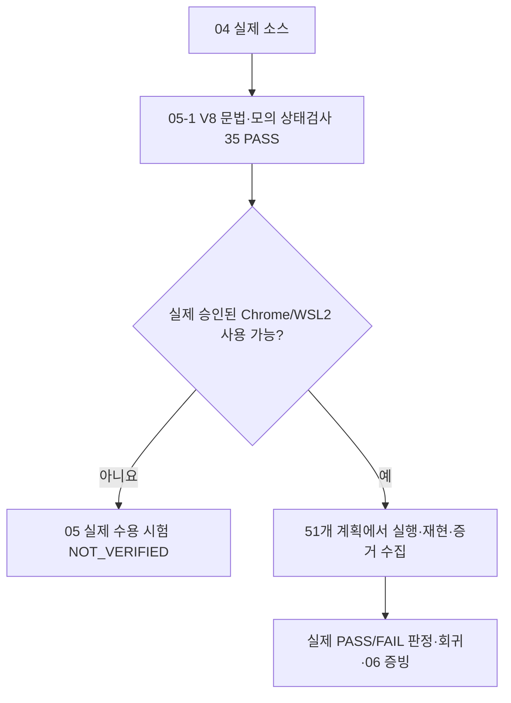

# B1-1 Round 04 — 05단계 테스트·회귀 검증

> **현재 상태(2026-10-27):** `JS_V8_SYNTAX=PASS`, `V8_MOCK_FUNCTIONAL_CHECKS=35_PASS_0_FAIL` **(가상 DOM·가상 API에서만)**, `WSL2_NODE_EXECUTION=PASS`, `CHROME_REAL_BROWSER=NOT_VERIFIED`, `51_FORMAL_ACCEPTANCE_CASES=NOT_VERIFIED`, `DEPLOYMENT=NOT_STARTED`.

## 입문자 30초 안내

- **V8 구문검사:** JavaScript 코드의 문법을 V8 엔진이 받아들일 수 있는지 확인하는 검사입니다.
- **Mock(모의) 시험:** 실제 웹페이지 대신 가짜 버튼·응답을 만들어 **원본 JavaScript 동작을 제한된 조건에서 검증**합니다.
- **실제 브라우저 시험:** Chrome에서 화면이 정상 표시되고 키보드·API·폼이 제대로 작동하는지 눈으로 확인하는 별개 검증입니다.

**이번에 완료한 것은 앞의 두 종류 중 V8 구문 확인과 모의 함수 검사입니다.** 실제 Chrome에서 정상 동작한다고 주장하지 않습니다.

## 학습·검증 결과 바로 열기

| 문서/파일 | 무엇을 확인할까요? | 상태 |
|---|---|---|
| [05-2 WSL2 로컬 Node.js 검증 보고서](05-2-WSL2-LOCAL-NODE-VALIDATION-20261027.md) | 원본 SHA 대조 후 **WSL2 실제 Node 실행 35/35**, DNS/브라우저 제한 | **PASS — Node + MOCK ONLY** |
| [05-1 모의 실행 검증 보고서](05-1-V8-MOCK-TEST-REPORT.md) | 35개 PASS와 정확한 한계, 소스 Blob SHA·시험 조건 | **PASS — MOCK ONLY** |
| [재현 가능한 모의 검사 파일](v8-mock-checks.cjs) | Node에서 나중에 다시 실행 가능한 독립 시험 스크립트 | **GitHub 파일 생성 PASS / Node CLI 실행 NOT_VERIFIED** |
| [03-6 공식 51개 시험 설계](../03-design/03-6-QUALITY-ACCESSIBILITY-TEST-PLAN.md) | 반응형 RES·접근성 A11Y·이벤트 INT/FLOW·API/폼·보안·배포 | **51개 실제 수용 시험 NOT_VERIFIED** |
| [04 신규 소스](../04-src/README.md) | HTML/CSS/JS 구현, 미전송 폼·무단 배포 금지 | **소스 작성 / 운영 미배포** |

**최신 WSL2 실행 사실:** 기존 로컬 B1-1 체크아웃이 신규 브랜치를 포함하지 않고 GitHub DNS 조회도 실패하여, 공개 GitHub에서 읽은 파일 2개를 Agent Codyssey 파일 전송으로 /tmp에 격리했습니다. Git Blob SHA가 원본과 일치한 뒤 Node v18.19.1로 `node --check`와 기존 모의 시험 **35/35 PASS**를 수행했습니다. **실제 Chrome·51개 수용 시험은 NOT_VERIFIED**입니다. [정확한 작업/해시·실패 내역](05-2-WSL2-LOCAL-NODE-VALIDATION-20261027.md).

**안전 규칙:** WSL2 도구의 `UNKNOWN` 상태는 STOP이며 중복 실행하지 않습니다. 배포·운영 설정·`main` 병합은 별도 승인 필요. 과거 Round·본인 미확정 사용자정보·비밀키를 새 기능의 실증으로 사용하지 않습니다.
